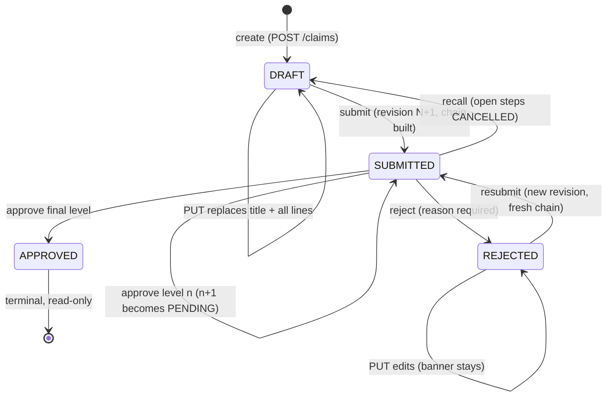
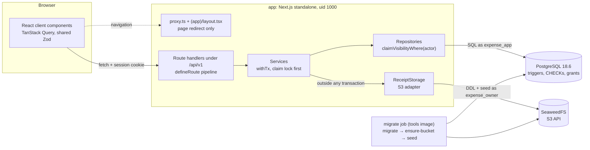

# Expense Claims and Reimbursement (POC)

Employees file expense claims with line items and receipts. Approvers decide them along a chain
that depends on the amount, and finance reads every claim and exports the approved ones as CSV.
One Next.js 16.4 App Router app serves the React UI and a REST API under `/api/v1`. PostgreSQL 18.6,
reached through Prisma 7.10, enforces the integrity rules itself (triggers, CHECKs and grants), so
even raw SQL run with the app's own credentials cannot break them.

**Status: feature-complete (Phase 8, evidence and hardening).** `pnpm verify` is green (unit,
component and integration on a real PostgreSQL), and the Playwright suite (`pnpm test:e2e`) is green
against a fresh `docker compose up`.

| Read                                                                                       | For                                                                           |
| ------------------------------------------------------------------------------------------ | ----------------------------------------------------------------------------- |
| [PLAN.md](PLAN.md)                                                                         | Decisions at a glance, invariants, phase log, walkthrough prep, risks         |
| [docs/design/](docs/design/00-decisions-and-contracts.md)                                  | The design set: register (00), stack (01), workflow (02), data (03), API (04) |
| [docs/adr/](docs/adr/)                                                                     | Eight one-page architecture decision records                                  |
| [docs/walkthrough.md](docs/walkthrough.md)                                                 | §7 answers with file and line pointers into `src/`                            |
| [docs/demo-script.md](docs/demo-script.md) · [docs/runbook.md](docs/runbook.md)            | The 12-minute demo; operations, stuck steps, troubleshooting                  |
| [docs/perf/](docs/perf/) · [docs/reference/sql-proof/](docs/reference/sql-proof/README.md) | EXPLAIN evidence; the planning-time SQL proof (127/127 checks)                |

## What it solves

- **Claimants** (every user) create claims with one or more line items (date, category, amount,
  description) and optional receipts per line, submit them, recall them, and edit and resubmit
  rejected ones. They see only their own claims.
- **Approvers** see only the claims currently routed to them, and approve, or reject with a
  reason. Decided claims stay readable to them, read-only.
- **Finance** reads every claim, read-only, and streams a CSV of the claims approved in a period.

Two guarantees are enforced by the database, not by convention:

1. **The claim total cannot drift.** `claims.total_minor` is stored, but only Postgres statement
   triggers write it; any other writer gets UC003, and a deferred check re-asserts
   `total = Σ lines` at COMMIT (UC009) ([ADR-0003](docs/adr/0003-claim-total-integrity.md)).
2. **Visibility is decided inside the query.** An approver asking for a claim outside their queue by
   id gets no row back from Postgres, so the API answers 404, byte-identical to a random id
   ([ADR-0006](docs/adr/0006-authz-404-vs-403-scoped-queries.md)).

## Prerequisites

To **run the app**, nothing but Docker:

- Docker Desktop or Docker Engine with the **Compose plugin, v2.21 or newer** (`docker compose`,
  which supports `up --wait`; Compose v5.x works too, the old `docker-compose` v1 binary does not).
  Check with `docker compose version`.
- **At least 6 GB of RAM** for the Docker VM (Docker Desktop → Settings → Resources; check with
  `docker info --format '{{.MemTotal}}'`).
- Host ports **3000, 5432 and 8333 free on 127.0.0.1** (check with
  `lsof -nP -iTCP:3000 -sTCP:LISTEN`, and the same for 5432 and 8333). Otherwise set `APP_PORT`,
  `POSTGRES_HOST_PORT` and `S3_HOST_PORT` in `.env`, make `APP_BASE_URL` and `E2E_BASE_URL` match a
  new `APP_PORT`, and, for the host commands, the ports in `DATABASE_URL`, `MIGRATE_DATABASE_URL`,
  `PERF_DATABASE_URL` and `S3_ENDPOINT`.

To run the **tests and scripts on the host** you also need Node.js 24.21.0 (`.nvmrc`:
`nvm install && nvm use`), pnpm 10.34.6 through Corepack (`corepack enable`), then
`pnpm install && pnpm db:generate` (the Prisma client is generated into `src/generated/`, not
committed; `pnpm verify` regenerates it, but `pnpm verify:integrity` and the other host scripts need
it first). The e2e suite needs a browser once: `pnpm exec playwright install chromium`. The demo
scripts need `curl` and `jq` (and `docker` for `sql-attacks.sh`).

## Run it

```bash
cp .env.example .env          # the only manual step; local demo values
docker compose up --build --wait
```

The first run pulls `node`, `postgres` and SeaweedFS images and builds two images (a few minutes;
about a minute once the base images are cached). `compose.yaml` pins the project name
`expense-claims`, so a second checkout on the same machine shares its containers and volumes: stop
the first stack, or give the second its own name (`docker compose -p <name> up --build --wait`).

Open **<http://localhost:3000>**, exactly as written: **not 127.0.0.1**. The CSRF check compares the
browser's `Origin` with `APP_BASE_URL` (`http://localhost:3000`), so a sign-in from another host is
refused with 403 `CSRF_REJECTED`.

`--wait` returns when `postgres`, `objectstore` (SeaweedFS, S3 API) and `app` are healthy and the
one-shot `migrate` job has exited 0. That job runs as `expense_owner`: `prisma migrate deploy` →
ensure the `receipts` bucket → seed (reference data on every release; the demo cast and claims
C01–C12 only on an empty `users` table). The app connects as `expense_app` and never receives owner
or superuser credentials. Stop with `docker compose down`; reset everything with
`docker compose down -v`. Probes: `/api/health/live`, `/api/health/ready`.

### Demo accounts

Every account's password is the `SEED_DEMO_PASSWORD` value in `.env.example` (a local demo value:
the text before the inline `#` comment). The login page does not list the accounts; use this table.

| Email                   | Role in the app                                         | Notes                                   |
| ----------------------- | ------------------------------------------------------- | --------------------------------------- |
| `asha.rao@acme.test`    | Employee (claimant)                                     | Owns most demo claims; reports to Ravi  |
| `ravi.menon@acme.test`  | Approver: L1 for Asha                                   | Reports to Meera                        |
| `meera.iyer@acme.test`  | Approver: L2 for Asha                                   | Reports to Vikram                       |
| `vikram.shah@acme.test` | Approver: L3 for Asha                                   | Top of the hierarchy                    |
| `deepa.menon@acme.test` | Approver: fallback approver, designated L4 (CFO) user   | Department FIN, role EMPLOYEE           |
| `neha.kapoor@acme.test` | Approver outside Asha's chain                           | The "foreign claim" actor; L1 for Arjun |
| `arjun.das@acme.test`   | Employee (claimant)                                     | Owns C08 and C09                        |
| `farah.khan@acme.test`  | Finance: reads every claim, exports; can never approve  | Also files her own claim (C12)          |
| `admin@acme.test`       | Admin: no extra visibility; configuration is owner-only | No UI                                   |

The seeded claims C01–C12 (draft, in approval, approved, rejected, recalled, the IST month
boundary pair, the fallback route) are listed in [docs/demo-script.md](docs/demo-script.md#seeded-data).

To host a free demo on Vercel, Neon and Tigris instead of Docker, follow
[docs/deploy-vercel-free.md](docs/deploy-vercel-free.md).

## Application flow



A claim is editable only while DRAFT or REJECTED. Each submit freezes a DB-verified snapshot in
`claim_submissions` and materialises the chain as `approval_steps` rows (level 1 PENDING, the rest
WAITING), so "who is next" is the next row. Every state change (submit, each approval, reject,
recall) writes exactly one typed `claim_events` row in the same transaction.



Request pipeline (`src/server/http/define-route.ts`): request id → authenticate (401) → CSRF (403)
→ role gate (403) → path params (404) → content type (415) → Zod (422) → service → error mapping →
access log. Only repositories import Prisma, and ESLint fails the build otherwise
([ADR-0002](docs/adr/0002-layering-and-import-boundaries.md)).

## Data model

The ERD and the verified Prisma schema are in
[03 §2.1](docs/design/03-data-model-and-integrity.md#21-erd). Eleven tables: `users`,
`departments`, `categories`, `approval_policy_tiers` (reference data, owner-written);
`claims`, `line_items`, `receipts` (the editable claim); `claim_submissions` (one immutable snapshot
per revision), `approval_steps` (the materialised chain), `claim_events` (append-only audit); and
`sessions`. Money is integer paise (`int4`) end to end; instants are `timestamptz(3)`; ids are
`uuidv7()`; claim numbers look like `EXP-2026-000004`.

## API

JSON envelopes `{data}` / `{error:{code,message,requestId,details?}}`; every response carries
`x-request-id`. Lists are keyset-paginated (`limit`, opaque `cursor`, no `COUNT(*)`). Full shapes in
[04 §7](docs/design/04-security-and-api.md#7-api-reference). The app exports **29 route handlers**:
the 22 endpoints below plus the `/api/v1/[...path]` catch-all for 7 methods.

| #   | Method and path                                                | Who → scope                                    | Success                                   | Typical refusals                                                                                |
| --- | -------------------------------------------------------------- | ---------------------------------------------- | ----------------------------------------- | ----------------------------------------------------------------------------------------------- |
| 1   | `POST /api/v1/auth/login`                                      | public                                         | 200 `{data:{user}}` + session cookie      | 401 `INVALID_CREDENTIALS`, 403 `CSRF_REJECTED`                                                  |
| 2   | `POST /api/v1/auth/logout`                                     | any user                                       | 204, session deleted                      | 401                                                                                             |
| 3   | `GET /api/v1/auth/me`                                          | any user                                       | 200 user + capability flags               | 401                                                                                             |
| 4   | `GET /api/health/live`                                         | public                                         | 200 (no dependencies)                     | —                                                                                               |
| 5   | `GET /api/health/ready`                                        | public                                         | 200 `db`, `integrityTriggers`, `storage`  | 503 `NOT_READY` (DB down or an integrity trigger disabled)                                      |
| 6   | `GET /api/v1/categories`                                       | any user                                       | 200 list with `isActive`                  | 401                                                                                             |
| 7   | `GET /api/v1/claims`                                           | any user → `claimant_id = me`                  | 200 page                                  | 422 `VALIDATION_FAILED`, `INVALID_CURSOR`                                                       |
| 8   | `POST /api/v1/claims`                                          | any user → creates own DRAFT                   | 201 claim detail                          | 422 `TOTAL_IS_DERIVED`, `READ_ONLY_FIELD`, `CATEGORY_INACTIVE`                                  |
| 9   | `GET /api/v1/claims/:claimId`                                  | `claimVisibilityWhere(actor)`                  | 200 detail with `allowedActions`          | 404 `CLAIM_NOT_FOUND`                                                                           |
| 10  | `PUT /api/v1/claims/:claimId`                                  | owner lock; DRAFT or REJECTED                  | 200 detail (whole line set replaced)      | 404 `LINE_ITEM_NOT_FOUND`; 409 `CLAIM_NOT_EDITABLE`, `CLAIM_LOCKED`; 422                        |
| 11  | `DELETE /api/v1/claims/:claimId`                               | owner lock; never-submitted DRAFT              | 204                                       | 409 `CLAIM_HAS_HISTORY`, `CLAIM_LOCKED`                                                         |
| 12  | `POST /api/v1/claims/:claimId/submit`                          | owner lock; DRAFT or REJECTED                  | 200 (revision + 1, fresh chain)           | 409 `INVALID_STATUS_TRANSITION`, `CLAIM_LOCKED`; 422 `NO_LINE_ITEMS`, `ROUTING_UNRESOLVABLE`    |
| 13  | `POST /api/v1/claims/:claimId/recall`                          | owner lock; SUBMITTED                          | 200 (DRAFT, open steps CANCELLED)         | 409 `INVALID_STATUS_TRANSITION`, `CLAIM_LOCKED`                                                 |
| 14  | `POST /api/v1/claims/:claimId/approve`                         | approver → my PENDING step; body `{revision}`  | 200 detail                                | 403 `FORBIDDEN`, `NOT_IN_YOUR_QUEUE`; 409 `REVISION_MISMATCH`, `ALREADY_DECIDED`                |
| 15  | `POST /api/v1/claims/:claimId/reject`                          | as approve; body `{revision, reason}`          | 200 detail (REJECTED)                     | as approve; 422 reason under 10 characters                                                      |
| 16  | `GET /api/v1/claims/:claimId/history`                          | `claimVisibilityWhere(actor)`                  | 200 every revision and event              | 404 `CLAIM_NOT_FOUND`                                                                           |
| 17  | `POST /api/v1/claims/:claimId/line-items/:lineItemId/receipts` | owner; editable claim; line bound to the claim | 201 receipt (sha256)                      | 404; 409; 413 `PAYLOAD_TOO_LARGE`; 415; 422 `RECEIPT_TYPE_NOT_ALLOWED`, `RECEIPT_LIMIT_REACHED` |
| 18  | `GET /api/v1/claims/:claimId/receipts/:receiptId/content`      | visible claim; receipt live or in a snapshot   | 200 file stream (`attachment`, `nosniff`) | 404 `CLAIM_NOT_FOUND`, `RECEIPT_NOT_FOUND`                                                      |
| 19  | `DELETE /api/v1/claims/:claimId/receipts/:receiptId`           | owner; editable claim                          | 204                                       | 404 `RECEIPT_NOT_FOUND`; 409 `CLAIM_NOT_EDITABLE`, `CLAIM_LOCKED`                               |
| 20  | `GET /api/v1/approvals`                                        | approver gate → `approver_id = me`             | 200 page (PENDING by default, or decided) | 403 `FORBIDDEN`; 422                                                                            |
| 21  | `GET /api/v1/finance/claims`                                   | FINANCE gate → all claims                      | 200 page (DRAFT hidden unless asked)      | 403 `FORBIDDEN`; 422                                                                            |
| 22  | `GET /api/v1/finance/exports/approved-claims?from&to[&status]` | FINANCE gate; cross-site GET refused           | 200 `text/csv` stream                     | 403 `FORBIDDEN`, `CSRF_REJECTED`; 422 `EXPORT_RANGE_TOO_LARGE`, `EXPORT_STATUS_NOT_ALLOWED`     |
| 23  | `GET HEAD POST PUT PATCH DELETE OPTIONS /api/v1/[...path]`     | any user                                       | —                                         | 401 without a session, else 404 `ROUTE_NOT_FOUND`                                               |

## Authentication and authorization

- **Sessions, not JWT.** Login verifies an argon2id hash (`node:crypto`), stores `sha256(token)`
  in `sessions` and sets a 32-byte opaque token in an `HttpOnly`, `SameSite=Lax` cookie
  (`ec_session` on http, `__Host-ec_session` on https). 60-minute sliding idle timeout, 12-hour
  absolute. Role and `can_approve` are read from the live `users` row on every request, so logout,
  deactivation and role changes apply on the next request
  ([ADR-0007](docs/adr/0007-sessions-vs-jwt-and-entra.md), which also maps Entra ID).
- **Authentication inside every handler.** `defineRoute` authenticates before anything else, so
  `proxy.ts` is only a page-redirect convenience. `PUBLIC_ROUTES` is exactly login plus the two
  health probes.
- **CSRF.** Unsafe methods must carry this app's `Origin` (or none, like curl) and a same-origin
  `Sec-Fetch-Site`; bodies are JSON only (415 otherwise); no CORS.
- **Authorization.** A role gate (`APPROVER` = `can_approve` and not FINANCE; `FINANCE`) runs before
  any query. Reads AND-compose `claimVisibilityWhere(actor)` (owner, or an approver with a PENDING,
  APPROVED or REJECTED step on the claim, or FINANCE) into the one SELECT. Writes lock the claim with
  an actor-scoped `FOR NO KEY UPDATE` (owner, or "my PENDING step"). Buttons render only from the
  server's `allowedActions`, which is cosmetic by design.
- **Failure ladder.** 401 → 403 → 404 → 409 → 422. Can't see the claim: 404, identical to a random
  id. Role gate: 403 `FORBIDDEN`. Approve or reject without a PENDING step of yours (any id): 403
  `NOT_IN_YOUR_QUEUE`. State conflicts: specific 409s (`CLAIM_LOCKED`, `CLAIM_NOT_EDITABLE`, …).
  Trigger SQLSTATEs map to the same codes by SQLSTATE, never by message.
- **Database roles.** `expense_owner` owns the schema and runs only in the migrate job and host
  scripts; `expense_app` has only per-table DML grants, owns nothing and cannot disable triggers,
  `TRUNCATE` or change `session_replication_role`
  ([ADR-0008](docs/adr/0008-db-roles-and-migrations-as-a-job.md)).

## §6: what is checked, where it is enforced, which test proves it

Test files are under `tests/` (Vitest; integration runs as `expense_app` on a Testcontainers
PostgreSQL 18.6) and `e2e/` (Playwright against the compose stack). Names are quoted verbatim.

| §6 check                                                                                                       | Enforcement point                                                                                                                                                                                                                                                                                                                                                                                                                                                          | Test(s)                                                                                                                                                                                                                                                                                                                                                                                                                                                                                                                                                                                                                                                                                                            |
| -------------------------------------------------------------------------------------------------------------- | -------------------------------------------------------------------------------------------------------------------------------------------------------------------------------------------------------------------------------------------------------------------------------------------------------------------------------------------------------------------------------------------------------------------------------------------------------------------------- | ------------------------------------------------------------------------------------------------------------------------------------------------------------------------------------------------------------------------------------------------------------------------------------------------------------------------------------------------------------------------------------------------------------------------------------------------------------------------------------------------------------------------------------------------------------------------------------------------------------------------------------------------------------------------------------------------------------------ |
| **1. Amounts are positive, dates valid, categories real; a claim with zero lines can't be submitted**          | Strict shared Zod (`src/shared/schemas/claims.ts`) → service category checks (`claims.service.ts`, `lifecycle.service.ts` `NO_LINE_ITEMS`) → DB: CHECK `line_items_amount_range` (1 to 100,000,000 paise), `line_items_before_write` (UC013 inactive category, UC014 future IST date), `claims_guard` + `claim_submissions_verify` (UC004 zero lines)                                                                                                                      | TC-I10 › "rejects %s with 422 VALIDATION_FAILED at the field path" (table-driven), "inactive category returns 422 CATEGORY_INACTIVE", "DB backstops: raw amount_minor = 0 → 23514, raw future expense_date → UC014, raw inactive category → UC013"; TC-I15 › "submitting a claim with zero line items returns 422 NO_LINE_ITEMS", "raw UPDATE claims SET status='SUBMITTED' on an empty claim raises UC004"; TC-U05 › "amountMinor must be a positive safe integer ≤ 100000000"                                                                                                                                                                                                                                    |
| **2. Editing an approved claim, or approving one not in your queue, fails clearly and specifically**           | `decide()` (`src/server/authz/claim-policy.ts`) under `lockOwnedClaim` → 409 `CLAIM_LOCKED`; `lockClaimRoutedToMe` + my PENDING step (`approvals.service.ts`) → 403 `NOT_IN_YOUR_QUEUE`, same body for a random id; DB UC001 → `map-error.ts` → the same 409                                                                                                                                                                                                               | TC-I11 › "every mutation route on an APPROVED claim returns 409 CLAIM_LOCKED"; TC-I27 › "SUBMITTED → 409 CLAIM_NOT_EDITABLE; APPROVED → 409 CLAIM_LOCKED"; TC-I19 › "approving a claim that is not in my queue returns 403 NOT_IN_YOUR_QUEUE", "approving a non-existent id returns the same 403 NOT_IN_YOUR_QUEUE body", "double approve returns 200 then 409 ALREADY_DECIDED with exactly one event"; TC-U08 › "maps every UC SQLSTATE to its catalogue code and status"; TC-I04 › "every non-2xx response has {error:{code,message,requestId}}"                                                                                                                                                                 |
| **3. Every route requires a real, authenticated user**                                                         | `defineRoute` authenticates inside every handler (`src/server/http/define-route.ts`); `PUBLIC_ROUTES` = login + `/api/health/live` + `/api/health/ready` (`src/server/http/public-routes.ts`); `(app)/layout.tsx` redirects pages                                                                                                                                                                                                                                          | TC-I01 › "every exported handler for every HTTP method carries ROUTE_META", "only PUBLIC_ROUTES are public", "every non-public route returns 401 UNAUTHENTICATED with no cookie", "the x-middleware-subrequest header does not bypass authentication"; TC-I02 › "logout deletes the session and the old cookie gets 401", "deactivating a user revokes their sessions on the next request"; TC-E04 › "every (app) page redirects to /login without a session"                                                                                                                                                                                                                                                      |
| **4. Sharpest: an approver asking for a claim outside their queue by id is refused at the point of the query** | `findClaimForActor()` AND-composes `claimVisibilityWhere(actor)` into the single SELECT (`src/server/repositories/claim-visibility.ts`); decisions use the PENDING-scoped lock; ESLint keeps Prisma inside repositories                                                                                                                                                                                                                                                    | TC-I17 (`tests/integration/authz/out-of-queue-by-id.int.test.ts`) › "approver requesting a claim outside their queue by id is refused at the point of the query", "GET /claims/:id returns 404 CLAIM_NOT_FOUND identical to the 404 for a random UUID", "history and receipt routes for that claim return 404", "approve and reject return 403 NOT_IN_YOUR_QUEUE", "nothing changes: step statuses, the claim row and claim_events are untouched"; TC-I18 visibility matrix; TC-U10 › "importing @/generated/prisma from src/app fails lint"; TC-E02 › "neha opening asha's claim sees the not-found view and the API returns 404"                                                                                 |
| **5. The total is provably impossible to desynchronise**                                                       | Statement triggers recompute `SUM` (the only writer); `claims_guard` UC003 refuses any other write; deferred `assert_claim_total_consistent` UC009 at COMMIT; `expense_app` cannot disable triggers; strict Zod 422 `TOTAL_IS_DERIVED`                                                                                                                                                                                                                                     | TC-I12 › "no code path can leave claims.total_minor different from the sum of its line items" (12 cases, e.g. "raw SQL: UPDATE claims SET total_minor is refused with UC003", "bulk INSERT … SELECT, COPY FROM STDIN and MERGE keep total = Σ lines", "owner sabotage: with the recompute trigger disabled, COMMIT fails with UC009"); TC-I13 › "a second writer waits on the claim lock (visible in pg_stat_activity) and the final total is 300", "10 parallel PUTs on one claim end with total = Σ lines"; TC-I00 (a)–(e); TC-I07 › "expense_app cannot DISABLE TRIGGER, TRUNCATE, or SET session_replication_role (42501)"; `afterEach(assertTotalsInSync)` on every integration test; `pnpm verify:integrity` |
| **6. The approver queue and the finance export filter by date range and status without loading every claim**   | Keyset pagination with `LIMIT n+1` and SQL filters on partial/composite indexes (`approval_steps_pending_queue_idx`, `claims_export_idx`, …); IST dates → half-open UTC range; streamed export, one 500-claim keyset batch per pull. **The export's `status` accepts only `APPROVED` (422 `EXPORT_STATUS_NOT_ALLOWED` otherwise)**; that is how it meets the status-filter check without leaking in-flight or rejected claims. The finance list has the full status filter | TC-I25 › "from/to use IST day boundaries (23:59:59.999 IST in, 00:00 next day out)", "keyset pages are complete and disjoint including ties on activated_at", "status=APPROVED,REJECTED lists my decided steps newest first"; TC-I28 › "keyset batches (batchSize=3) with tied approved_at emit every line exactly once", "status=APPROVED is accepted and returns the same CSV as omitting status", "status=REJECTED returns 422 EXPORT_STATUS_NOT_ALLOWED", "Sep + Oct exports equal the Sep–Oct export with no duplicates"; TC-I26 › "filters by status and by dateField submittedAt or approvedAt"; plans in `docs/perf/explain-*.txt`                                                                         |
| **7. Submission, approval and rejection each leave a structured trace**                                        | `recordEvent()` in the same transaction (`src/server/audit/record-event.ts`); deferred `assert_transition_audited` refuses COMMIT without the event (UC015); SELECT+INSERT grant + `forbid_mutation` (UC007); `request_id` joins the event to the logs                                                                                                                                                                                                                     | TC-I23 › "submit, approve (intermediate and final), reject and recall each write exactly one typed event", "event request_id equals the response x-request-id", "a status change without an event fails at COMMIT with UC015", "claim_events rejects UPDATE and DELETE (42501 / UC007)"; TC-I05 › "every log line within a request carries requestId and userId"                                                                                                                                                                                                                                                                                                                                                   |
| **8. `docker compose up` with nothing but a documented `.env`**                                                | One-shot `migrate` job, healthchecks and `depends_on` conditions, a complete `.env.example`, per-service `environment:` lists (no `env_file`); boot exits if the app holds owner material or a privileged role (`src/instrumentation.ts`)                                                                                                                                                                                                                                  | TC-E06 › "a clean docker compose up is healthy and the app container holds no owner or superuser credentials"; TC-I06 › "assertRuntimeRole rejects the owner role and accepts expense_app"; TC-U11 › "the forbidden owner and superuser variables are detected in production mode"; the clean-clone rehearsal                                                                                                                                                                                                                                                                                                                                                                                                      |

## Decisions the brief asks us to document

| Topic                                | Decision                                                                                                                                                                                                                                                                                                                                | Detail                                                                                                   |
| ------------------------------------ | --------------------------------------------------------------------------------------------------------------------------------------------------------------------------------------------------------------------------------------------------------------------------------------------------------------------------------------- | -------------------------------------------------------------------------------------------------------- |
| Receipts per line or per claim       | **Per line item**, optional for submission; up to 5 per line; jpeg, png, webp or pdf, ≤ 10 MiB, magic bytes checked, sha256 stored. Server-proxied upload and download. Receipts lock with the claim; objects referenced by any submitted snapshot are never deleted                                                                    | [ADR-0004](docs/adr/0004-lifecycle-revisions-amount-change.md), [06 §5](docs/design/06-cross-cutting.md) |
| Approval thresholds                  | Data rows, exclusive lower bounds: **L1 Line manager > ₹0; L2 Skip-level > ₹10,000.00; L3 Senior leader > ₹50,000.00; L4 CFO > ₹2,00,000.00 (seeded inactive)**. The chain is every active tier the total exceeds, in level order. `pnpm policy:activate-tier L4_CFO` adds a level with no code change                                  | [ADR-0005](docs/adr/0005-data-driven-routing.md)                                                         |
| Amount changes after routing started | Lines, title and receipts are **frozen while SUBMITTED** (409 `CLAIM_NOT_EDITABLE`, hint `RECALL_TO_EDIT`; DB UC002). The claimant may **recall** until the final approval; the next submit builds a **brand-new chain from the new total**, and earlier approvals never carry over. Decisions pin `revision` (409 `REVISION_MISMATCH`) | [ADR-0004](docs/adr/0004-lifecycle-revisions-amount-change.md)                                           |
| Store or calculate the total         | **Stored, maintained only by PostgreSQL** (statement triggers + guard + deferred COMMIT check); compute-on-read survives as the auditor view `v_claim_total_drift`, which must stay empty                                                                                                                                               | [ADR-0003](docs/adr/0003-claim-total-integrity.md)                                                       |

## Interpretation decisions

- **Export period** = the final `approved_at`, in inclusive IST calendar dates, converted once to
  `[from 00:00 IST, (to + 1) 00:00 IST)`, and also before `asOf` (the export's start). A claim
  approved at 00:15 IST on 1 October is in October. Ranges are capped at 366 days.
- **Export `status`** accepts only `APPROVED` (422 `EXPORT_STATUS_NOT_ALLOWED` otherwise); omitting
  it means the same. That is how the export meets the §6 status-filter check while §3.6 keeps
  in-flight and rejected claims out. Rows come from the frozen approved snapshot, one per line.
- **Decided approvers keep read-only access** to the claim (all revisions) after deciding.
- **Finance reads every claim, including drafts**, read-only (the finance list hides DRAFT unless
  asked), and edits only its own claims. Finance can never approve: a CHECK forbids
  `role = FINANCE` with `can_approve`.
- **The reject reason is required (10–1000 characters); the approve comment is optional.**
- **`PUBLIC_ROUTES`** = `POST /api/v1/auth/login`, `GET /api/health/live`, `GET /api/health/ready`.
  Every other API route returns 401 without a session, and every `(app)` page redirects to `/login`.

## Commands

| Command                                                    | What it does                                                                                                                                                                                                                                          |
| ---------------------------------------------------------- | ----------------------------------------------------------------------------------------------------------------------------------------------------------------------------------------------------------------------------------------------------- |
| `pnpm verify`                                              | The local gate: `db:generate`, typecheck, lint (layering rules), format check, unit, component and integration tests                                                                                                                                  |
| `pnpm test:unit` · `pnpm test:component` · `pnpm test:int` | One Vitest project each; `test:int` runs on a real PostgreSQL 18.6 via Testcontainers (Docker must be running)                                                                                                                                        |
| `pnpm test:e2e`                                            | Playwright against the running compose stack (`E2E_BASE_URL`, default `http://localhost:3000`); report in `playwright-report/`. It adds claims to the demo data: `docker compose down -v && docker compose up --build --wait` restores the clean seed |
| `pnpm verify:integrity`                                    | Prints every row of `v_claim_total_drift` (must be 0) using the app's own credentials                                                                                                                                                                 |
| `pnpm policy:activate-tier L4_CFO` (`--off` to undo)       | Owner script: switches one approval tier; in-flight chains never change                                                                                                                                                                               |
| `pnpm perf:seed` · `pnpm perf:explain`                     | Build `expense_perf` (10,000 claims over 24 months, every trigger on); write `docs/perf/*.txt`                                                                                                                                                        |
| `scripts/demo/edit-approved.sh`                            | curl as Asha against the approved C04: every mutation → 409 `CLAIM_LOCKED`, nothing changes                                                                                                                                                           |
| `scripts/demo/sql-attacks.sh`                              | psql as `expense_app`: UC001 (line edit, receipt delete on C04), UC003, 42501 ×2; totals unchanged                                                                                                                                                    |
| `pnpm compose:up` · `compose:down` · `compose:reset`       | `docker compose up --build --wait` / `down` / `down -v`                                                                                                                                                                                               |
| `pnpm db:deploy` · `pnpm db:diff-check`                    | Apply migrations as the owner; fail if the database drifted from `prisma/schema.prisma`                                                                                                                                                               |

Inner loop with hot reload on the host (all `db:*` commands run as the owner,
`MIGRATE_DATABASE_URL`):

```bash
docker compose up -d --wait postgres objectstore && docker compose run --rm migrate
pnpm db:generate && pnpm dev     # or pnpm dev:pretty for readable logs
```

CI (`.github/workflows/ci.yml`) runs the same gate plus the migration drift check and an image
build.

## Production mapping (Azure)

| Local                   | Azure                                                                                | Note                                                                                        |
| ----------------------- | ------------------------------------------------------------------------------------ | ------------------------------------------------------------------------------------------- |
| `app` (runner image)    | Azure Container Apps; readiness `/api/health/ready`, liveness `/api/health/live`     | Same image, `APP_ENV=production`, https `APP_BASE_URL` (cookie becomes `__Host-ec_session`) |
| `migrate` (tools image) | Container Apps **Job**, run before the new revision goes live                        | The only identity that reads the owner secret; `SEED_ON_START=false`                        |
| `postgres:18.6`         | Azure Database for PostgreSQL Flexible Server                                        | Roles script once as the admin; if PG 18 isn't offered, ids move to Prisma `uuid(7)`        |
| SeaweedFS               | Blob Storage through an `AzureBlobReceiptStorage` adapter behind `ReceiptStorage`    | Scoped managed identity, not account keys                                                   |
| `.env`                  | Key Vault references + managed identity                                              | Images carry no secrets today                                                               |
| pino JSON on stdout     | Log Analytics; Application Insights via OpenTelemetry (optional)                     | `requestId` joins logs to `claim_events.request_id`                                         |
| `pnpm verify:integrity` | A scheduled Container Apps Job that alerts on any drift row                          | See [docs/runbook.md](docs/runbook.md)                                                      |
| Password login          | Entra ID (OIDC code + PKCE), mapped by `(tid, oid)` to a user, then the same session | [ADR-0007](docs/adr/0007-sessions-vs-jwt-and-entra.md)                                      |

## Known limitations and next steps

- **No Row-Level Security.** The AND-composed predicate already makes Postgres refuse the row; RLS
  is the next hardening step (it would double the authz surface).
- **A deactivated approver blocks the claim.** The chain is frozen at submit and the DB re-checks
  eligibility at decision time. Today's remedy is recall + resubmit; the runbook has the query that
  finds such claims, and a reassign endpoint is the next step.
- **Uploads are proxied through the app.** Presigned direct-to-store uploads are the §8 step behind
  the same `ReceiptStorage` interface. Local SeaweedFS uses admin keys (loopback only).
- **Last write wins** on a claimant's own draft edited in two tabs (harmless: the DB derives the
  total); an optional claim `version` would return 409.
- **Not built, by choice (§8 "deepen, don't add"):** Entra code, admin UI, policy versioning,
  per-line endpoints, a 90-day age rule, HEIC, login throttling, OpenTelemetry.
- **Scale.** Every list and export query costs O(page). At 10× load: exports from a read replica or
  as an async job, monthly partitions for `claim_events`, App Insights.
- Users are seeded only (no sign-up or password reset); one currency (INR) and one business time
  zone (Asia/Kolkata).
