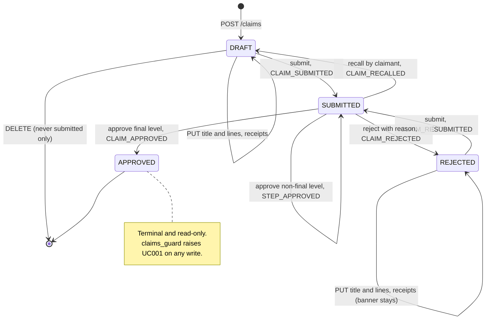
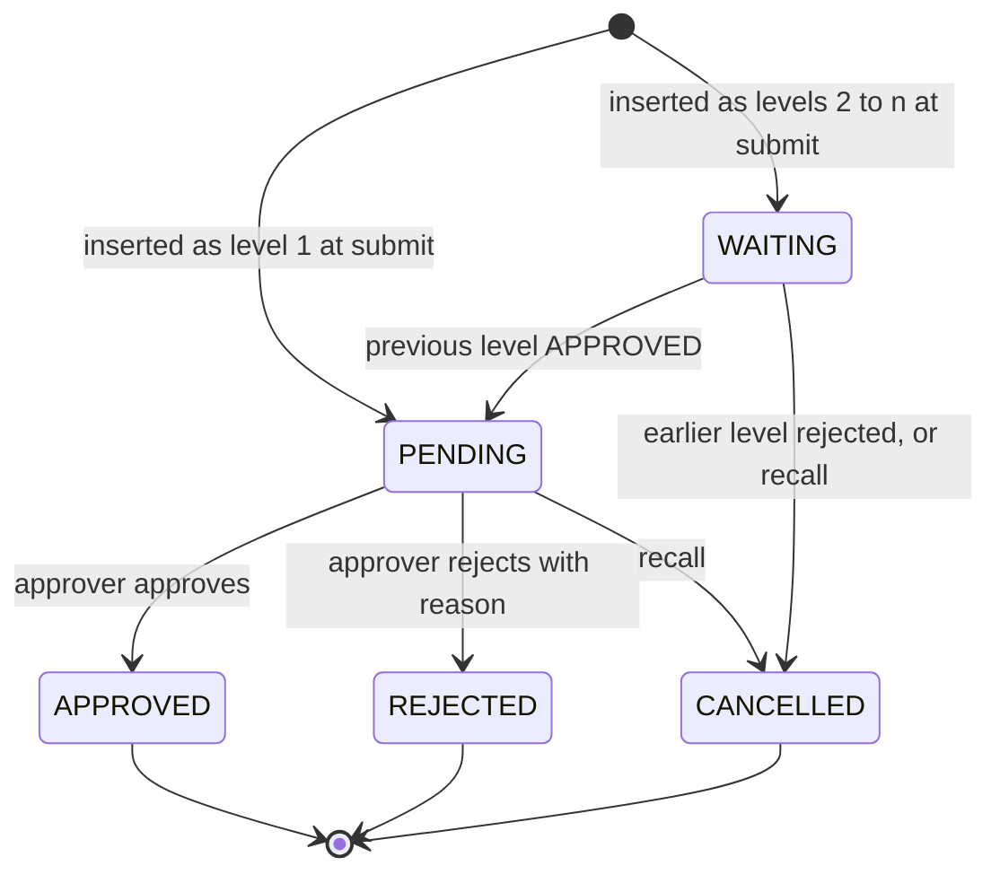
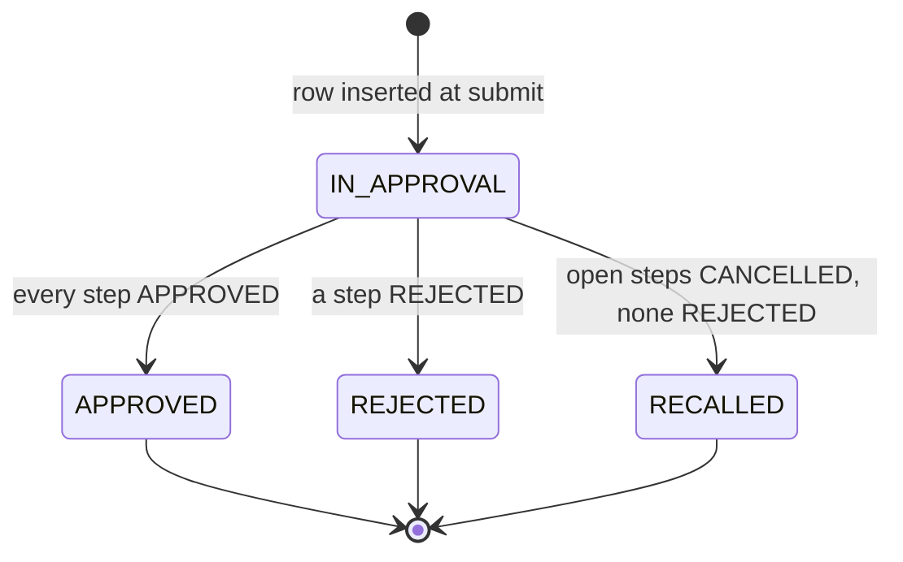
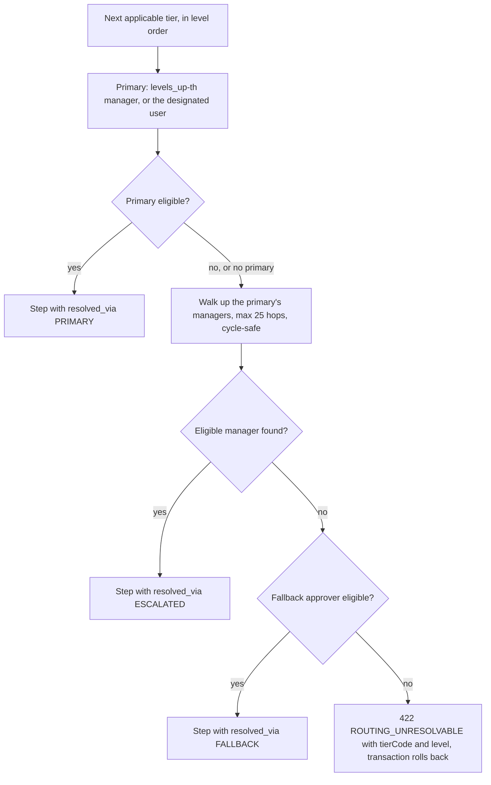
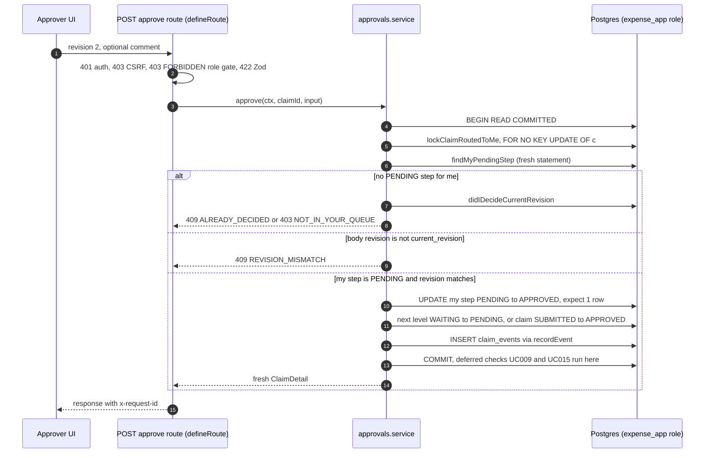

# 02 · Domain and workflow

> Claim lifecycle, approval routing, recall and resubmission, concurrency, and the audit trail.
> This doc owns decisions D-15 to D-22 and contracts C-02, C-13 and C-20 of the canonical set. The SQL for every trigger named here lives in [03 · Data model and integrity](./03-data-model-and-integrity.md). Routes, the error envelope and the visibility predicate are in [04 · Security and API](./04-security-and-api.md). Screens are in [05 · Frontend](./05-frontend.md), and the full test catalogue is in [07 · Testing](./07-testing.md). Phases are in [PLAN.md](../../PLAN.md).

**Contents**
1. [Lifecycle model](#1-lifecycle-model-claim--submission-revision--approval-step)
2. [State machines](#2-state-machines)
3. [Approval policy (§3.2, documented)](#3-approval-policy-32-documented)
4. [Building the chain: `buildChain` and approver resolution](#4-building-the-chain-buildchain-and-approver-resolution)
5. [Who is next? (walkthrough Q1)](#5-who-is-next-walkthrough-q1)
6. [Amount-change rule and recall (§3.2, documented)](#6-amount-change-rule-and-recall-32-documented)
7. [Rejection and resubmission (§3.3, walkthrough Q3)](#7-rejection-and-resubmission-33-walkthrough-q3)
8. [Concurrency](#8-concurrency)
9. [Service sketches](#9-service-sketches)
10. [Audit trail](#10-audit-trail)
11. [Tests that pin this document](#11-tests-that-pin-this-document)
12. [Walkthrough answers](#12-walkthrough-answers)

---

## 1. Lifecycle model: claim → submission revision → approval step

The model has three levels. Every rule in this doc follows from keeping them separate.

| Level | Table | Lifetime | Answers |
|---|---|---|---|
| **Claim** | `claims` + live `line_items` + `receipts` | One id and one `claim_number` (`EXP-2026-000123`) for its whole life | "What does the claimant have now, and in what status?" |
| **Submission (revision N)** | `claim_submissions` (INSERT-only) | One row per submit. The snapshot and `total_minor` never change | "What exactly was sent for approval the Nth time?" |
| **Approval step** | `approval_steps` | One row per applicable tier per submission, created at submit | "Who must sign revision N, in what order, and what did each person decide?" |
| Trace | `claim_events` (append-only) | One row per state-changing request | "Who did what, when and why?" (§4, §6) |

> **An approval is a signature on a specific revision, not on the live claim.** That one sentence answers "what did the approver approve?", "what happens if the amount changes?" and "what survives a resubmission?".

Key pointers on `claims`:
- `current_revision`: 0 means never submitted.
- `current_submission_id`: the newest submission, or NULL when the revision is 0 (enforced by CHECK `claims_revision_matches_submission`).
- `total_minor`: derived, and written only by triggers ([03](./03-data-model-and-integrity.md)).
- `submitted_at`, `approved_at`, `rejected_at`: stamped by the DB (D-23).

Where the code lives ([01](./01-architecture-and-stack.md) has the full layout):

| Concern | Module |
|---|---|
| Service context and signatures | `src/server/services/context.ts` (`ServiceCtx`, `SeedClock`); every service function is `(ctx, ...ids, input?)` ([C-26](./00-decisions-and-contracts.md#c-26-repository-and-service-signatures)) |
| Create, get, replace, delete draft | `src/server/services/claims.service.ts` (`createClaim`, `getClaim`, `replaceClaim`, `deleteDraft`) |
| Submit, recall | `src/server/services/lifecycle.service.ts` (`submit`, `recall`) |
| Approve, reject, approver queue | `src/server/services/approvals.service.ts` (`approve`, `reject`) |
| Chain building (pure) | `src/server/routing/build-chain.ts`, `policy.ts` (`assertPolicyWellFormed`, plus the boot check `assertPolicyLoadsWellFormed`), `org-loader.ts` (rows → `OrgLookup`) |
| Allowed actions, submission outcome (pure) | `src/server/authz/claim-policy.ts` (`decide`, `submissionOutcome`) |
| Audit | `src/server/audit/events.ts` (Zod union), `record-event.ts` (`recordEvent`) |
| Locks and conditional writes | `claims.repo.ts` (`lockOwnedClaim`, `lockClaimRoutedToMe`) and `src/server/repositories/{steps,submissions,line-items,tiers,users,events}.repo.ts`; reads through `claim-visibility.ts` (`findClaimForActor`); `src/server/db/tx.ts` (`withTx`) |

---

## 2. State machines

### 2.1 Claim status (`claims.status`, enum `claim_status`)



There are four statuses because §3 has four states. No IN_REVIEW, no WITHDRAWN. A REJECTED claim **stays REJECTED while it is edited**, so the rejection banner and reason stay on screen until the resubmit. There is one `/submit` endpoint for first submit and resubmit, so there is one chain builder to test.

**Transition table.** Every row except T1 runs inside `withTx` and takes the actor-scoped claim lock first (§8). "Same tx" means the side effects and the event commit or roll back together.

| # | Transition | Request | Actor (lock) | Preconditions, checked after the lock (failure → code) | Side effects (same tx, in this order) | Audit event | Result |
|---|---|---|---|---|---|---|---|
| T1 | create → DRAFT | `POST /api/v1/claims` | any authenticated user | body valid (422) | INSERT claim: DRAFT, revision 0, total 0. The DB assigns `claim_number` and `created_at`. Optional lines are inserted and the DB recomputes the total | none (log `claim.created`) | 201 `ClaimDetail` |
| T2 | DRAFT/REJECTED → same | `PUT /api/v1/claims/:claimId`; receipt upload/delete | owner (`lockOwnedClaim`) | APPROVED → 409 `CLAIM_LOCKED`; SUBMITTED → 409 `CLAIM_NOT_EDITABLE` (`hint: RECALL_TO_EDIT`); foreign line id → 404 `LINE_ITEM_NOT_FOUND`; inactive category → 422 `CATEGORY_INACTIVE` | replace-set of lines (see [04](./04-security-and-api.md)), then title. The DB recomputes `total_minor` | none (log `claim.updated`; the next snapshot captures the edit) | 200 `ClaimDetail` |
| T3 | DRAFT → deleted | `DELETE /api/v1/claims/:claimId` | owner | APPROVED → 409 `CLAIM_LOCKED`; `current_revision > 0` → 409 `CLAIM_HAS_HISTORY` | DELETE claim (cascades to lines and receipts). Storage objects are deleted after commit | none (log `claim.deleted`) | 204 |
| T4 | DRAFT → SUBMITTED | `POST /api/v1/claims/:claimId/submit` | owner | APPROVED → 409 `CLAIM_LOCKED`; SUBMITTED → 409 `INVALID_STATUS_TRANSITION`; 0 lines → 422 `NO_LINE_ITEMS`; inactive category → 422 `CATEGORY_INACTIVE`; no eligible approver for a tier → 422 `ROUTING_UNRESOLVABLE` | INSERT `claim_submissions` (revision + 1, snapshot) → INSERT steps (level 1 PENDING, rest WAITING) → UPDATE claim (SUBMITTED, revision, `current_submission_id`) | `CLAIM_SUBMITTED` | 200 `ClaimDetail` |
| T5 | REJECTED → SUBMITTED | same endpoint | owner | same as T4 | same as T4: a new revision and a **brand-new chain from the new total** | `CLAIM_RESUBMITTED` | 200 |
| T6 | SUBMITTED → SUBMITTED | `POST /api/v1/claims/:claimId/approve` `{revision, comment?}` | approver with a PENDING step (`lockClaimRoutedToMe`) | role gate (403 `FORBIDDEN`, before the tx); no PENDING step for me → 409 `ALREADY_DECIDED` or 403 `NOT_IN_YOUR_QUEUE`; `revision ≠ current_revision` → 409 `REVISION_MISMATCH`; a next level exists | my step PENDING → APPROVED (+ comment) → level n+1 WAITING → PENDING | `STEP_APPROVED` | 200 |
| T7 | SUBMITTED → APPROVED | same | same | same, and no next level | my step → APPROVED → claim → APPROVED (the DB stamps `approved_at`) | `CLAIM_APPROVED` | 200 |
| T8 | SUBMITTED → REJECTED | `POST /api/v1/claims/:claimId/reject` `{revision, reason}` | same | same as T6, plus `reason` trimmed 10..1000 (422 `VALIDATION_FAILED`) | my step → REJECTED (+ `rejection_reason`) → remaining WAITING → CANCELLED → claim → REJECTED (the DB stamps `rejected_at`) | `CLAIM_REJECTED` | 200 |
| T9 | SUBMITTED → DRAFT | `POST /api/v1/claims/:claimId/recall` `{note?}` | owner | APPROVED → 409 `CLAIM_LOCKED`; not SUBMITTED → 409 `INVALID_STATUS_TRANSITION` | the current submission's PENDING/WAITING steps → CANCELLED → claim → DRAFT. APPROVED steps stay | `CLAIM_RECALLED` | 200 |
| — | APPROVED → anything | any write | — | always refused | — | — | 409 `CLAIM_LOCKED`; DB UC001 |

A non-owner calling an owner route gets 404 `CLAIM_NOT_FOUND`. That includes finance. The lock query is `WHERE id = $1 AND claimant_id = $me`, so "not yours" and "doesn't exist" look the same and nothing leaks (D-25).

### 2.2 Approval step status (`approval_steps.status`, enum `approval_step_status`)



| From → To | Request | DB rule (`approval_steps_guard`) | DB-stamped column |
|---|---|---|---|
| insert → PENDING (level 1) | submit | approver eligible (UC008); the step belongs to the claim's newest submission while the claim is still DRAFT/REJECTED (UC012) | `activated_at` |
| insert → WAITING (levels 2..n) | submit | same | — |
| WAITING → PENDING | approve of level n−1 | only if level n−1 is APPROVED (UC012) | `activated_at` |
| PENDING → APPROVED | approve | eligibility **re-checked at decision time** (UC008); an event with this `step_id` and `actor_id = approver_id` must exist at COMMIT (UC015) | `decided_at` |
| PENDING → REJECTED | reject | same, plus CHECK `steps_reason_length` (10..1000) | `decided_at` |
| WAITING/PENDING → CANCELLED | reject at an earlier level, or recall | — | `cancelled_at` |
| APPROVED/REJECTED/CANCELLED → anything | — | terminal (UC006) | — |
| any other transition | — | UC005 | — |
| change of `approver_id`, `level`, `submission_id`, `claim_id` | — | immutable (UC010) | — |
| DELETE | — | no grant (42501), and the trigger raises UC007 | — |

At most one PENDING step per submission (partial unique index `approval_steps_one_pending_per_submission`). One person signs at most one level (`UNIQUE (submission_id, approver_id)`). Levels are unique per submission (`UNIQUE (submission_id, level)`).

### 2.3 Submission outcome (derived, not stored)



`claim_submissions` is INSERT-only, so the outcome is never written. It is computed from the steps, which become immutable once terminal. The result is the same every time you ask.

```ts
// src/server/authz/claim-policy.ts
export type SubmissionOutcome = 'IN_APPROVAL' | 'APPROVED' | 'REJECTED' | 'RECALLED';
export function submissionOutcome(steps: readonly { status: ApprovalStepStatus }[]): SubmissionOutcome {
  if (steps.some((s) => s.status === 'REJECTED')) return 'REJECTED';
  if (steps.length > 0 && steps.every((s) => s.status === 'APPROVED')) return 'APPROVED';
  if (steps.some((s) => s.status === 'CANCELLED')) return 'RECALLED';
  return 'IN_APPROVAL';
}
```

### 2.4 Action × status → result, and `allowedActions`

Every refusal returns a specific code (§6: "not a silent no-op, not a generic error"). This table is the contract for `decide()` and for the visibility matrix test.

| Action \ status | DRAFT | SUBMITTED | APPROVED | REJECTED |
|---|---|---|---|---|
| PUT (title/lines) | 200 | 409 `CLAIM_NOT_EDITABLE` (`hint: RECALL_TO_EDIT`) | 409 `CLAIM_LOCKED` | 200 |
| Receipt upload/delete | 201/204 | 409 `CLAIM_NOT_EDITABLE` | 409 `CLAIM_LOCKED` | 201/204 |
| DELETE claim | 204 if rev 0, else 409 `CLAIM_HAS_HISTORY` | 409 `CLAIM_HAS_HISTORY` | 409 `CLAIM_LOCKED` | 409 `CLAIM_HAS_HISTORY` |
| Submit | 200 (422 `NO_LINE_ITEMS` if empty) | 409 `INVALID_STATUS_TRANSITION` | 409 `CLAIM_LOCKED` | 200 |
| Recall | 409 `INVALID_STATUS_TRANSITION` | 200 | 409 `CLAIM_LOCKED` | 409 `INVALID_STATUS_TRANSITION` |
| Approve/reject (approver) | 409 `ALREADY_DECIDED` if I decided the current (recalled) revision, else 403 `NOT_IN_YOUR_QUEUE` | 200 if my step is PENDING; 409 `REVISION_MISMATCH` if stale; 409 `ALREADY_DECIDED` if I decided this revision; else 403 `NOT_IN_YOUR_QUEUE` | 409 `ALREADY_DECIDED` if I decided it, else 403 `NOT_IN_YOUR_QUEUE` | 409 `ALREADY_DECIDED` if I decided it, else 403 `NOT_IN_YOUR_QUEUE` |
| Any owner action by a non-owner (incl. finance) | 404 `CLAIM_NOT_FOUND` | ← | ← | ← |
| Approve/reject by FINANCE or a user without `can_approve` | 403 `FORBIDDEN` | ← | ← | ← |

`ClaimDetail.allowedActions` comes from the pure `decide(actor, facts)`. The UI renders buttons only from this list and never re-implements the state machine (D-50).

| Status | Owner | Approver whose step is PENDING (`canApprove`, role ≠ FINANCE) | Anyone else who can see it (decided approver, finance) |
|---|---|---|---|
| DRAFT, revision 0 | `EDIT`, `SUBMIT`, `DELETE` | — | `[]` |
| DRAFT, revision > 0 (recalled) | `EDIT`, `SUBMIT` | — | `[]` |
| SUBMITTED | `RECALL` | `APPROVE`, `REJECT` | `[]` |
| REJECTED | `EDIT`, `SUBMIT` | — | `[]` |
| APPROVED | `[]` | — | `[]` |

---

## 3. Approval policy (§3.2, documented)

### 3.1 Thresholds, in ₹ and paise

The thresholds are **exclusive lower bounds in integer paise**: a tier applies when `claim total > applies_above_minor`. That matches the spec's wording ("above it: a second approver"), and it means exactly ₹10,000.00 is still a one-signature claim.

| level | code | label | `applies_above_minor` (paise) | In rupees | Resolver | `levels_up` / designated | Seeded |
|---|---|---|---|---|---|---|---|
| 1 | `L1_MANAGER` | Line manager | 0 | > ₹0.00 (every claim) | `REPORTING_LINE` | 1 | active |
| 2 | `L2_SKIP_LEVEL` | Skip-level manager | 1,000,000 | > ₹10,000.00 | `REPORTING_LINE` | 2 | active |
| 3 | `L3_SENIOR_LEADER` | Senior leader | 5,000,000 | > ₹50,000.00 | `REPORTING_LINE` | 3 | active |
| 4 | `L4_CFO` | CFO | 20,000,000 | > ₹2,00,000.00 | `DESIGNATED_USER` | `deepa.menon@acme.test` | **inactive** (§8 demo) |

| Claim total | Steps (T4 inactive) | Steps (T4 active) | Boundary cases asserted |
|---|---|---|---|
| ₹0.01 – ₹10,000.00 | 1 | 1 | ₹10,000.00 → 1 step |
| ₹10,000.01 – ₹50,000.00 | 2 | 2 | ₹10,000.01 → 2; ₹50,000.00 → 2 |
| ₹50,000.01 – ₹2,00,000.00 | 3 | 3 | ₹50,000.01 → 3 |
| > ₹2,00,000.00 (cap ₹1,00,00,000.00) | 3 | 4 | ₹2,50,000 → 3 / 4 |

**Why these numbers.**
- Day-to-day spend (meals, local transport, a train ticket) needs one signature.
- Typical travel above ₹10,000 gets a second pair of eyes.
- Multi-day trips and training above ₹50,000 reach a senior leader.
- The CFO tier shows that a fourth tier is a data change and nothing more.

All amounts are integer paise, so a threshold comparison is an exact integer comparison (D-09).

### 3.2 The variable-length chain rule

```
chain = every ACTIVE tier with  claim total > applies_above_minor,  ordered by level,
        each mapped through its own resolver to one distinct eligible person
```

There is no `if (amount > X)` anywhere in code; the routing rule is a filter over rows. Level 1 has threshold 0 and thresholds strictly increase, so the applicable tiers are always a **contiguous prefix 1..n** of the active tiers. Two things follow:
- `step.level = tier.level`.
- The DB can check the chain's shape with one count (§4.6).

Every submitted claim has total ≥ 1 paisa, because it has at least one line of at least 1 paisa. So every claim gets at least one step.

### 3.3 Policy storage and well-formedness

There is one table, `approval_policy_tiers(level, code, label, applies_above_minor, resolver, levels_up, designated_user_id, is_active)`. Its CHECKs are in [03](./03-data-model-and-integrity.md): `level` and `code` unique, `levels_up BETWEEN 1 AND 5`, and `tiers_resolver_shape`. There is a single currency (INR) and no policy versioning.

`assertPolicyWellFormed(tiers)` (pure, in `src/server/routing/policy.ts`) runs at seed time, at boot (through `assertPolicyLoadsWellFormed()` below; a malformed policy means the instance refuses to start), inside `submit` before `buildChain`, in the owner script, and in a unit test:

```ts
export function assertPolicyWellFormed(tiers: readonly PolicyTier[]): void {
  const active = tiers.filter((t) => t.isActive).sort((a, b) => a.level - b.level);
  if (active.length === 0) throw new PolicyConfigError('no active tiers');
  active.forEach((t, i) => {
    if (t.level !== i + 1) throw new PolicyConfigError('active levels must be contiguous 1..N');
    if (i === 0 && t.appliesAboveMinor !== 0) throw new PolicyConfigError('level 1 must apply to every claim (threshold 0)');
    if (i > 0 && t.appliesAboveMinor <= active[i - 1].appliesAboveMinor) throw new PolicyConfigError('thresholds must strictly increase');
    const shapeOk = t.resolver === 'REPORTING_LINE'
      ? t.levelsUp !== null && t.levelsUp >= 1 && t.levelsUp <= 5 && t.designatedUserId === null
      : t.designatedUserId !== null && t.levelsUp === null;
    if (!shapeOk) throw new PolicyConfigError(`tier ${t.code}: resolver columns are inconsistent`);
  });
}

/** Boot check: step 4 of instrumentation.ts (wired in P3, with the tiers table). Runs as expense_app (SELECT on tiers). */
export async function assertPolicyLoadsWellFormed(): Promise<void> {
  assertPolicyWellFormed(await tiersRepo.listAll());
}
```

The boot check can pass in every environment because the `release` step runs `seedReference()` on every boot: tiers T1–T3 (and L4, inactive, once its designated user exists) are inserted with `ON CONFLICT (code) DO NOTHING`, so a fresh staging database gets them and an already-seeded dev volume picks them up without losing an activated L4 (D-45, [03 §12.1](./03-data-model-and-integrity.md#121-rules-d-45)).

### 3.4 Changing the policy (§8 "variable-length chain without special-casing")

- `expense_app` has **SELECT only** on `approval_policy_tiers`, so no bug or SQL injection running as the app can collapse the policy (D-35). Tier changes ship as migrations or through the owner script `pnpm policy:activate-tier <CODE>` (`tsx --conditions=react-server`, because `policy.ts` imports `server-only`). The script loads `.env`, sets `DATABASE_URL` to `MIGRATE_DATABASE_URL` (exit 1 if unset) before importing `policy.ts`, so it runs as `expense_owner`; then, in one transaction, it selects all tiers `FOR UPDATE`, flips `is_active`, calls `assertPolicyWellFormed`, and commits.
- **§8 demo:** run `pnpm policy:activate-tier L4_CFO`. Asha's next ₹2,50,000 claim then routes to [ravi, meera, vikram, deepa], with zero code change.
- **In-flight chains never change.** Each step copies `tier_code`, `tier_label` and `applies_above_minor` at submit. The `claims_guard` chain-shape check runs only on → SUBMITTED, and → APPROVED only requires the steps that exist to be APPROVED. So activating a tier affects new submissions only.

---

## 4. Building the chain: `buildChain` and approver resolution

### 4.1 One resolution rule for every edge case

For each applicable tier, build an ordered candidate list:
1. **Primary.** For `REPORTING_LINE`, the claimant's `levels_up`-th manager on the org chart as it is. Null if the line is shorter. For `DESIGNATED_USER`, the designated user.
2. **Escalation.** The primary's managers, walking upward. The walk is cycle-safe and capped at 25 hops.
3. **Fallback.** The single user with `is_fallback_approver = true`.

The first **eligible** candidate wins. Eligible means:

> `is_active AND can_approve AND role ≠ 'FINANCE' AND id ≠ claimant AND not already in this chain`

Each step records `resolved_via ∈ {PRIMARY, ESCALATED, FALLBACK}`. If nothing is eligible, the result is **422 `ROUTING_UNRESOLVABLE` `{tierCode, level}`**: the whole submit transaction rolls back and nothing changes. The system **never auto-approves and never drops a tier.** Why candidates were skipped is deliberately **not** stored or shown, because "inactive" or "not an approver" is HR information about colleagues.



### 4.2 `buildChain`: a pure function

`src/server/routing/build-chain.ts` has no I/O, no clock, no randomness, and never mutates its inputs. Identical inputs produce deep-equal outputs, so the unit tests need no DB.

```ts
import { AppError } from '@/server/errors/app-error';

export type ResolvedVia = 'PRIMARY' | 'ESCALATED' | 'FALLBACK';
export interface PolicyTier {
  level: number; code: string; label: string;
  appliesAboveMinor: number;                    // tier applies iff totalMinor > this (paise)
  resolver: 'REPORTING_LINE' | 'DESIGNATED_USER';
  levelsUp: number | null;                      // REPORTING_LINE only, 1..5
  designatedUserId: string | null;              // DESIGNATED_USER only
  isActive: boolean;
}
export interface OrgUser { id: string; managerId: string | null; isActive: boolean; canApprove: boolean; role: UserRole }
export interface OrgLookup { get(id: string): OrgUser | undefined; readonly fallbackApproverId: string | null }
export interface PlannedStep {
  level: number; tierCode: string; tierLabel: string; appliesAboveMinor: number;
  approverId: string; resolvedVia: ResolvedVia;
}

const MAX_HOPS = 25;

export function buildChain(input: {
  tiers: readonly PolicyTier[]; claimant: OrgUser; org: OrgLookup; totalMinor: number;
}): PlannedStep[] {
  const { tiers, claimant, org, totalMinor } = input;
  if (!Number.isSafeInteger(totalMinor) || totalMinor < 1) throw new Error('buildChain: totalMinor must be a positive integer');

  const applicable = tiers
    .filter((t) => t.isActive && totalMinor > t.appliesAboveMinor)   // ← the entire routing rule
    .sort((a, b) => a.level - b.level);                               // input order is irrelevant

  const chosen = new Set<string>();
  return applicable.map((tier) => {
    for (const cand of candidates(primaryCandidate(tier, claimant, org), org)) {
      if (isEligible(org.get(cand.id), claimant.id, chosen)) {
        chosen.add(cand.id);
        return { level: tier.level, tierCode: tier.code, tierLabel: tier.label,
                 appliesAboveMinor: tier.appliesAboveMinor, approverId: cand.id, resolvedVia: cand.via };
      }
    }
    throw new AppError('ROUTING_UNRESOLVABLE',
      `No eligible approver for the ${tier.label} step. Ask an administrator to fix the reporting line.`,
      { tierCode: tier.code, level: tier.level });
  });
}

function primaryCandidate(tier: PolicyTier, claimant: OrgUser, org: OrgLookup): string | null {
  if (tier.resolver === 'DESIGNATED_USER') return tier.designatedUserId;
  let cur: OrgUser | undefined = claimant;
  for (let i = 0; i < (tier.levelsUp ?? 0); i++) {      // walk the chart as-is; eligibility is judged later
    if (!cur?.managerId) return null;
    cur = org.get(cur.managerId);
  }
  return cur?.id ?? null;
}

/** primary → primary's managers upward (cycle-safe, capped) → fallback */
function* candidates(primaryId: string | null, org: OrgLookup): Generator<{ id: string; via: ResolvedVia }> {
  const seen = new Set<string>();
  let id = primaryId;
  for (let hops = 0; id !== null && !seen.has(id) && hops <= MAX_HOPS; hops++) {
    seen.add(id);
    yield { id, via: hops === 0 ? 'PRIMARY' : 'ESCALATED' };
    id = org.get(id)?.managerId ?? null;
  }
  const fb = org.fallbackApproverId;
  if (fb !== null && !seen.has(fb)) yield { id: fb, via: 'FALLBACK' };
}

function isEligible(u: OrgUser | undefined, claimantId: string, chosen: ReadonlySet<string>): boolean {
  return !!u && u.isActive && u.canApprove && u.role !== 'FINANCE' && u.id !== claimantId && !chosen.has(u.id);
}
```

- `role !== 'FINANCE'` duplicates the row CHECK `users_finance_cannot_approve` on purpose. The routing rule then reads as the business rule, and it stays correct if the CHECK is ever relaxed.
- A tier that resolves to someone already in the chain **escalates**; it never collapses. N tiers always means N distinct signatures (four-eyes).

### 4.3 Loading the routing context

This runs inside the submit transaction, as one recursive CTE in `users.repo.ts` (`loadRoutingRows`). The result is turned into an `OrgLookup` by `src/server/routing/org-loader.ts` (pure; only repositories touch Prisma, D-03). The CTE starts from the claimant, every active tier's designated user and the fallback approver, then walks up their managers.

```sql
WITH RECURSIVE line AS (
  SELECT u.id, u.manager_id, 0 AS depth
    FROM public.users u
   WHERE u.id = ANY(${seedIds}::uuid[]) OR u.is_fallback_approver   -- claimant + designated users + fallback
  UNION
  SELECT m.id, m.manager_id, l.depth + 1
    FROM public.users m JOIN line l ON m.id = l.manager_id
   WHERE l.depth < 25
)
SELECT u.id, u.manager_id AS "managerId", u.is_active AS "isActive", u.can_approve AS "canApprove",
       u.role::text AS role, u.is_fallback_approver AS "isFallbackApprover"
  FROM public.users u
 WHERE u.id IN (SELECT id FROM line);
```

`users` is owner-written only (seed and migrations), so the routing input cannot be changed by the app's own credentials (D-35). Chains are **"routed per the org chart as of submit"**.

### 4.4 Edge cases

| Edge case | What happens | Why |
|---|---|---|
| Claimant has no manager, or the line is shorter than `levels_up` (Vikram at the top) | Primary is null, so escalation yields nothing and the **fallback** (Deepa) is used. If the fallback isn't eligible: 422 | A missing manager is a data gap. Routing to one configured person is explicit and shows up as `resolved_via = FALLBACK` |
| The resolved person is the claimant (cycle in the chart, designated user files a claim, the fallback files a claim) | Not eligible, so escalate. Example: Deepa (the fallback) filing ₹25,000 → 422 at L2, because her line has one manager and the fallback is herself | No self-approval. Also enforced by the step trigger (UC008) |
| The same person resolves for two tiers | Escalate to the next **distinct** eligible person. DB: `UNIQUE (submission_id, approver_id)` | Collapsing would let one click satisfy two tiers, defeating the threshold |
| Candidate is FINANCE | Not eligible, so escalate. Re-checked at decision time by the role gate (403 `FORBIDDEN`) and the DB (UC008) | §3.5: finance never approves |
| Candidate lacks `can_approve` (e.g. an ADMIN manager) | Not eligible, so escalate | Approving is a capability, not a side effect of having reports |
| Candidate is inactive | Not eligible, so escalate. Example (not seeded): with Ravi deactivated, Asha's ₹25,000 → [meera (ESCALATED), vikram (ESCALATED)]; L2's primary, meera, is already in the chain, so it escalates to vikram | Deactivated users can't sign |
| Approver deactivated or demoted **after** routing | The chain doesn't change. Deactivation deletes their sessions, so the step blocks. If someone bypasses the service, the DB refuses the decision (UC008). **Day-one remedy:** the claimant recalls and resubmits, and fresh routing skips that person. The "stuck steps" query below is in `docs/runbook.md`. A reassign endpoint is OPTIONAL | An explicit, audited fix with no background job |
| Org chart changes after routing (new manager) | In-flight chains are unchanged. The old manager keeps the PENDING step and its visibility; the new manager sees nothing until a recall and resubmit re-routes | Responsibility is fixed at submit: audit-friendly and race-free |
| Policy changes after routing | Unaffected; steps carry their tier copy | Same reason |
| Senior claimant with too few distinct eligible people (Vikram ₹25,000; Meera ₹75,000) | 422 `ROUTING_UNRESOLVABLE` `{tierCode, level}`. The claim stays DRAFT/REJECTED | Deliberate. N tiers need N people other than the claimant. A real org adds a second fallback or a board delegate (documented limitation) |
| Claimant splits a ₹60,000 trip into two ₹30,000 claims | Each claim routes on its own total (2 steps each) | DEFERRED policy gap (RT-m9). A finance detective report (same claimant, overlapping dates, same receipt sha256) is a next step |

Stuck-steps runbook query, run as the owner:

```sql
SELECT c.claim_number, s.level, s.tier_code, u.email AS approver, s.activated_at
  FROM public.approval_steps s
  JOIN public.claims c ON c.id = s.claim_id
  JOIN public.users  u ON u.id = s.approver_id
 WHERE s.status = 'PENDING'
   AND NOT (u.is_active AND u.can_approve AND u.role <> 'FINANCE')
 ORDER BY s.activated_at;
```

OPTIONAL reassign, buffer only: `POST /api/v1/admin/approval-steps/:stepId/reassign`. It would apply the same eligibility rule, take the claim lock, allow `approver_id` to change only on WAITING/PENDING steps (UC010 relaxed for that case), and write `STEP_REASSIGNED` (added via `ALTER TYPE … ADD VALUE`).

### 4.5 Expected chains for the seed cast (asserted by tests)

The cast is in canonical C-15: asha → ravi → meera → vikram (top); neha → meera; arjun → neha; deepa (fallback) → vikram; farah (FINANCE) → deepa.

| Claimant | Total | Chain (`resolved_via` PRIMARY unless noted) |
|---|---|---|
| Asha | ₹8,000 / ₹10,000.00 | [ravi] |
| Asha | ₹10,000.01 / ₹25,000 | [ravi, meera] |
| Asha | ₹75,000 | [ravi, meera, vikram] |
| Asha | ₹2,50,000 | T4 inactive: [ravi, meera, vikram]; T4 active: [ravi, meera, vikram, deepa] |
| Arjun | ₹5,000 / ₹25,000 | [neha] / [neha, meera] |
| Ravi | ₹75,000 | [meera, vikram, deepa (FALLBACK)] |
| Vikram | ₹8,000 | [deepa (FALLBACK)] |
| Vikram | ₹25,000 | **422 `ROUTING_UNRESOLVABLE` `{tierCode: 'L2_SKIP_LEVEL', level: 2}`**: no second-level manager, and the fallback is already in the chain (deliberate fixture) |
| Farah (finance, as claimant) | ₹3,000 | [deepa] |

### 4.6 DB backstops for routing (rules here, SQL in [03](./03-data-model-and-integrity.md))

The service builds the chain. The database refuses anything that couldn't have come from a correct chain, even from raw SQL or a `buildChain` bug:

| Backstop | Rule | SQLSTATE → API |
|---|---|---|
| `claims_guard` on → SUBMITTED | step count of the current submission = number of active tiers with `applies_above_minor < total_minor`; levels exactly 1..n; level 1 PENDING with `activated_at`, the others WAITING; the submission is this claim's newest | UC012 → 500 |
| `approval_steps_guard` on INSERT | approver eligible; the step belongs to the newest submission while the claim is DRAFT/REJECTED | UC008 / UC012 → 500 |
| `approval_steps_guard` on decision | eligibility re-checked at PENDING → APPROVED/REJECTED | UC008 → 500 |
| `claims_guard` on → APPROVED | every step of the current submission is APPROVED | UC011 → 500 |
| Uniques | `(submission_id, level)`, `(submission_id, approver_id)`, one PENDING per submission | 23505 → 409 `CONFLICT` |
| Privileges | `expense_app` can't write `approval_policy_tiers` or `users` | 42501 → 500 |

Under-approval is therefore impossible. A ₹75,000 claim cannot reach APPROVED with one signature. **DEFERRED:** a SQL check that the approver is the *right* manager. Instead, a test compares the stored approvers with `buildChain()` for every seeded claim.

---

## 5. Who is next? (walkthrough Q1)

**Nothing is computed at approval time.**
1. At submit, `buildChain` turns *policy rows + org chart + total* into numbered `approval_steps` rows. That is the only time routing logic runs.
2. "Next" is **the one row with `status = 'PENDING'`** on the current submission. The partial unique index guarantees there is at most one.
3. Approving level n flips level n+1 from WAITING to PENDING **in the same transaction**. The DB refuses WAITING → PENDING unless level n is APPROVED (UC012).
4. With no level n+1, the claim becomes APPROVED and the DB stamps `approved_at`.

```sql
-- "who has it now?" (ClaimDetail.approval, ClaimSummary.currentLevel/levelCount)
SELECT s.level, s.tier_label, u.name AS approver
  FROM public.claims c
  JOIN public.approval_steps s ON s.submission_id = c.current_submission_id AND s.status = 'PENDING'
  JOIN public.users u          ON u.id = s.approver_id
 WHERE c.id = $1;                                    -- 0 or 1 row
```

**The approver queue** (§3.2 "only the claims currently routed to them") is a query over *my steps*, not over claims. WAITING ("not your turn yet") and CANCELLED steps never appear and grant no visibility. The endpoint contract (`GET /api/v1/approvals`, filters, cursor) is in [04](./04-security-and-api.md); the shape is:

```sql
SELECT s.id AS step_id, s.level, s.tier_label, s.activated_at,
       c.id AS claim_id, c.claim_number, c.title, sub.revision, sub.total_minor, sub.currency, u.name AS claimant
  FROM public.approval_steps s
  JOIN public.claim_submissions sub ON sub.id = s.submission_id     -- amount = what was submitted
  JOIN public.claims c              ON c.id = s.claim_id
  JOIN public.users u               ON u.id = c.claimant_id
 WHERE s.approver_id = $me AND s.status = 'PENDING'
   AND s.activated_at >= $fromUtc AND s.activated_at < $toUtcExclusive   -- optional, IST days → UTC
   AND (s.activated_at, s.id) > ($cursorAt, $cursorId)                   -- keyset
 ORDER BY s.activated_at, s.id                                           -- oldest waiting first
 LIMIT $limit + 1;                          -- index approval_steps_pending_queue_idx, no Sort, no COUNT(*)
```

---

## 6. Amount-change rule and recall (§3.2, documented)

### 6.1 The rule

> **While a claim is SUBMITTED, nothing on it can change: lines, amounts, title or receipts.**
> A change returns 409 `CLAIM_NOT_EDITABLE` with `details.hint = 'RECALL_TO_EDIT'`. The DB backs this up with UC002: `line_items_before_write` and `receipts_before_write` lock the parent and allow writes only when it is DRAFT or REJECTED.
> To change anything, the claimant **recalls** the claim. The next submit builds a **brand-new chain from the new total**. **Earlier approvals never carry over.**

The spec's example, "a line item edit before the first approval", gets exactly this treatment: the edit is refused with a hint, the UI offers **Recall to edit**, and the resubmission is routed from scratch. If ₹9,000 becomes ₹45,000, the 1-step chain becomes a 2-step chain automatically.

### 6.2 Why, and the alternatives we rejected

| Concern | Edit while SUBMITTED + auto re-route (rejected) | Keep approvals if the tier count is unchanged (rejected) | **Recall → resubmit (chosen)** |
|---|---|---|---|
| What did the approver sign? | Ambiguous unless every edit makes a revision, and then it *is* recall + resubmit with the step hidden | An amount bucket, not content | Always "revision N snapshot" |
| TOCTOU: approver reviews ₹9,000 while it becomes ₹45,000 | Possible; needs extra races and checks | Possible | Impossible: content is frozen while SUBMITTED |
| Places that build chains | Two (submit and edit) | Two | **One** (`lifecycle.service#submit`) |
| DB lock rule | Conditional on step states | Conditional | One line: editable iff DRAFT or REJECTED |
| UX cost | One fewer click | One fewer click | A "Recall to edit" button with a confirm: "approvals so far will need to be repeated" |

**Say it like this:** "Approvals bind to content, not to an amount bucket. While approvers are looking at a claim it is frozen. To change it you take it back, and whatever you send next is new content that needs new signatures."

### 6.3 The recall rule

- **When:** while SUBMITTED, i.e. until the final approval, **including after intermediate approvals**. APPROVED is terminal, so recall then returns 409 `CLAIM_LOCKED`.
- **Effect** (one transaction):
  - the current submission's PENDING/WAITING steps → CANCELLED (kept);
  - APPROVED steps stay APPROVED in history against that revision;
  - the claim → DRAFT, with `current_revision` unchanged;
  - event `CLAIM_RECALLED` (`reason` = optional note ≤ 500, `payload.approvedLevelsVoided`).
- **After a recall:** the claim is a DRAFT with history. It is editable and submittable, but **not deletable** (409 `CLAIM_HAS_HISTORY`). Submitting it writes `CLAIM_SUBMITTED` with `previousRevision.outcome = 'RECALLED'`. A cancelled approver loses read access (404), because CANCELLED grants no visibility.
- **Rejected alternatives:**
  - *Recall only before the first approval.* A claimant who spots a mistake after L1 has to ask L2 to reject it. That wastes approver time and leaves a misleading REJECTED record.
  - *No recall at all.* Same problem.
  - *A WITHDRAWN status.* An extra state for the same effect.
- **If the RM objects** to discarding L1's work, tightening the rule to "before the first approval" is one extra precondition in `lifecycle.service#recall` (`approved steps = 0`, else 409 `INVALID_STATUS_TRANSITION`).

### 6.4 Revision pinning on decisions (D-17)

Approve and reject bodies **require `revision`**: the revision the approver reviewed (`ClaimDetail.currentRevision` when the page loaded). Under the claim lock, `body.revision ≠ claims.current_revision` → **409 `REVISION_MISMATCH` `{requestedRevision, currentRevision}`**.

Scenario: L1 has revision 1 (₹9,000) open in a tab. The claimant recalls, changes it to ₹9,800 and resubmits, which puts L1 at PENDING again on revision 2. Without the pin, L1's click would sign content they never saw. With it, they get a 409 and the UI refetches. This is the same idea as `If-Match` and ETags.

Claimant-side optimistic `version` on PUT/submit is OPTIONAL. Two tabs of the *same claimant* on a draft resolve last-write-wins, which is harmless because the total is always derived by the DB.

---

## 7. Rejection and resubmission (§3.3, walkthrough Q3)

### 7.1 What a rejection does

- The rejecting step stores `rejection_reason` (trimmed 10..1000; Zod and CHECK `steps_reason_length`) and `decided_at`.
- Later WAITING steps → CANCELLED.
- The claim → REJECTED, and the DB stamps `rejected_at`.
- One `CLAIM_REJECTED` event carries the reason and `cancelledStepIds`.
- The claimant sees `ClaimDetail.lastRejection = { revision, level, reason, by, at }` (the newest REJECTED step of any revision). The banner shows while the status is REJECTED. The claim is editable (`allowedActions` = `EDIT`, `SUBMIT`) through the same PUT and receipt routes as a draft.

The reason exists in two immutable places: the step (terminal steps reject any UPDATE, UC006) and the event (append-only, UC007).

### 7.2 Preserved vs reset

| Preserved (never lost, never mutated) | Reset or new on resubmit |
|---|---|
| Claim `id`, `claim_number`, claimant, `created_at`, currency | `status` REJECTED → SUBMITTED; the DB clears `rejected_at` and re-stamps `submitted_at` |
| Every `claim_submissions` row (rev 1..N): snapshot (lines, categories with GL codes, claimant identity, receipts with sha256), total, `submitted_at` | `current_revision` + 1, a new `claim_submissions` row, and `current_submission_id` pointing at it |
| Every `approval_steps` row of earlier revisions: approver, tier copy, decision, `decided_at`, **rejection reason**, comments | A **brand-new chain** from the new total. It may be longer or shorter (C06: rev 1 ₹30,000 = 2 steps; rev 2 ₹9,500 = 1 step). **Prior approvals do not carry over** |
| Every `claim_events` row | Editability: the claim is frozen again until the next recall or rejection |
| Receipt objects referenced by any snapshot. They are never deleted from storage, and the download route serves snapshot-only receipts (D-31) | — |
| `line_items.id` of lines kept across the PUT, so revisions can be compared line by line | Live lines and receipts are whatever the claimant edited |
| `lastRejection` (still shown to approvers as "previously rejected" context) | — |

Deliberately, there is no "resume at the rejecting step". The content changed, so earlier signatures were about different content, and the new total may need a different number of steps.

### 7.3 Seeded demo path (C-15)

- **C05:** Asha, ₹12,000, rejected by Ravi: "Hotel invoice missing for 3 Oct". Show the banner, edit, resubmit, and the timeline.
- **C06:** already resubmitted. Rev 1 (₹30,000, rejected by Meera at L2) and rev 2 (₹9,500, PENDING Ravi) show the chain shrinking from 2 steps to 1.
- **C07:** recalled after Ravi approved L1 of 2. The DRAFT shows the cancelled L2 and the kept L1 approval on rev 1.

---

## 8. Concurrency

### 8.1 The recipe (D-14)

1. **Role checks happen before the transaction** (`defineRoute` role gate plus the service's own guard). Out-of-scope actors never take a lock, so finance can't stall writers.
2. **`withTx(fn)`**: a Prisma interactive transaction, **READ COMMITTED**, `maxWait 5000`, `timeout 10000`. Role settings on `expense_app`: `lock_timeout 5s`, `statement_timeout 15s`.
3. **First statement: an actor-scoped row lock on the claim**, `SELECT … FOR NO KEY UPDATE`:
   - owner actions use `lockOwnedClaim(tx, actor, claimId)`, with `claimant_id = me`;
   - decisions use `lockClaimRoutedToMe(tx, actor, claimId)`, with `EXISTS step approver_id = me AND status = 'PENDING'` and `FOR NO KEY UPDATE OF c`.
   No row means refused **at the point of the query**.
4. **Re-read the facts with a fresh statement** after the lock (lines, my step, the steps).
5. **Decide, then write with conditional updates that expect `count = 1`** (`WHERE id = $id AND status = 'PENDING'`). Under the lock a 0 is "impossible": it throws 409 `CONFLICT` and logs at `error`.
6. **Lock order: claim → submission → steps → events.** Child-row triggers also lock the parent claim `FOR NO KEY UPDATE`, which is a no-op when the service already holds it. Raw-SQL writers queue behind it.
7. **Retries:** 40001 / 40P01 (Prisma P2034) are retried up to 2 times by re-running the whole `fn` in a fresh transaction, then 409 `CONFLICT` with `details.retryable = true`. 55P03 (lock timeout) → 409 `CONFLICT`. A retry is safe because there is **no network I/O inside a transaction**: storage calls and logs happen after commit.

**Why each choice:**
- **The claim row is the mutex.** Contention per claim is tiny, so pessimistic locking is the simplest correct option.
- **`NO KEY UPDATE`, not `UPDATE`.** It conflicts with itself but not with the `KEY SHARE` lock that FK checks take, so concurrent line inserts queue instead of deadlocking on a lock upgrade.
- **Not SERIALIZABLE.** It needs retry loops everywhere and turns specific codes into generic failures.
- **Not optimistic versions.** They need retries across multi-row writes.
- **Why step 4 (the fresh re-read) matters.** If the lock had to wait, Postgres re-checks only the *claim row* against the WHERE. The `EXISTS` subquery keeps its old snapshot. So "I got the lock" proves only that the claim is mine to touch, not that my step is still PENDING. The fresh statement sees the winner's committed rows.

### 8.2 Transaction and lock helpers

```ts
// src/server/db/tx.ts
export type Tx = Prisma.TransactionClient;
const RETRYABLE = new Set(['40001', '40P01']);

export async function withTx<T>(fn: (tx: Tx) => Promise<T>): Promise<T> {
  for (let attempt = 0; ; attempt++) {
    try {
      return await getDb().$transaction(fn, {
        isolationLevel: Prisma.TransactionIsolationLevel.ReadCommitted, maxWait: 5_000, timeout: 10_000,
      });
    } catch (err) {
      if (err instanceof AppError) throw err;                         // business refusals pass through
      const retryable = RETRYABLE.has(readSqlState(err) ?? '') || isPrismaCode(err, 'P2034');
      if (retryable && attempt < 2) continue;                          // whole fn re-runs on a fresh snapshot
      if (retryable) throw new AppError('CONFLICT', 'The claim changed concurrently. Please retry.', { retryable: true });
      throw err;                                                       // mapped by SQLSTATE in map-error.ts (C-05)
    }
  }
}

// src/server/repositories/claims.repo.ts  ($queryRaw tagged templates only; *Unsafe is lint-banned)
// C-26: both lock functions return null for "not yours"; the service decides which error that is.
export async function lockOwnedClaim(tx: Tx, actor: Actor, claimId: string): Promise<LockedClaim | null> {
  const rows = await tx.$queryRaw<LockedClaim[]>`
    SELECT id, claimant_id AS "claimantId", status::text AS status, title, currency,
           total_minor AS "totalMinor", current_revision AS "currentRevision",
           current_submission_id AS "currentSubmissionId"
      FROM public.claims
     WHERE id = ${claimId}::uuid AND claimant_id = ${actor.id}::uuid
       FOR NO KEY UPDATE`;
  return rows[0] ?? null;
}

export async function lockClaimRoutedToMe(tx: Tx, actor: Actor, claimId: string): Promise<LockedClaim | null> {
  const rows = await tx.$queryRaw<LockedClaim[]>`
    SELECT c.id, c.claimant_id AS "claimantId", c.status::text AS status, c.title, c.currency,
           c.total_minor AS "totalMinor", c.current_revision AS "currentRevision",
           c.current_submission_id AS "currentSubmissionId"
      FROM public.claims c
     WHERE c.id = ${claimId}::uuid
       AND EXISTS (SELECT 1 FROM public.approval_steps s
                    WHERE s.claim_id = c.id AND s.approver_id = ${actor.id}::uuid AND s.status = 'PENDING')
       FOR NO KEY UPDATE OF c`;
  return rows[0] ?? null;
}

export function expectOne(count: number): void {          // used by every conditional update
  if (count !== 1) throw new AppError('CONFLICT', 'The claim changed concurrently. Please retry.', { retryable: true });
}
```

A PENDING step can only exist on the current submission, because recall and reject cancel every open step before a new submission can exist. So the PENDING-scoped lock needs no revision filter.

### 8.3 Approve/reject: finding my step, and the refusal codes

```ts
// src/server/services/approvals.service.ts
async function lockMyPendingStep(tx: Tx, actor: Actor, claimId: string, revision: number) {
  const claim = await claimsRepo.lockClaimRoutedToMe(tx, actor, claimId);
  const step = claim && (await stepsRepo.findMyPendingStep(tx, actor, claim.currentSubmissionId!)); // fresh statement
  if (!claim || !step) {
    // Same answer for "doesn't exist", "not routed to me" and "WAITING", so there is no existence oracle.
    // ALREADY_DECIDED is told only to someone who signed this revision and can already read the claim.
    const decided = await stepsRepo.didIDecideCurrentRevision(tx, actor, claimId);
    throw decided
      ? new AppError('ALREADY_DECIDED', 'You have already decided this claim.')
      : new AppError('NOT_IN_YOUR_QUEUE', 'This claim is not in your approval queue.');
  }
  if (revision !== claim.currentRevision) {
    throw new AppError('REVISION_MISMATCH', 'This claim was resubmitted since you opened it. Reload to review the new revision.',
      { requestedRevision: revision, currentRevision: claim.currentRevision });
  }
  return { claim, step };   // step = { id, submissionId, level, levelCount, tierCode }
}
```

`didIDecideCurrentRevision` checks for a step on `claims.current_submission_id` with `approver_id = me AND status IN ('APPROVED','REJECTED')`. A nonexistent id returns false, which gives the same 403.

### 8.4 Race matrix: who wins, and the exact code the loser gets

| Race | Outcome | Loser gets | Backstop if the app were wrong |
|---|---|---|---|
| Double-click or 10 parallel approves of one step | First commit wins; the rest wait on the lock, then the fresh re-read finds no PENDING step | 409 `ALREADY_DECIDED` (exactly one event) | `WHERE status = 'PENDING'` count 1; terminal steps UC006 |
| Approve vs recall: recall first | Claim DRAFT, steps CANCELLED | Approver: 403 `NOT_IN_YOUR_QUEUE`, or 409 `ALREADY_DECIDED` if they had already signed this revision | UC006 on the cancelled step |
| Approve vs recall: approve first (intermediate) | Both succeed in order. L1 stays APPROVED, the just-activated L2 → CANCELLED | — | `claims_guard` → DRAFT requires no open steps (UC012) |
| Approve vs recall: approve first (final; the single-step case in the race test) | Claim APPROVED | Recall: 409 `CLAIM_LOCKED` | APPROVED is terminal (UC001) |
| Reject vs recall | Reject first → recall 409 `INVALID_STATUS_TRANSITION`. Recall first → reject 403 `NOT_IN_YOUR_QUEUE` | as stated | transition whitelist (UC005) |
| Two submits from two tabs | First creates revision N+1 | 409 `INVALID_STATUS_TRANSITION` | `UNIQUE (claim_id, revision)` → 23505 → 409 `CONFLICT` |
| PUT (edit) vs submit | Edit first → the snapshot includes it. Submit first → the edit gets 409 `CLAIM_NOT_EDITABLE` | as stated | `line_items_before_write` locks the parent and checks status (UC002) |
| Delete vs submit | Delete first → submit 404 `CLAIM_NOT_FOUND`. Submit first → delete 409 `CLAIM_HAS_HISTORY` | as stated | `claims_guard` DELETE with revision > 0 (UC017) |
| L2 acts while their step is WAITING (or while L1 is committing) | L2's lock query finds no PENDING step | 403 `NOT_IN_YOUR_QUEUE` (correct at that instant; retry after L1 commits) | WAITING → PENDING only after the previous level is APPROVED (UC012) |
| Stale tab after recall + resubmit (same L1) | — | 409 `REVISION_MISMATCH` | — |
| Approver demoted to FINANCE or loses `can_approve` mid-chain | Role read live per request | 403 `FORBIDDEN` before any query | UC008 at decision time |
| Two PUTs on one draft (same claimant) | Last write wins; total = Σ lines | — (documented) | recompute trigger + deferred UC009 |
| Lock held > 5 s / deadlock or serialization after 2 retries | — | 409 `CONFLICT` (`retryable: true`) | — |

The UI treats every 409 as a "refetch and show a specific toast" signal. Mutations never auto-retry ([05](./05-frontend.md)).

---

## 9. Service sketches

Every service function is `(ctx: ServiceCtx, ...ids, input?)` ([C-26](./00-decisions-and-contracts.md#c-26-repository-and-service-signatures)). The types live in `src/server/services/context.ts`, so services never import `@/server/http/*`:

```ts
// src/server/services/context.ts
export interface SeedClock { now(): Date }
export interface ServiceCtx { actor: Actor; requestId: string; clock?: SeedClock }
```

`defineRoute` builds `ctx = { actor, requestId }` for every request; the test factories build the same shape. **Only the owner-run seed sets `clock`.** When `ctx.clock` is present, services pass `clock.now()`:
- as `claims.created_at` (create);
- as `claims.submitted_at`, `claim_submissions.submitted_at` and the level-1 `activated_at` (submit);
- as `decided_at`, the next level's `activated_at`, `approved_at` / `rejected_at` and `cancelled_at` (approve, reject, recall);
- as `claim_events.occurred_at` (`recordEvent`).

When it is absent (every production request) they pass nothing and the DB stamps `now()`. For `expense_app` the DB overwrites any supplied value anyway (D-23), so the clock can only ever backdate seed data written as the owner. The sketches below show it as `at = ctx.clock?.now()`, handed to every repository write that touches one of those columns. Every service returns the fresh `ClaimDetail` from `getClaim(ctx, claimId)`, the visibility-scoped read (`findClaimForActor`) after commit. Seed check (P5 exit): `SELECT approved_at AT TIME ZONE 'Asia/Kolkata'` for C09 and C10 returns `2026-09-30 23:59:30` and `2026-10-01 00:15:00`.

### 9.1 Submit and resubmit (one code path)

```ts
// src/server/services/lifecycle.service.ts
export async function submit(ctx: ServiceCtx, claimId: string, _input: SubmitInput = {}): Promise<ClaimDetail> {
  const at = ctx.clock?.now();                                                        // seed only (see above)
  const { type, revision } = await withTx(async (tx) => {
    const claim = await claimsRepo.lockOwnedClaim(tx, ctx.actor, claimId);           // 1. owner-scoped lock
    if (!claim) throw new AppError('CLAIM_NOT_FOUND', 'Claim not found.');
    if (claim.status === 'APPROVED') throw new AppError('CLAIM_LOCKED', 'This claim is approved and locked.', { status: 'APPROVED' });
    if (claim.status === 'SUBMITTED') throw new AppError('INVALID_STATUS_TRANSITION', 'This claim is already in approval.', { status: 'SUBMITTED' });

    const lines = await lineItemsRepo.listForSnapshot(tx, claim.id);                 // 2. fresh read after the lock
    if (lines.length === 0) throw new AppError('NO_LINE_ITEMS', 'Add at least one line item before submitting.');
    const bad = lines.findIndex((l) => !l.category.isActive);
    if (bad >= 0) throw new AppError('CATEGORY_INACTIVE', 'A line uses a retired category.',
      { issues: [{ path: ['lineItems', bad, 'categoryId'], message: 'Category is no longer active', code: 'CATEGORY_INACTIVE' }] });

    const tiers = await tiersRepo.listActive(tx);                                     // 3. route
    assertPolicyWellFormed(tiers);
    const org = buildOrgLookup(await usersRepo.loadRoutingRows(tx, claim.claimantId, tiers));
    const chain = buildChain({ tiers, claimant: org.get(claim.claimantId)!, org, totalMinor: claim.totalMinor });

    const revision = claim.currentRevision + 1;                                       // 4. submission → steps → claim → event
    const previous = claim.currentSubmissionId ? await submissionsRepo.summary(tx, claim.currentSubmissionId) : null;
    const submission = await submissionsRepo.insert(tx, {
      claimId: claim.id, revision, submittedById: ctx.actor.id,
      totalMinor: claim.totalMinor, currency: claim.currency, lineItemCount: lines.length, submittedAt: at,
      snapshot: toSnapshotV1(await usersRepo.claimantIdentity(tx, claim.claimantId), claim, lines),  // C-21
    });                                                    // claim_submissions_verify: live lines = snapshot (UC016)
    await stepsRepo.insertChain(tx, claim.id, submission.id, chain, at);             // L1 PENDING (activated_at), rest WAITING
    await claimsRepo.markSubmitted(tx, claim.id, { from: claim.status, revision, submissionId: submission.id, at });
                                                           // claims_guard: chain shape (UC012), stamps submitted_at
    const type = claim.status === 'REJECTED' ? 'CLAIM_RESUBMITTED' : 'CLAIM_SUBMITTED';
    await recordEvent(tx, ctx, {
      type, claimId: claim.id, submissionId: submission.id, revision, totalMinor: claim.totalMinor,
      payload: {
        lineItemCount: lines.length,
        chain: chain.map(({ level, tierCode, approverId, resolvedVia }) => ({ level, tierCode, approverId, resolvedVia })),
        ...(previous && { previousRevision: { revision: previous.revision, totalMinor: previous.totalMinor,
                                               outcome: claim.status === 'REJECTED' ? 'REJECTED' : 'RECALLED' } }),
      },
    });
    return { type, revision };
  });
  logger.info({ event: type === 'CLAIM_RESUBMITTED' ? 'claim.resubmitted' : 'claim.submitted', claimId, revision });
  return getClaim(ctx, claimId);
}
```

### 9.2 Approve



```ts
export async function approve(ctx: ServiceCtx, claimId: string, input: ApproveInput): Promise<ClaimDetail> {
  requireDecider(ctx.actor);                       // canApprove && role !== 'FINANCE', else 403 FORBIDDEN (self-guard)
  const at = ctx.clock?.now();
  const logEvent = await withTx(async (tx) => {
    const { claim, step } = await lockMyPendingStep(tx, ctx.actor, claimId, input.revision);
    await stepsRepo.approve(tx, step.id, input.comment ?? null, at);        // WHERE status='PENDING', expectOne; decided_at
    const base = { claimId: claim.id, submissionId: step.submissionId, stepId: step.id,
                   revision: claim.currentRevision, totalMinor: claim.totalMinor,   // = submission total: lines frozen
                   reason: input.comment };
    const next = await stepsRepo.findByLevel(tx, step.submissionId, step.level + 1);
    if (next) {
      await stepsRepo.activate(tx, next.id, at);                            // WAITING → PENDING, expectOne; activated_at
      await recordEvent(tx, ctx, { ...base, type: 'STEP_APPROVED',
        payload: { level: step.level, levelCount: step.levelCount, tierCode: step.tierCode, nextApproverId: next.approverId } });
      return 'claim.step_approved';
    }
    await claimsRepo.markApproved(tx, claim.id, at);                        // SUBMITTED → APPROVED; approved_at (DB-stamped for the app), UC011
    await recordEvent(tx, ctx, { ...base, type: 'CLAIM_APPROVED',
      payload: { level: step.level, levelCount: step.levelCount, tierCode: step.tierCode,
                 approverIds: await stepsRepo.approverIdsInOrder(tx, step.submissionId) } });
    return 'claim.approved';
  });
  logger.info({ event: logEvent, claimId });
  return getClaim(ctx, claimId);
}
```

### 9.3 Reject

```ts
export async function reject(ctx: ServiceCtx, claimId: string, input: RejectInput): Promise<ClaimDetail> {
  requireDecider(ctx.actor);
  const at = ctx.clock?.now();
  await withTx(async (tx) => {
    const { claim, step } = await lockMyPendingStep(tx, ctx.actor, claimId, input.revision);
    await stepsRepo.reject(tx, step.id, input.reason, at);                  // PENDING → REJECTED + rejection_reason, decided_at
    const cancelledStepIds = await stepsRepo.cancelWaiting(tx, step.submissionId, at);   // later levels → CANCELLED
    await claimsRepo.markRejected(tx, claim.id, at);                        // SUBMITTED → REJECTED; rejected_at
    await recordEvent(tx, ctx, {
      type: 'CLAIM_REJECTED', claimId: claim.id, submissionId: step.submissionId, stepId: step.id,
      revision: claim.currentRevision, totalMinor: claim.totalMinor, reason: input.reason,
      payload: { level: step.level, levelCount: step.levelCount, tierCode: step.tierCode, cancelledStepIds },
    });
  });
  logger.info({ event: 'claim.rejected', claimId });
  return getClaim(ctx, claimId);
}
```

### 9.4 Recall

```ts
export async function recall(ctx: ServiceCtx, claimId: string, input: RecallInput = {}): Promise<ClaimDetail> {
  const at = ctx.clock?.now();
  await withTx(async (tx) => {
    const claim = await claimsRepo.lockOwnedClaim(tx, ctx.actor, claimId);
    if (!claim) throw new AppError('CLAIM_NOT_FOUND', 'Claim not found.');
    if (claim.status === 'APPROVED') throw new AppError('CLAIM_LOCKED', 'This claim is approved and locked.', { status: 'APPROVED' });
    if (claim.status !== 'SUBMITTED') throw new AppError('INVALID_STATUS_TRANSITION', 'Only a claim in approval can be recalled.', { status: claim.status });

    const steps = await stepsRepo.listForSubmission(tx, claim.currentSubmissionId!);
    const open = steps.filter((s) => s.status === 'PENDING' || s.status === 'WAITING');
    await stepsRepo.cancelOpen(tx, claim.currentSubmissionId!, open.length, at); // expects count = open.length; cancelled_at
    await claimsRepo.markRecalled(tx, claim.id);                               // SUBMITTED → DRAFT (UC012 if any left open)
    await recordEvent(tx, ctx, {
      type: 'CLAIM_RECALLED', claimId: claim.id, submissionId: claim.currentSubmissionId!,
      revision: claim.currentRevision, totalMinor: claim.totalMinor, reason: input.note,
      payload: {
        cancelledSteps: open.map((s) => ({ stepId: s.id, level: s.level, approverId: s.approverId, wasStatus: s.status })),
        approvedLevelsVoided: steps.filter((s) => s.status === 'APPROVED').length,
      },
    });
  });
  logger.info({ event: 'claim.recalled', claimId });
  return getClaim(ctx, claimId);
}
```

---

## 10. Audit trail

### 10.1 Writer model: one writer, in the same transaction (D-22)

- Services call **`recordEvent(tx, ctx, event)`** (`src/server/audit/record-event.ts`) **exactly once per state-changing request**, inside the same transaction, after the state writes.
- `actor_id` is **always `ctx.actor.id`**, the authenticated actor. The function has no parameter for it, so a service cannot write someone else's name into history.
- `actor_role`, `from_status` and `to_status` are derived from the event type by a constant table. A service cannot record an inconsistent transition.
- The event is validated by a **Zod discriminated union** before insert. A bad payload is a programmer bug and returns 500. It never comes from user input.
- `request_id` is the request's `x-request-id`. The same id is echoed on the response, included in error envelopes and stamped on every log line, so one value joins the audit row to the logs (D-40).
- If the transaction rolls back, the event rolls back with it: a failed transition writes no event. Logs mirror events **after commit** (`claim.submitted`, `claim.resubmitted`, `claim.step_approved`, `claim.approved`, `claim.rejected`, `claim.recalled`).

**Rejected:**
- *SECURITY DEFINER triggers writing events, with `app.actor_id` GUCs.* The actor would be derived from data, a GUC is spoofable and fails open, and payloads would be poorer.
- *Both writers at once.* Double events, or 42501 failures.
- *Logs as the audit trail.* Logs are sampled and rotated, and a line can be written for an action that later rolled back.

### 10.2 Guarantees (SQL in [03](./03-data-model-and-integrity.md))

| Guarantee | Mechanism | Fails with |
|---|---|---|
| History can't be edited or deleted by the app | `expense_app` has SELECT + INSERT only on `claim_events` and `claim_submissions` | 42501 |
| …or by the owner by accident | `forbid_mutation()` BEFORE UPDATE/DELETE trigger | UC007 |
| Time and transaction can't be forged | For `expense_app`, the INSERT branch stamps `occurred_at := now()` and `tx_id := pg_current_xact_id()` | — (overwritten) |
| A transition can't commit without its event | Deferred constraint trigger `assert_transition_audited` on `claims` (AFTER UPDATE OF status) and `approval_steps` (→ APPROVED/REJECTED). It requires an event **in this transaction** (`tx_id`) for that claim with matching `from_status/to_status/revision`, or matching `step_id` | UC015 at COMMIT |
| The event names the right person | Same trigger: `actor_id = claimant_id` for submit, resubmit and recall; `actor_id = approver_id` of the decided step for decisions | UC015 at COMMIT |
| Submitted claims can't vanish | `claim_events.claim_id` and `claim_submissions.claim_id` are `ON DELETE RESTRICT`; `claims_guard` refuses DELETE when revision > 0 | UC017 |

**Residual risk, stated in the walkthrough:** code running *as* `expense_app` could still write a consistent forged event together with a matching state change. "The DB proves the state machine and the completeness of the audit trail; the scoped query proves identity." It is mitigated by least privilege (D-34, D-35), and in production by pgaudit.

**Ordering note:** `occurred_at` is transaction start, so every row in one transition shares one instant. History orders by `(occurred_at, id)` (`claim_events_timeline_idx`). Because the claim lock is every transaction's first statement, two racing transactions on one claim can only invert their timestamps within one round trip (< 1 ms). Each event's `revision` and `level` make the sequence unambiguous anyway.

### 10.3 Event catalogue (C-20)

Every row also stores `claim_id`, `submission_id`, `revision`, `total_minor` (the submission total), `request_id`, `tx_id` and `occurred_at`. All columns are NOT NULL except `submission_id`, `step_id` and `reason`.

| `type` | Written by | `from → to` | `actor_role` / `actor_id` | `step_id` | `reason` | `payload` |
|---|---|---|---|---|---|---|
| `CLAIM_SUBMITTED` | submit from DRAFT (rev 1, or after a recall) | DRAFT → SUBMITTED | CLAIMANT / claimant | – | – | `{ lineItemCount, chain: [{ level, tierCode, approverId, resolvedVia }], previousRevision?: { revision, totalMinor, outcome } }` |
| `CLAIM_RESUBMITTED` | submit from REJECTED | REJECTED → SUBMITTED | CLAIMANT / claimant | – | – | same; `previousRevision` required |
| `STEP_APPROVED` | approve, non-final level | SUBMITTED → SUBMITTED | APPROVER / step approver | ✓ | approve comment (optional) | `{ level, levelCount, tierCode, nextApproverId }` |
| `CLAIM_APPROVED` | approve, final level | SUBMITTED → APPROVED | APPROVER / step approver | ✓ | approve comment (optional) | `{ level, levelCount, tierCode, approverIds }` |
| `CLAIM_REJECTED` | reject at any level | SUBMITTED → REJECTED | APPROVER / step approver | ✓ | rejection reason (required) | `{ level, levelCount, tierCode, cancelledStepIds }` |
| `CLAIM_RECALLED` | recall | SUBMITTED → DRAFT | CLAIMANT / claimant | – | recall note (optional) | `{ cancelledSteps: [{ stepId, level, approverId, wasStatus }], approvedLevelsVoided }` |

One request writes one row. Cascaded effects (cancelled steps, the activated next level) go in that row's payload. OPTIONAL: `STEP_REASSIGNED`, for the reassign endpoint only.

### 10.4 Payload schemas and `recordEvent`

```ts
// src/server/audit/events.ts
const Uuid = z.uuid();
const Level = z.number().int().min(1);
const Base = { claimId: Uuid, submissionId: Uuid, revision: z.number().int().min(1), totalMinor: z.number().int().min(1) };
const ChainEntry = z.strictObject({ level: Level, tierCode: z.string(), approverId: Uuid,
                                    resolvedVia: z.enum(['PRIMARY', 'ESCALATED', 'FALLBACK']) });
const PreviousRevision = z.strictObject({ revision: Level, totalMinor: z.number().int().min(1),
                                          outcome: z.enum(['REJECTED', 'RECALLED']) });
const SubmitPayload = { lineItemCount: z.number().int().min(1), chain: z.array(ChainEntry).min(1) };
const Decision = { level: Level, levelCount: Level, tierCode: z.string() };

export const ClaimEventInputSchema = z.discriminatedUnion('type', [
  z.strictObject({ ...Base, type: z.literal('CLAIM_SUBMITTED'),
    payload: z.strictObject({ ...SubmitPayload, previousRevision: PreviousRevision.optional() }) }),
  z.strictObject({ ...Base, type: z.literal('CLAIM_RESUBMITTED'),
    payload: z.strictObject({ ...SubmitPayload, previousRevision: PreviousRevision }) }),
  z.strictObject({ ...Base, type: z.literal('STEP_APPROVED'), stepId: Uuid, reason: z.string().max(1000).optional(),
    payload: z.strictObject({ ...Decision, nextApproverId: Uuid }) }),
  z.strictObject({ ...Base, type: z.literal('CLAIM_APPROVED'), stepId: Uuid, reason: z.string().max(1000).optional(),
    payload: z.strictObject({ ...Decision, approverIds: z.array(Uuid).min(1) }) }),
  z.strictObject({ ...Base, type: z.literal('CLAIM_REJECTED'), stepId: Uuid, reason: z.string().trim().min(10).max(1000),
    payload: z.strictObject({ ...Decision, cancelledStepIds: z.array(Uuid) }) }),
  z.strictObject({ ...Base, type: z.literal('CLAIM_RECALLED'), reason: z.string().max(500).optional(),
    payload: z.strictObject({
      cancelledSteps: z.array(z.strictObject({ stepId: Uuid, level: Level, approverId: Uuid, wasStatus: z.enum(['PENDING', 'WAITING']) })),
      approvedLevelsVoided: z.number().int().min(0) }) }),
]);
export type ClaimEventInput = z.input<typeof ClaimEventInputSchema>;
```

```ts
// src/server/audit/record-event.ts
const TRANSITION = {
  CLAIM_SUBMITTED:   { from: 'DRAFT',     to: 'SUBMITTED', actorRole: 'CLAIMANT' },
  CLAIM_RESUBMITTED: { from: 'REJECTED',  to: 'SUBMITTED', actorRole: 'CLAIMANT' },
  STEP_APPROVED:     { from: 'SUBMITTED', to: 'SUBMITTED', actorRole: 'APPROVER' },
  CLAIM_APPROVED:    { from: 'SUBMITTED', to: 'APPROVED',  actorRole: 'APPROVER' },
  CLAIM_REJECTED:    { from: 'SUBMITTED', to: 'REJECTED',  actorRole: 'APPROVER' },
  CLAIM_RECALLED:    { from: 'SUBMITTED', to: 'DRAFT',     actorRole: 'CLAIMANT' },
} as const satisfies Record<ClaimEventType, { from: ClaimStatus; to: ClaimStatus; actorRole: EventActorRole }>;

export async function recordEvent(tx: Tx, ctx: ServiceCtx, input: ClaimEventInput): Promise<void> {
  const e = ClaimEventInputSchema.parse(input);
  const t = TRANSITION[e.type];
  await eventsRepo.insert(tx, {
    claimId: e.claimId, submissionId: e.submissionId, stepId: 'stepId' in e ? e.stepId : null,
    revision: e.revision, type: e.type, actorId: ctx.actor.id, actorRole: t.actorRole,
    fromStatus: t.from, toStatus: t.to, totalMinor: e.totalMinor, reason: 'reason' in e ? (e.reason ?? null) : null,
    payload: e.payload, requestId: ctx.requestId,
    occurredAt: ctx.clock?.now(),                        // seed only; for expense_app the DB stamps occurred_at (and always tx_id)
  });
}
```

### 10.5 Reading the trail

- **API:** `GET /api/v1/claims/:claimId/history` → `ClaimHistory`. It contains `submissions[]`: revision, `submittedAt`, `totalMinor`, `lineItemCount`, derived `outcome`, the snapshot, and that revision's steps. It also contains `events[]` ordered by `(occurred_at, id)`, each with actor, role, revision, from/to, reason, payload and `requestId`. Visibility is the same `claimVisibilityWhere(actor)` as the claim ([04](./04-security-and-api.md)). The trail is bounded per claim, so there is no pagination. The UI groups events into revision cards ([05](./05-frontend.md)).
- **Dispute query for finance**, in SQL. Answers "who approved this, when, and why":

```sql
SELECT e.occurred_at AT TIME ZONE 'Asia/Kolkata' AS at_ist, e.type, e.revision, u.name AS actor, e.actor_role,
       e.from_status, e.to_status, e.total_minor, e.reason, e.payload, e.request_id
  FROM public.claim_events e
  JOIN public.claims c ON c.id = e.claim_id
  JOIN public.users  u ON u.id = e.actor_id
 WHERE c.claim_number = 'EXP-2026-000123'
 ORDER BY e.occurred_at, e.id;              -- then grep the logs for request_id
```

### 10.6 What is deliberately not audited

These are not audited: draft creation, edits and deletion, and receipt changes on editable claims. Each is logged (`claim.created`, `claim.updated`, `claim.deleted`, `receipt.uploaded`, `receipt.deleted`), and **the next submission's immutable snapshot captures the result**. The diff between two snapshots *is* the edit history. Never-submitted drafts can therefore be hard-deleted, while everything ever submitted is protected by `ON DELETE RESTRICT` and UC017.

---

## 11. Tests that pin this document

Exact names from the canonical catalogue (full catalogue in [07](./07-testing.md)).

| Rule | Test (id › name) |
|---|---|
| Threshold boundaries | TC-U03 › "₹10,000.00 routes to 1 step", "₹10,000.01 routes to 2 steps", "₹50,000.00 routes to 2 steps", "₹50,000.01 routes to 3 steps" |
| Variable-length chain, no special-casing (§8) | TC-U03 › "activating the L4 tier row yields a 4-step chain with no code change"; TC-I16 › "activating L4 via owner SQL routes ₹2,50,000 to [ravi, meera, vikram, deepa] with no code change" |
| Resolution edge cases | TC-U03 › "tier input order does not change the chain", "skips claimant, FINANCE, inactive and non-approver candidates by escalating upward", "a person resolved for two tiers is used once; the later tier escalates to the next distinct approver", "uses the fallback approver when the reporting line is too short", "throws ROUTING_UNRESOLVABLE when no eligible candidate exists", "assertPolicyWellFormed rejects gaps, non-increasing thresholds and a level 1 threshold above 0" |
| Seeded chains, fallback, unresolvable | TC-I16 › "₹10,000.00 → [ravi]; ₹10,000.01 → [ravi, meera]; ₹50,000.01 → [ravi, meera, vikram]", "vikram's ₹8,000 claim routes to deepa as FALLBACK", "stored approvers equal buildChain() for every seeded claim", "expense_app cannot change approval_policy_tiers"; TC-I15 › "vikram's ₹25,000 claim returns 422 ROUTING_UNRESOLVABLE and the claim is unchanged" |
| Who is next | TC-I16 › "only level 1 is PENDING at submit; approving level n activates n+1" |
| Submit rules and DB backstops | TC-I15 › "submitting a claim with zero line items returns 422 NO_LINE_ITEMS", "submit creates revision 1, a snapshot, a chain from the total and one CLAIM_SUBMITTED event", "submitting a SUBMITTED claim returns 409 INVALID_STATUS_TRANSITION", "a raw chain shorter than the applicable tiers is refused with UC012", "a forged snapshot that disagrees with the live lines is refused with UC016", "a raw invalid status transition raises UC005" |
| Decisions and refusal codes | TC-I19 › "approving a claim that is not in my queue returns 403 NOT_IN_YOUR_QUEUE", "approving a non-existent id returns the same 403 NOT_IN_YOUR_QUEUE body", "the L2 approver while WAITING gets 403 NOT_IN_YOUR_QUEUE", "double approve returns 200 then 409 ALREADY_DECIDED with exactly one event", "stale revision returns 409 REVISION_MISMATCH", "FINANCE approve/reject returns 403 FORBIDDEN", "an approver demoted to FINANCE mid-chain is refused by the DB (UC008) even if the service check is bypassed", "intermediate approval keeps SUBMITTED and activates the next level; final approval sets APPROVED and approved_at", "rejection cancels WAITING steps and sets REJECTED with the reason" |
| Races | TC-I20 › "10 parallel approvals of one step produce exactly 1 success and 1 event", "approve racing recall: on the final level exactly one wins; on an intermediate level both succeed in lock order; status, steps and events agree" |
| Amount-change rule and recall | TC-I11 › "PUT on a SUBMITTED claim returns 409 CLAIM_NOT_EDITABLE with hint RECALL_TO_EDIT"; TC-I21 › "line items cannot be edited while SUBMITTED (409 CLAIM_NOT_EDITABLE)", "recall after L1 approved: L1 stays APPROVED on revision 1, open steps CANCELLED, claim DRAFT, CLAIM_RECALLED event", "resubmitting at a higher amount builds a fresh chain from the new total (1 → 3 steps)", "recalling an APPROVED claim returns 409 CLAIM_LOCKED", "only the claimant can recall (404 for others)", "a cancelled approver loses visibility (404)" |
| Rejection and resubmission (Q3) | TC-I22 › "a rejected claim shows reason, approver and time to the claimant and is editable", "after edit and resubmit, revision 1 snapshot, steps and reason are unchanged", "events read CLAIM_SUBMITTED(r1) → CLAIM_REJECTED(r1) → CLAIM_RESUBMITTED(r2)", "preserved vs reset: claim number, events, reasons and prior steps preserved; status, chain and editability reset", "receipts referenced by revision 1 stay downloadable after the line is deleted"; TC-E03 › "ravi rejects with a reason, asha edits and resubmits, and the timeline shows both revisions" |
| Audit trail (§6) | TC-I23 › "submit, approve (intermediate and final), reject and recall each write exactly one typed event", "event request_id equals the response x-request-id", "event actor is the authenticated actor", "a failed transition writes no event", "a status change without an event fails at COMMIT with UC015", "a decision event whose actor is not the step approver fails at COMMIT with UC015", "claim_events rejects UPDATE and DELETE (42501 / UC007)", "GET /claims/:id/history returns ordered events to authorized viewers only" |
| Draft deletion and allowed actions | TC-I09 › "DELETE of a claim that was ever submitted returns 409 CLAIM_HAS_HISTORY", "concurrent PUTs on one draft end last-write-wins with no drift"; TC-U04 › "decide() is exhaustive over status × relationship × action", "allowedActions offers DELETE only for never-submitted drafts", "submissionOutcome derives IN_APPROVAL, APPROVED, REJECTED and RECALLED from steps" |
| Queue shows only currently routed claims | TC-I25 › "default lists only my PENDING steps, oldest first", "never lists claims routed to other approvers or WAITING steps" |

Build order: P3 migration `…_workflow`, `buildChain`, submit/resubmit, `recordEvent`, the boot policy check, and `ctx.clock` through createClaim, replaceClaim, submit and `recordEvent`. P4 queue, approve/reject (with `ctx.clock`), the parallel-approvals race. P5 recall (with `ctx.clock`), resubmit from REJECTED, history, the approve-vs-recall race. Phase scopes are in [C-24](./00-decisions-and-contracts.md#c-24-phases-and-calendar); days and dates only in [PLAN §4–§5](../../PLAN.md#4-phase-wise-plan).

---

## 12. Walkthrough answers

**Q1: "How does the chain know which approver is next? What if the amount changes mid-chain?"**
"At submit, a pure function turns the active policy rows, the org chart and the total into numbered step rows. That is the only time routing runs. 'Next' is the single PENDING row, and a unique index guarantees there's only one. Approving level n activates n+1 in the same transaction, and the database refuses to activate a level whose predecessor isn't approved. The amount can't change mid-chain: lines are frozen while SUBMITTED in both the service and the database. To change it you recall, which cancels the open steps but keeps them in history. Resubmitting builds a fresh chain from the new total. Approve requests carry the revision, so nobody signs content they didn't see."

**Q3: "Show me a rejected claim returning for edit. What is preserved and what is reset?"**
Open C05 or C06 and use the §7.2 table. Preserved: the claim's identity, every revision's snapshot and total, every step with its decision and reason, every event, and the receipts referenced by snapshots. Reset: the status, a new revision, and a brand-new chain from the new total; previous approvals don't carry over. Then show the timeline: rev 1 REJECTED with the quoted reason, and rev 2 IN_APPROVAL with a shorter chain.

**Q2** (where read-only is enforced) is answered in [03](./03-data-model-and-integrity.md); this doc contributes the 409 `CLAIM_LOCKED` service refusal and the transition whitelist.

| Likely follow-up | One-line answer |
|---|---|
| "Can someone approve their own claim?" | No. `buildChain` skips the claimant, the step trigger refuses `approver_id = claimant` (UC008), and `UNIQUE (submission_id, approver_id)` stops one person signing two tiers |
| "Why can't finance approve, and where is that enforced?" | A row CHECK makes FINANCE and `can_approve` exclusive, `buildChain` skips FINANCE, the role gate returns 403 `FORBIDDEN`, and the DB re-checks eligibility at decision time (UC008) |
| "An approver leaves or the org changes mid-chain?" | Chains are stored rows fixed at submit ("routed per the org chart as of submit"). A blocked step is fixed by recall + resubmit, which re-routes on current data; the runbook query lists stuck steps |
| "The claimant recalls or resubmits while I'm reviewing?" | Content is frozen while SUBMITTED. After a recall you get 403 `NOT_IN_YOUR_QUEUE`; after a resubmit where you're L1 again, 409 `REVISION_MISMATCH` and the UI reloads |
| "Six months later: who approved this and why?" | `claim_events`: append-only, written in the same transaction as the change, actor = authenticated user, reason and `request_id` included, and a COMMIT without the event is impossible (UC015). The snapshot shows exactly what was signed |
| "Why not just use logs?" | Logs are operational, sampled and rotated, and can describe a rolled-back action. The event commits or rolls back with the state change, and finance can query it |
| "Why does recalling after L1 approved throw L1's approval away?" | The approval was for revision N's content. Revision N+1 is different content and needs new signatures. L1's signature stays in history, attached to what it was for |
