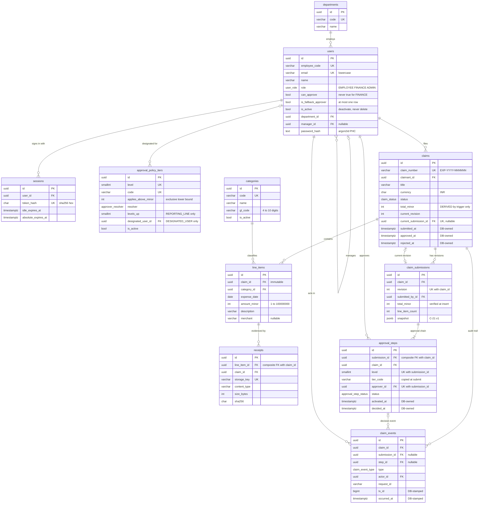
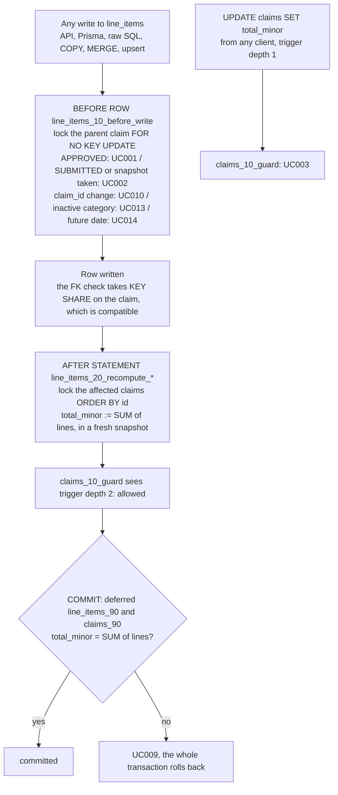
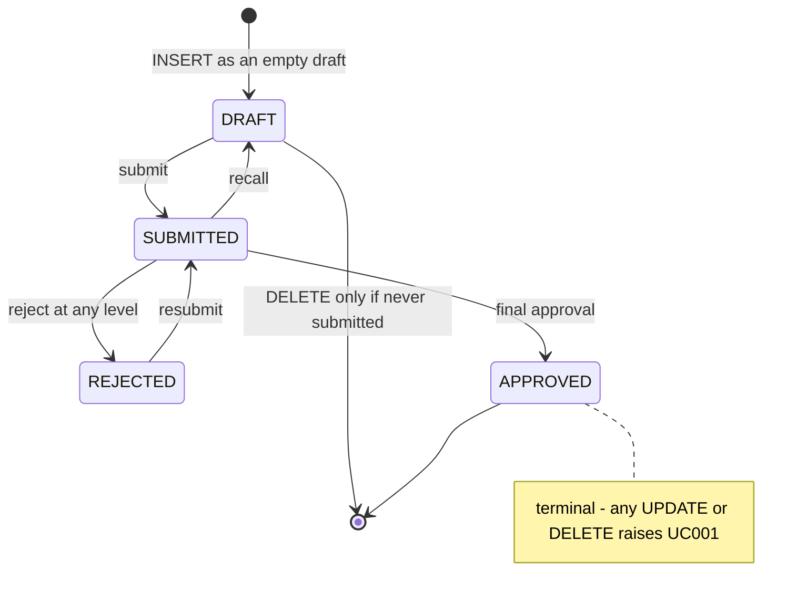

# 03 · Data model and integrity

> **What this doc owns:** the schema, the claim-total design (requirements §3.1, §4, §6), every guarantee the database itself enforces (approved lock, state machine, chain shape, snapshot, audit completeness), DB roles and grants, indexes, migrations, the seed and the load dataset. Decision ids (`D-xx`) and contract ids (`C-xx`) refer to the canonical set used by every doc.
> **Proof status:** the SQL in [§16](#16-verified-sql-migration-by-migration) and the schema in [§3](#3-prisma-schema) were executed on a real PostgreSQL 18.4 with Prisma 7.10.0. **127/127 tests passed**, with every attack run as the least-privilege role `expense_app` (up to 12 concurrent connections), and `prisma migrate diff` reported no drift. P0 re-ran the ported spike on `postgres:18.6-trixie` (digest-pinned) through Testcontainers: TC-I00 (a)–(e), TC-I06, TC-I07 and TC-I08 green, and the drift rule (§11.4) printed "No difference detected" ([§14](#14-tests-that-pin-this-doc)).
> **Related:** [01 Architecture and stack](./01-architecture-and-stack.md) · [02 Domain and workflow](./02-domain-and-workflow.md) · [04 Security and API](./04-security-and-api.md) · [05 Frontend](./05-frontend.md) · [06 Cross-cutting](./06-cross-cutting.md) · [07 Testing](./07-testing.md) · [PLAN](../../PLAN.md)

**Contents**
1. [Decisions at a glance](#1-decisions-at-a-glance)
2. [Entity-relationship model](#2-entity-relationship-model)
3. [Prisma schema](#3-prisma-schema)
4. [The claim total (§3.1, §4, §6)](#4-the-claim-total-31-4-6)
5. [DB-level lock and state enforcement](#5-db-level-lock-and-state-enforcement)
6. [Constraints](#6-constraints)
7. [SQLSTATE ↔ API mapping and Prisma 7 error shapes](#7-sqlstate--api-mapping-and-prisma-7-error-shapes)
8. [Database roles, grants and credential separation](#8-database-roles-grants-and-credential-separation)
9. [Index plan](#9-index-plan)
10. [Money, dates and time zones](#10-money-dates-and-time-zones)
11. [Migrations, drift and the test database](#11-migrations-drift-and-the-test-database)
12. [Seed plan](#12-seed-plan)
13. [Two-year load dataset generator](#13-two-year-load-dataset-generator)
14. [Tests that pin this doc](#14-tests-that-pin-this-doc)
15. [Walkthrough crib](#15-walkthrough-crib)
16. [Verified SQL, migration by migration](#16-verified-sql-migration-by-migration)

---

## 1. Decisions at a glance

| # | Decision | Why (the sentence to say) | Ref |
|---|---|---|---|
| 1 | **The claim total is stored** in `claims.total_minor` and written **only** by Postgres statement triggers on `line_items`. A guard refuses every other write (UC003), a deferred check re-verifies it at COMMIT (UC009), and the view `v_claim_total_drift` audits it | Routing, queues, sorting and the export need a cheap number, and an approval needs a frozen one. Making the database the only writer covers every code path: the API, Prisma, raw SQL, COPY, MERGE and concurrent transactions | D-12 |
| 2 | **Plan B gate:** switch to compute-on-read if the five spike tests aren't green by the Plan B gate ([PLAN §5](../../PLAN.md#decision-gates)) | §4 allows either design, and a hard gate stops the core hard case eating the schedule. The SQL proof says Plan B isn't needed | D-13 |
| 3 | **APPROVED is terminal inside the database.** `claims_guard` and the child-row triggers lock the parent claim and refuse (UC001). SUBMITTED content is frozen (UC002) | "Read-only" has to hold for raw SQL too, not just for the UI and the API | D-15, D-16, D-21 |
| 4 | **The submission snapshot** is built by the service, verified by the DB against the live rows, INSERT-only, and frozen once taken | The app can't forge "what was submitted", and history survives every later edit | D-18 |
| 5 | **Chain backstop:** step count = applicable active tiers; approver eligibility is checked at insert **and** at decision time | Under-approval and segregation-of-duties breaks stay impossible even if `buildChain()` has a bug | D-21 |
| 6 | **Audit:** one writer (the service, in the same transaction). The DB makes events append-only and DB-stamped, and refuses COMMIT without them (UC015) | Services can't forget an event or rewrite one | D-22 |
| 7 | **Transition timestamps are owned by the DB** for `expense_app` | No code path can backdate an approval into an already-exported period | D-23 |
| 8 | **Money** is int4 paise; **ids** are `uuidv7()`; **claim numbers** come from a sequence | No float drift; time-ordered keys; lock-free numbering where gaps are fine | D-09, D-11 |
| 9 | **Instants** are `timestamptz(3)` in UTC; **calendar dates** are `date`; the business time zone `Asia/Kolkata` is a code constant | Milliseconds round-trip through JS `Date` (keyset cursors rely on it), and finance thinks in IST days | D-10 |
| 10 | **Locking:** READ COMMITTED, and the claim row is locked `FOR NO KEY UPDATE` first | The claim row is the mutex. NO KEY UPDATE doesn't deadlock with the `KEY SHARE` lock that FK checks take | D-14 |
| 11 | **Three roles.** The app role owns nothing and gets per-table DML only | That is what makes "provably impossible" true against raw SQL from the app's own connection | D-34, D-35 |
| 12 | **Function hardening:** every relation is schema-qualified, `search_path` is pinned, and PUBLIC has no TEMP or CREATE | A temp table named `claims` can't fool a trigger | D-36 |
| 13 | **Migrations:** `prisma migrate dev --create-only` plus hand SQL; explicit grants; never `db push` or `db pull` | Hand SQL replays in the shadow DB, so drift detection stays quiet | D-37 |
| 14 | **Seed** runs as the owner in two parts: reference data (`seedReference()`) on every release, and the cast + demo claims through the real services with a `SeedClock` only on an empty local DB; there is one `@acme.test` cast | Seed data obeys the same integrity rules as production, and every environment has the tiers the boot check needs | D-45 |
| 15 | **Load data** goes into a separate DB, `expense_perf`, as the owner, with **all triggers on** | Query plans are proven on data that passed every rule | D-48 |
| 16 | **No Row-Level Security** ([04 §5.7](./04-security-and-api.md#57-postgresql-row-level-security--evaluated-not-planned-d-46)) | The AND-composed visibility predicate already meets §6 | D-46 |

---

## 2. Entity-relationship model

### 2.1 ERD



The optional `export_runs` table (buffer day) is left out of the diagram.

### 2.2 Tables, writers and mutability

| Table | Holds | `expense_app` may | Mutability rule (enforced by) |
|---|---|---|---|
| `departments` | org units | SELECT | owner-only writes (grants) |
| `users` | people, `role`, `can_approve`, `is_fallback_approver`, `manager_id` | SELECT | owner-only writes. Users are deactivated, never deleted: every FK to `users` from claims, submissions, steps, events and receipts is RESTRICT. Segregation-of-duties CHECKs |
| `sessions` | `sha256(token)` of opaque session cookies ([04 §2.2](./04-security-and-api.md#22-session-model-srcserverauthsessionts)) | SELECT, INSERT, UPDATE, DELETE | none |
| `categories` | expense categories with GL code | SELECT | owner-only; retire with `is_active = false`, never delete |
| `approval_policy_tiers` | the routing policy, one row per tier (C-13) | SELECT | owner-only: a migration or `pnpm policy:activate-tier` |
| `claims` | header, status, **derived** total, revision pointer | SELECT, INSERT, UPDATE, DELETE | `claims_10_guard`: state machine, derived total, immutable identity, DB-owned timestamps, deletable only as a never-submitted draft |
| `line_items` | expense lines | SELECT, INSERT, UPDATE, DELETE | writable only while the claim is DRAFT/REJECTED and not mid-submit (UC001/UC002); `claim_id` immutable (UC010) |
| `receipts` | object-store metadata per line ([06 §5](./06-cross-cutting.md#5-receipts-d-30-d-31)) | SELECT, INSERT, DELETE | same lock as lines; a receipt never moves; no UPDATE grant |
| `claim_submissions` | one verified, frozen snapshot per revision | SELECT, INSERT | INSERT-only (no grant, plus UC007) |
| `approval_steps` | the chain of one submission | SELECT, INSERT, UPDATE | whitelisted transitions; decided and cancelled steps are immutable; no DELETE |
| `claim_events` | the audit trail ([02 §10](./02-domain-and-workflow.md#10-audit-trail)) | SELECT, INSERT | append-only and DB-stamped; completeness checked at COMMIT |

### 2.3 Conventions

- **Names:** a table is `snake_case` plural and its Prisma model is `PascalCase` singular (`@@map`); a column is `snake_case` and its field is camelCase (`@map`).
- **Primary keys:** `id uuid DEFAULT uuidv7()`, generated by Postgres 18 for every insert path (Prisma, raw SQL, seed, perf generator).
- **Types:** instants are `timestamptz(3)`; calendar dates are `date`; money is int4 paise; statuses are Postgres enums (C-02). `created_at DEFAULT now()`. `updated_at` is maintained by Prisma `@updatedAt`; it is informational and never used for concurrency.
- **Trigger names:** `<table>_<NN>_<purpose>`. Triggers of the same kind fire in name order, so `NN` fixes the order: `00` append-only guard, `10` BEFORE guards, `20` total recompute, `90` total check, `95` audit check.
- **Raised errors:** `ERRCODE = 'UCnnn'`, `MESSAGE = '<API_CODE>: …'` ([§7](#7-sqlstate--api-mapping-and-prisma-7-error-shapes)).
- **Client:** generated to `src/generated/prisma` (generator `prisma-client`) and imported as `@/generated/prisma/client`. Only `src/server/repositories/**` and `src/server/db/**` may import it; lint enforces this ([01 §7](./01-architecture-and-stack.md#7-layering-rules-and-how-lint-enforces-them)).

---

## 3. Prisma schema

### 3.1 `prisma/schema.prisma` (verified)

This is the verified file, verbatim. `prisma validate` and `prisma format --check` pass, and `prisma migrate diff` from both the live DB and the replayed migrations to this file is empty. It is staged across migrations: `init` (P0) creates the first six models, `workflow` (P3) adds the four workflow enums, tiers, submissions, steps, events and the `current_submission_id` FK, and `receipts` (P6) adds `Receipt`. In P0 the file holds only the P0 models.

```prisma
// prisma/schema.prisma — Expense Claims POC · Prisma ORM 7.10.0 · PostgreSQL 18
//
// Conventions (canonical C-03):
//   table snake_case plural  <-> model PascalCase singular (@@map)
//   column snake_case        <-> field camelCase (@map)
//   every PK uuid DEFAULT uuidv7() generated by Postgres 18
//   every instant timestamptz(3); calendar dates are `date`; money is Int minor units (paise)
//
// Prisma does NOT model the integrity layer. It lives only in prisma/migrations/*/migration.sql
// (hand-appended after `prisma migrate dev --create-only`) and is proven by the integration tests:
//   CHECK constraints · sequence claim_number_seq · functions + triggers · view v_claim_total_drift · GRANTs
// Never use `prisma db push` or `prisma db pull`: both lose that layer.
//
// Fields marked DERIVED / DB-OWNED are written by Postgres triggers. Never write them from TypeScript.
//
// Migration staging (C-23): 0001_init = departments, users, sessions, categories, claims, line_items
// (claims.current_submission_id exists but has no FK yet); 0004_workflow = the four workflow enums,
// approval_policy_tiers, claim_submissions, approval_steps, claim_events + the current_submission FK;
// 0005_receipts = receipts. Verified: `prisma migrate diff` DB→schema and migrations→schema are empty.

generator client {
  provider        = "prisma-client"
  output          = "../src/generated/prisma"
  moduleFormat    = "esm"
  previewFeatures = ["partialIndexes"]
}

datasource db {
  provider = "postgresql"
  // URL: prisma.config.ts (CLI, owner role) and the PrismaPg adapter (runtime, expense_app role)
}

enum UserRole {
  EMPLOYEE
  FINANCE
  ADMIN

  @@map("user_role")
}

enum ClaimStatus {
  DRAFT
  SUBMITTED
  APPROVED
  REJECTED

  @@map("claim_status")
}

enum ApprovalStepStatus {
  WAITING
  PENDING
  APPROVED
  REJECTED
  CANCELLED

  @@map("approval_step_status")
}

enum ApproverResolver {
  REPORTING_LINE
  DESIGNATED_USER

  @@map("approver_resolver")
}

enum ClaimEventType {
  CLAIM_SUBMITTED
  CLAIM_RESUBMITTED
  STEP_APPROVED
  CLAIM_APPROVED
  CLAIM_REJECTED
  CLAIM_RECALLED

  @@map("claim_event_type")
}

enum EventActorRole {
  CLAIMANT
  APPROVER

  @@map("event_actor_role")
}

model Department {
  id        String   @id @default(dbgenerated("uuidv7()")) @db.Uuid
  code      String   @unique @db.VarChar(16)
  name      String   @db.VarChar(120)
  createdAt DateTime @default(now()) @map("created_at") @db.Timestamptz(3)

  users User[]

  @@map("departments")
}

/// Users are deactivated, never deleted. expense_app has SELECT only (C-16).
model User {
  id                 String   @id @default(dbgenerated("uuidv7()")) @db.Uuid
  employeeCode       String   @unique @map("employee_code") @db.VarChar(20)
  /// CHECK users_email_lowercase
  email              String   @unique @db.VarChar(254)
  name               String   @db.VarChar(120)
  role               UserRole @default(EMPLOYEE)
  /// CHECK users_finance_cannot_approve
  canApprove         Boolean  @default(false) @map("can_approve")
  /// CHECK users_fallback_must_approve; partial UNIQUE users_one_fallback_approver
  isFallbackApprover Boolean  @default(false) @map("is_fallback_approver")
  isActive           Boolean  @default(true) @map("is_active")
  departmentId       String   @map("department_id") @db.Uuid
  /// CHECK users_not_own_manager
  managerId          String?  @map("manager_id") @db.Uuid
  passwordHash       String?  @map("password_hash")
  createdAt          DateTime @default(now()) @map("created_at") @db.Timestamptz(3)
  updatedAt          DateTime @default(now()) @updatedAt @map("updated_at") @db.Timestamptz(3)

  department    Department           @relation(fields: [departmentId], references: [id], onDelete: Restrict)
  manager       User?                @relation("UserManager", fields: [managerId], references: [id], onDelete: Restrict)
  reports       User[]               @relation("UserManager")
  sessions      Session[]
  claims        Claim[]              @relation("ClaimClaimant")
  designatedFor ApprovalPolicyTier[] @relation("TierDesignatedUser")
  submissions   ClaimSubmission[]    @relation("SubmissionSubmitter")
  approvalSteps ApprovalStep[]       @relation("StepApprover")
  events        ClaimEvent[]         @relation("EventActor")
  receipts      Receipt[]            @relation("ReceiptUploader")

  @@unique([isFallbackApprover], map: "users_one_fallback_approver", where: raw("is_fallback_approver"))
  @@index([managerId])
  @@map("users")
}

/// Opaque DB sessions (D-05): the cookie holds a random token; only sha256(token) hex is stored.
model Session {
  id                String   @id @default(dbgenerated("uuidv7()")) @db.Uuid
  userId            String   @map("user_id") @db.Uuid
  tokenHash         String   @unique @map("token_hash") @db.Char(64)
  createdAt         DateTime @default(now()) @map("created_at") @db.Timestamptz(3)
  lastSeenAt        DateTime @default(now()) @map("last_seen_at") @db.Timestamptz(3)
  idleExpiresAt     DateTime @map("idle_expires_at") @db.Timestamptz(3)
  absoluteExpiresAt DateTime @map("absolute_expires_at") @db.Timestamptz(3)
  userAgent         String?  @map("user_agent") @db.VarChar(512)

  user User @relation(fields: [userId], references: [id], onDelete: Cascade)

  @@index([userId])
  @@map("sessions")
}

model Category {
  id        String  @id @default(dbgenerated("uuidv7()")) @db.Uuid
  code      String  @unique @db.VarChar(32)
  name      String  @db.VarChar(80)
  /// CHECK categories_gl_code_format
  glCode    String  @map("gl_code") @db.VarChar(20)
  isActive  Boolean @default(true) @map("is_active")
  sortOrder Int     @default(0) @map("sort_order") @db.SmallInt

  lineItems LineItem[]

  @@map("categories")
}

/// Data-driven routing policy (D-19). The chain = every active tier with claim total > appliesAboveMinor,
/// ordered by level. expense_app has SELECT only; tiers change via migrations or `pnpm policy:activate-tier`.
model ApprovalPolicyTier {
  id                String           @id @default(dbgenerated("uuidv7()")) @db.Uuid
  level             Int              @unique @db.SmallInt
  code              String           @unique @db.VarChar(32)
  label             String           @db.VarChar(80)
  /// exclusive lower bound, paise
  appliesAboveMinor Int              @map("applies_above_minor")
  resolver          ApproverResolver
  levelsUp          Int?             @map("levels_up") @db.SmallInt
  designatedUserId  String?          @map("designated_user_id") @db.Uuid
  isActive          Boolean          @default(true) @map("is_active")
  createdAt         DateTime         @default(now()) @map("created_at") @db.Timestamptz(3)

  designatedUser User? @relation("TierDesignatedUser", fields: [designatedUserId], references: [id], onDelete: Restrict)

  @@map("approval_policy_tiers")
}

model Claim {
  id                  String      @id @default(dbgenerated("uuidv7()")) @db.Uuid
  /// DB-OWNED: drawn from claim_number_seq by the column default next_claim_number()
  claimNumber         String      @unique @default(dbgenerated("next_claim_number()")) @map("claim_number") @db.VarChar(24)
  claimantId          String      @map("claimant_id") @db.Uuid
  title               String      @db.VarChar(120)
  currency            String      @default("INR") @db.Char(3)
  status              ClaimStatus @default(DRAFT)
  /// DERIVED — written only by the line_items recompute trigger (UC003 otherwise). Never write it.
  totalMinor          Int         @default(0) @map("total_minor")
  currentRevision     Int         @default(0) @map("current_revision")
  currentSubmissionId String?     @unique @map("current_submission_id") @db.Uuid
  /// DB-OWNED transition timestamps (stamped with now() for expense_app; UC010 outside their transition)
  submittedAt         DateTime?   @map("submitted_at") @db.Timestamptz(3)
  approvedAt          DateTime?   @map("approved_at") @db.Timestamptz(3)
  rejectedAt          DateTime?   @map("rejected_at") @db.Timestamptz(3)
  createdAt           DateTime    @default(now()) @map("created_at") @db.Timestamptz(3)
  updatedAt           DateTime    @default(now()) @updatedAt @map("updated_at") @db.Timestamptz(3)

  claimant          User              @relation("ClaimClaimant", fields: [claimantId], references: [id], onDelete: Restrict)
  currentSubmission ClaimSubmission?  @relation("ClaimCurrentSubmission", fields: [currentSubmissionId], references: [id], onDelete: Restrict)
  submissions       ClaimSubmission[] @relation("ClaimSubmissions")
  lineItems         LineItem[]
  approvalSteps     ApprovalStep[]    @relation("StepClaim")
  events            ClaimEvent[]      @relation("EventClaim")

  @@index([claimantId, createdAt(sort: Desc), id(sort: Desc)], map: "claims_claimant_list_idx")
  @@index([status, submittedAt(sort: Desc), id(sort: Desc)], map: "claims_finance_list_idx")
  @@index([submittedAt(sort: Desc), id(sort: Desc)], map: "claims_submitted_idx")
  @@index([approvedAt, id], map: "claims_export_idx")
  @@map("claims")
}

model LineItem {
  id          String   @id @default(dbgenerated("uuidv7()")) @db.Uuid
  /// immutable (UC010)
  claimId     String   @map("claim_id") @db.Uuid
  categoryId  String   @map("category_id") @db.Uuid
  expenseDate DateTime @map("expense_date") @db.Date
  /// CHECK line_items_amount_range 1..100000000
  amountMinor Int      @map("amount_minor")
  description String   @db.VarChar(500)
  merchant    String?  @db.VarChar(120)
  createdAt   DateTime @default(now()) @map("created_at") @db.Timestamptz(3)
  updatedAt   DateTime @default(now()) @updatedAt @map("updated_at") @db.Timestamptz(3)

  claim    Claim     @relation(fields: [claimId], references: [id], onDelete: Cascade)
  category Category  @relation(fields: [categoryId], references: [id], onDelete: Restrict)
  receipts Receipt[]

  @@unique([id, claimId], map: "line_items_id_claim_id_key")
  @@index([claimId, expenseDate, id], map: "line_items_claim_idx")
  @@map("line_items")
}

/// A receipt row exists only for an uploaded, verified object (no status column in core).
/// claimId is kept consistent with the line by the composite FK (line_item_id, claim_id).
model Receipt {
  id           String   @id @default(dbgenerated("uuidv7()")) @db.Uuid
  claimId      String   @map("claim_id") @db.Uuid
  lineItemId   String   @map("line_item_id") @db.Uuid
  storageKey   String   @unique @map("storage_key") @db.VarChar(512)
  fileName     String   @map("file_name") @db.VarChar(255)
  contentType  String   @map("content_type") @db.VarChar(100)
  sizeBytes    Int      @map("size_bytes")
  sha256       String   @db.Char(64)
  uploadedById String   @map("uploaded_by_id") @db.Uuid
  createdAt    DateTime @default(now()) @map("created_at") @db.Timestamptz(3)

  lineItem   LineItem @relation(fields: [lineItemId, claimId], references: [id, claimId], onDelete: Cascade)
  uploadedBy User     @relation("ReceiptUploader", fields: [uploadedById], references: [id], onDelete: Restrict)

  @@index([lineItemId], map: "receipts_line_item_idx")
  @@map("receipts")
}

/// One row per (re)submission. INSERT-only (UC007). Service-built snapshot, DB-verified (UC016).
model ClaimSubmission {
  id            String   @id @default(dbgenerated("uuidv7()")) @db.Uuid
  claimId       String   @map("claim_id") @db.Uuid
  revision      Int
  submittedById String   @map("submitted_by_id") @db.Uuid
  /// DB-OWNED for expense_app
  submittedAt   DateTime @default(now()) @map("submitted_at") @db.Timestamptz(3)
  totalMinor    Int      @map("total_minor")
  currency      String   @db.Char(3)
  lineItemCount Int      @map("line_item_count")
  /// Submission snapshot JSON v1 (C-21)
  snapshot      Json     @db.JsonB
  createdAt     DateTime @default(now()) @map("created_at") @db.Timestamptz(3)

  claim       Claim          @relation("ClaimSubmissions", fields: [claimId], references: [id], onDelete: Restrict)
  currentFor  Claim?         @relation("ClaimCurrentSubmission")
  submittedBy User           @relation("SubmissionSubmitter", fields: [submittedById], references: [id], onDelete: Restrict)
  steps       ApprovalStep[] @relation("StepSubmission")
  events      ClaimEvent[]   @relation("EventSubmission")

  @@unique([claimId, revision])
  @@unique([id, claimId], map: "claim_submissions_id_claim_id_key")
  @@map("claim_submissions")
}

/// The approval chain of one submission. Never deleted (UC007). Tier fields are copied at submit.
model ApprovalStep {
  id                String             @id @default(dbgenerated("uuidv7()")) @db.Uuid
  claimId           String             @map("claim_id") @db.Uuid
  submissionId      String             @map("submission_id") @db.Uuid
  level             Int                @db.SmallInt
  tierCode          String             @map("tier_code") @db.VarChar(32)
  tierLabel         String             @map("tier_label") @db.VarChar(80)
  appliesAboveMinor Int                @map("applies_above_minor")
  approverId        String             @map("approver_id") @db.Uuid
  /// PRIMARY | ESCALATED | FALLBACK (CHECK steps_resolved_via)
  resolvedVia       String             @map("resolved_via") @db.VarChar(16)
  status            ApprovalStepStatus
  /// DB-OWNED transition timestamps for expense_app
  activatedAt       DateTime?          @map("activated_at") @db.Timestamptz(3)
  decidedAt         DateTime?          @map("decided_at") @db.Timestamptz(3)
  cancelledAt       DateTime?          @map("cancelled_at") @db.Timestamptz(3)
  comment           String?            @db.VarChar(1000)
  rejectionReason   String?            @map("rejection_reason") @db.VarChar(1000)
  createdAt         DateTime           @default(now()) @map("created_at") @db.Timestamptz(3)

  claim      Claim           @relation("StepClaim", fields: [claimId], references: [id], onDelete: Restrict)
  submission ClaimSubmission @relation("StepSubmission", fields: [submissionId, claimId], references: [id, claimId], onDelete: Restrict)
  approver   User            @relation("StepApprover", fields: [approverId], references: [id], onDelete: Restrict)
  events     ClaimEvent[]    @relation("EventStep")

  @@unique([submissionId, level])
  @@unique([submissionId, approverId])
  @@unique([submissionId], map: "approval_steps_one_pending_per_submission", where: raw("(status = 'PENDING'::approval_step_status)"))
  @@index([approverId, activatedAt, id], map: "approval_steps_pending_queue_idx", where: raw("(status = 'PENDING'::approval_step_status)"))
  @@index([approverId, decidedAt(sort: Desc), id(sort: Desc)], map: "approval_steps_approver_history_idx")
  @@index([claimId, approverId], map: "approval_steps_visibility_idx")
  @@map("approval_steps")
}

/// Append-only audit trail (UC007). Written by the service's recordEvent() in the same transaction;
/// occurred_at and tx_id are stamped by the DB for expense_app; deferred triggers prove completeness (UC015).
model ClaimEvent {
  id           String         @id @default(dbgenerated("uuidv7()")) @db.Uuid
  claimId      String         @map("claim_id") @db.Uuid
  submissionId String?        @map("submission_id") @db.Uuid
  stepId       String?        @map("step_id") @db.Uuid
  revision     Int
  type         ClaimEventType
  actorId      String         @map("actor_id") @db.Uuid
  actorRole    EventActorRole @map("actor_role")
  fromStatus   ClaimStatus    @map("from_status")
  toStatus     ClaimStatus    @map("to_status")
  totalMinor   Int            @map("total_minor")
  reason       String?        @db.VarChar(1000)
  payload      Json           @default("{}") @db.JsonB
  requestId    String         @map("request_id") @db.VarChar(64)
  /// DB-OWNED for expense_app
  txId         BigInt         @default(dbgenerated("((pg_current_xact_id())::text)::bigint")) @map("tx_id")
  /// DB-OWNED for expense_app
  occurredAt   DateTime       @default(now()) @map("occurred_at") @db.Timestamptz(3)

  claim      Claim            @relation("EventClaim", fields: [claimId], references: [id], onDelete: Restrict)
  submission ClaimSubmission? @relation("EventSubmission", fields: [submissionId], references: [id], onDelete: Restrict)
  step       ApprovalStep?    @relation("EventStep", fields: [stepId], references: [id], onDelete: Restrict)
  actor      User             @relation("EventActor", fields: [actorId], references: [id], onDelete: Restrict)

  @@index([claimId, occurredAt, id], map: "claim_events_timeline_idx")
  @@map("claim_events")
}
```

### 3.2 Notes on the schema

- **Prisma doesn't model the integrity layer.** CHECKs, the sequence, functions, triggers, the view and grants live only in migration SQL ([§16](#16-verified-sql-migration-by-migration)). The `///` comments flag them so nobody "simplifies" a column.
- **Never write a DERIVED or DB-OWNED field from TypeScript:** `totalMinor` on `Claim`, the claim number, and the transition timestamps. The DB would refuse or overwrite the value anyway ([§5.6](#56-values-the-database-owns)). Prisma omits `claimNumber` on create because it is `dbgenerated`, so the column DEFAULT draws the number.
- **Partial indexes use the `partialIndexes` preview.** The `where: raw("(status = 'PENDING'::approval_step_status)")` spelling must match what Postgres stores, character for character; any other spelling shows up as drift. Fallback: hand-written SQL plus a non-partial schema index (D-37).
- **`ApprovalStep.claimId` sits in two relations:** the plain FK to `claims` and the composite FK `(submission_id, claim_id)`. `prisma validate` accepts this. If a future Prisma rejects it, drop the plain relation and reach the claim through the submission.
- **`expenseDate` is `@db.Date`,** which Prisma returns as a JS `Date` at 00:00Z. Repositories convert it to and from `YYYY-MM-DD` strings; services and DTOs never carry `Date` objects for calendar dates ([§10](#10-money-dates-and-time-zones)).
- **`ClaimEvent.txId` is a `BigInt`.** No DTO exposes it; the history DTO omits it.
- **Prisma emits `ON UPDATE CASCADE` on every FK.** This is harmless: every referenced id is immutable (UC010) or not writable by the app. It is left as generated so the schema stays free of noise.

---

## 4. The claim total (§3.1, §4, §6)

The spec's hardest line: *no code path, including a direct API call, can leave a claim's total different from the sum of its line items.*

### 4.1 Stored or computed?

| | Compute on read | **Stored, maintained by the DB (chosen)** | Stored, maintained by the app |
|---|---|---|---|
| Can it drift? | No, by construction | **No.** Every write path fires the triggers, direct writes are refused, and COMMIT re-checks the invariant | **Yes.** Any path that forgets drifts it: raw SQL, a script, a new endpoint, a Prisma nested write, a race |
| Read cost | `SUM … GROUP BY` on every list, queue, export and routing query; can't index or sort by amount | O(1) column | O(1) |
| Frozen number for the approval | Still needed, so you store a snapshot anyway and must prove it matches | The snapshot is verified against the same locked rows in the same transaction | Same problem, plus drift |
| Concurrency | trivial | needs a claim-row lock before the SUM ([§4.6](#46-concurrency-under-read-committed)) | the same care, but only in the code paths that remember it |

Also rejected: a **generated column** (it can't reference other tables); a **materialized view** (stale until refreshed); **`CREATE ASSERTION`** (not implemented in Postgres); **delta triggers** (`total = total + NEW.amount`). Delta triggers are concurrency-safe, but they are not self-healing: one missed path leaves a permanent error that every later delta carries forward.

> **Say it like this:** "We store the total because routing, queues, sorting and the export need a cheap number, and an approval needs a frozen one. Only Postgres can write it. It recalculates from the lines inside the same transaction, refuses every other write, and re-checks the invariant at COMMIT. Compute-on-read still exists, as the auditor view `v_claim_total_drift`, which must always be empty."

### 4.2 The chosen design



Six layers, in the order a write meets them:

1. **The app never sends a total.** Strict Zod refuses `totalMinor`, `total` and `total_minor` with 422 `TOTAL_IS_DERIVED` ([04 §10](./04-security-and-api.md#10-validation)), and no service or repository writes the column.
2. **Recompute** (`line_items_recompute_claim_totals`, function #3) is the only writer ([§4.3](#43-the-recompute-trigger-the-only-writer)).
3. **Guard** (`claims_guard`, function #4): a total change at `pg_trigger_depth() < 2` raises UC003, and so does an insert with a total ≠ 0. This applies to every role ([§4.4](#44-the-guard-who-may-write-total_minor)).
4. **Commit-time backstop** (`assert_claim_total_consistent`, function #5): deferred constraint triggers raise UC009 if `total_minor ≠ Σ lines` at COMMIT ([§4.5](#45-the-commit-time-backstop)).
5. **Privileges:** the app role can't disable triggers, truncate, create objects or use temp tables, so it can't switch layers 2–4 off ([§8](#8-database-roles-grants-and-credential-separation)).
6. **Auditor and detection:** `v_claim_total_drift` must always be empty. It is read by `afterEach(assertTotalsInSync)` in every integration test and by `pnpm verify:integrity`, and `/api/health/ready` goes 503 if any integrity trigger is disabled ([06 §3](./06-cross-cutting.md#3-health-readiness-and-shutdown-d-41)).

### 4.3 The recompute trigger: the only writer

The heart of function #3 (full text in [§16.3](#163-migration-2-integrity_core-p0)):

```sql
PERFORM 1 FROM public.claims c WHERE c.id = ANY (v_claim_ids) ORDER BY c.id FOR NO KEY UPDATE;

UPDATE public.claims c
   SET total_minor = s.total
  FROM (SELECT ids.id, COALESCE(SUM(li.amount_minor), 0)::integer AS total
          FROM unnest(v_claim_ids) AS ids(id)
          LEFT JOIN public.line_items li ON li.claim_id = ids.id
         GROUP BY ids.id) AS s
 WHERE c.id = s.id
   AND c.total_minor IS DISTINCT FROM s.total;
```

- **Statement level, with transition tables.** A `createMany` of 10 lines, or a 1,000-claim perf batch, costs **one** lock + SUM + UPDATE per claim, not one per row. Postgres doesn't allow transition tables on a multi-event trigger, so there are three triggers (`…_after_insert`, `…_after_update`, `…_after_delete`) sharing one function.
- **Full recompute, never deltas.** Each run derives the total from the source of truth, so it is self-healing.
- **Claims are locked in `id` order,** so two multi-claim statements can't deadlock against each other.
- **The SUM is a new statement inside a volatile function,** so under READ COMMITTED it gets a fresh snapshot, taken after the lock was granted. It sees every committed line plus our own.
- **The UPDATE branch recomputes both the old and the new parent** whenever `amount_minor` or `claim_id` changed. Moves are already refused (UC010), so this is defence in depth that costs nothing. A description-only edit triggers no recompute.
- **Overflow fails closed.** A total over ₹1 crore violates `claims_total_range` (23514), and a SUM past int4 raises 22003. Both map to 422 `VALIDATION_FAILED`, never 500, and the stored total is unchanged (proof A9).

### 4.4 The guard: who may write `total_minor`

`claims_guard` has to tell "the recompute trigger is writing" apart from "anyone else is writing".

| Mechanism | How it decides | Can app SQL spoof it? | Verdict |
|---|---|---|---|
| Transaction-local flag `set_config('app.recalc', 'on', true)` | `current_setting('app.recalc', true) = 'on'` | **Yes.** Custom GUCs are settable by any role. Proof B4 sets the flag and still gets UC003, because the flag grants nothing | Rejected: a GUC can carry context, never authority |
| **`pg_trigger_depth() < 2` → refuse** | the UPDATE runs inside a trigger, and only the recompute trigger updates `total_minor` | **No**, as long as (1) the app owns nothing and has no TRIGGER privilege, so it can't add triggers; (2) no trigger runs SQL taken from data; (3) every function is schema-qualified with a pinned `search_path` | **Chosen** |
| `SECURITY DEFINER` recompute + a `current_user` gate | role identity | No | Equally strong, more moving parts; kept as the fallback |

The guard is a **rule, not a privilege**: the owner gets UC003 too (proof B2). A CTE that inserts a line and then writes the total is refused (B3). On an APPROVED claim the earlier UC001 check fires first (B5). Code-review rule: no other trigger may assign `total_minor`, and if one ever did, the deferred check would still reject a wrong value.

### 4.5 The commit-time backstop

`assert_claim_total_consistent()` runs as `DEFERRABLE INITIALLY DEFERRED` constraint triggers on `line_items` (insert, delete, or update of `amount_minor` or `claim_id`) and on `claims` (when `total_minor` changes).

- **Why deferred:** the invariant only has to hold at COMMIT, and between a row write and the end-of-statement recompute it is briefly false. Non-deferred constraint triggers are AFTER ROW triggers, which fire *before* AFTER STATEMENT triggers, so an immediate check would see that intermediate state and fail.
- **What it catches that nothing else does:** a failure of the primary mechanism itself. In proofs A11 and P0-c the owner disables the recompute trigger inside a transaction and inserts a line. COMMIT fails with UC009, and because DDL is transactional the `DISABLE` rolls back with it (`tgenabled = 'O'` afterwards).
- **Nothing can slip in between the recompute and the check:** the claim row stays locked until COMMIT, so no other writer can change that claim's lines in the gap.
- **Cost:** one indexed SUM per changed line at COMMIT. The perf generator therefore commits in batches, because deferred-trigger events queue in memory until COMMIT.
- **Foot-gun (proof J13):** running `SET CONSTRAINTS ALL IMMEDIATE` *before* a line write raises a spurious UC009 at the end of the statement. It fails closed, but app code must never call `SET CONSTRAINTS`.
- **Limit:** an owner or superuser who disables *both* the recompute trigger and the deferred trigger can still drift a total. That is detected, not prevented: the readiness probe, `v_claim_total_drift`, and owner credentials that never reach the app ([§8.5](#85-residual-risk)).

### 4.6 Concurrency under READ COMMITTED

**Three Postgres facts the design relies on:**
1. Under READ COMMITTED, **every statement inside a VOLATILE function takes a fresh snapshot**, and trigger functions are volatile.
2. A statement that waits for a row lock re-checks **only that row** after the holder commits (EvalPlanQual). Sub-selects keep the statement's original snapshot.
3. FK checks take `FOR KEY SHARE` on the parent row. `FOR NO KEY UPDATE` conflicts with itself but **not** with `KEY SHARE`; `FOR UPDATE` conflicts with both.

**Scenario A: a naive trigger** (`UPDATE claims SET total_minor = (SELECT SUM …)` with no lock taken first). Two inserts into claim C, which starts at 0:

| t | T1 | T2 |
|---|---|---|
| 1 | INSERT L1 (100); the SUM sees {L1}; UPDATE C = 100, which row-locks C | |
| 2 | | INSERT L2 (200); the SUM sees only {L2} because T1 hasn't committed; UPDATE C **waits** |
| 3 | COMMIT | |
| 4 | | EvalPlanQual re-checks `id = C` on the new row version and writes **200**; the SUM is not re-run. The true total is 300: a **lost update**. The deferred check catches it (UC009), but the user sees a spurious failure |

**Scenario B: the design.**

| t | T1 | T2 |
|---|---|---|
| 1 | INSERT L1. BEFORE ROW locks C `FOR NO KEY UPDATE`; status DRAFT ✓ | |
| 2 | AFTER STATEMENT re-locks C (a no-op). The new statement gets a new snapshot: SUM = 100; UPDATE C | INSERT L2. BEFORE ROW lock on C **waits** |
| 3 | COMMIT; the deferred check sees 100 = 100 ✓ | |
| 4 | | The lock is granted. The locking SELECT returns the *latest* C, so the status check sees the truth. The recompute is a new statement and sees L1 + L2 = 300 |
| 5 | | COMMIT; 300 = 300 ✓. A serial outcome with no error and no deadlock |

**Why `FOR NO KEY UPDATE` and not `FOR UPDATE`.** Each inserter already holds `KEY SHARE` on C from its own FK check. If both then asked for `FOR UPDATE`, each would wait for the other's `KEY SHARE`, a deadlock (40P01). `NO KEY UPDATE` is compatible with `KEY SHARE`, so the second writer simply queues. It is also the lock that a plain UPDATE of a non-key column takes.

**Verified interleavings.** Each ran on separate `expense_app` connections with explicit `BEGIN`. Waiting was observed, not assumed: a monitor connection saw `pg_stat_activity.wait_event_type = 'Lock'`.

| Proof | Interleaving | Result |
|---|---|---|
| D1 / P0-e | T1 inserts 100 · T2 inserts 200 (waits on the claim row) · T1 COMMIT · T2 COMMIT | total **300**; no error, no deadlock |
| D2 | the same, but T1 rolls back | total 200 |
| D3 / D4 | UPDATE vs DELETE of the same line, in both orders | the waiter re-checks the newest row version; an update of a deleted line affects 0 rows, which the service turns into 404/409; totals consistent |
| D5 | concurrent UPDATEs of *different* lines of one claim | serialized on the claim: 111 + 222 = 333 |
| D6 / D7 | line insert vs submit | insert first: submit waits, and its snapshot includes the new line. Submit first: the insert waits, then gets UC002 |
| D8 | 12 connections × 25 random insert/update/delete transactions on 3 claims, claim locked first | **0 errors**, no drift |
| D8b | the same storm, but *without* locking the claim first | 27–68 deadlocks (40P01) plus a few 55P03/57014 per run. **Never UC009, never drift** |
| D9 | two claims written in opposite order | one transaction gets 40P01, the other commits; the service retry re-runs the loser |
| D10 / D11 / D12 | double approve; approve vs recall; a lock wait past `lock_timeout` | exactly one decision; serialized in order; 55P03 → 409 `CONFLICT` |

D8b is the lesson to remember: **integrity never depended on the "claim row first" rule, but availability does.** The BEFORE ROW trigger locks the line row first and then the claim, so raw multi-row writes that skip `lockOwnedClaim` deadlock routinely. Services always lock the claim first and retry 40P01. The service-level recipe (lock, re-read, conditional updates, retries) and the API outcome of every race are in [02 §8](./02-domain-and-workflow.md#8-concurrency).

### 4.7 What the application layers add

- **Request validation:** a total-like key in any body returns 422 `TOTAL_IS_DERIVED` *before* any SQL runs, so the client gets a specific error instead of a silent strip (D-28).
- **No writer in TypeScript:** no service, repository, seed or script assigns `totalMinor`. DTOs are re-read after the write, and even a Prisma nested create returns the DB-derived total (the proof's client probe read back 4200).
- **Ordinary copies elsewhere:** `claim_submissions.total_minor` is verified equal to the claim's total at insert (UC016) and immutable after; `claim_events.total_minor` is the submission total, copied by `recordEvent`. Only `claims.total_minor` is guarded.
- **Not built:** a `forbidDerivedWrites` Prisma extension. It would be a redundant fourth layer, and on `$allModels` it would also block the legitimate `ClaimSubmission.totalMinor` and `ClaimEvent.totalMinor` writes.

### 4.8 How we prove it can't drift

The SQL proof attacked every path below as `expense_app`. Each row is re-proved in the app's own suite: §6 asks for "a test that tries", and these tests are it. The umbrella is TC-I12 › **"no code path can leave claims.total_minor different from the sum of its line items"**.

| Attack | Verified result (proof id) | Re-proved by (TC id › test name) |
|---|---|---|
| `totalMinor` in a POST or PUT body | 422 `TOTAL_IS_DERIVED` (app layer) | TC-I12 › "API: POST and PUT with totalMinor return 422 TOTAL_IS_DERIVED and persist nothing" |
| Prisma `claim.update({ totalMinor })` / `updateMany` | UC003 via P2039 (PE) | TC-I12 › "Prisma: claim.update({ totalMinor }) is refused with UC003" |
| Raw `UPDATE claims SET total_minor` as app or owner; CTE trick; `set_config` flag | UC003 (B1–B4, P0-a) | TC-I00 › "(a) app role raw UPDATE claims SET total_minor raises UC003"; TC-I12 › "raw SQL: UPDATE claims SET total_minor is refused with UC003" |
| `INSERT INTO claims` with a total ≠ 0 | UC003 (A12) | TC-I12 › "raw SQL: INSERT INTO claims with total_minor ≠ 0 is refused with UC003" |
| Insert, multi-row insert, update, delete, upsert of lines | total = Σ (A1–A4, A6) | TC-I12 › "raw SQL insert, update and delete of lines keep total = Σ lines" |
| `INSERT … SELECT`, `COPY FROM STDIN`, `MERGE` | total = Σ (A7, A8) | TC-I12 › "bulk INSERT … SELECT, COPY FROM STDIN and MERGE keep total = Σ lines" |
| Prisma `createMany` / `updateMany` / `deleteMany`; the PUT replace-set in one transaction | total = Σ (A2, A5) | TC-I12 › "Prisma createMany, updateMany and deleteMany keep total = Σ lines"; TC-I09 › "PUT replace-set inserts, updates and deletes lines in one transaction" |
| Move a line to another claim | UC010; both totals intact (C1, C2) | TC-I12 › "moving a line to another claim is refused with UC010" |
| Cascade delete of a draft | clean (A10) | TC-I12 › "cascade delete of a draft does not trip the guard" |
| Owner disables the recompute trigger | COMMIT fails with UC009 (A11, P0-c) | TC-I00 › "(c) owner-disabled recompute trigger makes COMMIT fail with UC009"; TC-I12 › "owner sabotage: with the recompute trigger disabled, COMMIT fails with UC009" |
| Overflow past the claim cap or int4 | 23514 / 22003, total unchanged (A9) | TC-I12 › "50 lines at the per-line cap exceed the claim cap and return 422, never 500" |
| `DISABLE TRIGGER`, `TRUNCATE`, `session_replication_role`, temp-table shadowing, `CREATE` | 42501 (H1–H4, P0-d) | TC-I00 › "(d) app role cannot DISABLE TRIGGER, TRUNCATE or SET session_replication_role (42501)"; TC-I07 › "expense_app has no TEMP or CREATE privilege" |
| Two concurrent writers | they serialize; 300 (D1, P0-e) | TC-I00 › "(e) two connections inserting lines into one claim serialize and the total is 300"; TC-I13 › "a second writer waits on the claim lock (visible in pg_stat_activity) and the final total is 300" |
| Write storm | 0 errors, no drift (D8) | TC-I13 › "10 parallel PUTs on one claim end with total = Σ lines" |
| Opposite-order multi-claim writers | 40P01, then the retry succeeds (D9) | TC-I13 › "inserts spanning two claims in opposite order deadlock-retry without drift" |
| Anything an integration test does | drift view empty (J12) | `afterEach(assertTotalsInSync)` on every integration test; TC-I12 › "v_claim_total_drift is empty after every case" |
| An integrity trigger disabled in a running system | readiness 503 (J9) | TC-I06 › "/api/health/ready returns 503 NOT_READY when an integrity trigger is disabled" |

Live demo: `scripts/demo/sql-attacks.sh` (psql as `expense_app` → UC003, UC001, 42501), then `pnpm verify:integrity` prints 0 rows.

### 4.9 Plan B gate (D-13)

If TC-I00 (a)–(e) aren't green on `postgres:18.6-trixie` by the **Plan B gate** ([PLAN §5](../../PLAN.md#decision-gates)), switch to compute-on-read:
- drop functions #3 and #5 and the total rule in `claims_guard`;
- add a view `claims_with_totals` (claims + `SUM(line_items.amount_minor)`);
- keep `claim_submissions.total_minor` stored immutably and verified against the snapshot at insert.

The §6 desync test then asserts "there is no mutable stored total, and submitted totals are verified at insert".

**Status:** the proof passed (a)–(e) on the P0 migration subset alone (0001–0003), and P0 re-ran them green on `postgres:18.6-trixie` through Testcontainers. Plan B is not needed.

---

## 5. DB-level lock and state enforcement

The service checks first and returns the friendly, specific code. The database repeats every rule as a backstop that no client can skip, and the SQLSTATE still maps to the **same** API code ([§7](#7-sqlstate--api-mapping-and-prisma-7-error-shapes)). The full lifecycle and the action × status table are in [02 §2](./02-domain-and-workflow.md#2-state-machines).

### 5.1 Enforcement map

| Rule | Service answer | DB backstop (function → SQLSTATE) | Test (TC id › name) |
|---|---|---|---|
| An approved claim is read-only (§3.4) | 409 `CLAIM_LOCKED` | `claims_guard` on any UPDATE/DELETE; `assert_claim_editable` called by the line, receipt and submission triggers → UC001 | TC-I11 › "raw SQL as expense_app on an APPROVED claim raises UC001"; TC-I27 › "raw DELETE FROM receipts on an APPROVED claim raises UC001" |
| Submitted content is frozen (D-16) | 409 `CLAIM_NOT_EDITABLE` | `assert_claim_editable` (SUBMITTED, or the snapshot already taken); `claims_guard` (title) → UC002 | TC-I00 › "(b) Prisma lineItem.update on a SUBMITTED claim raises UC002 and its error shape is recorded" |
| A zero-line claim can't be submitted (§6) | 422 `NO_LINE_ITEMS` | `claim_submissions_verify` and `claims_guard` → SUBMITTED → UC004 | TC-I15 › "raw UPDATE claims SET status='SUBMITTED' on an empty claim raises UC004" |
| Only whitelisted transitions | 409 `INVALID_STATUS_TRANSITION` | `claims_guard`, `approval_steps_guard` → UC005 | TC-I15 › "a raw invalid status transition raises UC005" |
| The chain matches the policy | 422 `ROUTING_UNRESOLVABLE` when no chain can be built | `claims_guard` → SUBMITTED; `approval_steps_guard` insert and activation order → UC012 | TC-I15 › "a raw chain shorter than the applicable tiers is refused with UC012" |
| The approver is eligible (segregation of duties) | 403 `FORBIDDEN` (role gate) | `approval_steps_guard` at insert **and** at decision → UC008 | TC-I19 › "an approver demoted to FINANCE mid-chain is refused by the DB (UC008) even if the service check is bypassed" |
| A decision is final | 409 `ALREADY_DECIDED` | `approval_steps_guard` → UC006; at most one PENDING per submission (partial unique, 23505) | TC-I19 › "double approve returns 200 then 409 ALREADY_DECIDED with exactly one event" |
| APPROVED needs every step; REJECTED needs a rejected step and no open steps | — | `claims_guard` → UC011 | ported proofs I4, I5, I16 |
| The snapshot equals the live content | — | `claim_submissions_verify`, `claims_guard` → UC016 | TC-I15 › "a forged snapshot that disagrees with the live lines is refused with UC016" |
| Every transition is audited, by the right actor | — | deferred `assert_transition_audited` → UC015 | TC-I23 › "a status change without an event fails at COMMIT with UC015" |
| History is append-only | — | grants (42501); `forbid_mutation` → UC007 | TC-I23 › "claim_events rejects UPDATE and DELETE (42501 / UC007)" |
| Only never-submitted drafts can be deleted | 409 `CLAIM_HAS_HISTORY` | `claims_guard` DELETE → UC017 | TC-I09 › "DELETE of a claim that was ever submitted returns 409 CLAIM_HAS_HISTORY" |
| Identity columns and DB-owned timestamps are immutable | — | `claims_guard`, the line, receipt and step triggers → UC010 | TC-I28 › "backdating approved_at as expense_app raises UC010" |
| A real, active category; a date not after today (IST) | 422 `CATEGORY_INACTIVE` / `VALIDATION_FAILED` | `line_items_before_write` → UC013 / UC014; FK → 23503 | TC-I10 › "DB backstops: raw amount_minor = 0 → 23514, raw future expense_date → UC014, raw inactive category → UC013" |

### 5.2 Claim transitions as the database sees them



`claims_guard` (v2) checks run **in this order**. The order matters: rule 9 runs before rule 10, so an illegal `SET status = 'APPROVED', approved_at = now()` on a DRAFT reports UC005 (→ 409), not UC010 (→ 500). That was BUG-3 in [§5.7](#57-defects-the-proof-found-and-fixed).

| # | When | Check | Raises |
|---|---|---|---|
| 1 | INSERT, any role | `total_minor ≠ 0` | UC003 |
| 2 | INSERT, any role | not an empty DRAFT (status, revision 0, no submission pointer, no transition timestamps) | UC005 |
| 3 | INSERT, `expense_app` | `claim_number` is replaced unless it is the number the DEFAULT just drew; `created_at := now()` | — |
| 4 | DELETE | APPROVED → UC001; `current_revision > 0` → UC017 | UC001 / UC017 |
| 5 | UPDATE | OLD is APPROVED: any column, any role | UC001 |
| 6 | UPDATE | `id`, `claimant_id`, `claim_number`, `currency` or `created_at` changed | UC010 |
| 7 | UPDATE | `total_minor` changed at trigger depth < 2 → UC003; changed on a non-editable claim → UC002 | UC003 / UC002 |
| 8 | UPDATE | `title` changed while SUBMITTED | UC002 |
| 9 | UPDATE | status change outside the whitelist. v1 (P0): `DRAFT>SUBMITTED`, `SUBMITTED>DRAFT`. v2 (P3) adds `REJECTED>SUBMITTED`, `SUBMITTED>APPROVED`, `SUBMITTED>REJECTED` | UC005 |
| 10 | UPDATE | `submitted_at`, `approved_at` or `rejected_at` changed outside its own transition (any role) | UC010 |
| 11 | UPDATE | `current_revision` or `current_submission_id` moved without a move to SUBMITTED | UC010 |
| 12 | → SUBMITTED | no lines → UC004. Pointer not at this claim's new revision N+1 → UC012. Submission total, line count or title ≠ the claim → UC016. Steps ≠ the active tiers with `applies_above_minor < total` in level order (count, levels 1..n, tier copies, level 1 PENDING and activated, the rest WAITING) → UC012. Then stamps `submitted_at` and clears `rejected_at` | UC004 / UC012 / UC016 |
| 13 | → APPROVED | no steps, or any step of the current submission not APPROVED → UC011. Then stamps `approved_at` | UC011 |
| 14 | → REJECTED | no REJECTED step, or WAITING/PENDING steps remain → UC011. Then stamps `rejected_at` | UC011 |
| 15 | → DRAFT (recall) | open steps remain on the current submission | UC012 |

### 5.3 Approval-step transitions

`approval_steps_guard` locks the parent claim first (a no-op when the service already holds the lock), then:

| Operation | Rule | Raises |
|---|---|---|
| INSERT | the claim is DRAFT/REJECTED and the step belongs to this claim's revision N+1 submission (steps are created only by a submit) | UC012 |
| INSERT | the approver is `is_active AND can_approve AND role ≠ 'FINANCE' AND id ≠ claimant` | UC008 |
| INSERT | level 1 is PENDING; levels > 1 are WAITING with no `activated_at`; no decision fields are set | UC012 |
| DELETE | never | UC007 |
| UPDATE of an APPROVED/REJECTED/CANCELLED step | terminal | UC006 |
| UPDATE of `claim_id`, `submission_id`, `level`, the tier copies, `approver_id`, `resolved_via` or `created_at` | immutable | UC010 |
| UPDATE with no status change | an open step changes only through a transition | UC010 |
| any transition while the claim isn't SUBMITTED, or on a non-current submission | — | UC005 |
| transition not in `WAITING>PENDING`, `PENDING>APPROVED`, `PENDING>REJECTED`, `WAITING>CANCELLED`, `PENDING>CANCELLED` | — | UC005 |
| timestamps, `comment` or `rejection_reason` changed outside their own transition | — | UC010 |
| `WAITING>PENDING` | level − 1 is APPROVED | UC012 |
| `PENDING>APPROVED` / `PENDING>REJECTED` | eligibility **re-checked at decision time** (a demotion mid-chain can't produce an approval) | UC008 |

At most one step per submission can be PENDING, and that is also a partial unique index: an owner who bypasses the trigger still gets 23505 (proof J11).

### 5.4 Submission snapshot: verified, then frozen

`claim_submissions_verify` runs BEFORE INSERT, after `assert_claim_editable` has locked the claim:

| Part | Must equal | Else |
|---|---|---|
| Claim state | DRAFT or REJECTED, with no newer submission already taken | UC001 / UC002 |
| Lines present | ≥ 1 live line and a non-empty `snapshot.lines` array | UC004 |
| `revision` | `current_revision + 1` | UC016 |
| `submitted_by_id` | `claims.claimant_id` | UC016 |
| Header | the `currency`, `total_minor` and `line_item_count` columns; snapshot `v = 1`, `title`, `currency`, `totalMinor` | UC016 |
| `snapshot.claimant` | exactly `{id, employeeCode, name, email, departmentCode}` from the live user and department | UC016 |
| `snapshot.lines` | multiset equality on `(lineItemId, expenseDate, categoryId, categoryCode, categoryName, glCode, amountMinor, description, merchant)`; count and Σ `amountMinor` = the claim total | UC016 |
| `lines[*].receipts` (v2, P6) | multiset equality per line on `(receiptId, fileName, contentType, sizeBytes, sha256, storageKey)` | UC016 |

- **Why stricter than amount and category:** the export and the dispute view read the GL code, names and storage keys *from the snapshot* (D-32), so those must be unforgeable too.
- **Snapshot freeze (BUG-2 fix):** `assert_claim_editable` v2 raises UC002 while a submission with `revision > current_revision` exists. Between the snapshot insert and the status flip, lines, receipts and the title are therefore frozen inside the submitting transaction too. At the flip to SUBMITTED, `claims_guard` re-checks total, line count and title (UC016).
- **INSERT-only:** the app has no UPDATE or DELETE grant, and the owner gets UC007. The outcome (IN_APPROVAL / APPROVED / REJECTED / RECALLED) is **derived** from the steps by the pure `submissionOutcome()` ([02 §2.3](./02-domain-and-workflow.md#23-submission-outcome-derived-not-stored)), never stored.
- **Blind spots:** extra keys inside line objects and the order of lines are not verified. The service must therefore build the snapshot exactly as C-21 says: lines ordered by `expense_date, id`, `expenseDate` as `YYYY-MM-DD`, and every text value copied **verbatim** from the live row, with no re-trimming.

### 5.5 Audit trail guarantees

The event catalogue and the `recordEvent` contract are in [02 §10](./02-domain-and-workflow.md#10-audit-trail). The database guarantees:

| Guarantee | Mechanism | Proof |
|---|---|---|
| The app can't edit or delete history | SELECT + INSERT grant only (42501); `claim_events_00_guard` / `claim_submissions_00_append_only` → UC007 for the owner | G1, G2 |
| The app can't backdate or misattribute an event | for `expense_app`, `forbid_mutation` overwrites `occurred_at := now()` and `tx_id := pg_current_xact_id()` | G4 |
| Every claim transition has its event, from this transaction, by the right actor | deferred `claims_95_transition_audited` → UC015 at COMMIT | G5, G7, G9, G10 |
| Every step decision has its event, naming that step, written by its approver | deferred `approval_steps_95_transition_audited` → UC015 at COMMIT | G6, G8 |
| A rejection event carries its reason; the payload is a JSON object | `claim_events_rejection_reason`, `claim_events_payload_object` CHECKs | — |

**What "matching" means.** For a claim transition there must be an event with:
- `tx_id` = the current transaction id;
- `type` derived from the transition (`DRAFT>SUBMITTED` → `CLAIM_SUBMITTED`, `REJECTED>SUBMITTED` → `CLAIM_RESUBMITTED`, `SUBMITTED>APPROVED` → `CLAIM_APPROVED`, `SUBMITTED>REJECTED` → `CLAIM_REJECTED`, `SUBMITTED>DRAFT` → `CLAIM_RECALLED`);
- the same `from_status`, `to_status`, `revision` and `submission_id` as the claim;
- the right actor. Submit, resubmit and recall need `actor_role = 'CLAIMANT'` and `actor_id = claimant_id`. Approve and reject need `actor_role = 'APPROVER'` and a `step_id` whose approver is `actor_id` and whose status matches the decision.

For a step decision there must be an event in this transaction with `step_id` = the step and `actor_id = approver_id`, of type `STEP_APPROVED`/`CLAIM_APPROVED` (approve) or `CLAIM_REJECTED` (reject).

**Why `tx_id` instead of a time window:** two transactions can share an instant, but never a transaction id. An event committed by an *earlier* transaction can't satisfy a later transition (proof G9).

**Accepted residual (RT-M2, proof G11):** the app role *can* INSERT a stand-alone event. It is DB-stamped and immutable but changes no state. The database proves the state machine and that the audit is complete; the scoped query proves identity.

### 5.6 Values the database owns

`now()` is the transaction start time, so every row written by one transition shares one instant.

| Column | Written by `expense_app` | Written by the owner (seed, perf generator) | Changed outside its transition |
|---|---|---|---|
| `claims.claim_number` | drawn by the DEFAULT; a supplied value is replaced | the DEFAULT, unless supplied (the perf generator supplies the creation year) | UC010 |
| `claims.created_at` | forced to `now()` | kept if supplied, else `now()` | UC010 |
| `claims.submitted_at` / `approved_at` / `rejected_at` | `now()` at the transition (`rejected_at` is cleared on resubmit) | kept if supplied (`SeedClock`), else `now()` | UC010 (any role) |
| `claim_submissions.submitted_at`, `created_at` | `now()` | kept if supplied | immutable (UC007) |
| `approval_steps.activated_at` / `decided_at` / `cancelled_at` | `now()` at the transition | kept if supplied, else `now()` | UC010 |
| `approval_steps.created_at` | `now()` | kept if supplied | UC010 |
| `claim_events.occurred_at`, `tx_id` | `now()`, `pg_current_xact_id()` | `occurred_at` kept if supplied; `tx_id` must be the default, or the audit check fails | UC007 |

**The claim-number rule (BUG-1 fix).** The column has `DEFAULT next_claim_number()`. For `expense_app` the guard keeps the number only if it equals the `currval`-formatted number this session just drew; otherwise (a supplied value, or a fresh session) it draws a new one. Forcing a fresh draw unconditionally, as first written, burned two sequence values per claim: EXP-2026-000002, 000004, 000006… The fix produces consecutive numbers, and a forged number is replaced (proof J3).

### 5.7 Defects the proof found and fixed

| # | Defect in the first design | Fix (in §16) | Proof |
|---|---|---|---|
| BUG-1 | Column DEFAULT plus a forced redraw for the app: every app insert burned two sequence values | keep the DEFAULT-drawn number when it matches `currval` | BUG-1 shows 2/4/6 before the fix and 7/8 after; J3 |
| BUG-2 | The snapshot was verified only at INSERT. In the same transaction the claim was still DRAFT, so lines could change before the status flip: the claim committed as SUBMITTED with snapshot category MEALS against a live line of CLIENT_ENTERTAINMENT | snapshot freeze in `assert_claim_editable` v2 (UC002), plus a UC016 re-check at → SUBMITTED | BUG-2; E7; F4 |
| BUG-3 | An illegal transition that also touched a DB-owned timestamp raised UC010 (→ 500) instead of UC005 (→ 409) | the whitelist runs before the timestamp rule, in both guards | P0-f; I1 |

### 5.8 What the database deliberately does not enforce

| Not in the DB | Why | Covered by |
|---|---|---|
| `claims.claimant_id` = the authenticated actor; event actor = the authenticated actor | no GUC-based authority by design (R-04); identity comes from the actor-scoped query | owner-scoped `lockOwnedClaim`; TC-I23 › "event actor is the authenticated actor" |
| The approver is the *right* manager | the DB checks chain shape, tier copies and eligibility, not the reporting line | TC-I16 › "stored approvers equal buildChain() for every seeded claim" |
| ≤ 50 lines per claim; ≤ 5 receipts per line | request-shape limits | Zod and the service; TC-I10 › "51 lines return 422 VALIDATION_FAILED"; TC-I27 › "the 6th receipt on a line returns 422 RECEIPT_LIMIT_REACHED" |
| Claim splitting to stay under thresholds (RT-m9) | a policy gap, not an integrity bug | documented limitation |

---

## 6. Constraints

### 6.1 CHECK constraints

These are backstops for the Zod rules (D-28). Full DDL is in [§16](#16-verified-sql-migration-by-migration).

| Table | CHECK | Rule | Why |
|---|---|---|---|
| `users` | `users_email_lowercase` | `email = lower(email)` | login looks up by lowercased email; no case duplicates |
| | `users_finance_cannot_approve` | `NOT (role = 'FINANCE' AND can_approve)` | "Finance can't approve" is a row fact, not a runtime hope |
| | `users_fallback_must_approve` | `NOT is_fallback_approver OR can_approve` | the fallback approver must be eligible |
| | `users_not_own_manager` | `manager_id <> id` | no one-node cycles; `buildChain` is cycle-safe for longer ones |
| `categories` | `categories_gl_code_format` | `^[0-9]{4,10}$` | GL codes go into the CSV raw (D-33) |
| `claims` | `claims_claim_number_format` | `^EXP-[0-9]{4}-[0-9]{6,}$` | the human number |
| | `claims_currency_format` | `^[A-Z]{3}$` | ISO 4217; `'INR'` only in the POC |
| | `claims_total_range` | `0..1,000,000,000` | ₹1 crore cap; overflow fails closed (23514 → 422) |
| | `claims_revision_nonneg`, `claims_revision_matches_submission`, `claims_submitted_has_revision` | revision ≥ 0; `(revision = 0) = (pointer IS NULL)`; non-DRAFT ⇒ revision ≥ 1 | the revision pointer is always coherent |
| | `claims_approved_at_iff_approved`, `claims_rejected_at_iff_rejected` | `(status = X) = (ts IS NOT NULL)` | the export filter on `approved_at` can only ever match APPROVED claims |
| | `claims_title_length` | trimmed 3..120 | |
| `line_items` | `line_items_amount_range` | `1..100,000,000` | positive amounts (§6); ₹10 lakh per line |
| | `line_items_expense_date_min` | `≥ 2000-01-01` | an immutable lower bound ([§6.3](#63-why-not-in-the-future-is-a-trigger-not-a-check)) |
| | `line_items_description_length` | trimmed 3..500 | |
| `approval_policy_tiers` | `tiers_level_min`, `tiers_threshold_nonneg`, `tiers_levels_up_range`, `tiers_resolver_shape` | level ≥ 1; threshold ≥ 0; `levels_up` 1..5; resolver columns consistent | the routing policy is well formed at row level; `assertPolicyWellFormed()` checks the set ([02 §3.3](./02-domain-and-workflow.md#33-policy-storage-and-well-formedness)) |
| `claim_submissions` | `…_revision_min`, `…_total_positive`, `…_line_count_min` | revision ≥ 1; total > 0; ≥ 1 line | |
| `approval_steps` | `steps_level_min`, `steps_resolved_via` | level ≥ 1; `PRIMARY / ESCALATED / FALLBACK` | |
| | `steps_activated`, `steps_decided_iff`, `steps_cancelled_iff` | timestamps present exactly in the matching statuses | |
| | `steps_reason_iff_rejected`, `steps_reason_length`, `steps_comment_only_on_approve` | a reason iff REJECTED, trimmed 10..1000; a comment only on APPROVED | §2 "reject with a reason" |
| `claim_events` | `claim_events_payload_object`, `claim_events_rejection_reason` | payload is a JSON object; `CLAIM_REJECTED` has a reason | |
| `receipts` | `receipts_content_type_allowed`, `receipts_size_range`, `receipts_sha256_format` | jpeg/png/webp/pdf; 1..10,485,760 bytes; 64 lowercase hex chars | |

**NULL-safe iff checks.** A CHECK that evaluates to NULL counts as *satisfied*. So the iff rules are written as boolean equalities, `(status = 'REJECTED') = (rejection_reason IS NOT NULL)`, where neither side can be NULL. Where NULL is legal it is allowed explicitly (`rejection_reason IS NULL OR …`).

### 6.2 Keys, uniques and composite foreign keys

| Constraint | What it guarantees |
|---|---|
| `line_items_id_claim_id_key UNIQUE (id, claim_id)` + `receipts (line_item_id, claim_id) → line_items (id, claim_id)` | a receipt's `claim_id` always equals its line's claim (23503, proof J8), so receipt reads scoped by claim can't leak another claim's evidence |
| `claim_submissions_id_claim_id_key UNIQUE (id, claim_id)` + `approval_steps (submission_id, claim_id) → claim_submissions (id, claim_id)` | a step can't point at another claim's submission (proof I19) |
| `UNIQUE (claim_id, revision)` on `claim_submissions` | two concurrent submits: the second gets 23505 → 409 `CONFLICT` |
| `UNIQUE (submission_id, level)`, `UNIQUE (submission_id, approver_id)` | levels are unique, and N tiers always means N distinct people (four-eyes) |
| `approval_steps_one_pending_per_submission UNIQUE (submission_id) WHERE status = 'PENDING'` | a strictly sequential chain |
| `claims.current_submission_id UNIQUE` + FK | one submission is current for at most one claim |
| `users_one_fallback_approver UNIQUE (is_fallback_approver) WHERE is_fallback_approver` | at most one fallback approver |
| FK delete rules | `line_items → claims` and `receipts → line_items` CASCADE (draft deletion); `sessions → users` CASCADE; **everything else RESTRICT**, so history can never be orphaned and users are never deleted |

`claims.current_submission_id → claim_submissions` and `claim_submissions.claim_id → claims` form a cycle. Truncating all the transactional tables in **one** `TRUNCATE` statement handles it (proof J14).

### 6.3 Why "not in the future" is a trigger, not a CHECK

Postgres accepts `CHECK (expense_date <= current_date)`, but it **assumes CHECK conditions are immutable**. A condition that depends on the clock and on the session's `TimeZone` changes meaning over time, and can make a dump/restore fail. A trigger fires only at write time, and pg_dump reinstalls triggers after restoring the data. So:
- Zod refines on the IST date, which gives the friendly message;
- `line_items_before_write` checks `expense_date > (now() AT TIME ZONE 'Asia/Kolkata')::date` → UC014, on insert and whenever the date changes;
- the only CHECK is the immutable lower bound `2000-01-01`.

---

## 7. SQLSTATE ↔ API mapping and Prisma 7 error shapes

**Raise convention:** `RAISE EXCEPTION USING ERRCODE = 'UC001', MESSAGE = 'CLAIM_LOCKED: claim … is approved and read-only'`. The app maps **by SQLSTATE only**, never by message text. A custom class gives one stable, machine-readable code from the trigger to the JSON envelope. Class `UC` lies in the implementation-defined range, and Postgres itself never uses a `U` class.

### 7.1 Where each SQLSTATE is raised

The HTTP envelope and the generic rows are in [04 §9.3](./04-security-and-api.md#93-sqlstate--api-mapping).

| SQLSTATE | Name | Raised by | API code / HTTP |
|---|---|---|---|
| UC001 | CLAIM_LOCKED | `claims_guard` (UPDATE/DELETE of an APPROVED claim); `assert_claim_editable` via the line, receipt and submission triggers | `CLAIM_LOCKED` 409 |
| UC002 | CLAIM_NOT_EDITABLE | `assert_claim_editable` (SUBMITTED, or snapshot already taken); `claims_guard` (title while SUBMITTED, total on a non-editable claim) | `CLAIM_NOT_EDITABLE` 409 |
| UC003 | TOTAL_IS_DERIVED | `claims_guard` (total written at depth < 2; insert with total ≠ 0) | `TOTAL_IS_DERIVED` 422 |
| UC004 | NO_LINE_ITEMS | `claim_submissions_verify`; `claims_guard` → SUBMITTED | `NO_LINE_ITEMS` 422 |
| UC005 | INVALID_STATUS_TRANSITION | `claims_guard` (whitelist; insert that isn't an empty draft); `approval_steps_guard` | `INVALID_STATUS_TRANSITION` 409 |
| UC006 | ALREADY_DECIDED | `approval_steps_guard` (update of a terminal step) | `ALREADY_DECIDED` 409 |
| UC007 | APPEND_ONLY | `forbid_mutation`; `approval_steps_guard` on DELETE | `INTERNAL_ERROR` 500 |
| UC008 | APPROVER_NOT_ELIGIBLE | `approval_steps_guard` (insert or decision) | `INTERNAL_ERROR` 500 |
| UC009 | TOTAL_MISMATCH | `assert_claim_total_consistent`, at COMMIT | `INTERNAL_ERROR` 500 |
| UC010 | IMMUTABLE_FIELD | `claims_guard`, `line_items_before_write`, `receipts_before_write`, `approval_steps_guard` | `INTERNAL_ERROR` 500 |
| UC011 | APPROVAL_INCOMPLETE | `claims_guard` → APPROVED / → REJECTED | `INTERNAL_ERROR` 500 |
| UC012 | CHAIN_INVALID | `claims_guard` → SUBMITTED / → DRAFT; `approval_steps_guard` insert and activation | `INTERNAL_ERROR` 500 |
| UC013 | CATEGORY_INACTIVE | `line_items_before_write` | `CATEGORY_INACTIVE` 422 |
| UC014 | EXPENSE_DATE_IN_FUTURE | `line_items_before_write` | `VALIDATION_FAILED` 422 (`issues[0].path = ['lineItems']`) |
| UC015 | AUDIT_EVENT_MISSING | `assert_transition_audited`, at COMMIT | `INTERNAL_ERROR` 500 |
| UC016 | SNAPSHOT_MISMATCH | `claim_submissions_verify`; `claims_guard` → SUBMITTED | `INTERNAL_ERROR` 500 |
| UC017 | CLAIM_HAS_HISTORY | `claims_guard` DELETE with `current_revision > 0` | `CLAIM_HAS_HISTORY` 409 |

A **500 from a UC code means the DB caught a bug in our code**, for example a service that forgot `recordEvent`. It is logged at `error` as `db.backstop` with `defense: 'db'` and `sqlstate` ([06 §2](./06-cross-cutting.md#2-structured-logging-and-request-ids-d-40)). The 409/422 UC codes keep §6's "clear, specific failure" true even when the backstop is what fires.

### 7.2 How Prisma 7.10 surfaces them

All shapes below were recorded against `@prisma/adapter-pg` 7.10.0:

| Path | Error | Where the SQLSTATE lives |
|---|---|---|
| Model op (`create`, `createMany`, `update`, `updateMany`, `deleteMany`), including inside `$transaction(async tx => …)` | `PrismaClientKnownRequestError`, `code = 'P2039'` | `meta.driverAdapterError.cause.originalCode` (also `.code`); `originalMessage = '<API_CODE>: …'` |
| `$executeRaw` / `$queryRaw` | `PrismaClientKnownRequestError`, `code = 'P2010'` | the same `meta.driverAdapterError.cause` |
| Unique violation | `P2002` | `cause = { kind: 'UniqueConstraintViolation', originalCode: '23505', constraint }`. **There is no `.code`**, so read `originalCode` first |
| **A deferred trigger at COMMIT** (UC009, UC015) | a raw **`DriverAdapterError`**, thrown by `$transaction`, not a Prisma known error | `err.cause.originalCode` (also `err.cause.code`) |
| node-postgres in tests and scripts | `DatabaseError` | `err.code` |

`src/server/db/pg-error.ts`, verified against all 11 probed cases:

```ts
export function readSqlState(err: unknown): string | undefined {
  const e = err as any;
  return (
    e?.meta?.driverAdapterError?.cause?.originalCode ??   // P2039 / P2010 / P2002
    e?.meta?.driverAdapterError?.cause?.code ??
    e?.cause?.originalCode ??                             // DriverAdapterError thrown at COMMIT
    e?.cause?.code ??
    (typeof e?.code === 'string' && /^[0-9A-Z]{5}$/.test(e.code) ? e.code : undefined) // pg DatabaseError
  );
}
```

- **The `HINT` (`RECALL_TO_EDIT`) is not exposed** on the Prisma error, so the service sets `details.hint` itself.
- **Commit-time errors escape the callback.** `withTx` must map the error thrown by `$transaction` itself, not just errors inside `fn` ([02 §8.2](./02-domain-and-workflow.md#82-transaction-and-lock-helpers)).
- TC-U08 › "reads SQLSTATE from Prisma P2039/P2010 meta, from a commit-time DriverAdapterError and from pg errors" uses the shapes recorded in P0 as fixtures. TC-I11 › "Prisma lineItem.update on an APPROVED claim maps to 409 CLAIM_LOCKED" catches shape changes on a Prisma upgrade.

---

## 8. Database roles, grants and credential separation

### 8.1 Roles

| Role | Attributes | Owns | Used by | Credential |
|---|---|---|---|---|
| `postgres` | SUPERUSER | the cluster | the postgres container's initdb only | `POSTGRES_PASSWORD`, given to the `postgres` service only |
| `expense_owner` | LOGIN NOSUPERUSER NOCREATEROLE NOBYPASSRLS **CREATEDB** (for the Prisma shadow DB and `expense_perf`) | the database, schema `public`, every table, function, sequence and view | the `migrate` job (`migrate deploy`, seed), the host `prisma` CLI, `pnpm perf:*`, `pnpm policy:activate-tier`, test-harness reset | `MIGRATE_DATABASE_URL` (built from `DB_OWNER_PASSWORD`) |
| `expense_app` | LOGIN NOSUPERUSER NOCREATEDB NOCREATEROLE NOBYPASSRLS **NOINHERIT**; `statement_timeout 15s`, `lock_timeout 5s`, `idle_in_transaction_session_timeout 30s` | **nothing** | the Next.js runtime; app code under test | `DATABASE_URL` (built from `DB_APP_PASSWORD`) |

- **NOINHERIT:** even an accidental `GRANT expense_owner TO expense_app` wouldn't hand over privileges without an explicit `SET ROLE`, and that is refused (proof H5).
- **The timeouts:** `lock_timeout` turns a stuck lock into 55P03 → 409 `CONFLICT` in 5 s; `idle_in_transaction_session_timeout` kills leaked transactions.
- **Role names are fixed constants**, not env: the triggers compare `current_user = 'expense_app'`.

The bootstrap file is [`docker/postgres/initdb/01-roles.sh`](./01-architecture-and-stack.md#104-dockerpostgresinitdb01-rolessh); the statements the proof ran are in [§16.1](#161-bootstrap-01-rolessh-statements-not-a-migration). The proof used `REVOKE ALL ON DATABASE … FROM PUBLIC` and `REVOKE ALL ON SCHEMA public FROM PUBLIC`, which are supersets of `REVOKE TEMPORARY` / `REVOKE CREATE`; use the `REVOKE ALL` forms. Table grants live in migrations, next to the table they cover, with **no `ALTER DEFAULT PRIVILEGES`**, so a new table is never accidentally writable.

### 8.2 Privilege matrix for `expense_app`

| Object | SELECT | INSERT | UPDATE | DELETE | Why |
|---|---|---|---|---|---|
| `users`, `departments`, `categories`, `approval_policy_tiers` | ✓ | – | – | – | no SQLi, bug or compromised dependency can self-grant FINANCE, re-point a manager or collapse the tier policy (RT-M7) |
| `sessions` | ✓ | ✓ | ✓ | ✓ | login, sliding expiry, logout |
| `claims` | ✓ | ✓ | ✓ | ✓ | DELETE succeeds only for never-submitted drafts (trigger) |
| `line_items` | ✓ | ✓ | ✓ | ✓ | the PUT replace-set |
| `receipts` | ✓ | ✓ | – | ✓ | a receipt never changes; delete only while editable |
| `claim_submissions` | ✓ | ✓ | – | – | INSERT-only history |
| `approval_steps` | ✓ | ✓ | ✓ | – | steps are never deleted |
| `claim_events` | ✓ | ✓ | – | – | append-only |
| `v_claim_total_drift` | ✓ | | | | `security_invoker`; readable for `verify:integrity` and tests |
| `claim_number_seq` | USAGE, SELECT | | no UPDATE (no `setval`) | | |
| `_prisma_migrations` | – | – | – | – | |
| `export_runs` (OPTIONAL) | ✓ | ✓ | ✓ (trigger-guarded) | – | buffer day only |

The app has no TRUNCATE, TRIGGER, REFERENCES or MAINTAIN on anything, no TEMPORARY or CREATE on the database, and no CREATE on schema `public`. TC-I07 › "privilege matrix for expense_app matches the expected matrix for every table in public" iterates **every** relation in `public` and fails on any table missing from the expected matrix, so a new table can't be added without deciding its grants (RT-m8).

### 8.3 What the app role cannot do (verified)

| Attempt as `expense_app` | Result | Proof |
|---|---|---|
| `SET session_replication_role = replica` (skips every trigger) | 42501 | H1 |
| `ALTER TABLE … DISABLE TRIGGER` (ALL, USER or one) on every guarded table | 42501 "must be owner" | H2 |
| `TRUNCATE` on the 7 transactional tables (TRUNCATE fires no row triggers) | 42501 | H3 |
| `CREATE TABLE/FUNCTION/VIEW` in `public`, `CREATE SCHEMA`, `CREATE TEMP TABLE claims (…)` (shadowing) | 42501 | H4 |
| `SET ROLE expense_owner / postgres`; `ALTER ROLE … SUPERUSER`; self-`GRANT` | 42501 / no effect | H5 |
| Promote self to FINANCE, re-point a manager, change a tier | 42501 | H6 |
| `UPDATE`/`DELETE` on `claim_events`, `claim_submissions`; `DELETE` on `approval_steps`; `UPDATE` on `receipts` | 42501 (the owner gets UC007/UC010) | G1–G3, C3 |

**Temp-table shadowing, in one breath:** `pg_temp` is searched first for relations unless it is listed explicitly, so a temp table named `line_items` could fool both the recompute and the deferred check, which would then agree with each other. Defences: every relation is schema-qualified (`public.line_items`); every function pins `SET search_path = pg_catalog, public, pg_temp` (TC-I08 › "every plpgsql function pins search_path = pg_catalog, public, pg_temp"); PUBLIC has no TEMPORARY. Tests use the same `01-roles.sh` on a single database, because template-cloned per-file databases don't copy database-level REVOKEs.

### 8.4 Credential separation and runtime self-checks

- **The app container never receives owner or superuser credentials.** No compose service uses `env_file`; each gets an explicit `environment:` list, and the app's `DATABASE_URL` is built from `DB_APP_PASSWORD` ([01 §9.4](./01-architecture-and-stack.md#94-which-process-receives-which-variable-app-vs-migrate-separation)).
- **Boot self-check:** `assertRuntimeRole()` in `instrumentation.ts` exits if the connected role is a superuser, BYPASSRLS, CREATEROLE, CREATEDB, owns any relation in `public`, or is a member of `expense_owner`. The query is in [01 §9.2](./01-architecture-and-stack.md#92-srcinstrumentationts-boot-checks-fail-fast); run as the app, it returns all-false (proof H8).
- **Readiness:** `/api/health/ready` returns 503 if any non-internal trigger in `public` is disabled. The query is in [06 §3.2](./06-cross-cutting.md#32-readiness-implementation) and works as the app role (proof J9).
- **Owner-only operations** run as one-shot jobs or host commands: migrate, seed, `perf:seed`/`perf:explain`, `policy:activate-tier`, and the test reset.

### 8.5 Residual risk

The owner and the superuser can still disable triggers, and that is how Postgres works. Mitigations:
- their credentials never reach the app;
- readiness goes 503 when a trigger is disabled;
- `v_claim_total_drift` and `pnpm verify:integrity` detect drift. The runbook schedules `verify:integrity` as a periodic job in production;
- in production, managed identities and pgaudit/Azure audit logs on owner sessions.

---

## 9. Index plan

Every hot query is a scope-first, keyset, `LIMIT n+1` range scan with no Sort node. The expected plans, the rules every list repository follows and the EXPLAIN evidence files are in [06 §7](./06-cross-cutting.md#7-list-and-query-performance-notes-d-29-d-48). The keyset contract is in [04 §8.2](./04-security-and-api.md#82-keyset-pagination).

| Index (contract name) | Definition | Serves |
|---|---|---|
| `claims_claimant_list_idx` | `(claimant_id, created_at DESC, id DESC)` | `GET /api/v1/claims`: the actor scope is the leading column, so the scope *is* the range. Also covers the `claimant_id` FK |
| `claims_finance_list_idx` | `(status, submitted_at DESC, id DESC)` | `GET /api/v1/finance/claims` with one status |
| `claims_submitted_idx` | `(submitted_at DESC, id DESC)` | the finance list's default multi-status view (`submitted_at IS NOT NULL` skips drafts) |
| `claims_export_idx` | `(approved_at, id)`, **full, not partial** | export batches; finance `dateField=approvedAt` (backward scan). About 80% of claims end APPROVED, so a partial index would save little |
| `line_items_claim_idx` | `(claim_id, expense_date, id)` | the recompute SUM, the commit-time SUM, ordered lines for the DTO and the snapshot, the cascade from a draft delete |
| `receipts_line_item_idx` | `(line_item_id)` | receipts per line; the cascade from a line delete |
| `approval_steps_pending_queue_idx` | `(approver_id, activated_at, id) WHERE status = 'PENDING'` | the approver queue. PENDING is a tiny, hot subset, so the index stays small however much history accumulates |
| `approval_steps_one_pending_per_submission` | `UNIQUE (submission_id) WHERE status = 'PENDING'` | the "one approver at a time" constraint; also answers "who holds this claim now" |
| `approval_steps_approver_history_idx` | `(approver_id, decided_at DESC, id DESC)` | the "decided" tab (`decided_at IS NOT NULL`) |
| `approval_steps_visibility_idx` | `(claim_id, approver_id)` | the `EXISTS` in `claimVisibilityWhere` and `lockClaimRoutedToMe`, i.e. the sharpest test's query ([04 §5.1](./04-security-and-api.md#51-the-visibility-predicate-srcserverrepositoriesclaim-visibilityts)) |
| `claim_events_timeline_idx` | `(claim_id, occurred_at, id)` | the history endpoint; the deferred audit check's `claim_id` lookup |
| `users_one_fallback_approver` | `UNIQUE (is_fallback_approver) WHERE is_fallback_approver` | constraint |

**Prisma-generated unique and FK indexes** also serve queries: `claim_submissions (claim_id, revision)` (history, FK), `approval_steps (submission_id, level)` (next-level lookup, final approver), `approval_steps (submission_id, approver_id)` ("did I decide the current revision"), `users (manager_id)` (org walk), `sessions (user_id)` (revoke all on deactivation), plus `token_hash`, `email`, `claim_number` and `storage_key`. Every FK that references `claims` has an index with `claim_id` leading, so deleting a draft never scans a child table.

**Deliberately not indexed:**
- `line_items.category_id`, `claim_events.actor_id`/`step_id`/`submission_id` and `receipts.uploaded_by_id`: their parents are never deleted, and no core screen filters by them;
- any amount column: there is no amount sort (R-59).

The two query shapes the plan is built around are written out elsewhere: the approver-queue page in [02 §5](./02-domain-and-workflow.md#5-who-is-next-walkthrough-q1), and the export batch in [06 §6.6](./06-cross-cutting.md#66-streaming-pull-based-readablestream--keyset-batches).

---

## 10. Money, dates and time zones

| Concept | Postgres | Prisma | TypeScript / wire | Display |
|---|---|---|---|---|
| Money | `int4` paise: a line is 1..100,000,000, a claim 0..1,000,000,000 | `Int` | `number`, a JSON safe integer (`amountMinor`, `totalMinor`) | `Intl.NumberFormat('en-IN', { style: 'currency', currency: 'INR' })`, given a decimal **string** |
| Currency | `char(3)` per claim, `'INR'` only | `String @db.Char(3)` | the `CURRENCY` constant | — |
| Instant | `timestamptz(3)`; the database time zone is UTC | `DateTime @db.Timestamptz(3)` | ISO-8601 UTC with `Z` | IST, labelled "IST" |
| Calendar date | `date` | `DateTime @db.Date` (00:00Z) | `'YYYY-MM-DD'` string | as is |
| Business "today" | `(now() AT TIME ZONE 'Asia/Kolkata')::date` | — | `todayInBusinessTz()` | — |
| Period filter | half-open `[from 00:00 IST, (to+1) 00:00 IST)` on a `timestamptz` | — | `businessDayRangeToUtc(from, to)` | — |
| Ids | `uuid DEFAULT uuidv7()` | `String @db.Uuid`, `dbgenerated` | string | — |

- **No floats anywhere.** The client parses typed strings with `parseMoneyToMinor()`, never `parseFloat(x) * 100` ([04 §10.4](./04-security-and-api.md#104-money-parsing)). `$queryRaw` returns `SUM`/`COUNT` as `bigint`; convert with `Number()` only after a range check.
- **int4 headroom:** the largest claim, 1,000,000,000, is below 2,147,483,647, and values stay plain JS numbers with no BigInt JSON pain. Widening to `bigint` later is a migration plus string handling on the wire; it is not planned.
- **`timestamptz(3)`** because milliseconds round-trip exactly through JS `Date`, and keyset cursors compare for equality.
- **`@db.Date` is converted only in repositories:** `toIsoDate(d) = d.toISOString().slice(0, 10)` and `fromIsoDate(s) = new Date(s + 'T00:00:00Z')`. The helpers are in [06 §4](./06-cross-cutting.md#4-business-time-helpers-srcshareddatests-d-10).
- **The database session time zone is UTC** (`ALTER DATABASE … SET timezone TO 'UTC'`), so SQL never formats in a laptop's zone. Component tests run with `TZ=America/Los_Angeles` to prove the IST display doesn't depend on the process zone.
- **`Asia/Kolkata` is hard-coded in SQL** in two places: the future-date rule in `line_items_before_write`, and the claim-number year (`next_claim_number()` plus the matching comparison in `claims_guard`). Changing the books' time zone is a business change: a migration plus the `BUSINESS_TIMEZONE` constant.
- **`now()` vs `clock_timestamp()`:** triggers use `now()` (transaction start), so one transition shares one instant. The export caps at `asOf = clock_timestamp()` taken at request start ([06 §6](./06-cross-cutting.md#6-finance-export-36-d-32-d-33)).

---

## 11. Migrations, drift and the test database

### 11.1 The migration list

Folder names get the timestamp prefix Prisma generates (`prisma/migrations/<timestamp>_<name>/migration.sql`).

| # | Name | Phase | Prisma-generated part | Hand-written part |
|---|---|---|---|---|
| 1 | `init` | P0 | enums `user_role`, `claim_status`; `departments`, `users`, `sessions`, `categories`, `claims` (`current_submission_id` with UNIQUE but **no FK yet**), `line_items`; indexes, including partial `users_one_fallback_approver` | **prepend** `claim_number_seq` + `next_claim_number()`, because the `claims` DEFAULT needs them |
| 2 | `integrity_core` | P0 | *(empty)* | CHECKs; #1 `assert_claim_editable` v1, #2, #3, #4 `claims_guard` v1, #5; view `v_claim_total_drift` |
| 3 | `privileges` | P0 | *(empty)* | grants for the P0 tables, the view and the sequence, plus the schema re-assert |
| 4 | `workflow` | P3 | enums `approval_step_status`, `approver_resolver`, `claim_event_type`, `event_actor_role`; `approval_policy_tiers`, `claim_submissions`, `approval_steps`, `claim_events`; the `current_submission_id` FK; partial indexes | CHECKs; **#1 v2** (snapshot freeze); #6 `claim_submissions_verify` v1; #7; #8; #9; **#4 v2** (full whitelist); 6 triggers; grants |
| 5 | `receipts` | P6 | `receipts` + composite FK | CHECKs; #10 + trigger; **#6 v2** (receipts verified); grants |
| opt | `export_runs` | BUF | `export_run_status`, `export_runs` | an immutability trigger (exactly one RUNNING → SUCCEEDED/FAILED), grants |
| opt | `receipt_upload_intents` | BUF (§8) | `receipt_status`, status columns | adjusted receipts trigger |

`CREATE OR REPLACE FUNCTION` keeps triggers bound, so v2 of a function needs no trigger DDL. The final count is 11 functions (10 PL/pgSQL plus `next_claim_number()`) and 14 triggers.

### 11.2 Recipe for every migration

1. Edit `prisma/schema.prisma`.
2. `pnpm prisma migrate dev --create-only --name <name>`. The CLI runs as the **owner**, because `prisma.config.ts` prefers `MIGRATE_DATABASE_URL` ([01 §9.5](./01-architecture-and-stack.md#95-key-configuration-files)).
3. Paste the HAND-WRITTEN blocks from [§16](#16-verified-sql-migration-by-migration) where their label says (prepend or append), **before** applying.
4. `pnpm db:migrate:dev` replays every migration in the shadow DB, then applies the new one. Prisma 7 runs neither `generate` nor the seed here, so run `pnpm db:generate` yourself.
5. Run `pnpm db:migrate:dev --create-only --name should_be_empty`: it must produce an empty migration (delete the folder). Then apply the drift rule (§11.4): `pnpm db:deploy && pnpm db:diff-check`. P0 passed both.
6. Extend TC-I07 (grants) and TC-I08 (exact trigger set) for the new objects.

### 11.3 Rules

- **Never edit an applied migration;** its checksum changes and `migrate dev` demands a reset. To change a function, add a **new** migration with the full `CREATE OR REPLACE FUNCTION`.
- **Never `prisma db push` or `prisma db pull`.** The first creates tables without triggers or grants; the second loses everything Prisma doesn't model. Neither appears in `package.json`.
- **Grants go in the migration that creates the table.** There is no `ALTER DEFAULT PRIVILEGES` for DML.
- **New enum values** (for example the optional `STEP_REASSIGNED`) use `ALTER TYPE … ADD VALUE` in their own migration.
- **Fallbacks (D-11, D-37):** if the `partialIndexes` preview misbehaves, write the partial indexes as hand SQL and keep non-partial schema indexes. If the `dbgenerated("next_claim_number()")` default keeps showing as drift (it didn't in P0), the service runs `SELECT public.next_claim_number()` inside the same `withTx` as the INSERT and passes the result, keeping the UNIQUE index and the CHECK. Never `nextval` plus JS formatting: after the BUG-1 fix `claims_guard` keeps an app-supplied number only if it equals this session's `currval` formatted with the IST year of `now()`, so a number drawn on another pooled connection, or a year formatted in JS, makes the guard draw a second number (the double draw the proof fixed; TC-I09's consecutive-numbers check fails).

### 11.4 Drift checks

**The drift rule (D-37), one rule everywhere:** Drift = `pnpm db:deploy && pnpm db:diff-check`. No shadow DB is involved or pre-created.

| Check | Command | Proof | Where it runs |
|---|---|---|---|
| **Drift rule:** live DB (after deploy) ↔ schema | `pnpm db:deploy && pnpm db:diff-check`, where `db:diff-check` = `prisma migrate diff --from-config-datasource --to-schema prisma/schema.prisma --exit-code` | PR-1 | locally after every migration, P0 exit (passed: "No difference detected"), and CI in P8 ([01 §13](./01-architecture-and-stack.md#13-ci-outline-githubworkflowsciyml)) |
| No pending schema change | `prisma migrate dev --create-only --name should_be_empty` → "-- This is an empty migration." Delete the folder afterwards | PR-3 | P0 exit (passed twice); after every migration |
| Hand SQL still present | TC-I08 › "each table has exactly the expected triggers, all enabled" and TC-I07 matrix | J10, H7 | integration suite |

Prisma doesn't model triggers, functions, CHECKs, views, grants or sequences. Every such object is created **by a migration**, so `migrate dev`'s own shadow-DB replay contains it and drift detection stays quiet. The schema-objects test catches anyone "cleaning up" a migration. Not used: `prisma migrate diff --from-migrations` (PR-2), because it needs a pre-created shadow database (P1003 without one) and adds nothing the drift rule doesn't already prove.

### 11.5 Test database lifecycle

The harness itself is owned by [07](./07-testing.md); these are the DB-facing facts it relies on.

- **One container per run.** Vitest `globalSetup` (`tests/helpers/global-setup.ts`) starts `postgres:18.6-trixie` (the same digest as compose) through `@testcontainers/postgresql` with `01-roles.sh` mounted (same roles, same REVOKEs), runs `prisma migrate deploy` as `expense_owner`, and seeds the reference data and the cast as the owner. **External-DB mode:** with `TEST_PG_SUPERUSER_URL` set, it uses that empty PG 18 cluster instead: it creates a fresh `expense_claims_test_<hex>` database, runs the same `01-roles.sh` SQL against it, and drops it at teardown. Testcontainers stays the default.
- **App code under test connects as `expense_app`.** Raw-SQL attacks use `appSql`; sabotage and fixtures use `ownerSql` (`tests/helpers/db.ts`). Concurrency tests that need to observe another role's lock waits use a superuser or `pg_monitor` connection.
- **`beforeEach`, as the owner:** one `TRUNCATE` over the transactional tables **that exist** — `SELECT tablename FROM pg_tables WHERE schemaname = 'public' AND tablename = ANY('{claims,line_items,receipts,claim_submissions,approval_steps,claim_events,sessions,export_runs}')` — so the same helper works from P0, when only `claims`, `line_items` and `sessions` exist, through P6, when `receipts` arrives. Then delete throwaway users (`email LIKE 'tmp.%'`). TRUNCATE fires no row triggers and handles the circular FK (proof J14). The sequence isn't restarted.
- **`afterEach(assertTotalsInSync)`:** `SELECT * FROM v_claim_total_drift` must be empty, which turns every integration test into a desync probe.
- **Why not roll back per test:** deferred checks fire only at COMMIT, and concurrency tests need committed work on several connections. Tests commit, and the next test truncates.
- **Serial files** (`fileParallelism: false`), because there is one database.
- **Recipes that made the proof deterministic** (copy them into `tests/helpers/db.ts`):
  - `rejects(code, fn)` wraps the **whole transaction**, because deferred errors appear only at COMMIT.
  - To prove a block rather than rely on a sleep, read `pg_backend_pid()` first, start the blocking statement with `p.catch(() => {})`, and poll `pg_stat_activity.wait_event_type = 'Lock'` from the monitor connection.
  - A third connection holding `FOR NO KEY UPDATE` on the claim acts as a gate that orders contenders.
  - `SET lock_timeout = '300ms'` on one connection exercises 55P03 without waiting 5 s.
  - pg gotchas: cast `name[]` with `::text[]`, and read `timestamptz` as text when comparing instants exactly.

---

## 12. Seed plan

### 12.1 Rules (D-45)

- **`prisma/seed.ts`** (+ `seed-personas.ts`, `seed-claims.ts`) runs in the `migrate` job (`release` = migrate deploy → ensure-bucket → seed) **as the owner**. `DATABASE_URL` is set to the owner URL in that process only. `pnpm db:seed` runs it on demand.
- **It has two parts.**
  1. **`seedReference()` runs on every `release`**, regardless of `SEED_ON_START` and in every environment: departments, the 10 + 1 categories, tiers T1–T3 active (from P3, once the `…_workflow` migration has created `approval_policy_tiers`), and T4 `L4_CFO` inactive **only if** its designated user deepa exists. Every insert is `INSERT … ON CONFLICT (code) DO NOTHING`, so it is idempotent, never resets an activated L4, and brings new reference rows to a volume that was seeded in an earlier phase. Without it, staging/production would have no tiers and the boot check (`assertPolicyLoadsWellFormed()`, [02 §3.3](./02-domain-and-workflow.md#33-policy-storage-and-well-formedness)) would stop the app.
  2. **The cast and demo claims C01–C12** run only when `SEED_ON_START=true` **and** `users` is empty. This part **refuses** when `APP_ENV` is `staging` or `production`, or when any email doesn't end in `.test`.
- **After extending the seed** (P3 tiers, P3–P5 demo claims), `docker compose down -v && docker compose up --build --wait` must still be healthy.
- **Claims go through the real services**, so every snapshot, step and event is genuine and every trigger checks it. A `SeedClock` (`ServiceCtx.clock`, [C-26](./00-decisions-and-contracts.md#c-26-repository-and-service-signatures)) supplies backdated transition timestamps: services forward `clock.now()` into exactly the columns listed in [02 §9](./02-domain-and-workflow.md#9-service-sketches), and the DB keeps them only for non-app roles ([§5.6](#56-values-the-database-owns)). In production code paths the clock is absent, and for `expense_app` the DB overwrites any value anyway.
- **Passwords:** every cast member gets the argon2id hash of `SEED_DEMO_PASSWORD` (`.env.example`: `DemoOnly!2026`, local demo only).
- **One receipt is seeded** (P8): `devsummit-pass-invoice.pdf` on C04's first line, uploaded through `receiptsService.upload` before C04 is submitted (so it is in the revision-1 snapshot); `ensure-bucket` therefore runs before the seed. It is skipped under the `fs` driver. The demo uploads one live on C01, shows the 409 on C04, and `DELETE FROM receipts` on C04 as `expense_app` raises UC001.
- **Afterwards:** `v_claim_total_drift` is empty, and TC-I16 › "stored approvers equal buildChain() for every seeded claim" holds. The integration DB doesn't seed demo claims, so that test calls `seedDemoClaims()` (exported from `prisma/seed-claims.ts`) itself and first asserts `SELECT count(*) FROM approval_steps` > 0. Vitest factories and Playwright use the **same cast** (one naming scheme).

### 12.2 Organisation and reference data

Departments: `ENG` (Engineering), `FIN` (Finance), `EXEC` (Executive).

| Email | Name | Code | Dept | role | can_approve | Reports to | Purpose |
|---|---|---|---|---|---|---|---|
| `asha.rao@acme.test` | Asha Rao | E1001 | ENG | EMPLOYEE | – | ravi.menon | main claimant |
| `ravi.menon@acme.test` | Ravi Menon | E1002 | ENG | EMPLOYEE | ✓ | meera.iyer | L1 for Asha |
| `meera.iyer@acme.test` | Meera Iyer | E1003 | ENG | EMPLOYEE | ✓ | vikram.shah | L2 for Asha |
| `vikram.shah@acme.test` | Vikram Shah | E1004 | EXEC | EMPLOYEE | ✓ | — | L3 for Asha; top of the hierarchy |
| `deepa.menon@acme.test` | Deepa Menon | E1005 | FIN | EMPLOYEE | ✓ (`is_fallback_approver`) | vikram.shah | CFO: fallback approver and L4 designated user |
| `neha.kapoor@acme.test` | Neha Kapoor | E1006 | ENG | EMPLOYEE | ✓ | meera.iyer | approver **outside Asha's chain** (the sharpest-test actor) |
| `arjun.das@acme.test` | Arjun Das | E1007 | ENG | EMPLOYEE | – | neha.kapoor | owner of claims routed to Neha |
| `farah.khan@acme.test` | Farah Khan | E1008 | FIN | FINANCE | – | deepa.menon | finance: read-all + export; never routed |
| `admin@acme.test` | Site Admin | E1009 | EXEC | ADMIN | – | — | config only; no extra visibility |

**Categories** (code / name / GL), all active except the last: `TRAVEL_AIR` Air travel 6101 · `TRAVEL_RAIL` Rail travel 6102 · `LOCAL_TRANSPORT` Local transport 6103 · `LODGING` Hotels & lodging 6110 · `MEALS` Meals 6120 · `CLIENT_ENTERTAINMENT` Client entertainment 6130 · `OFFICE_SUPPLIES` Office supplies 6200 · `INTERNET_PHONE` Internet & phone 6210 · `TRAINING` Training & courses 6300 · `MISC` Miscellaneous 6900 · **inactive** `LEGACY_PER_DIEM` Per diem (retired) 6199. The inactive one demonstrates the "real category" rule (UC013 / `CATEGORY_INACTIVE`).

**Tiers** (C-13; exclusive lower bounds in paise): `L1_MANAGER` > 0 (`REPORTING_LINE`, 1 up) · `L2_SKIP_LEVEL` > 1,000,000 (2 up) · `L3_SENIOR_LEADER` > 5,000,000 (3 up) · `L4_CFO` > 20,000,000 (`DESIGNATED_USER` deepa.menon, **inactive**; `pnpm policy:activate-tier L4_CFO` is the §8 demo). The seed runs `assertPolicyWellFormed()` before inserting. The tiers are part of `seedReference()` (from P3), so they reach every environment; L4 is inserted only once deepa exists. Routing semantics are in [02 §3](./02-domain-and-workflow.md#3-approval-policy-32-documented).

### 12.3 Demo claims (one per story)

The times below are IST, supplied by the `SeedClock`. "→" is a service call.

| Id | Owner | Final state | Built by | Demonstrates |
|---|---|---|---|---|
| C01 | Asha | DRAFT rev 0 | create "Team lunch" → PUT 1 line ₹1,200 | editable draft; total maintained by the DB |
| C02 | Asha | SUBMITTED rev 1, PENDING ravi | ₹8,000 → submit | **the out-of-queue target for Neha** (TC-I17) |
| C03 | Asha | SUBMITTED rev 1, L1 approved, PENDING meera | ₹25,000 → submit → ravi approves | mid-chain |
| C04 | Asha | APPROVED rev 1 (3 steps) on 2026-09-15 | ₹75,000 → submit → ravi, meera, vikram approve | the locked-claim demo |
| C05 | Asha | REJECTED rev 1 by ravi | ₹12,000 → submit → ravi rejects "Hotel invoice missing for 3 Oct" | the rejection banner, edit and resubmit |
| C06 | Asha | SUBMITTED rev 2, PENDING ravi | rev 1 ₹30,000 → ravi approves → meera rejects → edit to ₹9,500 → resubmit | history preserved; the chain shrinks from 2 steps to 1 |
| C07 | Asha | DRAFT rev 1 | ₹25,000 → submit → ravi approves L1 of 2 → Asha recalls | recall: L1 kept, open steps CANCELLED |
| C08 | Arjun | SUBMITTED rev 1, PENDING neha | ₹5,000 → submit | foreign to Ravi |
| C09 | Arjun | APPROVED at 2026-09-30 23:59:30 | submit → neha approves | September export boundary |
| C10 | Asha | APPROVED at 2026-10-01 00:15:00 | submit → ravi approves | October export boundary |
| C11 | Vikram | SUBMITTED rev 1, PENDING deepa (FALLBACK) | ₹8,000 → submit | the fallback approver |
| C12 | Farah | APPROVED by deepa | ₹3,000 → submit → deepa approves | a finance user as a claimant |

C09 and C10 are single-step amounts (≤ ₹10,000), so one approval finalises them at the boundary instant. The `SeedClock` reaches those columns through `ServiceCtx.clock` ([02 §9](./02-domain-and-workflow.md#9-service-sketches)); check (P5 exit): `SELECT approved_at AT TIME ZONE 'Asia/Kolkata'` for C09 and C10 returns `2026-09-30 23:59:30` and `2026-10-01 00:15:00`.

---

## 13. Two-year load dataset generator

**The spec lives in [07 §12.1](./07-testing.md#121-the-generator-scriptsperfseed-perfts-pnpm-perfseed)**, the one description of `scripts/perf/seed-perf.ts` (`pnpm perf:seed`): parameters, org shape, status mix, transaction batching and the order of the legal-transition walk. The defaults are `--months 24 --claims 10000`; 50,000 / 100,000 claims are OPTIONAL-§8 (O3). The output files and expected plans are in [06 §7](./06-cross-cutting.md#7-list-and-query-performance-notes-d-29-d-48).

The two database rules it must keep (D-48) are this doc's: it connects **as the owner** through `PERF_DATABASE_URL` (a core variable, C-11) to the separate database `expense_perf`, never the demo database; and it loads with **all triggers on**, walking only legal transitions, so every row passes the same total, snapshot, chain, eligibility and audit checks as production ([§5](#5-db-level-lock-and-state-enforcement)). The database-level statements of [§16.1](#161-bootstrap-01-rolessh-statements-not-a-migration) apply to `expense_perf` too.

---

## 14. Tests that pin this doc

Names are the catalogue's verbatim names. The SQL proof's cases (ids in brackets) are ported into these files ([07](./07-testing.md) owns the harness).

| TC id | File (`tests/integration/…` unless noted) | Pins | Phase |
|---|---|---|---|
| TC-I00 | `spike/integrity-spike.int.test.ts` | spike (a)–(e): UC003, UC002 + the Prisma error shape, UC009 sabotage, 42501, two-writer serialization [P0-a…e] | P0 |
| TC-I06 | `observability/health.int.test.ts` | the readiness trigger probe; "assertRuntimeRole rejects the owner role and accepts expense_app" [J9, H8] | P0–P1 |
| TC-I07 | `db/privileges.int.test.ts` | the exhaustive matrix; "expense_app cannot DISABLE TRIGGER, TRUNCATE, or SET session_replication_role (42501)"; "expense_app cannot write users, departments, categories or approval_policy_tiers" [H1–H8] | P0, P3, P6 |
| TC-I08 | `db/schema-objects.int.test.ts` | the exact trigger set per table (14 triggers on 6 tables), `search_path` pinned on all 11 functions, the 12 contract indexes [J10] | P0, P3, P6 |
| TC-I09 | `claims/claims-crud.int.test.ts` | "POST /claims creates an empty DRAFT with total 0 and a claim number"; replace-set in one transaction; `CLAIM_HAS_HISTORY` [J3, A5, I23] | P2 (`CLAIM_HAS_HISTORY` P3) |
| TC-I10 | `claims/line-item-validation.int.test.ts` | the DB backstops 23514 / UC014 / UC013 [J1, J2, J7] | P2 |
| TC-I11 | `claims/locked-approved.int.test.ts` | UC001 through the API, Prisma and raw SQL [E1–E6, I2] | P5 (receipt cases P6) |
| TC-I12 | `integrity/total-desync.int.test.ts` | §4.8 [A1–A12, B1–B5, C1–C2, J13] | P2 |
| TC-I13 | `integrity/total-concurrency.int.test.ts` | §4.6 [D1–D9] | P2 |
| TC-I15 | `workflow/submit.int.test.ts` | UC004, UC005, UC012, UC016 [F1–F4, I1, I6–I9, I17–I19] | P3 |
| TC-I16 | `workflow/routing-tiers.int.test.ts` | exclusive thresholds in SQL; T4 activation; "expense_app cannot change approval_policy_tiers"; "stored approvers equal buildChain() for every seeded claim" over `seedDemoClaims()` [I7, I24] | P3, P4 (level-activation case), P5 (stored-approvers case, once `seedDemoClaims()` is complete) |
| TC-I19 / TC-I20 | `workflow/approve-reject.int.test.ts`, `workflow/decisions-concurrency.int.test.ts` | UC006, UC008 at decision time; races [I11–I14, D10, D11-*] | P4 (approve-vs-recall race P5) |
| TC-I21 / TC-I22 | `workflow/recall-resubmit.int.test.ts`, `workflow/rejection-history.int.test.ts` | recall leaves no open steps; revision-1 history unchanged; snapshot receipts stay downloadable [E7, E8, I15, I16, I21–I23] | P5, P6 |
| TC-I23 | `audit/audit-trail.int.test.ts` | append-only (42501 / UC007); UC015 at COMMIT [G1–G12] | P3 (submit), P4 (approve, reject), P5 (recall, history) |
| TC-I28 | `export/finance-export.int.test.ts` | "backdating approved_at as expense_app raises UC010" [J4] | P7 |
| TC-U08 | `tests/unit/error-mapping.test.ts` | `readSqlState` across every recorded shape; "maps every UC SQLSTATE to its catalogue code and status" | P1 |

The approve-vs-recall race in TC-I20 has exactly one winner only when the approval is **final** (D11-final). For an intermediate level both succeed, in order (D11-approve). Hence its verbatim name: "approve racing recall: on the final level exactly one wins; on an intermediate level both succeed in lock order; status, steps and events agree".

---

## 15. Walkthrough crib

- **"Can I make the total wrong?"** Run `scripts/demo/sql-attacks.sh` as `expense_app`: a raw UPDATE of the total gives UC003, an edit to an approved claim gives UC001, and `DISABLE TRIGGER` gives 42501. Then `pnpm verify:integrity` prints 0 rows. Show TC-I12's owner-sabotage case: even with the recompute trigger disabled, COMMIT fails with UC009.
- **"Why store it if computing can't drift?"** Routing, queues, sorting and the export need it cheaply, and an approval needs a frozen number anyway. We get both, and computing survives as the auditor view.
- **"Two people add lines at the same moment?"** The claim row is the lock. The second writer waits (TC-I13 shows it in `pg_stat_activity`), then sums in a fresh snapshot: 100 + 200 = 300, every time. `NO KEY UPDATE`, because `FOR UPDATE` would deadlock with the FK check's `KEY SHARE`.
- **"Approved is read-only: UI, service or DB?"** All three, and the DB is the one that can't be bypassed. `claims_guard` refuses any change to an APPROVED row, every child trigger locks the parent and checks it, and the app role can't disable triggers.
- **"Could a buggy service approve ₹75,000 with one signature?"** No. → SUBMITTED requires the chain to equal the active tiers above the total (UC012), and → APPROVED requires every step APPROVED (UC011). Eligibility is re-checked at decision time (UC008).
- **"Who writes the audit trail, and can it be forged or forgotten?"** The service, in the same transaction. The DB refuses COMMIT without the matching event by the right actor (UC015), stamps the time and transaction id itself, and never allows UPDATE or DELETE. Residual: a stand-alone event can be inserted, but it changes no state.
- **"Why custom SQLSTATEs?"** One stable code from the trigger to the JSON envelope, mapped by code, never by parsing text. A DB refusal still yields the same specific 409/422 the service would have returned.

---

## 16. Verified SQL, migration by migration

### 16.0 How to read this section

Each `migration.sql` is **exactly** the Prisma-generated DDL plus the hand-written blocks below, pasted where the label says, **before** the migration is applied ([§11.2](#112-recipe-for-every-migration)).
- **The Prisma-generated DDL is not reprinted.** `prisma migrate dev --create-only` produces it from [§3](#3-prisma-schema). Only the lines that matter for integrity are quoted, so you can check the generated file against them.
- **Every hand-written block is the verified text, verbatim.** The one exception is the clearly marked addition in [§16.4](#164-migration-3-privileges-p0).
- **Function versions:** #1 `assert_claim_editable` v1 (migration 2) → v2 (migration 4); #4 `claims_guard` v1 (2) → v2 (4); #6 `claim_submissions_verify` v1 (4) → v2 (5).

### 16.1 Bootstrap: `01-roles.sh` statements (not a migration)

These run as the `postgres` superuser on first boot, with an empty volume. **This is the statement list, not the file to copy:** copy `docker/postgres/initdb/01-roles.sh` verbatim from [01 §10.4](./01-architecture-and-stack.md#104-dockerpostgresinitdb01-rolessh), which uses `ALTER DATABASE :"db" OWNER TO expense_owner` and psql variables. The postgres image has already created `POSTGRES_DB=expense_claims` before initdb scripts run, so the `CREATE DATABASE … ; \connect …` lines below apply **only to `expense_perf`**; in `01-roles.sh` (run with `ON_ERROR_STOP`) they would fail with "already exists" and postgres would never become healthy, in compose and in Testcontainers alike. Re-run the "database part" for every database that needs production privileges: the Testcontainers DB (same script) and `expense_perf` (run by the owner, [§13](#13-two-year-load-dataset-generator)).

```sql
-- ---- cluster part (once) ----------------------------------------------------
CREATE ROLE expense_owner LOGIN PASSWORD '${DB_OWNER_PASSWORD}'
  NOSUPERUSER NOCREATEROLE CREATEDB NOBYPASSRLS;          -- CREATEDB only for the local Prisma shadow DB
CREATE ROLE expense_app LOGIN PASSWORD '${DB_APP_PASSWORD}'
  NOSUPERUSER NOCREATEDB NOCREATEROLE NOBYPASSRLS NOINHERIT;
ALTER ROLE expense_app SET statement_timeout = '15s';
ALTER ROLE expense_app SET lock_timeout = '5s';
ALTER ROLE expense_app SET idle_in_transaction_session_timeout = '30s';

-- ---- database part (per database) -------------------------------------------
CREATE DATABASE expense_claims OWNER expense_owner;              -- expense_perf only; 01-roles.sh uses ALTER DATABASE … OWNER TO
ALTER DATABASE expense_claims SET timezone TO 'UTC';
REVOKE ALL ON DATABASE expense_claims FROM PUBLIC;                -- drops PUBLIC's CONNECT + TEMPORARY (temp-table shadowing)
GRANT CONNECT ON DATABASE expense_claims TO expense_app;
\connect expense_claims
ALTER SCHEMA public OWNER TO expense_owner;
REVOKE ALL ON SCHEMA public FROM PUBLIC;                  -- no CREATE (and no implicit USAGE) for anyone else
GRANT USAGE ON SCHEMA public TO expense_app;
```

### 16.2 Migration 1: `init` (P0)

**HAND-WRITTEN: prepend above the Prisma DDL.** `greatest(6, length(n))` matters because `lpad()` alone would *truncate* once the sequence reaches 1,000,000.

```sql
-- ---------------------------------------------------------------------------
-- HAND-PREPENDED to the Prisma-generated init migration: claims.claim_number has
-- DEFAULT next_claim_number(), so the sequence and the function must exist first.
-- ---------------------------------------------------------------------------
CREATE SEQUENCE public.claim_number_seq AS bigint START WITH 1 INCREMENT BY 1 NO CYCLE;

-- EXP-<IST year>-<global sequence, zero-padded to at least 6 digits>. Gaps are fine.
-- greatest(6, length(n)) because lpad() alone would TRUNCATE once n reaches 1,000,000.
CREATE FUNCTION public.next_claim_number()
RETURNS text
LANGUAGE sql
VOLATILE
SET search_path = pg_catalog, public, pg_temp
AS $$
  SELECT 'EXP-' || to_char(now() AT TIME ZONE 'Asia/Kolkata', 'YYYY') || '-'
         || lpad(s.n::text, greatest(6, length(s.n::text)), '0')
    FROM (SELECT nextval('public.claim_number_seq') AS n) AS s;
$$;
```

**Prisma-generated** (from the P0 models): enums `user_role`, `claim_status`; tables `departments`, `users`, `sessions`, `categories`, `claims`, `line_items`; every unique and contract index; FKs (RESTRICT, except `sessions → users` and `line_items → claims`, which CASCADE). Lines to check in the generated file:

```sql
    "claim_number" VARCHAR(24) NOT NULL DEFAULT next_claim_number(),
CREATE UNIQUE INDEX "users_one_fallback_approver" ON "users"("is_fallback_approver") WHERE (is_fallback_approver);
CREATE UNIQUE INDEX "claims_current_submission_id_key" ON "claims"("current_submission_id");
```

### 16.3 Migration 2: `integrity_core` (P0)

The Prisma-generated file is empty; everything here is hand-written. This migration is the total machinery, the approved/submitted lock for lines, and the first version of the claim guard.

**CHECK constraints** (backstops for the Zod rules, [§6.1](#61-check-constraints)):

```sql
-- Hand-written; `prisma migrate dev --create-only --name integrity_core` produces an empty file.
-- Every function: schema-qualified names + pinned search_path (D-36). Raise convention (C-05):
--   RAISE EXCEPTION USING ERRCODE = 'UCnnn', MESSAGE = '<API_CODE>: ...'  -- the app maps by SQLSTATE only.

-- ===========================================================================
-- CHECK constraints (DB backstops for the Zod rules)
-- ===========================================================================
ALTER TABLE public.users
  ADD CONSTRAINT users_email_lowercase        CHECK (email = lower(email)),
  ADD CONSTRAINT users_finance_cannot_approve CHECK (NOT (role = 'FINANCE' AND can_approve)),
  ADD CONSTRAINT users_fallback_must_approve  CHECK (NOT is_fallback_approver OR can_approve),
  ADD CONSTRAINT users_not_own_manager        CHECK (manager_id <> id);

ALTER TABLE public.categories
  ADD CONSTRAINT categories_gl_code_format CHECK (gl_code ~ '^[0-9]{4,10}$');

ALTER TABLE public.claims
  ADD CONSTRAINT claims_claim_number_format         CHECK (claim_number ~ '^EXP-[0-9]{4}-[0-9]{6,}$'),
  ADD CONSTRAINT claims_currency_format             CHECK (currency ~ '^[A-Z]{3}$'),
  ADD CONSTRAINT claims_total_range                 CHECK (total_minor BETWEEN 0 AND 1000000000),
  ADD CONSTRAINT claims_revision_nonneg             CHECK (current_revision >= 0),
  ADD CONSTRAINT claims_approved_at_iff_approved    CHECK ((status = 'APPROVED') = (approved_at IS NOT NULL)),
  ADD CONSTRAINT claims_rejected_at_iff_rejected    CHECK ((status = 'REJECTED') = (rejected_at IS NOT NULL)),
  ADD CONSTRAINT claims_revision_matches_submission CHECK ((current_revision = 0) = (current_submission_id IS NULL)),
  ADD CONSTRAINT claims_submitted_has_revision      CHECK (status = 'DRAFT' OR current_revision >= 1),
  ADD CONSTRAINT claims_title_length                CHECK (char_length(btrim(title)) BETWEEN 3 AND 120);

ALTER TABLE public.line_items
  ADD CONSTRAINT line_items_amount_range        CHECK (amount_minor BETWEEN 1 AND 100000000),
  ADD CONSTRAINT line_items_expense_date_min    CHECK (expense_date >= DATE '2000-01-01'),
  ADD CONSTRAINT line_items_description_length  CHECK (char_length(btrim(description)) BETWEEN 3 AND 500);
```

**#1 `assert_claim_editable` v1.** It locks first and checks second, so the status it reads can't change before COMMIT. It is called by every child-row trigger.

```sql
-- ===========================================================================
-- #1 assert_claim_editable(claim_id) — v1 (replaced in 0004 to add the snapshot freeze)
-- Locks the parent claim FOR NO KEY UPDATE, then checks it. Lock first, check second:
-- the status we read cannot change until we commit.
-- ===========================================================================
CREATE FUNCTION public.assert_claim_editable(p_claim_id uuid)
RETURNS void
LANGUAGE plpgsql
SET search_path = pg_catalog, public, pg_temp
AS $$
DECLARE
  v_status public.claim_status;
  v_number text;
BEGIN
  SELECT c.status, c.claim_number INTO v_status, v_number
    FROM public.claims c WHERE c.id = p_claim_id FOR NO KEY UPDATE;
  IF NOT FOUND THEN
    RETURN;  -- unknown claim: the FK raises 23503; or the parent is being cascade-deleted
  END IF;
  IF v_status = 'APPROVED' THEN
    RAISE EXCEPTION USING ERRCODE = 'UC001',
      MESSAGE = format('CLAIM_LOCKED: claim %s is approved and read-only', v_number);
  ELSIF v_status = 'SUBMITTED' THEN
    RAISE EXCEPTION USING ERRCODE = 'UC002',
      MESSAGE = format('CLAIM_NOT_EDITABLE: claim %s is in approval; recall it to edit', v_number),
      HINT = 'RECALL_TO_EDIT';
  END IF;
END
$$;
```

**#2 `line_items_before_write`.** Lock the parent, then the editability, immutability, date and category rules.

```sql
-- ===========================================================================
-- #2 line_items_before_write — BEFORE INSERT/UPDATE/DELETE, row
-- ===========================================================================
CREATE FUNCTION public.line_items_before_write()
RETURNS trigger
LANGUAGE plpgsql
SET search_path = pg_catalog, public, pg_temp
AS $$
BEGIN
  IF TG_OP = 'UPDATE' AND NEW.claim_id IS DISTINCT FROM OLD.claim_id THEN
    RAISE EXCEPTION USING ERRCODE = 'UC010',
      MESSAGE = 'IMMUTABLE_FIELD: a line item cannot move to another claim';
  END IF;

  IF TG_OP = 'DELETE' THEN
    PERFORM public.assert_claim_editable(OLD.claim_id);       -- UC001 / UC002
    RETURN OLD;
  END IF;

  PERFORM public.assert_claim_editable(NEW.claim_id);         -- UC001 / UC002

  IF (TG_OP = 'INSERT' OR NEW.expense_date IS DISTINCT FROM OLD.expense_date)
     AND NEW.expense_date > (now() AT TIME ZONE 'Asia/Kolkata')::date THEN
    RAISE EXCEPTION USING ERRCODE = 'UC014',
      MESSAGE = format('EXPENSE_DATE_IN_FUTURE: %s is after today in Asia/Kolkata', NEW.expense_date);
  END IF;

  IF (TG_OP = 'INSERT' OR NEW.category_id IS DISTINCT FROM OLD.category_id)
     AND EXISTS (SELECT 1 FROM public.categories cat WHERE cat.id = NEW.category_id AND NOT cat.is_active) THEN
    RAISE EXCEPTION USING ERRCODE = 'UC013',
      MESSAGE = 'CATEGORY_INACTIVE: choose an active expense category';
  END IF;

  RETURN NEW;
END
$$;

CREATE TRIGGER line_items_10_before_write
  BEFORE INSERT OR UPDATE OR DELETE ON public.line_items
  FOR EACH ROW EXECUTE FUNCTION public.line_items_before_write();
```

**#3 `line_items_recompute_claim_totals`.** The only writer of `claims.total_minor` ([§4.3](#43-the-recompute-trigger-the-only-writer)).

```sql
-- ===========================================================================
-- #3 line_items_recompute_claim_totals — AFTER STATEMENT with transition tables
-- The ONLY writer of claims.total_minor. Full recompute (never deltas), parents locked
-- in id order, and the SUM is a new statement => a fresh READ COMMITTED snapshot taken
-- after the lock was granted, so it sees every committed line plus our own.
-- ===========================================================================
CREATE FUNCTION public.line_items_recompute_claim_totals()
RETURNS trigger
LANGUAGE plpgsql
SET search_path = pg_catalog, public, pg_temp
AS $$
DECLARE
  v_claim_ids uuid[];
BEGIN
  IF TG_OP = 'INSERT' THEN
    SELECT array_agg(DISTINCT n.claim_id) INTO v_claim_ids FROM new_rows n;
  ELSIF TG_OP = 'DELETE' THEN
    SELECT array_agg(DISTINCT o.claim_id) INTO v_claim_ids FROM old_rows o;
  ELSE  -- UPDATE: rows whose amount or parent changed; recompute BOTH old and new parents
    SELECT array_agg(DISTINCT v.claim_id) INTO v_claim_ids
      FROM new_rows n
      JOIN old_rows o ON o.id = n.id
      CROSS JOIN LATERAL (VALUES (n.claim_id), (o.claim_id)) AS v(claim_id)
     WHERE n.amount_minor IS DISTINCT FROM o.amount_minor
        OR n.claim_id IS DISTINCT FROM o.claim_id;
  END IF;

  IF v_claim_ids IS NULL THEN
    RETURN NULL;  -- e.g. a description-only edit
  END IF;

  PERFORM 1 FROM public.claims c WHERE c.id = ANY (v_claim_ids) ORDER BY c.id FOR NO KEY UPDATE;

  UPDATE public.claims c
     SET total_minor = s.total
    FROM (SELECT ids.id, COALESCE(SUM(li.amount_minor), 0)::integer AS total
            FROM unnest(v_claim_ids) AS ids(id)
            LEFT JOIN public.line_items li ON li.claim_id = ids.id
           GROUP BY ids.id) AS s
   WHERE c.id = s.id
     AND c.total_minor IS DISTINCT FROM s.total;

  RETURN NULL;
END
$$;

CREATE TRIGGER line_items_20_recompute_after_insert
  AFTER INSERT ON public.line_items
  REFERENCING NEW TABLE AS new_rows
  FOR EACH STATEMENT EXECUTE FUNCTION public.line_items_recompute_claim_totals();

CREATE TRIGGER line_items_20_recompute_after_update
  AFTER UPDATE ON public.line_items
  REFERENCING OLD TABLE AS old_rows NEW TABLE AS new_rows
  FOR EACH STATEMENT EXECUTE FUNCTION public.line_items_recompute_claim_totals();

CREATE TRIGGER line_items_20_recompute_after_delete
  AFTER DELETE ON public.line_items
  REFERENCING OLD TABLE AS old_rows
  FOR EACH STATEMENT EXECUTE FUNCTION public.line_items_recompute_claim_totals();
```

**#4 `claims_guard` v1.** The only BEFORE trigger on `claims`. It allows only `DRAFT>SUBMITTED` and `SUBMITTED>DRAFT`, because approvals arrive with migration 4. A P0 "submit" is `UPDATE claims SET status='SUBMITTED', current_revision=1, current_submission_id=uuidv7()`, which is enough for spike (b); the FK doesn't exist yet.

```sql
-- ===========================================================================
-- #4 claims_guard — v1 (P0). The ONLY BEFORE trigger on claims. Replaced by v2 in 0004,
-- which adds the chain/approval/audit preconditions once those tables exist.
-- v1 allows only DRAFT->SUBMITTED and SUBMITTED->DRAFT: approvals arrive with 0004.
-- ===========================================================================
CREATE FUNCTION public.claims_guard()
RETURNS trigger
LANGUAGE plpgsql
SET search_path = pg_catalog, public, pg_temp
AS $$
DECLARE
  v_is_app     boolean     := (current_user = 'expense_app');
  v_now        timestamptz := now();          -- transaction start: one instant per transition
  v_transition text;
  v_seq        bigint;
BEGIN
  -- ---------------------------------------------------------------- INSERT
  IF TG_OP = 'INSERT' THEN
    IF NEW.total_minor IS DISTINCT FROM 0 THEN
      RAISE EXCEPTION USING ERRCODE = 'UC003',
        MESSAGE = 'TOTAL_IS_DERIVED: a claim is created with total_minor = 0; the total is derived from its line items';
    END IF;
    IF NEW.status <> 'DRAFT' OR NEW.current_revision <> 0 OR NEW.current_submission_id IS NOT NULL
       OR NEW.submitted_at IS NOT NULL OR NEW.approved_at IS NOT NULL OR NEW.rejected_at IS NOT NULL THEN
      RAISE EXCEPTION USING ERRCODE = 'UC005',
        MESSAGE = 'INVALID_STATUS_TRANSITION: a claim is created as an empty DRAFT (revision 0, no submission)';
    END IF;
    IF v_is_app THEN
      -- claim_number is DB-owned. Keep it only if it is the number the column DEFAULT just drew in
      -- this session (so the sequence is not consumed twice); anything app-supplied is replaced.
      BEGIN
        v_seq := currval('public.claim_number_seq');
      EXCEPTION WHEN object_not_in_prerequisite_state THEN
        v_seq := NULL;
      END;
      IF v_seq IS NULL OR NEW.claim_number IS DISTINCT FROM
           'EXP-' || to_char(v_now AT TIME ZONE 'Asia/Kolkata', 'YYYY') || '-'
           || lpad(v_seq::text, greatest(6, length(v_seq::text)), '0') THEN
        NEW.claim_number := public.next_claim_number();
      END IF;
      NEW.created_at := v_now;
    END IF;
    RETURN NEW;
  END IF;

  -- ---------------------------------------------------------------- DELETE
  IF TG_OP = 'DELETE' THEN
    IF OLD.status = 'APPROVED' THEN
      RAISE EXCEPTION USING ERRCODE = 'UC001',
        MESSAGE = format('CLAIM_LOCKED: claim %s is approved and read-only', OLD.claim_number);
    END IF;
    IF OLD.current_revision > 0 THEN
      RAISE EXCEPTION USING ERRCODE = 'UC017',
        MESSAGE = format('CLAIM_HAS_HISTORY: claim %s was submitted and cannot be deleted', OLD.claim_number);
    END IF;
    RETURN OLD;
  END IF;

  -- ---------------------------------------------------------------- UPDATE
  IF OLD.status = 'APPROVED' THEN
    RAISE EXCEPTION USING ERRCODE = 'UC001',
      MESSAGE = format('CLAIM_LOCKED: claim %s is approved and read-only', OLD.claim_number);
  END IF;

  IF (NEW.id, NEW.claimant_id, NEW.claim_number, NEW.currency, NEW.created_at)
     IS DISTINCT FROM (OLD.id, OLD.claimant_id, OLD.claim_number, OLD.currency, OLD.created_at) THEN
    RAISE EXCEPTION USING ERRCODE = 'UC010',
      MESSAGE = 'IMMUTABLE_FIELD: id, claimant, claim number, currency and created_at never change';
  END IF;

  IF NEW.total_minor IS DISTINCT FROM OLD.total_minor THEN
    IF pg_trigger_depth() < 2 THEN   -- not called from the recompute trigger
      RAISE EXCEPTION USING ERRCODE = 'UC003',
        MESSAGE = 'TOTAL_IS_DERIVED: total_minor is computed from line items and cannot be written';
    END IF;
    IF OLD.status NOT IN ('DRAFT', 'REJECTED') THEN
      RAISE EXCEPTION USING ERRCODE = 'UC002',
        MESSAGE = format('CLAIM_NOT_EDITABLE: claim %s is %s', OLD.claim_number, OLD.status);
    END IF;
  END IF;

  IF NEW.title IS DISTINCT FROM OLD.title AND OLD.status = 'SUBMITTED' THEN
    RAISE EXCEPTION USING ERRCODE = 'UC002',
      MESSAGE = format('CLAIM_NOT_EDITABLE: claim %s is in approval; recall it to edit', OLD.claim_number),
      HINT = 'RECALL_TO_EDIT';
  END IF;

  v_transition := OLD.status::text || '>' || NEW.status::text;

  IF NEW.status <> OLD.status AND v_transition NOT IN ('DRAFT>SUBMITTED', 'SUBMITTED>DRAFT') THEN   -- v1 whitelist
    RAISE EXCEPTION USING ERRCODE = 'UC005',
      MESSAGE = format('INVALID_STATUS_TRANSITION: %s -> %s is not allowed', OLD.status, NEW.status);
  END IF;

  -- DB-owned transition timestamps change only inside their own transition (all roles)
  IF (NEW.submitted_at IS DISTINCT FROM OLD.submitted_at AND v_transition NOT IN ('DRAFT>SUBMITTED', 'REJECTED>SUBMITTED'))
     OR (NEW.approved_at IS DISTINCT FROM OLD.approved_at AND v_transition <> 'SUBMITTED>APPROVED')
     OR (NEW.rejected_at IS DISTINCT FROM OLD.rejected_at AND v_transition NOT IN ('SUBMITTED>REJECTED', 'REJECTED>SUBMITTED')) THEN
    RAISE EXCEPTION USING ERRCODE = 'UC010',
      MESSAGE = 'IMMUTABLE_FIELD: submitted_at / approved_at / rejected_at are set by the database at their transition';
  END IF;

  IF NEW.status = OLD.status THEN
    IF (NEW.current_revision, NEW.current_submission_id) IS DISTINCT FROM (OLD.current_revision, OLD.current_submission_id) THEN
      RAISE EXCEPTION USING ERRCODE = 'UC010',
        MESSAGE = 'IMMUTABLE_FIELD: the submission pointer moves only on submit';
    END IF;
    RETURN NEW;
  END IF;

  IF NEW.status = 'SUBMITTED' THEN
    IF NOT EXISTS (SELECT 1 FROM public.line_items li WHERE li.claim_id = NEW.id) THEN
      RAISE EXCEPTION USING ERRCODE = 'UC004',
        MESSAGE = format('NO_LINE_ITEMS: claim %s has no line items', NEW.claim_number);
    END IF;
    IF NEW.current_revision <> OLD.current_revision + 1 OR NEW.current_submission_id IS NULL THEN
      RAISE EXCEPTION USING ERRCODE = 'UC012',
        MESSAGE = 'CHAIN_INVALID: a submit bumps current_revision by one and points at the new submission';
    END IF;
    NEW.submitted_at := CASE WHEN v_is_app OR NEW.submitted_at IS NOT DISTINCT FROM OLD.submitted_at
                             THEN v_now ELSE NEW.submitted_at END;
  ELSIF (NEW.current_revision, NEW.current_submission_id) IS DISTINCT FROM (OLD.current_revision, OLD.current_submission_id) THEN
    RAISE EXCEPTION USING ERRCODE = 'UC010',
      MESSAGE = 'IMMUTABLE_FIELD: the submission pointer moves only on submit';
  END IF;

  RETURN NEW;
END
$$;

CREATE TRIGGER claims_10_guard
  BEFORE INSERT OR UPDATE OR DELETE ON public.claims
  FOR EACH ROW EXECUTE FUNCTION public.claims_guard();
```

**#5 `assert_claim_total_consistent`.** The commit-time backstop ([§4.5](#45-the-commit-time-backstop)).

```sql
-- ===========================================================================
-- #5 assert_claim_total_consistent — commit-time backstop (UC009)
-- DEFERRABLE INITIALLY DEFERRED: the invariant must hold at COMMIT; it is briefly false
-- between a row write and the end-of-statement recompute.
-- ===========================================================================
CREATE FUNCTION public.assert_claim_total_consistent()
RETURNS trigger
LANGUAGE plpgsql
SET search_path = pg_catalog, public, pg_temp
AS $$
DECLARE
  v_ids uuid[];
  v_bad record;
BEGIN
  IF TG_TABLE_NAME = 'claims' THEN
    v_ids := ARRAY[NEW.id];
  ELSIF TG_OP = 'INSERT' THEN
    v_ids := ARRAY[NEW.claim_id];
  ELSIF TG_OP = 'DELETE' THEN
    v_ids := ARRAY[OLD.claim_id];
  ELSE
    v_ids := ARRAY[OLD.claim_id, NEW.claim_id];
  END IF;

  SELECT c.claim_number, c.total_minor AS stored, COALESCE(s.sum_minor, 0) AS actual
    INTO v_bad
    FROM public.claims c
    LEFT JOIN LATERAL (SELECT SUM(li.amount_minor) AS sum_minor
                         FROM public.line_items li WHERE li.claim_id = c.id) AS s ON true
   WHERE c.id = ANY (v_ids)
     AND c.total_minor <> COALESCE(s.sum_minor, 0)
   LIMIT 1;

  IF FOUND THEN
    RAISE EXCEPTION USING ERRCODE = 'UC009',
      MESSAGE = format('TOTAL_MISMATCH: claim %s stores %s but its line items sum to %s',
                       v_bad.claim_number, v_bad.stored, v_bad.actual);
  END IF;
  RETURN NULL;   -- a claim deleted in this transaction is simply not found
END
$$;

CREATE CONSTRAINT TRIGGER line_items_90_total_consistent
  AFTER INSERT OR UPDATE OF amount_minor, claim_id OR DELETE ON public.line_items
  DEFERRABLE INITIALLY DEFERRED
  FOR EACH ROW EXECUTE FUNCTION public.assert_claim_total_consistent();

CREATE CONSTRAINT TRIGGER claims_90_total_consistent
  AFTER UPDATE ON public.claims
  DEFERRABLE INITIALLY DEFERRED
  FOR EACH ROW
  WHEN (OLD.total_minor IS DISTINCT FROM NEW.total_minor)
  EXECUTE FUNCTION public.assert_claim_total_consistent();
```

**The auditor view.** `security_invoker` makes it run with the caller's privileges.

```sql
-- ===========================================================================
-- Auditor: compute-on-read survives as a view that must always be empty (pnpm verify:integrity)
-- ===========================================================================
CREATE VIEW public.v_claim_total_drift WITH (security_invoker = true) AS
SELECT c.id AS claim_id, c.total_minor, COALESCE(s.line_sum, 0)::bigint AS line_sum
  FROM public.claims c
  LEFT JOIN (SELECT li.claim_id, SUM(li.amount_minor) AS line_sum
               FROM public.line_items li GROUP BY li.claim_id) AS s ON s.claim_id = c.id
 WHERE c.total_minor <> COALESCE(s.line_sum, 0);
```

### 16.4 Migration 3: `privileges` (P0)

```sql
-- Hand-written. Explicit grants per table, in the migration that creates the table's
-- privileges (C-16). NO `ALTER DEFAULT PRIVILEGES` for DML: a new table is never
-- accidentally writable by the app. Database-level REVOKEs live in 01-roles.sh.
-- expense_app gets no TRUNCATE, TRIGGER or REFERENCES anywhere, and nothing on _prisma_migrations.

GRANT SELECT                         ON public.departments, public.users, public.categories TO expense_app;
GRANT SELECT, INSERT, UPDATE, DELETE ON public.sessions, public.claims, public.line_items  TO expense_app;
GRANT SELECT                         ON public.v_claim_total_drift                         TO expense_app;
GRANT USAGE, SELECT                  ON SEQUENCE public.claim_number_seq                    TO expense_app;
```

**ADDED AFTER THE PROOF; not in the verified text.** These schema-level statements are idempotent, and the owner can run them because it owns schema `public`. They keep `pnpm db:reset` safe: `prisma migrate reset` recreates schema `public`, which drops its grants ([01 §4](./01-architecture-and-stack.md#4-version-gotchas-day-1-traps), item 17). Append them to this migration (done in P0). TC-I07 runs on a fresh database through `migrate deploy`, so it doesn't prove the reset case. Verify by hand: run `pnpm db:reset` against the compose postgres, then as `expense_app` `SELECT count(*) FROM claims` succeeds and `CREATE TABLE x(i int)` fails with 42501. P0 verified the privileges as `expense_app` after `migrate deploy` (reads work; `CREATE TABLE` and `TEMP` are denied); the post-reset run is pending, because Prisma 7.10 refuses `migrate reset` under an AI agent until the user explicitly consents (`PRISMA_USER_CONSENT_FOR_DANGEROUS_AI_ACTION`, set by the user only; 01 §4 item 31).

```sql
REVOKE ALL ON SCHEMA public FROM PUBLIC;
GRANT USAGE ON SCHEMA public TO expense_app;
```

### 16.5 Migration 4: `workflow` (P3)

**Prisma-generated:**
- enums `approval_step_status`, `approver_resolver`, `claim_event_type`, `event_actor_role`;
- tables `approval_policy_tiers`, `claim_submissions`, `approval_steps`, `claim_events`;
- their unique keys and indexes;
- FKs, including the `current_submission_id` FK that migration 1 couldn't create yet.

Lines to check:

```sql
CREATE INDEX "approval_steps_pending_queue_idx" ON "approval_steps"("approver_id", "activated_at", "id") WHERE (status = 'PENDING'::approval_step_status);
CREATE UNIQUE INDEX "approval_steps_one_pending_per_submission" ON "approval_steps"("submission_id") WHERE (status = 'PENDING'::approval_step_status);
ALTER TABLE "claims" ADD CONSTRAINT "claims_current_submission_id_fkey" FOREIGN KEY ("current_submission_id") REFERENCES "claim_submissions"("id") ON DELETE RESTRICT ON UPDATE CASCADE;
ALTER TABLE "approval_steps" ADD CONSTRAINT "approval_steps_submission_id_claim_id_fkey" FOREIGN KEY ("submission_id", "claim_id") REFERENCES "claim_submissions"("id", "claim_id") ON DELETE RESTRICT ON UPDATE CASCADE;
```

**HAND-WRITTEN: append below the Prisma DDL.** It contains, in this order: the CHECKs, the #1 v2 snapshot freeze, #6 v1, #7, #8, #9, #4 v2, the triggers and the grants.

```sql
-- ===========================================================================
-- CHECK constraints
-- ===========================================================================
ALTER TABLE public.approval_policy_tiers
  ADD CONSTRAINT tiers_level_min          CHECK (level >= 1),
  ADD CONSTRAINT tiers_threshold_nonneg   CHECK (applies_above_minor >= 0),
  ADD CONSTRAINT tiers_levels_up_range    CHECK (levels_up BETWEEN 1 AND 5),
  ADD CONSTRAINT tiers_resolver_shape     CHECK (
        (resolver = 'REPORTING_LINE'  AND levels_up IS NOT NULL AND designated_user_id IS NULL)
     OR (resolver = 'DESIGNATED_USER' AND designated_user_id IS NOT NULL AND levels_up IS NULL));

ALTER TABLE public.claim_submissions
  ADD CONSTRAINT claim_submissions_revision_min    CHECK (revision >= 1),
  ADD CONSTRAINT claim_submissions_total_positive  CHECK (total_minor > 0),
  ADD CONSTRAINT claim_submissions_line_count_min  CHECK (line_item_count >= 1);

ALTER TABLE public.approval_steps
  ADD CONSTRAINT steps_level_min               CHECK (level >= 1),
  ADD CONSTRAINT steps_resolved_via            CHECK (resolved_via IN ('PRIMARY', 'ESCALATED', 'FALLBACK')),
  ADD CONSTRAINT steps_activated               CHECK (status IN ('WAITING', 'CANCELLED') OR activated_at IS NOT NULL),
  ADD CONSTRAINT steps_decided_iff             CHECK ((status IN ('APPROVED', 'REJECTED')) = (decided_at IS NOT NULL)),
  ADD CONSTRAINT steps_cancelled_iff           CHECK ((status = 'CANCELLED') = (cancelled_at IS NOT NULL)),
  ADD CONSTRAINT steps_reason_iff_rejected     CHECK ((status = 'REJECTED') = (rejection_reason IS NOT NULL)),
  ADD CONSTRAINT steps_reason_length           CHECK (rejection_reason IS NULL OR char_length(btrim(rejection_reason)) BETWEEN 10 AND 1000),
  ADD CONSTRAINT steps_comment_only_on_approve CHECK (comment IS NULL OR status = 'APPROVED');

ALTER TABLE public.claim_events
  ADD CONSTRAINT claim_events_payload_object     CHECK (jsonb_typeof(payload) = 'object'),
  ADD CONSTRAINT claim_events_rejection_reason   CHECK (type <> 'CLAIM_REJECTED' OR reason IS NOT NULL);
```

**#1 `assert_claim_editable` v2.** Adds the **snapshot freeze** (the BUG-2 fix): once a submission for revision current + 1 exists, the content is frozen even though the status is still DRAFT/REJECTED.

```sql
-- ===========================================================================
-- #1 assert_claim_editable — v2: adds the SNAPSHOT FREEZE. Once this transaction (or any)
-- has inserted the submission for revision current+1, the claim's content is frozen even
-- though its status is still DRAFT/REJECTED, so the snapshot can't drift from what is submitted.
-- ===========================================================================
CREATE OR REPLACE FUNCTION public.assert_claim_editable(p_claim_id uuid)
RETURNS void
LANGUAGE plpgsql
SET search_path = pg_catalog, public, pg_temp
AS $$
DECLARE
  v_status   public.claim_status;
  v_number   text;
  v_revision integer;
BEGIN
  SELECT c.status, c.claim_number, c.current_revision INTO v_status, v_number, v_revision
    FROM public.claims c WHERE c.id = p_claim_id FOR NO KEY UPDATE;
  IF NOT FOUND THEN
    RETURN;  -- unknown claim: the FK raises 23503; or the parent is being cascade-deleted
  END IF;
  IF v_status = 'APPROVED' THEN
    RAISE EXCEPTION USING ERRCODE = 'UC001',
      MESSAGE = format('CLAIM_LOCKED: claim %s is approved and read-only', v_number);
  ELSIF v_status = 'SUBMITTED' THEN
    RAISE EXCEPTION USING ERRCODE = 'UC002',
      MESSAGE = format('CLAIM_NOT_EDITABLE: claim %s is in approval; recall it to edit', v_number),
      HINT = 'RECALL_TO_EDIT';
  ELSIF EXISTS (SELECT 1 FROM public.claim_submissions s
                 WHERE s.claim_id = p_claim_id AND s.revision > v_revision) THEN
    RAISE EXCEPTION USING ERRCODE = 'UC002',
      MESSAGE = format('CLAIM_NOT_EDITABLE: claim %s is being submitted; its snapshot is already taken', v_number);
  END IF;
END
$$;
```

**#6 `claim_submissions_verify` v1.** The service builds the snapshot and the DB verifies it against the live rows of the locked claim ([§5.4](#54-submission-snapshot-verified-then-frozen)). v1 refuses any receipt reference, because the `receipts` table arrives in migration 5.

```sql
-- ===========================================================================
-- #6 claim_submissions_verify — BEFORE INSERT. v1 (replaced in 0005 to verify receipts too).
-- Service-built snapshot, DB-verified against the live rows of the locked claim.
-- ===========================================================================
CREATE FUNCTION public.claim_submissions_verify()
RETURNS trigger
LANGUAGE plpgsql
SET search_path = pg_catalog, public, pg_temp
AS $$
DECLARE
  v_c        record;
  v_lines    integer;
  v_snap_n   integer;
  v_snap_sum bigint;
  v_diff     integer;
BEGIN
  PERFORM public.assert_claim_editable(NEW.claim_id);   -- lock; APPROVED -> UC001; SUBMITTED / already snapshotted -> UC002

  SELECT c.claimant_id, c.title, c.currency, c.total_minor, c.current_revision,
         u.employee_code, u.name, u.email, d.code AS department_code
    INTO v_c
    FROM public.claims c
    JOIN public.users u ON u.id = c.claimant_id
    JOIN public.departments d ON d.id = u.department_id
   WHERE c.id = NEW.claim_id;
  IF NOT FOUND THEN
    RETURN NEW;  -- FK raises 23503
  END IF;

  SELECT count(*) INTO v_lines FROM public.line_items li WHERE li.claim_id = NEW.claim_id;
  IF v_lines = 0
     OR jsonb_typeof(NEW.snapshot -> 'lines') IS DISTINCT FROM 'array'
     OR jsonb_array_length(CASE WHEN jsonb_typeof(NEW.snapshot -> 'lines') = 'array'
                                THEN NEW.snapshot -> 'lines' ELSE '[]'::jsonb END) = 0 THEN
    RAISE EXCEPTION USING ERRCODE = 'UC004',
      MESSAGE = 'NO_LINE_ITEMS: a submission needs at least one line item';
  END IF;

  IF NEW.revision IS DISTINCT FROM v_c.current_revision + 1 THEN
    RAISE EXCEPTION USING ERRCODE = 'UC016',
      MESSAGE = format('SNAPSHOT_MISMATCH: the next revision is %s, not %s', v_c.current_revision + 1, NEW.revision);
  END IF;
  IF NEW.submitted_by_id IS DISTINCT FROM v_c.claimant_id THEN
    RAISE EXCEPTION USING ERRCODE = 'UC016',
      MESSAGE = 'SNAPSHOT_MISMATCH: only the claimant submits a claim';
  END IF;
  IF NEW.currency IS DISTINCT FROM v_c.currency
     OR NEW.total_minor IS DISTINCT FROM v_c.total_minor
     OR NEW.line_item_count IS DISTINCT FROM v_lines
     OR (NEW.snapshot ->> 'v')          IS DISTINCT FROM '1'
     OR (NEW.snapshot ->> 'title')      IS DISTINCT FROM v_c.title
     OR (NEW.snapshot ->> 'currency')   IS DISTINCT FROM v_c.currency::text
     OR (NEW.snapshot ->> 'totalMinor') IS DISTINCT FROM v_c.total_minor::text
     OR (NEW.snapshot -> 'claimant')    IS DISTINCT FROM jsonb_build_object(
            'id', v_c.claimant_id, 'employeeCode', v_c.employee_code, 'name', v_c.name,
            'email', v_c.email, 'departmentCode', v_c.department_code) THEN
    RAISE EXCEPTION USING ERRCODE = 'UC016',
      MESSAGE = 'SNAPSHOT_MISMATCH: header (title, currency, total, line count, claimant) differs from the live claim';
  END IF;

  -- Exact line-set equality (multiset), including the frozen category name and GL code used by the export.
  WITH snap AS (
    SELECT x."lineItemId", x."expenseDate", x."categoryId", x."categoryCode", x."categoryName", x."glCode",
           x."amountMinor", x.description, x.merchant
      FROM jsonb_to_recordset(NEW.snapshot -> 'lines') AS x(
             "lineItemId" uuid, "expenseDate" date, "categoryId" uuid, "categoryCode" text, "categoryName" text,
             "glCode" text, "amountMinor" integer, description text, merchant text)
  ), live AS (
    SELECT li.id, li.expense_date, li.category_id, cat.code::text, cat.name::text, cat.gl_code::text,
           li.amount_minor, li.description::text, li.merchant::text
      FROM public.line_items li
      JOIN public.categories cat ON cat.id = li.category_id
     WHERE li.claim_id = NEW.claim_id
  )
  SELECT (SELECT count(*) FROM (SELECT * FROM snap EXCEPT ALL SELECT * FROM live) AS a)
       + (SELECT count(*) FROM (SELECT * FROM live EXCEPT ALL SELECT * FROM snap) AS b),
         (SELECT count(*) FROM snap),
         (SELECT COALESCE(SUM("amountMinor"), 0) FROM snap)
    INTO v_diff, v_snap_n, v_snap_sum;
  IF v_diff <> 0 OR v_snap_n <> v_lines OR v_snap_sum <> v_c.total_minor THEN
    RAISE EXCEPTION USING ERRCODE = 'UC016',
      MESSAGE = 'SNAPSHOT_MISMATCH: snapshot lines differ from the live line items';
  END IF;

  -- No receipts table yet (0005): a snapshot may not reference any receipt.
  IF jsonb_path_exists(NEW.snapshot, '$.lines[*].receipts[*]') THEN
    RAISE EXCEPTION USING ERRCODE = 'UC016',
      MESSAGE = 'SNAPSHOT_MISMATCH: snapshot lists receipts that do not exist';
  END IF;

  IF current_user = 'expense_app' THEN
    NEW.submitted_at := now();
    NEW.created_at   := now();
  END IF;
  RETURN NEW;
END
$$;
```

**#7 `approval_steps_guard`.** Chain shape at insert, eligibility at insert and at decision, sequential activation, and immutability ([§5.3](#53-approval-step-transitions)).

```sql
-- ===========================================================================
-- #7 approval_steps_guard — BEFORE INSERT/UPDATE/DELETE, row
-- ===========================================================================
CREATE FUNCTION public.approval_steps_guard()
RETURNS trigger
LANGUAGE plpgsql
SET search_path = pg_catalog, public, pg_temp
AS $$
DECLARE
  v_is_app     boolean     := (current_user = 'expense_app');
  v_now        timestamptz := now();
  v_claim      record;
  v_ok         boolean;
  v_transition text;
BEGIN
  IF TG_OP = 'DELETE' THEN
    RAISE EXCEPTION USING ERRCODE = 'UC007',
      MESSAGE = 'APPEND_ONLY: approval steps are never deleted';
  END IF;

  -- Lock order: the claim first (re-locking a lock the service already holds is a no-op).
  SELECT c.status, c.claimant_id, c.current_revision, c.current_submission_id INTO v_claim
    FROM public.claims c
   WHERE c.id = CASE WHEN TG_OP = 'INSERT' THEN NEW.claim_id ELSE OLD.claim_id END
     FOR NO KEY UPDATE;

  -- ---------------------------------------------------------------- INSERT
  IF TG_OP = 'INSERT' THEN
    IF NOT FOUND THEN
      RETURN NEW;  -- FK raises 23503
    END IF;
    IF v_claim.status NOT IN ('DRAFT', 'REJECTED') OR NOT EXISTS (
         SELECT 1 FROM public.claim_submissions s
          WHERE s.id = NEW.submission_id AND s.claim_id = NEW.claim_id
            AND s.revision = v_claim.current_revision + 1) THEN
      RAISE EXCEPTION USING ERRCODE = 'UC012',
        MESSAGE = 'CHAIN_INVALID: approval steps are created only by a submit, for the claim''s newest submission';
    END IF;
    SELECT (u.is_active AND u.can_approve AND u.role <> 'FINANCE' AND u.id <> v_claim.claimant_id) INTO v_ok
      FROM public.users u WHERE u.id = NEW.approver_id;
    IF v_ok IS NOT TRUE THEN
      RAISE EXCEPTION USING ERRCODE = 'UC008',
        MESSAGE = 'APPROVER_NOT_ELIGIBLE: an approver is active, can approve, is not Finance and is not the claimant';
    END IF;
    IF NEW.decided_at IS NOT NULL OR NEW.cancelled_at IS NOT NULL
       OR NEW.comment IS NOT NULL OR NEW.rejection_reason IS NOT NULL
       OR (NEW.level = 1 AND NEW.status <> 'PENDING')
       OR (NEW.level > 1 AND (NEW.status <> 'WAITING' OR NEW.activated_at IS NOT NULL)) THEN
      RAISE EXCEPTION USING ERRCODE = 'UC012',
        MESSAGE = 'CHAIN_INVALID: level 1 starts PENDING, later levels start WAITING, nothing is decided yet';
    END IF;
    IF NEW.status = 'PENDING' AND (v_is_app OR NEW.activated_at IS NULL) THEN
      NEW.activated_at := v_now;
    END IF;
    IF v_is_app THEN
      NEW.created_at := v_now;
    END IF;
    RETURN NEW;
  END IF;

  -- ---------------------------------------------------------------- UPDATE
  IF OLD.status IN ('APPROVED', 'REJECTED', 'CANCELLED') THEN
    RAISE EXCEPTION USING ERRCODE = 'UC006',
      MESSAGE = format('ALREADY_DECIDED: approval step %s is already %s', OLD.id, OLD.status);
  END IF;

  IF (NEW.id, NEW.claim_id, NEW.submission_id, NEW.level, NEW.tier_code, NEW.tier_label,
      NEW.applies_above_minor, NEW.approver_id, NEW.resolved_via, NEW.created_at)
     IS DISTINCT FROM
     (OLD.id, OLD.claim_id, OLD.submission_id, OLD.level, OLD.tier_code, OLD.tier_label,
      OLD.applies_above_minor, OLD.approver_id, OLD.resolved_via, OLD.created_at) THEN
    RAISE EXCEPTION USING ERRCODE = 'UC010',
      MESSAGE = 'IMMUTABLE_FIELD: an approval step''s approver, level, tier and submission never change';
  END IF;

  IF NEW.status = OLD.status THEN
    IF NEW IS DISTINCT FROM OLD THEN
      RAISE EXCEPTION USING ERRCODE = 'UC010',
        MESSAGE = 'IMMUTABLE_FIELD: an open step changes only through a status transition';
    END IF;
    RETURN NEW;
  END IF;

  IF v_claim.status IS DISTINCT FROM 'SUBMITTED' OR v_claim.current_submission_id IS DISTINCT FROM OLD.submission_id THEN
    RAISE EXCEPTION USING ERRCODE = 'UC005',
      MESSAGE = 'INVALID_STATUS_TRANSITION: steps change only while their submission is the one in approval';
  END IF;

  v_transition := OLD.status::text || '>' || NEW.status::text;

  IF v_transition NOT IN ('WAITING>PENDING', 'PENDING>APPROVED', 'PENDING>REJECTED', 'WAITING>CANCELLED', 'PENDING>CANCELLED') THEN
    RAISE EXCEPTION USING ERRCODE = 'UC005',
      MESSAGE = format('INVALID_STATUS_TRANSITION: step %s -> %s is not allowed', OLD.status, NEW.status);
  END IF;

  IF (NEW.activated_at IS DISTINCT FROM OLD.activated_at AND v_transition <> 'WAITING>PENDING')
     OR (NEW.decided_at IS DISTINCT FROM OLD.decided_at AND v_transition NOT IN ('PENDING>APPROVED', 'PENDING>REJECTED'))
     OR (NEW.cancelled_at IS DISTINCT FROM OLD.cancelled_at AND v_transition NOT IN ('WAITING>CANCELLED', 'PENDING>CANCELLED'))
     OR (NEW.comment IS DISTINCT FROM OLD.comment AND v_transition <> 'PENDING>APPROVED')
     OR (NEW.rejection_reason IS DISTINCT FROM OLD.rejection_reason AND v_transition <> 'PENDING>REJECTED') THEN
    RAISE EXCEPTION USING ERRCODE = 'UC010',
      MESSAGE = 'IMMUTABLE_FIELD: a step''s timestamps, comment and reason change only in their own transition';
  END IF;

  CASE v_transition
    WHEN 'WAITING>PENDING' THEN
      IF NOT EXISTS (SELECT 1 FROM public.approval_steps p
                      WHERE p.submission_id = OLD.submission_id AND p.level = OLD.level - 1
                        AND p.status = 'APPROVED') THEN
        RAISE EXCEPTION USING ERRCODE = 'UC012',
          MESSAGE = 'CHAIN_INVALID: a level activates only after the previous level is approved';
      END IF;
      NEW.activated_at := CASE WHEN v_is_app OR NEW.activated_at IS NULL THEN v_now ELSE NEW.activated_at END;
    WHEN 'PENDING>APPROVED', 'PENDING>REJECTED' THEN
      -- eligibility re-checked at decision time (a demotion mid-chain can't produce an approval)
      SELECT (u.is_active AND u.can_approve AND u.role <> 'FINANCE' AND u.id <> v_claim.claimant_id) INTO v_ok
        FROM public.users u WHERE u.id = OLD.approver_id;
      IF v_ok IS NOT TRUE THEN
        RAISE EXCEPTION USING ERRCODE = 'UC008',
          MESSAGE = 'APPROVER_NOT_ELIGIBLE: the approver is no longer eligible to decide this step';
      END IF;
      NEW.decided_at := CASE WHEN v_is_app OR NEW.decided_at IS NULL THEN v_now ELSE NEW.decided_at END;
    ELSE  -- 'WAITING>CANCELLED', 'PENDING>CANCELLED' (rejection at an earlier level, or recall)
      NEW.cancelled_at := CASE WHEN v_is_app OR NEW.cancelled_at IS NULL THEN v_now ELSE NEW.cancelled_at END;
  END CASE;

  RETURN NEW;
END
$$;
```

**#8 `forbid_mutation`.** Append-only tables. It also stamps `occurred_at` and `tx_id` on events written by the app.

```sql
-- ===========================================================================
-- #8 forbid_mutation — append-only tables. On claim_events INSERT by expense_app the DB
-- stamps occurred_at and tx_id, so the app can neither backdate an event nor attribute it
-- to another transaction.
-- ===========================================================================
CREATE FUNCTION public.forbid_mutation()
RETURNS trigger
LANGUAGE plpgsql
SET search_path = pg_catalog, public, pg_temp
AS $$
BEGIN
  IF TG_OP IN ('UPDATE', 'DELETE') THEN
    RAISE EXCEPTION USING ERRCODE = 'UC007',
      MESSAGE = format('APPEND_ONLY: %s rows cannot be %s', TG_TABLE_NAME, lower(TG_OP) || 'd');
  END IF;
  IF current_user = 'expense_app' THEN
    NEW.occurred_at := now();
    NEW.tx_id := pg_current_xact_id()::text::bigint;
  END IF;
  RETURN NEW;
END
$$;
```

**#9 `assert_transition_audited`.** COMMIT fails with UC015 unless *this* transaction wrote the matching event by the right actor ([§5.5](#55-audit-trail-guarantees)).

```sql
-- ===========================================================================
-- #9 assert_transition_audited — deferred: COMMIT fails (UC015) unless THIS transaction
-- wrote the matching event with the right actor.
-- ===========================================================================
CREATE FUNCTION public.assert_transition_audited()
RETURNS trigger
LANGUAGE plpgsql
SET search_path = pg_catalog, public, pg_temp
AS $$
DECLARE
  v_tx   bigint := pg_current_xact_id()::text::bigint;
  v_type public.claim_event_type;
BEGIN
  IF TG_TABLE_NAME = 'claims' THEN
    v_type := CASE OLD.status::text || '>' || NEW.status::text
                WHEN 'DRAFT>SUBMITTED'    THEN 'CLAIM_SUBMITTED'::public.claim_event_type
                WHEN 'REJECTED>SUBMITTED' THEN 'CLAIM_RESUBMITTED'::public.claim_event_type
                WHEN 'SUBMITTED>APPROVED' THEN 'CLAIM_APPROVED'::public.claim_event_type
                WHEN 'SUBMITTED>REJECTED' THEN 'CLAIM_REJECTED'::public.claim_event_type
                WHEN 'SUBMITTED>DRAFT'    THEN 'CLAIM_RECALLED'::public.claim_event_type
              END;
    IF v_type IS NULL OR NOT EXISTS (
         SELECT 1
           FROM public.claim_events e
          WHERE e.claim_id = NEW.id
            AND e.tx_id = v_tx
            AND e.type = v_type
            AND e.from_status = OLD.status
            AND e.to_status = NEW.status
            AND e.revision = NEW.current_revision
            AND e.submission_id IS NOT DISTINCT FROM NEW.current_submission_id
            AND CASE
                  WHEN v_type IN ('CLAIM_APPROVED', 'CLAIM_REJECTED') THEN
                    e.actor_role = 'APPROVER' AND EXISTS (
                      SELECT 1 FROM public.approval_steps st
                       WHERE st.id = e.step_id
                         AND st.submission_id = NEW.current_submission_id
                         AND st.approver_id = e.actor_id
                         AND st.status = CASE WHEN v_type = 'CLAIM_APPROVED'
                                              THEN 'APPROVED'::public.approval_step_status
                                              ELSE 'REJECTED'::public.approval_step_status END)
                  ELSE e.actor_role = 'CLAIMANT' AND e.actor_id = NEW.claimant_id
                END) THEN
      RAISE EXCEPTION USING ERRCODE = 'UC015',
        MESSAGE = format('AUDIT_EVENT_MISSING: claim %s moved %s -> %s without a matching %s event by the right actor in this transaction',
                         NEW.claim_number, OLD.status, NEW.status, v_type);
    END IF;
  ELSE  -- approval_steps: a decision needs an event naming this step, written by its approver
    IF NOT EXISTS (
         SELECT 1
           FROM public.claim_events e
          WHERE e.claim_id = NEW.claim_id
            AND e.tx_id = v_tx
            AND e.step_id = NEW.id
            AND e.submission_id = NEW.submission_id
            AND e.actor_role = 'APPROVER'
            AND e.actor_id = NEW.approver_id
            AND e.type = ANY (CASE WHEN NEW.status = 'APPROVED'
                                   THEN ARRAY['STEP_APPROVED', 'CLAIM_APPROVED']::public.claim_event_type[]
                                   ELSE ARRAY['CLAIM_REJECTED']::public.claim_event_type[] END)) THEN
      RAISE EXCEPTION USING ERRCODE = 'UC015',
        MESSAGE = format('AUDIT_EVENT_MISSING: step %s became %s without a matching event by its approver in this transaction',
                         NEW.id, NEW.status);
    END IF;
  END IF;
  RETURN NULL;
END
$$;
```

**#4 `claims_guard` v2.** The full transition whitelist plus the chain, approval and snapshot preconditions ([§5.2](#52-claim-transitions-as-the-database-sees-them)). `CREATE OR REPLACE` keeps `claims_10_guard` bound.

```sql
-- ===========================================================================
-- #4 claims_guard — v2 (CREATE OR REPLACE; the trigger stays bound). Full transition
-- whitelist plus the workflow preconditions.
-- ===========================================================================
CREATE OR REPLACE FUNCTION public.claims_guard()
RETURNS trigger
LANGUAGE plpgsql
SET search_path = pg_catalog, public, pg_temp
AS $$
DECLARE
  v_is_app     boolean     := (current_user = 'expense_app');
  v_now        timestamptz := now();          -- transaction start: one instant per transition
  v_transition text;
  v_seq        bigint;
  v_lines      integer;
  v_tiers      integer;
  v_steps      integer;
  v_bad        integer;
  v_sub        record;
BEGIN
  -- ---------------------------------------------------------------- INSERT
  IF TG_OP = 'INSERT' THEN
    IF NEW.total_minor IS DISTINCT FROM 0 THEN
      RAISE EXCEPTION USING ERRCODE = 'UC003',
        MESSAGE = 'TOTAL_IS_DERIVED: a claim is created with total_minor = 0; the total is derived from its line items';
    END IF;
    IF NEW.status <> 'DRAFT' OR NEW.current_revision <> 0 OR NEW.current_submission_id IS NOT NULL
       OR NEW.submitted_at IS NOT NULL OR NEW.approved_at IS NOT NULL OR NEW.rejected_at IS NOT NULL THEN
      RAISE EXCEPTION USING ERRCODE = 'UC005',
        MESSAGE = 'INVALID_STATUS_TRANSITION: a claim is created as an empty DRAFT (revision 0, no submission)';
    END IF;
    IF v_is_app THEN
      -- claim_number is DB-owned. Keep it only if it is the number the column DEFAULT just drew in
      -- this session (so the sequence is not consumed twice); anything app-supplied is replaced.
      BEGIN
        v_seq := currval('public.claim_number_seq');
      EXCEPTION WHEN object_not_in_prerequisite_state THEN
        v_seq := NULL;
      END;
      IF v_seq IS NULL OR NEW.claim_number IS DISTINCT FROM
           'EXP-' || to_char(v_now AT TIME ZONE 'Asia/Kolkata', 'YYYY') || '-'
           || lpad(v_seq::text, greatest(6, length(v_seq::text)), '0') THEN
        NEW.claim_number := public.next_claim_number();
      END IF;
      NEW.created_at := v_now;
    END IF;
    RETURN NEW;
  END IF;

  -- ---------------------------------------------------------------- DELETE
  IF TG_OP = 'DELETE' THEN
    IF OLD.status = 'APPROVED' THEN
      RAISE EXCEPTION USING ERRCODE = 'UC001',
        MESSAGE = format('CLAIM_LOCKED: claim %s is approved and read-only', OLD.claim_number);
    END IF;
    IF OLD.current_revision > 0 THEN
      RAISE EXCEPTION USING ERRCODE = 'UC017',
        MESSAGE = format('CLAIM_HAS_HISTORY: claim %s was submitted and cannot be deleted', OLD.claim_number);
    END IF;
    RETURN OLD;
  END IF;

  -- ---------------------------------------------------------------- UPDATE
  IF OLD.status = 'APPROVED' THEN
    RAISE EXCEPTION USING ERRCODE = 'UC001',
      MESSAGE = format('CLAIM_LOCKED: claim %s is approved and read-only', OLD.claim_number);
  END IF;

  IF (NEW.id, NEW.claimant_id, NEW.claim_number, NEW.currency, NEW.created_at)
     IS DISTINCT FROM (OLD.id, OLD.claimant_id, OLD.claim_number, OLD.currency, OLD.created_at) THEN
    RAISE EXCEPTION USING ERRCODE = 'UC010',
      MESSAGE = 'IMMUTABLE_FIELD: id, claimant, claim number, currency and created_at never change';
  END IF;

  IF NEW.total_minor IS DISTINCT FROM OLD.total_minor THEN
    IF pg_trigger_depth() < 2 THEN   -- not called from the recompute trigger
      RAISE EXCEPTION USING ERRCODE = 'UC003',
        MESSAGE = 'TOTAL_IS_DERIVED: total_minor is computed from line items and cannot be written';
    END IF;
    IF OLD.status NOT IN ('DRAFT', 'REJECTED') THEN
      RAISE EXCEPTION USING ERRCODE = 'UC002',
        MESSAGE = format('CLAIM_NOT_EDITABLE: claim %s is %s', OLD.claim_number, OLD.status);
    END IF;
  END IF;

  IF NEW.title IS DISTINCT FROM OLD.title AND OLD.status = 'SUBMITTED' THEN
    RAISE EXCEPTION USING ERRCODE = 'UC002',
      MESSAGE = format('CLAIM_NOT_EDITABLE: claim %s is in approval; recall it to edit', OLD.claim_number),
      HINT = 'RECALL_TO_EDIT';
  END IF;

  v_transition := OLD.status::text || '>' || NEW.status::text;

  IF NEW.status <> OLD.status AND v_transition NOT IN ('DRAFT>SUBMITTED', 'REJECTED>SUBMITTED', 'SUBMITTED>DRAFT',
                                                       'SUBMITTED>APPROVED', 'SUBMITTED>REJECTED') THEN
    RAISE EXCEPTION USING ERRCODE = 'UC005',
      MESSAGE = format('INVALID_STATUS_TRANSITION: %s -> %s is not allowed', OLD.status, NEW.status);
  END IF;

  -- DB-owned transition timestamps change only inside their own transition (all roles)
  IF (NEW.submitted_at IS DISTINCT FROM OLD.submitted_at AND v_transition NOT IN ('DRAFT>SUBMITTED', 'REJECTED>SUBMITTED'))
     OR (NEW.approved_at IS DISTINCT FROM OLD.approved_at AND v_transition <> 'SUBMITTED>APPROVED')
     OR (NEW.rejected_at IS DISTINCT FROM OLD.rejected_at AND v_transition NOT IN ('SUBMITTED>REJECTED', 'REJECTED>SUBMITTED')) THEN
    RAISE EXCEPTION USING ERRCODE = 'UC010',
      MESSAGE = 'IMMUTABLE_FIELD: submitted_at / approved_at / rejected_at are set by the database at their transition';
  END IF;

  IF NEW.status = OLD.status THEN
    IF (NEW.current_revision, NEW.current_submission_id) IS DISTINCT FROM (OLD.current_revision, OLD.current_submission_id) THEN
      RAISE EXCEPTION USING ERRCODE = 'UC010',
        MESSAGE = 'IMMUTABLE_FIELD: the submission pointer moves only on submit';
    END IF;
    RETURN NEW;
  END IF;

  IF NEW.status <> 'SUBMITTED'
     AND (NEW.current_revision, NEW.current_submission_id) IS DISTINCT FROM (OLD.current_revision, OLD.current_submission_id) THEN
    RAISE EXCEPTION USING ERRCODE = 'UC010',
      MESSAGE = 'IMMUTABLE_FIELD: the submission pointer moves only on submit';
  END IF;

  IF NEW.status = 'SUBMITTED' THEN
    -- (a) zero line items are never submittable
    SELECT count(*) INTO v_lines FROM public.line_items li WHERE li.claim_id = NEW.id;
    IF v_lines = 0 THEN
      RAISE EXCEPTION USING ERRCODE = 'UC004',
        MESSAGE = format('NO_LINE_ITEMS: claim %s has no line items', NEW.claim_number);
    END IF;
    -- (b) points at this claim's brand-new submission (revision N+1)
    SELECT s.revision, s.total_minor, s.line_item_count, s.snapshot ->> 'title' AS title INTO v_sub
      FROM public.claim_submissions s
     WHERE s.id = NEW.current_submission_id AND s.claim_id = NEW.id;
    IF NOT FOUND OR NEW.current_revision <> OLD.current_revision + 1 OR v_sub.revision <> NEW.current_revision THEN
      RAISE EXCEPTION USING ERRCODE = 'UC012',
        MESSAGE = 'CHAIN_INVALID: a submit points at this claim''s new submission (revision N+1)';
    END IF;
    IF v_sub.total_minor <> NEW.total_minor OR v_sub.line_item_count <> v_lines OR v_sub.title IS DISTINCT FROM NEW.title THEN
      RAISE EXCEPTION USING ERRCODE = 'UC016',
        MESSAGE = 'SNAPSHOT_MISMATCH: the submission no longer matches the claim being submitted';
    END IF;
    -- (c) the chain = every active tier with total > applies_above_minor, in level order:
    --     same count, levels exactly 1..n, tier copies match, level 1 PENDING + activated, rest WAITING
    WITH tiers AS (
      SELECT t.code, t.applies_above_minor, row_number() OVER (ORDER BY t.level) AS rn
        FROM public.approval_policy_tiers t
       WHERE t.is_active AND t.applies_above_minor < NEW.total_minor
    ), steps AS (
      SELECT st.level, st.tier_code, st.applies_above_minor, st.status, st.activated_at
        FROM public.approval_steps st
       WHERE st.submission_id = NEW.current_submission_id
    )
    SELECT (SELECT count(*) FROM tiers),
           (SELECT count(*) FROM steps),
           (SELECT count(*)
              FROM tiers t FULL JOIN steps s ON s.level = t.rn
             WHERE t.rn IS NULL OR s.level IS NULL
                OR s.tier_code <> t.code OR s.applies_above_minor <> t.applies_above_minor
                OR (s.level = 1 AND (s.status <> 'PENDING' OR s.activated_at IS NULL))
                OR (s.level > 1 AND s.status <> 'WAITING'))
      INTO v_tiers, v_steps, v_bad;
    IF v_tiers = 0 OR v_steps <> v_tiers OR v_bad > 0 THEN
      RAISE EXCEPTION USING ERRCODE = 'UC012',
        MESSAGE = format('CHAIN_INVALID: claim %s needs %s approval level(s) for total %s; the chain has %s step(s) (%s bad)',
                         NEW.claim_number, v_tiers, NEW.total_minor, v_steps, v_bad);
    END IF;
    NEW.submitted_at := CASE WHEN v_is_app OR NEW.submitted_at IS NOT DISTINCT FROM OLD.submitted_at
                             THEN v_now ELSE NEW.submitted_at END;
    NEW.rejected_at := NULL;

  ELSIF NEW.status = 'APPROVED' THEN
    IF NOT EXISTS (SELECT 1 FROM public.approval_steps st WHERE st.submission_id = NEW.current_submission_id)
       OR EXISTS (SELECT 1 FROM public.approval_steps st
                   WHERE st.submission_id = NEW.current_submission_id AND st.status <> 'APPROVED') THEN
      RAISE EXCEPTION USING ERRCODE = 'UC011',
        MESSAGE = format('APPROVAL_INCOMPLETE: claim %s still has steps that are not approved', NEW.claim_number);
    END IF;
    NEW.approved_at := CASE WHEN v_is_app OR NEW.approved_at IS NULL THEN v_now ELSE NEW.approved_at END;

  ELSIF NEW.status = 'REJECTED' THEN
    IF NOT EXISTS (SELECT 1 FROM public.approval_steps st
                    WHERE st.submission_id = NEW.current_submission_id AND st.status = 'REJECTED')
       OR EXISTS (SELECT 1 FROM public.approval_steps st
                   WHERE st.submission_id = NEW.current_submission_id AND st.status IN ('WAITING', 'PENDING')) THEN
      RAISE EXCEPTION USING ERRCODE = 'UC011',
        MESSAGE = 'APPROVAL_INCOMPLETE: a rejection needs a rejected step and no open steps';
    END IF;
    NEW.rejected_at := CASE WHEN v_is_app OR NEW.rejected_at IS NULL THEN v_now ELSE NEW.rejected_at END;

  ELSE  -- SUBMITTED -> DRAFT (recall)
    IF EXISTS (SELECT 1 FROM public.approval_steps st
                WHERE st.submission_id = OLD.current_submission_id AND st.status IN ('WAITING', 'PENDING')) THEN
      RAISE EXCEPTION USING ERRCODE = 'UC012',
        MESSAGE = 'CHAIN_INVALID: cancel the open approval steps before recalling';
    END IF;
  END IF;

  RETURN NEW;
END
$$;
```

**Triggers and grants.**

```sql
-- ===========================================================================
-- Triggers
-- ===========================================================================
CREATE TRIGGER claim_submissions_00_append_only
  BEFORE UPDATE OR DELETE ON public.claim_submissions
  FOR EACH ROW EXECUTE FUNCTION public.forbid_mutation();

CREATE TRIGGER claim_submissions_10_verify
  BEFORE INSERT ON public.claim_submissions
  FOR EACH ROW EXECUTE FUNCTION public.claim_submissions_verify();

CREATE TRIGGER approval_steps_10_guard
  BEFORE INSERT OR UPDATE OR DELETE ON public.approval_steps
  FOR EACH ROW EXECUTE FUNCTION public.approval_steps_guard();

CREATE CONSTRAINT TRIGGER approval_steps_95_transition_audited
  AFTER UPDATE OF status ON public.approval_steps
  DEFERRABLE INITIALLY DEFERRED
  FOR EACH ROW
  WHEN (NEW.status IN ('APPROVED', 'REJECTED') AND OLD.status IS DISTINCT FROM NEW.status)
  EXECUTE FUNCTION public.assert_transition_audited();

CREATE TRIGGER claim_events_00_guard
  BEFORE INSERT OR UPDATE OR DELETE ON public.claim_events
  FOR EACH ROW EXECUTE FUNCTION public.forbid_mutation();

CREATE CONSTRAINT TRIGGER claims_95_transition_audited
  AFTER UPDATE OF status ON public.claims
  DEFERRABLE INITIALLY DEFERRED
  FOR EACH ROW
  WHEN (OLD.status IS DISTINCT FROM NEW.status)
  EXECUTE FUNCTION public.assert_transition_audited();

-- ===========================================================================
-- Grants (C-16)
-- ===========================================================================
GRANT SELECT                 ON public.approval_policy_tiers                TO expense_app;
GRANT SELECT, INSERT         ON public.claim_submissions, public.claim_events TO expense_app;
GRANT SELECT, INSERT, UPDATE ON public.approval_steps                       TO expense_app;
```

### 16.6 Migration 5: `receipts` (P6)

**Prisma-generated:** table `receipts`, `receipts_storage_key_key`, `receipts_line_item_idx`, and the composite FK, which is the line to check:

```sql
ALTER TABLE "receipts" ADD CONSTRAINT "receipts_line_item_id_claim_id_fkey" FOREIGN KEY ("line_item_id", "claim_id") REFERENCES "line_items"("id", "claim_id") ON DELETE CASCADE ON UPDATE CASCADE;
```

**HAND-WRITTEN: append below the Prisma DDL.** The CHECKs, #10 and its trigger:

```sql
ALTER TABLE public.receipts
  ADD CONSTRAINT receipts_content_type_allowed CHECK (content_type IN ('image/jpeg', 'image/png', 'image/webp', 'application/pdf')),
  ADD CONSTRAINT receipts_size_range           CHECK (size_bytes BETWEEN 1 AND 10485760),
  ADD CONSTRAINT receipts_sha256_format        CHECK (sha256 ~ '^[0-9a-f]{64}$');

-- ===========================================================================
-- #10 receipts_before_write — BEFORE INSERT/UPDATE/DELETE, row: lock the parent claim, then
-- check it (UC001 approved, UC002 submitted / snapshot taken); a receipt never moves (UC010).
-- ===========================================================================
CREATE FUNCTION public.receipts_before_write()
RETURNS trigger
LANGUAGE plpgsql
SET search_path = pg_catalog, public, pg_temp
AS $$
BEGIN
  IF TG_OP = 'UPDATE' AND (NEW.claim_id IS DISTINCT FROM OLD.claim_id
                           OR NEW.line_item_id IS DISTINCT FROM OLD.line_item_id) THEN
    RAISE EXCEPTION USING ERRCODE = 'UC010',
      MESSAGE = 'IMMUTABLE_FIELD: a receipt cannot move to another line item or claim';
  END IF;
  IF TG_OP = 'DELETE' THEN
    PERFORM public.assert_claim_editable(OLD.claim_id);
    RETURN OLD;
  END IF;
  PERFORM public.assert_claim_editable(NEW.claim_id);
  RETURN NEW;
END
$$;

CREATE TRIGGER receipts_10_before_write
  BEFORE INSERT OR UPDATE OR DELETE ON public.receipts
  FOR EACH ROW EXECUTE FUNCTION public.receipts_before_write();
```

**#6 `claim_submissions_verify` v2.** The snapshot's receipts must equal the live receipts too, so a forged `storageKey` or `sha256` can never become "evidence". The verified v2 is the v1 text from [§16.5](#165-migration-4-workflow-p3) with exactly three edits. **Write v2 out in full in the `…_receipts` migration** (one complete `CREATE OR REPLACE FUNCTION`), and don't skip it: v1 raises UC016 for any snapshot that contains receipts, so without v2 every submit of a claim with a receipt fails with a 500 from P6 on (TC-I22's receipt case, TC-E05). The three edits:
1. `CREATE FUNCTION` becomes `CREATE OR REPLACE FUNCTION`.
2. The comment line `-- Exact line-set equality (multiset), …` is dropped.
3. The five-line block that starts `-- No receipts table yet (0005)` and ends at its `END IF;` is replaced by:

```sql
  -- Receipts: exact multiset equality per line (what the download route and a dispute rely on).
  WITH snap_r AS (
    SELECT (l ->> 'lineItemId')::uuid AS line_item_id, r."receiptId", r."fileName", r."contentType",
           r."sizeBytes", r.sha256, r."storageKey"
      FROM jsonb_array_elements(NEW.snapshot -> 'lines') AS l
      CROSS JOIN LATERAL jsonb_to_recordset(COALESCE(l -> 'receipts', '[]'::jsonb)) AS r(
             "receiptId" uuid, "fileName" text, "contentType" text, "sizeBytes" integer, sha256 text, "storageKey" text)
  ), live_r AS (
    SELECT rc.line_item_id, rc.id, rc.file_name::text, rc.content_type::text, rc.size_bytes,
           rc.sha256::text, rc.storage_key::text
      FROM public.receipts rc
     WHERE rc.claim_id = NEW.claim_id
  )
  SELECT (SELECT count(*) FROM (SELECT * FROM snap_r EXCEPT ALL SELECT * FROM live_r) AS a)
       + (SELECT count(*) FROM (SELECT * FROM live_r EXCEPT ALL SELECT * FROM snap_r) AS b)
    INTO v_diff;
  IF v_diff <> 0 THEN
    RAISE EXCEPTION USING ERRCODE = 'UC016',
      MESSAGE = 'SNAPSHOT_MISMATCH: snapshot receipts differ from the live receipts';
  END IF;
```

**Grant:**

```sql
GRANT SELECT, INSERT, DELETE ON public.receipts TO expense_app;
```

**Not verified here (OPTIONAL):** `export_runs` (BUF) and `receipt_upload_intents` (§8, BUF). If you build either, follow the same pattern: explicit grants in the migration, schema-qualified functions with a pinned `search_path`, and for `export_runs` a guard trigger that allows exactly one RUNNING → SUCCEEDED/FAILED transition. Extend TC-I07 and TC-I08 for them.
