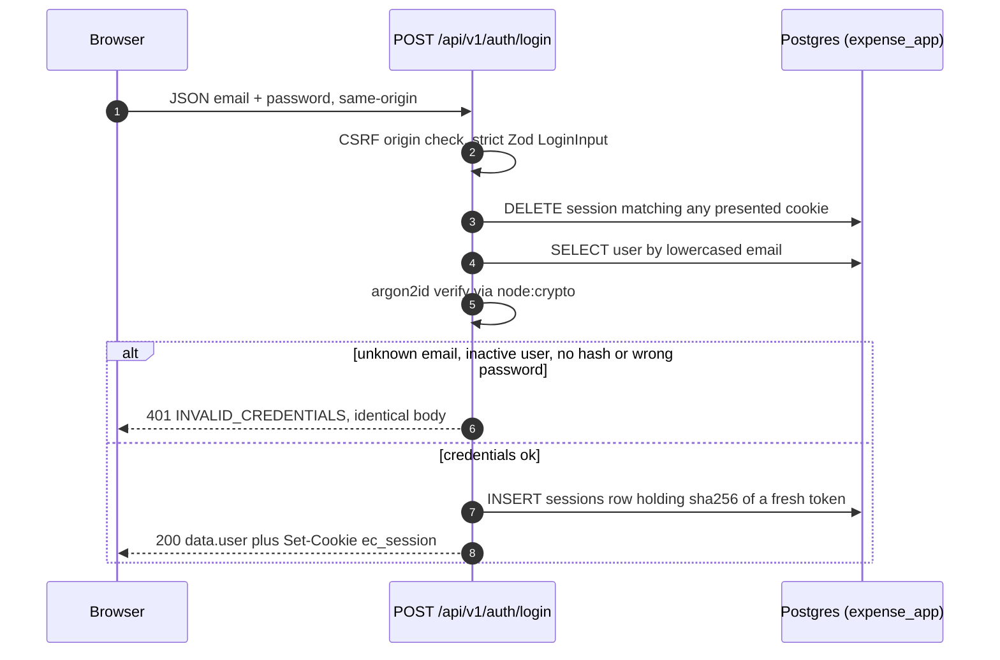
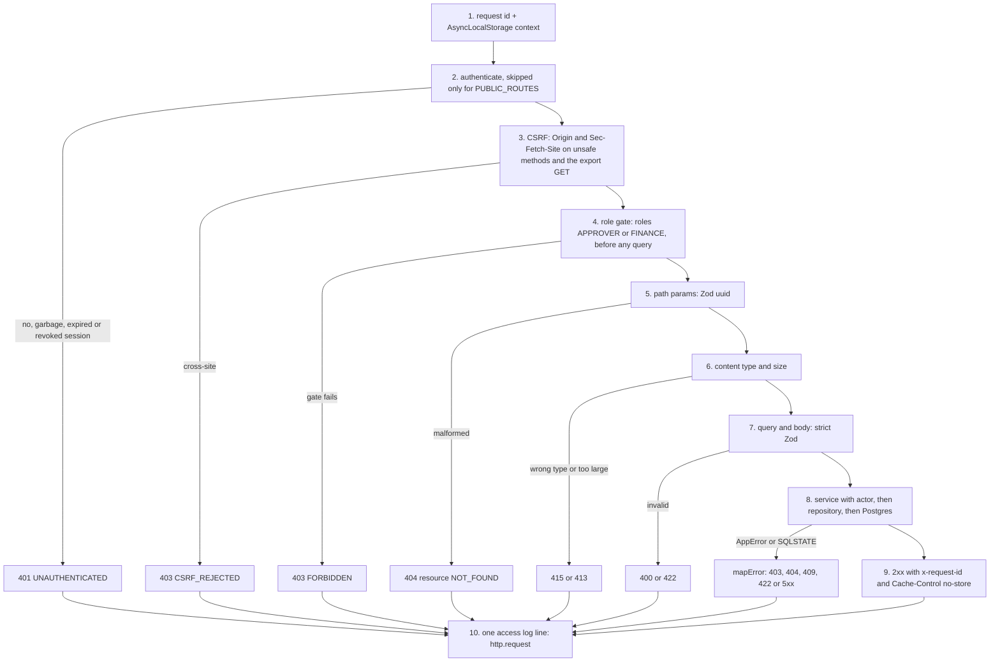
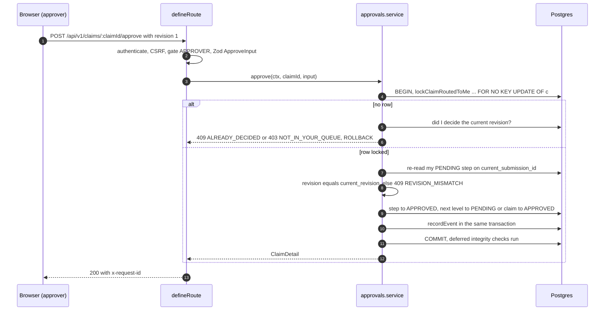

# 04 — Security and API

> Authentication, authorization, the `/api/v1` contract, errors and validation for the Expense Claims POC.
> Built in **P1** (identity and the request spine), **P2** (claims API and validation), **P4** (the authorization slice), **P6** (receipt routes) and **P7** (finance routes). Phase calendar: [PLAN](../../PLAN.md).
> Related docs: [01 Architecture and stack](01-architecture-and-stack.md) · [02 Domain and workflow](02-domain-and-workflow.md) · [03 Data model and integrity](03-data-model-and-integrity.md) · [05 Frontend](05-frontend.md) · [06 Cross-cutting](06-cross-cutting.md) · [07 Testing](07-testing.md)

**Contents**
1. [Decisions at a glance](#1-decisions-at-a-glance)
2. [Authentication](#2-authentication)
3. [Every route is authenticated](#3-every-route-is-authenticated)
4. [Authorization model](#4-authorization-model)
5. [Refusal at the point of the query](#5-refusal-at-the-point-of-the-query)
6. [The 401 → 403 → 404 → 409 → 422 ladder](#6-the-401--403--404--409--422-ladder)
7. [API reference](#7-api-reference)
8. [Envelopes, pagination, filtering and sorting](#8-envelopes-pagination-filtering-and-sorting)
9. [Error model](#9-error-model)
10. [Validation](#10-validation)
11. [Worked examples](#11-worked-examples)
12. [Security hardening checklist](#12-security-hardening-checklist)
13. [Tests that prove this doc](#13-tests-that-prove-this-doc)

---

## 1. Decisions at a glance

| # | Decision | Why (the line to say in the walkthrough) | Ref |
|---|---|---|---|
| 1 | Hand-rolled **opaque DB sessions**: random token in an HttpOnly cookie, `sha256(token)` in `sessions`, argon2id from `node:crypto`. No JWT for our own sessions, no `AUTH_SECRET` | About 150 lines I can explain end to end. Logout and deactivation take effect at once, and roles are read live on every request | D-05 |
| 2 | Authentication runs **inside every route handler** via `defineRoute`; `proxy.ts` only redirects pages | CVE-2025-29927 showed middleware can be skipped with one header. A test enumerates every handler and proves each returns 401 | D-07 |
| 3 | CSRF = `SameSite=Lax` + Origin / `Sec-Fetch-Site` check + JSON-only bodies + no CORS headers | Layered defence with no token plumbing in React | D-06 |
| 4 | Roles = `users.role` ∈ {EMPLOYEE, FINANCE, ADMIN} + `can_approve` + `is_fallback_approver`. "Finance can't approve" is a row CHECK | Segregation of duties is a database fact, not a runtime hope | D-08 |
| 5 | One visibility predicate `claimVisibilityWhere(actor)`, AND-composed into every claim, history and receipt read | An out-of-scope id makes Postgres return no row. That is literally "refused at the point of the query" | D-26 |
| 6 | Writes take **actor-scoped row locks**; child ids are always bound to the path claim | No load-then-check, and no IDOR through a foreign line or receipt id | D-14, D-27 |
| 7 | Response ladder 401 → 403 → 404 → 409 → 422. Can't see it → 404. Approve/reject with no PENDING step of yours → uniform 403 `NOT_IN_YOUR_QUEUE` | No existence oracle, yet the specific failures §6 asks for | D-25 |
| 8 | Approve and reject bodies **require `revision`** | A stale tab can't approve content its user never saw | D-17 |
| 9 | REST under `/api/v1`; one list endpoint per persona; keyset pagination; strict query schemas | Scope is fixed by the endpoint, not by a flag a client can flip; filtering happens in SQL | D-29 |
| 10 | Strict shared Zod 4 schemas; a total-like key returns 422 `TOTAL_IS_DERIVED` | Silently stripping it would be the "silent no-op" §6 forbids | D-28 |
| 11 | Money is integer paise (`amountMinor`) on the wire | No float exists anywhere in the stack | D-09 |
| 12 | One error catalogue; DB errors mapped **by SQLSTATE only**; 5xx bodies always generic | One place decides status codes; internals never leak | C-05, C-06 |
| 13 | PostgreSQL RLS is **not built** (documented next step) | The scoped predicate already meets §6; RLS would double the authorization surface | D-46 |

---

## 2. Authentication

### 2.1 Options considered

| Option | Verdict | Reason |
|---|---|---|
| **Hand-rolled opaque DB sessions** | **Chosen** | ~150 lines following OWASP session management. Instant revocation, live roles, login stays inside our `/api/v1` envelope, and tests authenticate with one `createSession(userId)` call |
| Better Auth | Rejected | About 80% unused (signup, reset, MFA, orgs); owns its own tables, `/api/auth/*` routes and error shape |
| Auth.js v5 | Rejected | Still beta, and Credentials login forces JWT sessions, which can't be revoked |
| Self-issued JWT sessions | Rejected | Revocation needs a DB denylist, which is a DB lookup on every request anyway, with none of the simplicity |

*Why not JWT:* we query Postgres on every request regardless, so an opaque token plus one indexed lookup is simpler and strictly more controllable. JWTs still appear in the design where they belong: Entra ID tokens ([§2.8](#28-future-entra-id-adr-0007)). Crypto is never hand-rolled: argon2id and SHA-256 come from OpenSSL through Node.

### 2.2 Session model (`src/server/auth/session.ts`)

Table `sessions` (columns in [03](03-data-model-and-integrity.md)): `id`, `user_id → users ON DELETE CASCADE`, `token_hash char(64) UNIQUE`, `created_at`, `last_seen_at`, `idle_expires_at`, `absolute_expires_at`, `user_agent varchar(512)`.

| Concern | Rule |
|---|---|
| Token | `randomBytes(32).toString('base64url')` (256 bits, 43 chars). The cookie holds the token; the DB holds `sha256(token)` as hex, so a DB read leak yields no usable cookie |
| Shape check | Cookie must match `^[A-Za-z0-9_-]{43}$` before any DB call, so garbage never reaches Postgres |
| Idle expiry | `SESSION_IDLE_TIMEOUT_MINUTES=60`, sliding; `last_seen_at` / `idle_expires_at` refreshed **at most every 5 minutes** (one write per 5 min, not per request), never past `absolute_expires_at` |
| Absolute expiry | `SESSION_ABSOLUTE_TIMEOUT_HOURS=12`; cookie `Max-Age=43200` |
| Rotation | A **new token on every login**; any session presented to login is deleted first (session-fixation safe). No mid-session rotation |
| Logout | Delete the row, then `Set-Cookie` with the same attributes and `Max-Age=0`; 204 |
| Revocation | Every lookup joins `users` and requires `is_active`, so deactivation (an owner script, which also deletes the user's sessions) is effective on the next request. `role` and `can_approve` are read from `users` on every request, so role changes apply immediately |
| Cleanup | Opportunistic delete of sessions expired more than a day ago on each successful login; no cron |
| "Real user" (§6) | Authenticated only if the cookie is well-formed, its hash matches a session whose idle and absolute expiry are in the future, and the user exists and is active |

```ts
// src/server/auth/session.ts
import 'server-only';
import { createHash, randomBytes } from 'node:crypto';
import type { NextRequest } from 'next/server';

const TOKEN_RE = /^[A-Za-z0-9_-]{43}$/;
const TOUCH_EVERY_MS = 5 * 60_000;
export const sha256Hex = (t: string) => createHash('sha256').update(t).digest('hex');

export async function createSession(userId: string, userAgent: string | null) {
  const token = randomBytes(32).toString('base64url');
  const now = Date.now();
  const absoluteExpiresAt = new Date(now + env().SESSION_ABSOLUTE_TIMEOUT_HOURS * 3_600_000);
  const idleExpiresAt = new Date(Math.min(now + env().SESSION_IDLE_TIMEOUT_MINUTES * 60_000, absoluteExpiresAt.getTime()));
  await sessionsRepo.insert({ userId, tokenHash: sha256Hex(token), idleExpiresAt, absoluteExpiresAt,
                              userAgent: userAgent?.slice(0, 512) ?? null });
  return { token, absoluteExpiresAt };
}

export async function authenticate(req: NextRequest): Promise<Actor> {
  const token = req.cookies.get(sessionCookieName(env().APP_BASE_URL))?.value; // NextRequest only, never next/headers
  if (!token || !TOKEN_RE.test(token)) throw new AppError('UNAUTHENTICATED');
  const now = new Date();
  const s = await sessionsRepo.findLive(sha256Hex(token), now);
  //   WHERE token_hash = $1 AND idle_expires_at > $now AND absolute_expires_at > $now AND users.is_active
  if (!s) throw new AppError('UNAUTHENTICATED');
  if (now.getTime() - s.lastSeenAt.getTime() > TOUCH_EVERY_MS) await sessionsRepo.touch(s.id, now);
  const u = s.user;
  return { id: u.id, email: u.email, name: u.name, role: u.role, canApprove: u.canApprove };
}
```

*Why the handler reads `NextRequest.cookies` and not `next/headers`:* a handler that only depends on its `Request` is a plain function, so Vitest can call it in-process without a Next server (the inventory and matrix tests depend on this). Server Components use the separate `getActor()` in `src/server/auth/rsc.ts` ([§3.5](#35-server-components-and-self-guarding-services)).

### 2.3 Password hashing (`src/server/auth/password.ts`)

argon2id with OWASP's minimum parameters (m = 19 MiB, t = 2, p = 1) via Node's built-in `crypto.argon2` (Node ≥ 24.7; pinned 24.21.0), stored as a standard PHC string.

```ts
import 'server-only';
import { argon2, randomBytes, timingSafeEqual } from 'node:crypto';
import { promisify } from 'node:util';

const argon2Async = promisify(argon2);
const PARAMS = { memory: 19_456, passes: 2, parallelism: 1, tagLength: 32 } as const;
const PHC = /^\$argon2id\$v=19\$m=(\d+),t=(\d+),p=(\d+)\$([A-Za-z0-9+/]+)\$([A-Za-z0-9+/]+)$/;
const b64 = (b: Buffer) => b.toString('base64').replace(/=+$/, '');

export async function hashPassword(password: string): Promise<string> {   // used by the owner-run seed only
  const nonce = randomBytes(16);
  const tag = await argon2Async('argon2id', { message: password.normalize('NFKC'), nonce, ...PARAMS });
  return `$argon2id$v=19$m=${PARAMS.memory},t=${PARAMS.passes},p=${PARAMS.parallelism}$${b64(nonce)}$${b64(tag)}`;
}

export async function verifyPassword(stored: string, password: string): Promise<boolean> {
  const m = PHC.exec(stored);
  if (!m) return false;
  const [, mem, t, p, salt, hash] = m;
  const expected = Buffer.from(hash, 'base64');
  const actual = await argon2Async('argon2id', { message: password.normalize('NFKC'), nonce: Buffer.from(salt, 'base64'),
    memory: +mem, passes: +t, parallelism: +p, tagLength: expected.length });
  return actual.length === expected.length && timingSafeEqual(actual, expected);
}
```

*Why `node:crypto`:* no native addon, so the image builds identically on Apple Silicon and linux/amd64. *Rejected:* bcrypt (72-byte truncation, not memory-hard). There is no rehash-on-login: `expense_app` has SELECT only on `users` ([03](03-data-model-and-integrity.md)), and parameters live inside each hash, so they can be raised by an owner script later.

### 2.4 Login, logout and `me`



1. **Login** (`auth: 'public'`, CSRF still checked, which prevents login CSRF). `LoginInput` = `{ email, password }`: email trimmed and lowercased (matches the `users_email_lowercase` CHECK), max 254; password 1..256 chars. Password policy is not checked at login because no password-setting endpoint exists.
2. Unknown email, inactive user, `password_hash IS NULL` and wrong password all return the **same** 401 `INVALID_CREDENTIALS` body. Logs record `auth.login.failed` with a reason and never the email or password.
3. Success: delete any presented session, `createSession(user.id, callMeta(req).userAgent)`, purge long-expired sessions, return **200 `{data:{user: MeDto}}`** + `Set-Cookie`. Log `auth.login.succeeded {userId}`.
4. **Logout** (`POST /api/v1/auth/logout`, authenticated): delete the session row, clear the cookie, 204. Log `auth.logout`.
5. **`GET /api/v1/auth/me`**: `MeDto = { id, email, name, role, canApprove, isFinance }`. The UI derives nav from these flags only; the server re-decides everything.

Services never import `next/*`: `auth.service.login()` returns `{ token, user }` and the route handler writes the cookie.

**`callMeta(req)`** (`src/server/http/call-meta.ts`, P1) returns `{ ip, userAgent }` from the request: `userAgent` is the `user-agent` header cut to 512 characters, and `ip` is the first `x-forwarded-for` hop (else `null`). It is a pure function of the `NextRequest`. `userAgent` is stored in `sessions.user_agent`. Both go on the `http.request` access line ([06 §2.2](06-cross-cutting.md)); the IP is never stored in the database.

### 2.5 Cookie specification (`src/server/auth/cookie.ts`)

One function, `sessionCookieName(appBaseUrl)`, is used by `authenticate()`, the cookie writer and `proxy.ts`, so the three can never disagree.

| Attribute | Value | Why |
|---|---|---|
| Name | `__Host-ec_session` when `APP_BASE_URL` is https; `ec_session` on plain-http localhost | `__Host-` forces Secure, `Path=/` and no `Domain`, so a sibling subdomain can't plant the cookie |
| `HttpOnly` | always | JavaScript, including injected XSS, can't read the token |
| `Secure` | when `APP_BASE_URL` is https (every deployed environment) | Keeps `docker compose up` on `http://localhost` working while staying strict everywhere else |
| `SameSite` | `Lax` | Blocks cross-site POST/PUT/DELETE from carrying the cookie; unlike `Strict`, following an email link to a claim keeps you signed in |
| `Path` | `/` | Required by `__Host-` |
| `Max-Age` | `43200` (12 h, the absolute lifetime) | Server-side idle expiry is the real control |

### 2.6 CSRF stance (`src/server/http/csrf.ts`)

1. **Primary:** `SameSite=Lax`. A cross-site `fetch` or form POST does not carry the cookie.
2. **Origin check** on POST/PUT/PATCH/DELETE: if `Origin` is present and differs from the origin of `APP_BASE_URL`, or `Sec-Fetch-Site` is present and is neither `same-origin` nor `none` → **403 `CSRF_REJECTED`**. Requests with no `Origin` header (curl, server-to-server) are allowed: they carry no ambient browser cookie.
3. **JSON-only bodies:** a request that carries a body must be `application/json`, else **415**. HTML forms can't send JSON cross-site, and a cross-site `fetch` with JSON needs a CORS preflight that we never answer (no CORS headers anywhere). Bodyless POSTs (`/submit`, `/logout`) are fine; the one multipart route requires `multipart/form-data`.
4. **The export GET** is the only GET with weight (a 366-day stream). Lax cookies ride on top-level cross-site navigations, so `Sec-Fetch-Site: cross-site` on that path → **403 `CSRF_REJECTED`**. Every other GET is side-effect free.

```ts
// src/server/http/csrf.ts
const SAFE = new Set(['GET', 'HEAD', 'OPTIONS']);
const CROSS_SITE_GET_DENYLIST = new Set(['/api/v1/finance/exports/approved-claims']);

export function assertSameOrigin(req: NextRequest): void {
  const site = req.headers.get('sec-fetch-site');
  if (SAFE.has(req.method)) {
    if (CROSS_SITE_GET_DENYLIST.has(req.nextUrl.pathname) && site === 'cross-site') throw new AppError('CSRF_REJECTED');
    return;
  }
  const origin = req.headers.get('origin');
  if (origin && origin !== new URL(env().APP_BASE_URL).origin) throw new AppError('CSRF_REJECTED');
  if (site && site !== 'same-origin' && site !== 'none') throw new AppError('CSRF_REJECTED');
}
```

*Rejected:* synchronizer or double-submit tokens (client plumbing with marginal benefit over Lax + Origin).

### 2.7 Login throttling — OPTIONAL (buffer day)

Postgres-backed fixed window in a `rate_limit_buckets(key, window_start, hits)` table, updated with `INSERT … ON CONFLICT DO UPDATE`: `LOGIN_RATE_LIMIT_IP=20` attempts per 15 minutes per IP and `LOGIN_RATE_LIMIT_ACCOUNT=5` failures per 15 minutes per account → **429 `RATE_LIMITED`** with `Retry-After`. No hard lockout (lockout is a denial-of-service vector). It is Postgres-backed so it stays correct across replicas and restarts. Companion option: verify against a precomputed dummy hash for unknown emails so response timing doesn't reveal which accounts exist. Test: TC-O05 › "the 6th failed login for an account in 15 minutes returns 429 RATE_LIMITED with Retry-After".

### 2.8 Future: Entra ID (ADR-0007)

Design text only; no code in the POC.

```
GET /api/v1/auth/entra/login     (public) → state + nonce + PKCE verifier in a short-lived __Host- cookie → 302 to Entra
GET /api/v1/auth/entra/callback  (public) → authorization code grant (openid-client), validate iss, aud, tid, exp, nonce
    → find user by (tid, oid)          NEVER by email (mutable, not guaranteed verified: the "nOAuth" class)
    → createSession(user.id)           identical cookie and Actor from here on
```

- **Unchanged:** `authenticate()`, `Actor`, every service, repository, policy and test. Authorization only ever sees an `Actor`, so changing *how someone proves who they are* never touches *who can do what*.
- A migration adds a unique `(tid, oid)` pair to `users`. Entra App Roles and the manager hierarchy (Graph `/users/{id}/manager`) are synced by an owner-role job into `users.role`, `can_approve` and `manager_id`; `expense_app` still cannot write them.
- Production disables password login; the client credential is a certificate or federated credential via Managed Identity (Key Vault), never a secret in env.
- Machine clients (optional): a second resolver in `authenticate()` validates an Entra-issued **JWT** bearer token against the tenant JWKS (issuer, audience, `scp`), maps `oid` to a user and returns the same `Actor`. This is where the learning path's JWT concepts apply: we *validate* JWTs from an identity provider, while our own browser session stays opaque and revocable.

---

## 3. Every route is authenticated

### 3.1 Why proxy/middleware is not the enforcement point

CVE-2025-29927 (CVSS 9.1) let any client skip Next.js middleware entirely by sending the internal `x-middleware-subrequest` header. Every app whose *only* auth check lived in middleware was open. Next 16 renamed middleware to `proxy.ts`, and Next's own guidance treats it as an optimistic check, with the authoritative check next to the data. **Our rule: if `src/proxy.ts` were deleted, the API would be exactly as secure.** Its matcher excludes `/api`; it only redirects page requests that have no session cookie to `/login?next=<path>`. The inventory test calls handlers directly with no proxy in the loop, which proves enforcement doesn't depend on it.

### 3.2 `defineRoute`: the request pipeline (`src/server/http/define-route.ts`)



*Why this order:* authentication first, so an anonymous caller learns nothing (not even "your body is invalid"); the role gate before any query, so FINANCE never takes a row lock on a claim it may not decide; request-shape errors before the service, so the service only ever sees typed, valid input.

```ts
// src/server/http/define-route.ts
import 'server-only';
export const ROUTE_META = Symbol.for('expense.routeMeta');
export type Gate = 'APPROVER' | 'FINANCE';

export function defineRoute<P, Q, B>(spec: {
  auth: 'required' | 'public';
  roles?: readonly Gate[];
  params?: z.ZodType<P>;
  query?: z.ZodType<Q>;
  body?: z.ZodType<B> | 'multipart';
  handler: (ctx: RouteCtx<P, Q, B>) => Promise<Response>;
}) {
  const route = (req: NextRequest, segment: { params: Promise<Record<string, string | string[]>> }) =>
    withRequestContext(req, async (rc) => {                                       // 1. x-request-id, ALS, access log
      try {
        const actor = spec.auth === 'required' ? await authenticate(req) : null;  // 2. 401
        if (actor) rc.userId = actor.id;
        assertSameOrigin(req);                                                    // 3. 403 CSRF_REJECTED
        if (actor && spec.roles?.some((g) => !passesGate(actor, g)))              // 4. 403 FORBIDDEN
          throw new AppError('FORBIDDEN');
        const params = parseParams(spec.params, await segment.params);            // 5. 404 <RESOURCE>_NOT_FOUND
        assertContentType(req, spec.body);                                        // 6. 415
        const query = parseQuery(spec.query, req.nextUrl.searchParams);           // 7. 422
        const body = await parseBody(req, spec.body);                             //    400 / 413 / 422
        const res = await spec.handler({ req, actor, params, query, body, requestId: rc.requestId });
        return finalize(res, rc);                                                 // 9. headers
      } catch (err) {
        return errorResponse(err, rc);                                            // mapError + log (§9)
      }
    });
  Object.defineProperty(route, ROUTE_META, { value: { auth: spec.auth, roles: spec.roles ?? [] } });
  return route;
}

// src/server/auth/actor.ts
export const canDecide = (a: Actor) => a.canApprove && a.role !== 'FINANCE';
export const passesGate = (a: Actor, g: Gate) => (g === 'APPROVER' ? canDecide(a) : a.role === 'FINANCE');
export function requireRole(a: Actor, g: Gate): void { if (!passesGate(a, g)) throw new AppError('FORBIDDEN'); }
```

A route file is then a few lines, and gets authentication, validation, error mapping and logging for free:

```ts
// src/app/api/v1/claims/[claimId]/approve/route.ts
export const POST = defineRoute({
  auth: 'required',
  roles: ['APPROVER'],
  params: ClaimIdParams,
  body: ApproveInput,
  handler: async ({ actor, params, body, requestId }) =>
    ok(await approvalsService.approve({ actor, requestId }, params.claimId, body)),
});
```

Every service function has the shape `(ctx: ServiceCtx, ...ids, input?)`, with `ServiceCtx = { actor; requestId; clock?: SeedClock }` (canonical C-26; `SeedClock` is in [02 §9](02-domain-and-workflow.md)). The names are `createClaim`, `getClaim`, `replaceClaim`, `deleteDraft`, `submit`, `recall`, `approve`, `reject` and `upload`. Route handlers never pass `clock`; only the owner-run seed does.

### 3.3 `PUBLIC_ROUTES` and `proxy.ts`

```ts
// src/server/http/public-routes.ts — the ONE allowlist, imported by the inventory test and proxy.ts
export const PUBLIC_ROUTES = ['POST /api/v1/auth/login', 'GET /api/health/live', 'GET /api/health/ready'] as const;
```

```ts
// src/proxy.ts — optimistic page redirect only; deleting it changes nothing about API security
export const config = { matcher: ['/((?!api|_next/static|_next/image|favicon.ico|login).*)'] };
export function proxy(req: NextRequest) {
  if (req.cookies.has(sessionCookieName(env().APP_BASE_URL))) return NextResponse.next();
  const url = new URL('/login', req.url);
  url.searchParams.set('next', req.nextUrl.pathname);              // the login page accepts only "/x", never "//x"
  return NextResponse.redirect(url);
}
```

The catch-all `src/app/api/v1/[...path]/route.ts` exports GET, HEAD, POST, PUT, PATCH, DELETE and OPTIONS through `defineRoute({ auth: 'required' })` and throws `ROUTE_NOT_FOUND`, so an anonymous caller gets 401 before 404 and learns nothing about the route map. A known path called with a method it doesn't export gets Next's built-in 405.

### 3.4 The route-enumeration test (TC-I01)

`tests/integration/auth/every-route-requires-auth.int.test.ts` discovers routes from the file system, so a new route is covered the moment it exists. The P0 health routes were written before `defineRoute` existed; P1 re-wraps `src/app/api/health/{live,ready}/route.ts` in `defineRoute({ auth: 'public' })` so they carry `ROUTE_META`.

```ts
// tests/helpers/route-manifest.ts
// The keys that must exist by now. Each phase appends its own: P1 has 12 (login, logout, me, the two health
// probes and the 7 catch-all methods); the finished app has 29 (22 concrete + 7 catch-all).
export const EXPECTED_ROUTES = [
  'POST /api/v1/auth/login', 'POST /api/v1/auth/logout', 'GET /api/v1/auth/me',
  'GET /api/health/live', 'GET /api/health/ready',
  ...['GET', 'HEAD', 'POST', 'PUT', 'PATCH', 'DELETE', 'OPTIONS'].map((m) => `${m} /api/v1/[...path]`),
  // P2: 'GET /api/v1/categories', 'GET /api/v1/claims', 'POST /api/v1/claims', 'GET /api/v1/claims/[claimId]', …
];
const METHODS = ['GET', 'HEAD', 'POST', 'PUT', 'PATCH', 'DELETE', 'OPTIONS'] as const;
export async function loadRouteManifest() {
  const files = await Array.fromAsync(glob('src/app/api/**/route.ts'));            // node:fs/promises
  return (await Promise.all(files.map(async (file) => {
    const mod = await import(path.resolve(file));
    const routePath = '/' + path.dirname(path.relative('src/app', file)).split(path.sep).join('/');
    return METHODS.filter((m) => m in mod)
      .map((method) => ({ method, routePath, key: `${method} ${routePath}`, handler: mod[method] }));
  }))).flat();
}
// materialise(routePath): [claimId]/[lineItemId]/[receiptId] → randomUUID(), [...path] → ['nope']
```

```ts
// tests/integration/auth/every-route-requires-auth.int.test.ts
const routes = await loadRouteManifest();
const guarded = routes.filter((r) => !(PUBLIC_ROUTES as readonly string[]).includes(r.key));
const hit = (r: Route, headers: Record<string, string> = {}, body?: string) =>
  r.handler(new NextRequest(new URL(materialise(r.routePath).url, 'http://localhost:3000'),
    { method: r.method, headers: { 'content-type': 'application/json', ...headers }, body }),
    { params: Promise.resolve(materialise(r.routePath).params) });

it('every exported handler for every HTTP method carries ROUTE_META', () => {
  expect(routes.map((r) => r.key)).toEqual(expect.arrayContaining(EXPECTED_ROUTES));   // grows phase by phase, never a count
  for (const r of routes) expect(r.handler[ROUTE_META], `${r.key}: wrap it in defineRoute`).toBeDefined();
});
it('only PUBLIC_ROUTES are public', () => {
  const pub = routes.filter((r) => r.handler[ROUTE_META].auth === 'public').map((r) => r.key).sort();
  expect(pub).toEqual([...PUBLIC_ROUTES].sort());
});
it('every non-public route returns 401 UNAUTHENTICATED with no cookie', async () => {
  for (const r of guarded) {
    const res = await hit(r);
    expect([r.key, res.status, (await res.json()).error.code]).toEqual([r.key, 401, 'UNAUTHENTICATED']);
  }
});
// same loop: "... with a garbage cookie" · "... with an expired session" (row with idle_expires_at in the past)
//            "... for a deactivated user" (tmp.* user, session, then ownerSql sets is_active = false)
it('an unauthenticated request with an invalid body gets 401, not 422', /* POST /claims {"totalMinor":1} → 401 */);
it('the x-middleware-subrequest header does not bypass authentication',
   /* every guarded route with x-middleware-subrequest: src/middleware:src/middleware:… → 401 */);
```

`tests/helpers/auth.ts` › `createSession(userId)` inserts a session row directly and returns a cookie string; it is **not** exported from `src`, so production code has no "log in as anyone" helper. Real HTTP is covered once by Playwright: TC-E04 › "every (app) page redirects to /login without a session" is **CORE** (P8, never cut), because it is the only test of the page half of §6-3 (the `(app)/layout.tsx` redirect, §3.5); TC-E07 is the OPTIONAL API smoke.

### 3.5 Server Components and self-guarding services

- **Server Components do no data reads.** `(app)/layout.tsx` calls `getActor()` from `@/server/auth/rsc` (reads `cookies()` from `next/headers`, wrapped in React `cache()`) to render the nav or redirect to `/login`. All claim, approval and finance data flows through `/api/v1` via TanStack Query ([05](05-frontend.md)). ESLint lets pages and layouts import only `@/server/auth/rsc`.
- **Services guard themselves anyway.** Every service function takes a `ServiceCtx` carrying the `Actor` (C-26). `requireRole(ctx.actor, 'FINANCE')` is the first line of every `finance.service` and `export.service` function, and `financeClaimsWhere(actor)` throws `FORBIDDEN` unless the actor is FINANCE. If someone later adds an RSC read, it is still safe.
- **No Server Actions** (`'use server'` is a lint error) and no `'use cache'`; `cacheComponents: false`. One door into the data, and it is the tested door.

---

## 4. Authorization model

### 4.1 Roles, capabilities and relationships

| Concept | Representation | Can do |
|---|---|---|
| Claimant (every user) | any active `users` row | create, edit, submit, recall, delete own claims; read own claims |
| Approver | `users.can_approve = true` (role EMPLOYEE or ADMIN) | approve/reject only steps PENDING for them; read claims where they have a PENDING, APPROVED or REJECTED step; `/approvals` |
| Fallback approver | `users.is_fallback_approver = true` (exactly one; must have `can_approve`) | as approver; used when a tier can't resolve otherwise ([02](02-domain-and-workflow.md)) |
| Finance | `users.role = 'FINANCE'` (`can_approve` must be false) | read every claim, read-only; finance list; export. Never approve, reject or edit others' claims |
| Admin | `users.role = 'ADMIN'` | nothing extra in the app: no UI, no extra visibility. Configuration changes go through owner scripts and migrations |

```ts
// src/server/auth/actor.ts
export type UserRole = 'EMPLOYEE' | 'FINANCE' | 'ADMIN';
export interface Actor { id: string; email: string; name: string; role: UserRole; canApprove: boolean }
```

**Relationships are per claim** and computed from its approval steps, never from a role:

| Relationship | Definition | Read access |
|---|---|---|
| Owner | `claims.claimant_id = me` | full |
| Active approver | my step on the claim is `PENDING` (at most one PENDING per submission) | read-only + approve/reject |
| Decided approver | I have an `APPROVED` or `REJECTED` step on any revision | read-only, all revisions (§3.5 "optionally" taken as yes, for accountability; an RM sign-off item) |
| Waiting approver | my step is `WAITING` (later level, not yet routed) | **none** ("currently routed to them", §3.2) |
| Cancelled approver | my step was `CANCELLED` by a recall or an earlier-level rejection | **none** |
| Finance | `role = 'FINANCE'` | every claim including drafts, read-only |

### 4.2 Segregation of duties

- `CHECK users_finance_cannot_approve NOT (role = 'FINANCE' AND can_approve)`: finance can't even be *made* an approver.
- `CHECK users_fallback_must_approve`, partial unique `users_one_fallback_approver`: exactly one fallback, and it must be an approver.
- Routing never picks the claimant, a FINANCE user, an inactive user or a non-approver, and never uses the same person twice in one chain (`UNIQUE(submission_id, approver_id)`), so N tiers means N distinct signatures ([02](02-domain-and-workflow.md)).
- At decision time the DB re-checks eligibility (`approval_steps_guard`, UC008), so an approver promoted to FINANCE mid-chain can't decide even if the service check were bypassed ([03](03-data-model-and-integrity.md)).
- **Stated residual (RT-M2):** the database proves the state machine and audit completeness; the scoped query proves identity. Code running with `expense_app` credentials could still forge a consistent state change plus event. That is mitigated by least privilege, keeping owner credentials out of the app container, and production pgaudit.

### 4.3 Visibility and permission matrix

Target: a **SUBMITTED** claim. Columns are the caller's relationship to it. Cells are HTTP status + `error.code`. Other statuses follow [§6.3](#63-action--status--result-owner-unless-noted). This table is mirrored one-to-one by TC-I18 (`it.each` "%s %s → %i %s").

| Action | Owner | Active approver | Waiting approver | Decided approver | Cancelled approver | Unrelated approver | Finance | Unrelated employee / ADMIN | Anonymous |
|---|---|---|---|---|---|---|---|---|---|
| `GET /claims/:id` | 200 (`allowedActions: [RECALL]`) | 200 RO (`[APPROVE, REJECT]`) | 404 `CLAIM_NOT_FOUND` | 200 RO (`[]`) | 404 `CLAIM_NOT_FOUND` | 404 `CLAIM_NOT_FOUND` | 200 RO (`[]`) | 404 `CLAIM_NOT_FOUND` | 401 |
| `GET …/history` | 200 | 200 | 404 | 200 | 404 | 404 | 200 | 404 | 401 |
| `GET …/receipts/:rid/content` | 200 | 200 | 404 | 200 | 404 | 404 | 200 | 404 | 401 |
| `PUT /claims/:id` | 409 `CLAIM_NOT_EDITABLE` | 404 `CLAIM_NOT_FOUND` | 404 | 404 | 404 | 404 | 404 | 404 | 401 |
| `DELETE /claims/:id` | 409 `CLAIM_HAS_HISTORY` | 404 | 404 | 404 | 404 | 404 | 404 | 404 | 401 |
| `POST …/submit` | 409 `INVALID_STATUS_TRANSITION` | 404 | 404 | 404 | 404 | 404 | 404 | 404 | 401 |
| `POST …/recall` | 200 | 404 | 404 | 404 | 404 | 404 | 404 | 404 | 401 |
| Receipt upload / delete | 409 `CLAIM_NOT_EDITABLE` | 404 | 404 | 404 | 404 | 404 | 404 | 404 | 401 |
| `POST …/approve`, `…/reject` | 403 `FORBIDDEN` (no `can_approve`) or 403 `NOT_IN_YOUR_QUEUE` | 200 (409 `REVISION_MISMATCH` if stale) | 403 `NOT_IN_YOUR_QUEUE` | 409 `ALREADY_DECIDED` | 403 `NOT_IN_YOUR_QUEUE` | 403 `NOT_IN_YOUR_QUEUE` | 403 `FORBIDDEN` | 403 `FORBIDDEN` (or `NOT_IN_YOUR_QUEUE` if `can_approve`) | 401 |
| `GET /claims` | 200, own only | 200, own only | 200, own only | 200, own only | 200, own only | 200, own only | 200, own only | 200, own only | 401 |
| `GET /approvals` | 403 `FORBIDDEN` unless `can_approve` | 200, row listed under PENDING | 200, row **not** listed | 200, row listed under decided | 200, row not listed | 200, row never listed | 403 `FORBIDDEN` | 403 `FORBIDDEN` unless `can_approve` | 401 |
| `GET /finance/claims`, export | 403 `FORBIDDEN` | 403 | 403 | 403 | 403 | 403 | 200 | 403 | 401 |

Also covered: "finance can GET any claim including drafts and every write returns 404 or 403 FORBIDDEN"; a cancelled approver's GET → 404 (TC-I21 › "a cancelled approver loses visibility (404)").

*Why owner-writes by non-owners are 404 and not 403:* the write path locks with `claimant_id = me`, so for anyone else the row simply doesn't exist in that query, and finance or an approver gains nothing from learning "it exists but isn't yours".

### 4.4 `decide()` and `allowedActions` (`src/server/authz/claim-policy.ts`)

A pure function over facts re-read under the lock. Services use it for state rules (the 409 codes); `ClaimDetail.allowedActions` is computed by the same function, so the UI never re-implements the state machine and hiding a button never protects anything.

```ts
export type ClaimAction = 'EDIT' | 'SUBMIT' | 'RECALL' | 'DELETE' | 'APPROVE' | 'REJECT';
export interface ClaimFacts {
  status: ClaimStatus; claimantId: string; currentRevision: number;
  myStepOnCurrentRevision: ApprovalStepStatus | null;      // my step on claims.current_submission_id, if any
}
type Decision = { ok: true } | { ok: false; code: ErrorCode };
const allow: Decision = { ok: true };
const deny = (code: ErrorCode): Decision => ({ ok: false, code });

export function decide(actor: Actor, f: ClaimFacts): Record<ClaimAction, Decision> {
  const ownerOnly = (d: Decision) => (f.claimantId === actor.id ? d : deny('CLAIM_NOT_FOUND'));
  const locked = f.status === 'APPROVED';
  const editable = f.status === 'DRAFT' || f.status === 'REJECTED';
  const decision = !canDecide(actor) ? deny('FORBIDDEN')
    : f.myStepOnCurrentRevision === 'PENDING' ? allow
    : f.myStepOnCurrentRevision === 'APPROVED' || f.myStepOnCurrentRevision === 'REJECTED' ? deny('ALREADY_DECIDED')
    : deny('NOT_IN_YOUR_QUEUE');
  return {
    EDIT:   ownerOnly(locked ? deny('CLAIM_LOCKED') : editable ? allow : deny('CLAIM_NOT_EDITABLE')),
    SUBMIT: ownerOnly(locked ? deny('CLAIM_LOCKED') : editable ? allow : deny('INVALID_STATUS_TRANSITION')),
    RECALL: ownerOnly(locked ? deny('CLAIM_LOCKED') : f.status === 'SUBMITTED' ? allow : deny('INVALID_STATUS_TRANSITION')),
    DELETE: ownerOnly(locked ? deny('CLAIM_LOCKED')
            : f.status === 'DRAFT' && f.currentRevision === 0 ? allow : deny('CLAIM_HAS_HISTORY')),
    APPROVE: decision,
    REJECT: decision,
  };
}
export const allowedActions = (a: Actor, f: ClaimFacts) =>
  (Object.entries(decide(a, f)) as [ClaimAction, Decision][]).filter(([, d]) => d.ok).map(([k]) => k);
```

TC-U04 › "decide() is exhaustive over status × relationship × action" · "allowedActions for FINANCE is always empty" (for claims the finance user doesn't own) · "allowedActions offers DELETE only for never-submitted drafts".

---

## 5. Refusal at the point of the query

### 5.1 The visibility predicate (`src/server/repositories/claim-visibility.ts`)

```ts
import 'server-only';
import type { Prisma } from '@/generated/prisma/client';

const VISIBLE_STEP_STATUSES = ['PENDING', 'APPROVED', 'REJECTED'] as const;   // WAITING and CANCELLED grant nothing

export function claimVisibilityWhere(actor: Actor): Prisma.ClaimWhereInput {
  if (actor.role === 'FINANCE') return {};             // read-all, including drafts; every write path is owner-scoped
  return { OR: [
    { claimantId: actor.id },
    { approvalSteps: { some: { approverId: actor.id, status: { in: [...VISIBLE_STEP_STATUSES] } } } },
  ] };
}

/** The ONLY way to load a claim by id for reading. Out of scope → null from Postgres itself.
 *  C-26: lives here, not in claims.repo.ts; takes no tx (reads run on getDb(), after any commit). */
export function findClaimForActor<S extends Prisma.ClaimSelect>(actor: Actor, claimId: string, select: S) {
  return getDb().claim.findFirst({
    where: { AND: [{ id: claimId }, claimVisibilityWhere(actor)] },   // AND: a caller's filter can never widen it
    select,
  });
}
```

Generated SQL, roughly: `WHERE id = $1 AND (claimant_id = $2 OR EXISTS (SELECT 1 FROM approval_steps s WHERE s.claim_id = claims.id AND s.approver_id = $2 AND s.status IN ('PENDING','APPROVED','REJECTED')))`, served by `approval_steps_visibility_idx (claim_id, approver_id)`. The row never leaves Postgres, so there is nothing to "hide in the UI". *Rejected:* load the row, then check ownership in the service (the row has already left the DB, and the check can be forgotten). P2 ships the owner and finance branches, proved by the first form of TC-I17 (§5.6); P4 adds the step branch together with the matrix test.

### 5.2 Child resources only through the scoped parent

| Child | How it is reached | Out of scope → |
|---|---|---|
| History (`claim_submissions`, `approval_steps`, `claim_events`) | `findClaimForActor` first; then children filtered by that `claim_id` | 404 `CLAIM_NOT_FOUND` |
| Receipt download | visible claim, then `receipts WHERE id = $rid AND claim_id = $cid`; else a receipt referenced by one of **this claim's** submission snapshots (evidence survives line deletion, [06](06-cross-cutting.md)) | 404 `CLAIM_NOT_FOUND` / `RECEIPT_NOT_FOUND` |
| Receipt upload | owned claim, then `line_items WHERE id = $lid AND claim_id = $cid` | 404 `CLAIM_NOT_FOUND` / `LINE_ITEM_NOT_FOUND` |
| Receipt delete | owned claim (locked), then `receipts WHERE id = $rid AND claim_id = $cid` | 404 `CLAIM_NOT_FOUND` / `RECEIPT_NOT_FOUND` |
| Line items in a PUT body | under the owned-claim lock, every incoming `id` must be in `SELECT id FROM line_items WHERE claim_id = $cid` | 404 `LINE_ITEM_NOT_FOUND`, **before anything is written** |

Every repository write signature is `(tx, actor, claimId, childId?)`, and child updates are `updateMany({ where: { id, claimId } })` expecting `count = 1`. The composite FK `receipts(line_item_id, claim_id) → line_items(id, claim_id)` and the immutable `line_items.claim_id` (UC010) back this at the DB. *Why:* a foreign line id riding inside my own PUT would otherwise rewrite another employee's draft (RT-B2); binding child → path claim → owner closes it. TC-I14 › "PUT on my claim containing another claim's line id returns 404 LINE_ITEM_NOT_FOUND and changes nothing" · "the victim's rows and total are byte-for-byte unchanged".

```ts
// claims.service.ts › replaceClaim(ctx, claimId, input) — the security-relevant steps (full write order in 02 / C-25)
const { actor } = ctx;
return withTx(async (tx) => {
  const claim = await claimsRepo.lockOwnedClaim(tx, actor, claimId);          // LockedClaim | null (C-26)
  if (!claim) throw new AppError('CLAIM_NOT_FOUND');                           // 404 for non-owners, incl. FINANCE
  assertOk(decide(actor, facts(claim)).EDIT);                                   // 409 CLAIM_LOCKED / CLAIM_NOT_EDITABLE
  const existing = await lineItemsRepo.idsForClaim(tx, actor, claimId);
  if (input.lineItems.some((l) => l.id && !existing.has(l.id))) throw new AppError('LINE_ITEM_NOT_FOUND');
  // … category checks, deleteMany({ claimId, id notIn kept }), updateMany per kept row, createMany with claimId from the PATH
  // P6 adds the C-25 receipt-key steps: collect receipts.storage_key of the removed lines here, delete the objects after commit
});
```

### 5.3 Actor-scoped locks and the approve diagnosis

Writes never use an unscoped `SELECT … FOR UPDATE`. The lock query itself carries the actor, so out-of-scope actors (finance, decided approvers) never take a lock on someone else's claim.

**Contract C-26.** Both lock functions live in `claims.repo.ts`, take `(tx, actor, claimId)` and return `LockedClaim | null`. Repositories never throw for "not found"; the **service** decides what a missing row means (`CLAIM_NOT_FOUND` for owner writes, the §5.3 diagnosis for decisions). `findClaimForActor(actor, claimId, select)` is the read counterpart in `claim-visibility.ts` (§5.1).

```ts
// src/server/repositories/claims.repo.ts
export async function lockOwnedClaim(tx: Tx, actor: Actor, claimId: string): Promise<LockedClaim | null> {
  const [row] = await tx.$queryRaw<LockedClaim[]>`
    SELECT id, status, current_revision AS "currentRevision", current_submission_id AS "currentSubmissionId"
    FROM claims WHERE id = ${claimId}::uuid AND claimant_id = ${actor.id}::uuid
    FOR NO KEY UPDATE`;
  return row ?? null;                                                          // the service throws CLAIM_NOT_FOUND
}

export async function lockClaimRoutedToMe(tx: Tx, actor: Actor, claimId: string): Promise<LockedClaim | null> {
  const [row] = await tx.$queryRaw<LockedClaim[]>`
    SELECT c.id, c.status, c.current_revision AS "currentRevision", c.current_submission_id AS "currentSubmissionId"
    FROM claims c
    WHERE c.id = ${claimId}::uuid
      AND EXISTS (SELECT 1 FROM approval_steps s
                  WHERE s.claim_id = c.id AND s.approver_id = ${actor.id}::uuid AND s.status = 'PENDING')
    FOR NO KEY UPDATE OF c`;
  return row ?? null;                                                          // caller diagnoses
}
```



```ts
// approvals.service.ts (the role gate already ran in defineRoute, so FINANCE never opens a transaction)
async function diagnoseNoPendingStep(tx: Tx, actor: Actor, claimId: string): Promise<AppError> {
  const decided = await stepsRepo.decidedCurrentRevision(tx, actor, claimId);
  //   EXISTS (SELECT 1 FROM approval_steps s JOIN claims c ON c.current_submission_id = s.submission_id
  //            WHERE c.id = $claimId AND s.approver_id = $me AND s.status IN ('APPROVED','REJECTED'))
  return new AppError(decided ? 'ALREADY_DECIDED' : 'NOT_IN_YOUR_QUEUE');
}
```

*Why this is not an existence oracle:* `ALREADY_DECIDED` is only ever returned to someone who decided that revision, and decided approvers can already read the claim. A random UUID, another approver's claim, a WAITING step and a claim never routed to you all produce the same 403 body (only `requestId` differs). Full write orders for approve, reject, recall and submit: [02](02-domain-and-workflow.md).

### 5.4 List scopes are non-optional `WHERE` clauses

| Endpoint | Repository scope (first conjunct, never from input) |
|---|---|
| `GET /api/v1/claims` | `{ claimantId: actor.id }` |
| `GET /api/v1/approvals` | `{ approverId: actor.id, status: PENDING or decided }` — WAITING and CANCELLED steps are never listed |
| `GET /api/v1/finance/claims` | `financeClaimsWhere(actor)` — throws `FORBIDDEN` unless FINANCE; returns `{}` (all claimants) |
| Export | `requireRole(actor, 'FINANCE')` + `status = 'APPROVED'` + period predicate ([06](06-cross-cutting.md)) |

*Why three endpoints and not `/claims?scope=`:* a scope chosen by the endpoint can't be widened by a client flag, and each repository function can be read in isolation.

### 5.5 Structural guardrails (ESLint, `eslint.config.mjs`)

```js
{
  files: ['src/**/*.{ts,tsx}'],
  ignores: ['src/server/repositories/**', 'src/server/db/**'],
  rules: {
    'no-restricted-imports': ['error', { patterns: [
      { group: ['@/server/db/client', '@/generated/prisma/*'], message: 'Only repositories talk to Prisma (D-03).' },
    ] }],
  },
},
{
  files: ['src/**/*.{ts,tsx}'],
  rules: {
    'no-restricted-properties': ['error',
      { property: '$queryRawUnsafe', message: 'Use the tagged $queryRaw template.' },
      { property: '$executeRawUnsafe', message: 'Use the tagged $executeRaw template.' }],
    'no-restricted-syntax': ['error',
      { selector: "ExpressionStatement[directive='use server']", message: 'Server Actions are banned (D-01).' },
      { selector: "ExpressionStatement[directive='use cache']", message: "'use cache' is banned (D-01)." },
      { selector: "CallExpression[callee.object.property.name='claim'][callee.property.name=/^findUnique(OrThrow)?$/]",
        message: 'Read claims through findClaimForActor or a lock* function.' }],
  },
},
// plus path zones: src/shared, src/lib, src/components, src/features never import @/server/**;
// pages and layouts import only @/server/auth/rsc; services never import next/*.
```

The pages zone is built (P0) as the regex `'^@/server(?:$|/(?!auth/rsc$))'`. The gitignore-style pair `['@/server/**', '!@/server/auth/rsc']` can't work: a negation can't re-include a path whose parent directory is already excluded. The snippet is in [01 §7.2](01-architecture-and-stack.md).

Also: request bodies are never spread into Prisma `data` (fields are mapped explicitly, and `claimantId` always comes from `actor.id`); repository functions take `actor` as a **required** parameter; there is no `findClaimById(id)` anywhere; `src/server/**` imports `server-only`. TC-U10 › "importing @/generated/prisma from src/app fails lint" · "importing @/server from src/components fails lint" · "a 'use server' directive fails lint" · "a 'use cache' directive fails lint".

### 5.6 The sharpest test (TC-I17)

`tests/integration/authz/out-of-queue-by-id.int.test.ts` — Neha is an approver outside Asha's chain; C02 is Asha's ₹8,000 claim PENDING with Ravi. The full file and its phase-by-phase growth are in [07 §8](07-testing.md); P2 already runs a first form that proves the owner branch on an unsubmitted draft. Sketch of the P4 form (helpers from 07 §5):

```ts
it('approver requesting a claim outside their queue by id is refused at the point of the query', async () => {
  const c02 = await submitAs('asha', await makeDraft('asha', { lines: [{ amountMinor: 800_000 }] }));  // routed to ravi
  const neha = await asPersona('neha');
  expect((await ownerSql`SELECT 1 FROM claims WHERE id = ${c02.id}`).length).toBe(1);   // the row exists…
  const queries = captureQueries();                                              // Prisma 'query' events
  expect(await findClaimForActor(neha, c02.id, { id: true })).toBeNull();       // …but Postgres returns nothing
  const claimSelects = queries.filter((q) => /^\s*SELECT/i.test(q) && /"claims"/.test(q));
  expect(claimSelects).toHaveLength(1);
  expect(claimSelects[0]).toMatch(/"approval_steps"[\s\S]*"approver_id"/);      // the single SELECT carries the predicate
});
it('GET /claims/:id returns 404 CLAIM_NOT_FOUND identical to the 404 for a random UUID', async () => {
  const get = (id: string) => callRoute(claimRoute, 'GET', { path: `/api/v1/claims/${id}`, params: { claimId: id }, as: 'neha' });
  const strip = async (r: Response) => { const b = await r.json(); delete b.error.requestId; return { status: r.status, b }; };
  expect(await get(c02.id).then(strip)).toEqual(await get(randomUUID()).then(strip));   // 404 CLAIM_NOT_FOUND, no oracle
});
// "history and receipt routes for that claim return 404"
// "approve and reject return 403 NOT_IN_YOUR_QUEUE"
// "nothing changes: step statuses, the claim row and claim_events are untouched"
```

The browser version is TC-E02 › "neha opening asha's claim sees the not-found view and the API returns 404".

### 5.7 PostgreSQL Row-Level Security — evaluated, NOT PLANNED (D-46)

What it would look like:

```sql
ALTER TABLE claims ENABLE ROW LEVEL SECURITY;
ALTER TABLE claims FORCE ROW LEVEL SECURITY;
CREATE POLICY claims_select ON claims FOR SELECT TO expense_app USING (
  claimant_id = NULLIF(current_setting('app.user_id', true), '')::uuid
  OR current_setting('app.is_finance', true) = 'on'
  OR EXISTS (SELECT 1 FROM approval_steps s
             WHERE s.claim_id = claims.id AND s.approver_id = NULLIF(current_setting('app.user_id', true), '')::uuid
               AND s.status IN ('PENDING','APPROVED','REJECTED')));
-- + matching policies on line_items, receipts, claim_submissions, approval_steps, claim_events
```

Why not now:
1. Every request would need an interactive transaction whose first statement runs `set_config('app.user_id', …, true)`; session-level `SET` leaks across pooled connections. Prisma's documented extension pattern uses batch transactions, which don't compose with our interactive, row-locking transactions.
2. `SELECT … FOR NO KEY UPDATE` must also pass UPDATE policies, and `INSERT … RETURNING` must pass SELECT policies, so write policies would mirror the whole state machine; the total-recompute triggers would need policies or `SECURITY DEFINER`.
3. The actor GUC is identity *by assertion*: `expense_app` can set any value, so RLS here only guards against our own forgotten `WHERE`, not a compromised app. We deliberately have no GUC-based authority anywhere.
4. Rules would live twice (TS predicate and SQL policy), and a denial looks like "0 rows", which is hard to debug.

The AND-composed predicate already makes Postgres refuse the row (§6). RLS is the documented next hardening step once there is more than one service or a reporting user with direct DB access.

---

## 6. The 401 → 403 → 404 → 409 → 422 ladder

### 6.1 Order

1. **401 `UNAUTHENTICATED`** — no, garbage, expired or revoked session, or deactivated user.
2. **403 `CSRF_REJECTED`** — cross-site unsafe method, or cross-site export GET.
3. **403 `FORBIDDEN`** — persona role gate: `/approvals` and approve/reject need `canApprove && role ≠ FINANCE`; `/finance/*` needs FINANCE. Checked before any query.
4. **404 for a malformed path UUID** (`CLAIM_NOT_FOUND`, `LINE_ITEM_NOT_FOUND`, `RECEIPT_NOT_FOUND`) — a URL that can't identify a resource is Not Found.
5. **400 / 413 / 415 / 422** request shape (Zod, size, content type).
6. **404 `CLAIM_NOT_FOUND`** — reads and owner-writes on a claim you can't see or don't own, byte-identical to a random UUID (finance mutating someone's claim gets 404 too).
7. **403 `NOT_IN_YOUR_QUEUE`** — approve/reject with no PENDING step for you, uniform for nonexistent ids.
8. **409** state conflicts — `CLAIM_LOCKED`, `CLAIM_NOT_EDITABLE`, `INVALID_STATUS_TRANSITION`, `ALREADY_DECIDED`, `REVISION_MISMATCH`, `CLAIM_HAS_HISTORY`, `CONFLICT`.
9. **422** DB-dependent business rules — `NO_LINE_ITEMS`, `CATEGORY_INACTIVE`, `ROUTING_UNRESOLVABLE`, `RECEIPT_LIMIT_REACHED`, …

**Walkthrough line:** "If you can't see it, it doesn't exist. If your role or your queue forbids the action, you get a specific 403. If the claim's state forbids it, you get a specific 409. We never tell you more than you can already read."

### 6.2 404 vs 403 decisions

| Situation | Response | Why |
|---|---|---|
| GET a claim you can't see (exists or not) | 404 `CLAIM_NOT_FOUND` | No existence oracle: sequential claim numbers or leaked UUIDs reveal nothing |
| Owner action (PUT, DELETE, submit, recall, receipts) by anyone but the owner, including finance and the active approver | 404 `CLAIM_NOT_FOUND` | The owner-scoped lock finds no row; there is no `NOT_CLAIM_OWNER` code |
| Approve/reject without `can_approve`, or as FINANCE | 403 `FORBIDDEN` | Role gate before any query; finance never takes a lock |
| Approve/reject with no PENDING step for you (random id, other approver's claim, WAITING step, cancelled step) | 403 `NOT_IN_YOUR_QUEUE` | §6 asks for a "clear, specific failure"; uniform for every id, so it leaks nothing |
| Approve/reject when you already decided the current revision | 409 `ALREADY_DECIDED` | Only reachable by someone who can already read the claim |
| Approve/reject with a stale `revision` while your step is PENDING | 409 `REVISION_MISMATCH` `{requestedRevision, currentRevision}` | You may act, but not on content you didn't see |
| Malformed UUID in the path | 404 `<RESOURCE>_NOT_FOUND` | Zod rejects it before Postgres sees it |

### 6.3 Action × status → result (owner unless noted)

| Action \ status | DRAFT | SUBMITTED | APPROVED | REJECTED |
|---|---|---|---|---|
| PUT (edit title and lines) | 200 | 409 `CLAIM_NOT_EDITABLE` (`details.hint = 'RECALL_TO_EDIT'`) | 409 `CLAIM_LOCKED` | 200 |
| Receipt upload / delete | 201 / 204 | 409 `CLAIM_NOT_EDITABLE` | 409 `CLAIM_LOCKED` | 201 / 204 |
| DELETE claim | 204 if revision 0, else 409 `CLAIM_HAS_HISTORY` | 409 `CLAIM_HAS_HISTORY` | 409 `CLAIM_LOCKED` | 409 `CLAIM_HAS_HISTORY` |
| Submit | 200 (422 `NO_LINE_ITEMS` if empty) | 409 `INVALID_STATUS_TRANSITION` | 409 `CLAIM_LOCKED` | 200 |
| Recall | 409 `INVALID_STATUS_TRANSITION` | 200 | 409 `CLAIM_LOCKED` | 409 `INVALID_STATUS_TRANSITION` |
| Approve/reject (approver) | 409 `ALREADY_DECIDED` if I decided the current (recalled) revision, else 403 `NOT_IN_YOUR_QUEUE` | 200 if my step is PENDING; 409 `REVISION_MISMATCH` if stale; 409 `ALREADY_DECIDED` if I decided this revision; else 403 `NOT_IN_YOUR_QUEUE` | 409 `ALREADY_DECIDED` if I decided it, else 403 `NOT_IN_YOUR_QUEUE` | 409 `ALREADY_DECIDED` if I decided it, else 403 `NOT_IN_YOUR_QUEUE` |
| Any owner action by a non-owner (incl. finance) | 404 `CLAIM_NOT_FOUND` | ← | ← | ← |
| Approve/reject by FINANCE or a user without `can_approve` | 403 `FORBIDDEN` | ← | ← | ← |

Every 409 on an APPROVED claim is also enforced by the database (UC001 from `claims_guard` and the child triggers), so a raw SQL or Prisma write that bypasses the service still fails and still maps to 409 `CLAIM_LOCKED` ([03](03-data-model-and-integrity.md)).

---

## 7. API reference

### 7.1 Conventions

- **Base path** `/api/v1` (health probes at `/api/health/*`, outside versioning). JSON UTF-8. Every `/api/v1` route requires authentication except login.
- **IDs** are UUIDv7 in paths. `claimNumber` (`EXP-2026-000123`) is for display only, never a path key.
- **Money** is integer minor units (`amountMinor`, `totalMinor`), JSON safe integers; currency on the claim (`'INR'`).
- **Instants** are UTC ISO-8601 with `Z` and millisecond precision; **calendar dates** are `YYYY-MM-DD` strings.
- **Every response** carries `x-request-id` and `Cache-Control: no-store`. Deletes and logout return 204 with no body.
- **Common errors** (not repeated per row): every non-public route → 401 `UNAUTHENTICATED`; every POST/PUT/DELETE → 403 `CSRF_REJECTED`; every JSON-body route → 400 `MALFORMED_JSON`, 413 `PAYLOAD_TOO_LARGE` (> 256 KiB), 415 `UNSUPPORTED_MEDIA_TYPE`, 422 `VALIDATION_FAILED`; every route with query params → 422 `VALIDATION_FAILED` for an unknown param; every write → 409 `CONFLICT` after retries; any route → 500 `INTERNAL_ERROR`, 503 `SERVICE_UNAVAILABLE`.

### 7.2 Routes

Gate = `defineRoute({ roles })`, checked before any query. Scope = the repository predicate.

| # | Method and path | Gate → scope | Params · query · body | Success | Route-specific errors |
|---|---|---|---|---|---|
| 1 | `POST /api/v1/auth/login` | **public** | body `LoginInput` | 200 `{data:{user: MeDto}}` + `Set-Cookie` | 401 `INVALID_CREDENTIALS`; 429 `RATE_LIMITED` (OPTIONAL) |
| 2 | `GET /api/health/live` | **public** | — | 200 `{data:{status:'live'}}` (no dependencies) | — |
| 3 | `GET /api/health/ready` | **public** | — | 200 `{data:{status:'ready', checks:{db, integrityTriggers, storage}}}` | 503 `NOT_READY` |
| 4 | `POST /api/v1/auth/logout` | any | no body | 204, cookie cleared | — |
| 5 | `GET /api/v1/auth/me` | any | — | 200 `{data: MeDto}` | — |
| 6 | `GET /api/v1/categories` | any | — | 200 `{data: CategoryDto[]}` (active and inactive, with `isActive`) | — |
| 7 | `GET /api/v1/claims` | any → `claimant_id = me` | query `ClaimListQuery` | 200 list of `ClaimSummary` | 422 `INVALID_CURSOR` |
| 8 | `POST /api/v1/claims` | any → creates an own empty DRAFT, then its lines | body `CreateClaimInput` | 201 `{data: ClaimDetail}` | 422 `TOTAL_IS_DERIVED`, `READ_ONLY_FIELD`, `CATEGORY_INACTIVE` |
| 9 | `GET /api/v1/claims/:claimId` | any → `claimVisibilityWhere` | path `claimId` | 200 `{data: ClaimDetail}` | 404 `CLAIM_NOT_FOUND` |
| 10 | `PUT /api/v1/claims/:claimId` | any → `lockOwnedClaim`; DRAFT or REJECTED | body `ReplaceClaimInput` (0..50 lines, replace-set) | 200 `{data: ClaimDetail}` | 404 `CLAIM_NOT_FOUND`, `LINE_ITEM_NOT_FOUND`; 409 `CLAIM_NOT_EDITABLE`, `CLAIM_LOCKED`; 422 `TOTAL_IS_DERIVED`, `READ_ONLY_FIELD`, `CATEGORY_INACTIVE` |
| 11 | `DELETE /api/v1/claims/:claimId` | any → `lockOwnedClaim`; never-submitted DRAFT | — | 204 | 404 `CLAIM_NOT_FOUND`; 409 `CLAIM_HAS_HISTORY`, `CLAIM_LOCKED` |
| 12 | `POST /api/v1/claims/:claimId/submit` | any → `lockOwnedClaim`; DRAFT or REJECTED (first submit and resubmit) | body optional, `SubmitInput` = `{}` | 200 `{data: ClaimDetail}` (SUBMITTED, revision + 1, fresh chain) | 404 `CLAIM_NOT_FOUND`; 409 `INVALID_STATUS_TRANSITION`, `CLAIM_LOCKED`; 422 `NO_LINE_ITEMS`, `CATEGORY_INACTIVE`, `ROUTING_UNRESOLVABLE` |
| 13 | `POST /api/v1/claims/:claimId/recall` | any → `lockOwnedClaim`; SUBMITTED | body optional `RecallInput` | 200 `{data: ClaimDetail}` (DRAFT; open steps CANCELLED) | 404 `CLAIM_NOT_FOUND`; 409 `INVALID_STATUS_TRANSITION`, `CLAIM_LOCKED` |
| 14 | `POST /api/v1/claims/:claimId/approve` | `APPROVER` → `lockClaimRoutedToMe` | body `ApproveInput` | 200 `{data: ClaimDetail}` | 403 `FORBIDDEN`, `NOT_IN_YOUR_QUEUE`; 409 `REVISION_MISMATCH`, `ALREADY_DECIDED` |
| 15 | `POST /api/v1/claims/:claimId/reject` | `APPROVER` → `lockClaimRoutedToMe` | body `RejectInput` | 200 `{data: ClaimDetail}` (REJECTED) | 403 `FORBIDDEN`, `NOT_IN_YOUR_QUEUE`; 409 `REVISION_MISMATCH`, `ALREADY_DECIDED` |
| 16 | `GET /api/v1/claims/:claimId/history` | any → `claimVisibilityWhere` | — | 200 `{data: ClaimHistory}` | 404 `CLAIM_NOT_FOUND` |
| 17 | `POST /api/v1/claims/:claimId/line-items/:lineItemId/receipts` | any → owned claim, line bound to it; DRAFT or REJECTED | `multipart/form-data`, single field `file` (≤ 10 MiB; jpeg, png, webp, pdf) | 201 `{data: ReceiptDto}` | 404 `CLAIM_NOT_FOUND`, `LINE_ITEM_NOT_FOUND`; 409 `CLAIM_NOT_EDITABLE`, `CLAIM_LOCKED`; 413 `PAYLOAD_TOO_LARGE`; 415; 422 `RECEIPT_TYPE_NOT_ALLOWED`, `RECEIPT_LIMIT_REACHED` |
| 18 | `GET /api/v1/claims/:claimId/receipts/:receiptId/content` | any → visible claim; receipt on it or in its snapshots | — | 200 file stream (stored `Content-Type`, `Content-Disposition: attachment`, `nosniff`) | 404 `CLAIM_NOT_FOUND`, `RECEIPT_NOT_FOUND` |
| 19 | `DELETE /api/v1/claims/:claimId/receipts/:receiptId` | any → owned claim, receipt bound to it; DRAFT or REJECTED | — | 204 | 404 `CLAIM_NOT_FOUND`, `RECEIPT_NOT_FOUND`; 409 `CLAIM_NOT_EDITABLE`, `CLAIM_LOCKED` |
| 20 | `GET /api/v1/approvals` | `APPROVER` → `approver_id = me` | query `ApprovalQueueQuery` | 200 list of `ApprovalTask` | 403 `FORBIDDEN`; 422 `INVALID_CURSOR` |
| 21 | `GET /api/v1/finance/claims` | `FINANCE` → `financeClaimsWhere` | query `FinanceClaimsQuery` | 200 list of `ClaimSummary` (with `claimant`) | 403 `FORBIDDEN`; 422 `INVALID_CURSOR` |
| 22 | `GET /api/v1/finance/exports/approved-claims` | `FINANCE`; cross-site GET refused | query `ExportQuery` | 200 `text/csv; charset=utf-8` stream | 403 `FORBIDDEN`, `CSRF_REJECTED`; 422 `EXPORT_RANGE_TOO_LARGE`, `EXPORT_STATUS_NOT_ALLOWED` |
| 23 | `ALL /api/v1/[...path]` | any | — | — | 404 `ROUTE_NOT_FOUND` (after 401) |

Errors raised *before* the CSV starts streaming are JSON envelopes; a failure mid-stream errors the stream so the download visibly fails instead of looking complete ([06](06-cross-cutting.md)). Receipt storage outages surface as 503 `SERVICE_UNAVAILABLE`.

**OPTIONAL routes** (buffer only): `GET /api/v1/finance/exports/approved-claims/summary` (FINANCE); `GET /api/v1/finance/exports` (`export_runs`); §8 `POST /api/v1/claims/:claimId/line-items/:lineItemId/receipts/upload-intent` + `POST /api/v1/claims/:claimId/receipts/:receiptId/confirm`; `GET /api/v1/claims/:claimId/routing-preview`; `POST /api/v1/admin/approval-steps/:stepId/reassign` (`STEP_REASSIGNED` event). Each goes through `defineRoute` and is picked up by TC-I01 automatically.

### 7.3 Request and response shapes

Requests live in `src/shared/schemas/*` (strict); responses in `src/shared/dto/*` (the client parses responses with them).

```ts
LoginInput          = { email: string; password: string }
LineItemInput       = { id?: uuid; expenseDate: 'YYYY-MM-DD'; categoryId: uuid; amountMinor: int 1..100000000;
                        description: string 3..500; merchant?: string ≤120 }
CreateClaimInput    = { title: string 3..120; lineItems?: LineItemInput[] /* 0..50, no ids */ }
ReplaceClaimInput   = { title: string 3..120; lineItems: LineItemInput[] /* 0..50 */ }
SubmitInput         = {}                                  // strict empty object; body optional
RecallInput         = { note?: string ≤500 }
ApproveInput        = { revision: int ≥1; comment?: string ≤1000 }
RejectInput         = { revision: int ≥1; reason: string trimmed 10..1000 }
ClaimListQuery      = { status?; from?; to?; cursor?; limit? }
ApprovalQueueQuery  = { status?; from?; to?; cursor?; limit? }
FinanceClaimsQuery  = { status?; dateField?: 'submittedAt' | 'approvedAt'; from?; to?; cursor?; limit? }
ExportQuery         = { from: 'YYYY-MM-DD'; to: 'YYYY-MM-DD'; status?: 'APPROVED' }

MeDto         = { id; email; name; role; canApprove; isFinance }
UserRef       = { id; name; email? }
CategoryDto   = { id; code; name; isActive }
ReceiptDto    = { id; fileName; contentType; sizeBytes; createdAt }
ClaimSummary  = { id; claimNumber; title; status; currency; totalMinor; currentRevision; lineItemCount; claimant?: UserRef;
                  createdAt; submittedAt; approvedAt; currentLevel?: number; levelCount?: number }
ClaimDetail   = { id; claimNumber; title; status; currency; totalMinor; currentRevision; claimant: UserRef;
                  createdAt; submittedAt; approvedAt; rejectedAt;
                  lineItems: { id; expenseDate; category: CategoryDto; amountMinor; description; merchant; receipts: ReceiptDto[] }[];
                  approval: { revision; steps: { level; tierCode; tierLabel; approver: UserRef; status; activatedAt; decidedAt;
                                                 comment; rejectionReason }[] } | null;
                  lastRejection: { revision; level; reason; by: UserRef; at } | null;
                  allowedActions: ClaimAction[] }
ApprovalTask  = { stepId; claimId; claimNumber; title; claimant: UserRef; revision; level; levelCount; tierLabel;
                  amountMinor /* the submission total */; currency; status; activatedAt; decidedAt }
ClaimHistory  = { submissions: { revision; submittedAt; totalMinor; lineItemCount; outcome: SubmissionOutcome; snapshot: SnapshotV1;
                                 steps: ClaimDetail['approval']['steps'] }[];
                  events: { id; type; occurredAt; actor: UserRef; actorRole; revision; fromStatus; toStatus; reason; payload; requestId }[] }
```

`SubmissionOutcome`, `SnapshotV1` and the event types are defined in [02](02-domain-and-workflow.md). Approver skip reasons are never stored or returned (they would leak colleagues' HR status).

### 7.4 Route files

```
src/app/api/v1/auth/{login,logout,me}/route.ts                         POST · POST · GET
src/app/api/v1/categories/route.ts                                     GET
src/app/api/v1/claims/route.ts                                         GET, POST
src/app/api/v1/claims/[claimId]/route.ts                               GET, PUT, DELETE
src/app/api/v1/claims/[claimId]/{submit,recall,approve,reject}/route.ts POST
src/app/api/v1/claims/[claimId]/history/route.ts                       GET
src/app/api/v1/claims/[claimId]/line-items/[lineItemId]/receipts/route.ts   POST
src/app/api/v1/claims/[claimId]/receipts/[receiptId]/route.ts          DELETE
src/app/api/v1/claims/[claimId]/receipts/[receiptId]/content/route.ts  GET
src/app/api/v1/approvals/route.ts                                      GET
src/app/api/v1/finance/claims/route.ts                                 GET
src/app/api/v1/finance/exports/approved-claims/route.ts                GET
src/app/api/v1/[...path]/route.ts                                      every method → ROUTE_NOT_FOUND
src/app/api/health/{live,ready}/route.ts                               GET
```

---

## 8. Envelopes, pagination, filtering and sorting

### 8.1 Envelopes and headers

```jsonc
// success
{ "data": { /* T */ } }
// list
{ "data": [ /* T */ ], "page": { "nextCursor": "eyJ…" /* or null */, "limit": 25 } }
// error
{ "error": { "code": "CLAIM_LOCKED", "message": "This claim is approved and locked.",
             "details": { "status": "APPROVED" }, "requestId": "0f6c…" } }
// VALIDATION_FAILED details
{ "issues": [ { "path": ["lineItems", 0, "amountMinor"], "message": "Must be at least 1", "code": "too_small" } ] }
```

`details` appears only on 4xx. `issues[].path` is an array so React Hook Form can `setError(path.join('.'), …)` on the exact field. No `totalCount` (no `COUNT(*)` per page) and no `meta` block.

### 8.2 Keyset pagination

- `limit`: integer 1..100, default 25. The repository fetches `limit + 1` rows; if the extra row exists, `nextCursor` encodes the last returned row.
- `cursor` = base64url(JSON `{ sort, value, id, fh }`): `sort` is the endpoint's fixed sort, `value` the last row's sort value (ISO instant), `id` its UUID, and `fh` a short hash of the normalised filters (`status` sorted, `from`, `to`, `dateField`; never `limit`). A malformed cursor, a different `sort` or a different `fh` → **422 `INVALID_CURSOR`**.
- **Not signed, on purpose:** a cursor is a position, not a permission. Tampering can only move the window *inside* the actor's `WHERE`.
- Sort is **fixed per endpoint** (no `sort` param in core; a `sort` param is an unknown param → 422). `id` is always the tiebreaker, so ties on the timestamp are stable.
- Timestamps are `timestamptz(3)`, so a cursor value round-tripped through a JS `Date` is exact (no duplicated or skipped rows at page boundaries).

```ts
// src/server/repositories/keyset.ts — explicit predicate, no Prisma cursor/skip
export function keysetWhere(field: string, dir: 'asc' | 'desc', c: { value: Date; id: string }) {
  const strict = dir === 'asc' ? 'gt' : 'lt';
  const loose = dir === 'asc' ? 'gte' : 'lte';
  return { AND: [
    { [field]: { [loose]: c.value } },                                        // range bound → index range scan
    { OR: [{ [field]: { [strict]: c.value } }, { [field]: c.value, id: { [strict]: c.id } }] },
  ] };
}
```

*Why keyset, not OFFSET:* cost is O(page) at any depth, and pages stay complete and disjoint while new claims are inserted (§6: "without loading every claim"). `DESC` sorts use Postgres' default `NULLS FIRST`, matching the canonical indexes: never-submitted drafts (NULL `submitted_at`, listed only when finance asks for `status=DRAFT`) come first, and a NULL cursor value is followed by `(field IS NULL AND id < cursor.id) OR field IS NOT NULL`.

### 8.3 Per-endpoint filters and sort

Unknown params → 422 `VALIDATION_FAILED`. `status` is a comma-separated enum list.

| Endpoint | `status` | Date field for `from`/`to` | Sort (keyset) | Index |
|---|---|---|---|---|
| `GET /claims` | any of `DRAFT,SUBMITTED,APPROVED,REJECTED` (default all) | `created_at` | `created_at DESC, id DESC` | `claims_claimant_list_idx` |
| `GET /approvals` | `PENDING` (default) or `APPROVED`, `REJECTED`, `APPROVED,REJECTED`; PENDING can't be combined (422) | PENDING: `activated_at`; decided: `decided_at` | PENDING: `activated_at ASC, id ASC` (oldest first); decided: `decided_at DESC, id DESC` | `approval_steps_pending_queue_idx` / `approval_steps_approver_history_idx` |
| `GET /finance/claims` | any ClaimStatus (default `SUBMITTED,APPROVED,REJECTED`; `DRAFT` only if listed) | `dateField` = `submittedAt` (default) or `approvedAt` | `<dateField> DESC, id DESC` | `claims_submitted_idx` / `claims_finance_list_idx` / `claims_export_idx` |
| `GET /finance/exports/approved-claims` | optional, only `APPROVED` (else 422 `EXPORT_STATUS_NOT_ALLOWED`) | `approved_at`; `from` and `to` **required**, ≤ 366 days inclusive | `approved_at ASC, id ASC`, batches of `EXPORT_BATCH_SIZE` (500) | `claims_export_idx` |

The export's `status` param is how it "supports status filtering" (§6) without ever leaking in-flight or rejected claims (§3.6); the finance list carries the full status filter. EXPLAIN evidence for each index lives in `docs/perf/*.txt` ([07](07-testing.md)).

### 8.4 Date ranges

`from` and `to` are **inclusive calendar dates in Asia/Kolkata** (`BUSINESS_TIMEZONE`, a code constant). Either may be omitted on lists; `from > to` → 422 `VALIDATION_FAILED`. `businessDayRangeToUtc(from, to)` in `src/shared/dates.ts` converts them once into a half-open UTC range `[from 00:00 IST, (to + 1) 00:00 IST)`, e.g. September → `[2026-08-31T18:30:00.000Z, 2026-09-30T18:30:00.000Z)`. Half-open ranges make "September + October = September–October" with no duplicates.

---

## 9. Error model

### 9.1 One error type, one mapper

- `AppError(code, message?, details?)` in `src/server/errors/app-error.ts`; code → HTTP status in `src/server/errors/codes.ts`; the client-side code list in `src/shared/errors.ts` (the UI switches on `error.code`, never on message text).
- `mapError(err)` in `src/server/errors/map-error.ts` is the **only** place that turns an exception into a status code. DB errors are mapped **by SQLSTATE only**, read with `readSqlState(err)` in `src/server/db/pg-error.ts`, which handles Prisma P2039/P2010 `meta.driverAdapterError.cause.originalCode` (or `.code`), a raw `DriverAdapterError` thrown at COMMIT (`err.cause.originalCode`), and node-postgres `DatabaseError.code`. The exact shapes are recorded by the P0 spike.
- **5xx bodies are always** `"Something went wrong. Quote reference <requestId>."` with no details, stack, Prisma text or SQL, in every environment (no `NODE_ENV` branching that could leak). The real error goes to the logs under the same `requestId`.
- Logging: 5xx at `error`; a DB-backstop SQLSTATE is logged as `db.backstop` with `defense: 'db'` and `sqlstate`; 401/403 and claim 404s at `warn` as `authz.denied` (a probing signal). A 401 that arrived with a session cookie also clears the cookie.

```ts
// src/server/errors/map-error.ts
const TOTAL_KEYS = new Set(['totalMinor', 'total', 'total_minor']);
const READ_ONLY_KEYS = new Set(['id', 'status', 'claimantId', 'claimNumber', 'currency', 'currentRevision', 'submittedAt',
  'approvedAt', 'rejectedAt', 'createdAt', 'updatedAt', 'allowedActions', 'approval', 'claimId', 'receipts']);

export function mapError(err: unknown): AppError {
  if (err instanceof AppError) return err;
  if (err instanceof z.ZodError) return fromZod(err);
  const sqlState = readSqlState(err);
  if (sqlState) return fromSqlState(sqlState, err);             // table in §9.3
  switch ((err as { code?: string })?.code) {
    case 'P2002': return new AppError('CONFLICT');
    case 'P2034': return new AppError('CONFLICT', undefined, { retryable: true });   // after withTx retries
    case 'P1001': case 'P1017': case 'P2024': return new AppError('SERVICE_UNAVAILABLE');
    default: return new AppError('INTERNAL_ERROR', undefined, undefined, { cause: err });
  }
}

function fromZod(err: z.ZodError): AppError {
  const unknown = err.issues.flatMap((i) => (i.code === 'unrecognized_keys' ? i.keys.map((k) => [...i.path, k]) : []));
  const issuesFor = (set: Set<string>) => unknown.filter((p) => set.has(String(p.at(-1))))
    .map((path) => ({ path, code: 'unrecognized_keys', message: 'This field is set by the server' }));
  const totals = issuesFor(TOTAL_KEYS);
  if (totals.length) return new AppError('TOTAL_IS_DERIVED',
    'The claim total is calculated from its line items and cannot be set.', { issues: totals });
  const readOnly = issuesFor(READ_ONLY_KEYS);
  if (readOnly.length) return new AppError('READ_ONLY_FIELD', undefined, { issues: readOnly });
  const promoted = err.issues.find((i) => i.code === 'custom' && i.params?.code);  // EXPORT_RANGE_TOO_LARGE, EXPORT_STATUS_NOT_ALLOWED
  if (promoted) return new AppError(promoted.params!.code, promoted.message);
  return new AppError('VALIDATION_FAILED', 'Some fields are invalid.',
    { issues: err.issues.map(({ path, message, code }) => ({ path, message, code })) });   // never echoes input
}
```

### 9.2 Error-code catalogue

| Code | HTTP | When | `details` | Default message |
|---|---|---|---|---|
| `MALFORMED_JSON` | 400 | body is not parseable JSON | — | Request body is not valid JSON. |
| `UNAUTHENTICATED` | 401 | no, garbage, expired or revoked session, or deactivated user | — | Please sign in. |
| `INVALID_CREDENTIALS` | 401 | login failed (unknown email, wrong password, inactive user — identical body) | — | Email or password is incorrect. |
| `CSRF_REJECTED` | 403 | unsafe method (or the export GET) with a cross-site `Origin` / `Sec-Fetch-Site` | — | Cross-site request refused. |
| `FORBIDDEN` | 403 | role gate: no `can_approve` (or FINANCE) on `/approvals`, approve, reject; non-FINANCE on `/finance/*`; service-level `requireRole` | — | Your role does not allow this action. |
| `NOT_IN_YOUR_QUEUE` | 403 | approve/reject with no PENDING step for the caller (incl. nonexistent ids, WAITING steps, other approvers' claims) | — | This claim is not awaiting your decision. |
| `CLAIM_NOT_FOUND` | 404 | claim not visible (reads) or not owned (owner writes), or malformed claim UUID | — | Claim not found. |
| `LINE_ITEM_NOT_FOUND` | 404 | line id in a PUT body or receipt path that doesn't belong to the path claim | — | Line item not found on this claim. |
| `RECEIPT_NOT_FOUND` | 404 | receipt not attached to (or snapshotted by) the visible path claim | — | Receipt not found on this claim. |
| `ROUTE_NOT_FOUND` | 404 | unknown `/api/v1/*` path (catch-all; authenticated) | — | No such API route. |
| `CLAIM_LOCKED` | 409 | any write to an APPROVED claim | `{ status: 'APPROVED' }` | This claim is approved and locked. |
| `CLAIM_NOT_EDITABLE` | 409 | edit or receipt write while SUBMITTED | `{ hint: 'RECALL_TO_EDIT' }` | This claim is awaiting approval. Recall it to make changes. |
| `INVALID_STATUS_TRANSITION` | 409 | submit while SUBMITTED; recall unless SUBMITTED | — | That action isn't possible in the claim's current status. |
| `ALREADY_DECIDED` | 409 | approve/reject when the caller already decided the current revision | — | You have already decided this claim. |
| `REVISION_MISMATCH` | 409 | approve/reject `revision ≠ current_revision` | `{ requestedRevision, currentRevision }` | The claim changed since you opened it. Reload and review. |
| `CLAIM_HAS_HISTORY` | 409 | DELETE of a claim that was ever submitted | — | A claim that was submitted can't be deleted. |
| `CONFLICT` | 409 | concurrency after retries, lock timeout, unique race | `{ retryable: true }` | The claim was changed by another request. Try again. |
| `PAYLOAD_TOO_LARGE` | 413 | JSON body > 256 KiB; receipt > 10 MiB | — | Request is too large. |
| `UNSUPPORTED_MEDIA_TYPE` | 415 | non-JSON body on a JSON route; non-multipart on the upload route | — | Unsupported content type. |
| `VALIDATION_FAILED` | 422 | Zod issues, unknown category, DB CHECK/FK/overflow backstops, `from > to` | `{ issues[{path, message, code}] }` or `{ constraint }` | Some fields are invalid. |
| `TOTAL_IS_DERIVED` | 422 | body contains a total-like key; UC003 | `{ issues[].path }` | The claim total is calculated from its line items and cannot be set. |
| `READ_ONLY_FIELD` | 422 | body contains another server-owned key | `{ issues[].path }` | This field is set by the server. |
| `NO_LINE_ITEMS` | 422 | submit with zero lines; UC004 | — | Add at least one line item before submitting. |
| `CATEGORY_INACTIVE` | 422 | line uses an inactive category; UC013 | `{ issues[].path }` | This category is no longer available. |
| `ROUTING_UNRESOLVABLE` | 422 | a tier has no eligible approver | `{ tierCode, level }` | No eligible approver was found for this claim. Contact finance. |
| `RECEIPT_TYPE_NOT_ALLOWED` | 422 | content type not allowed, or magic bytes don't match | — | Upload a JPEG, PNG, WEBP or PDF. |
| `RECEIPT_LIMIT_REACHED` | 422 | 6th receipt on a line | — | A line item can have at most 5 receipts. |
| `INVALID_CURSOR` | 422 | cursor malformed or issued for different filters | — | This page link is no longer valid. Start again. |
| `EXPORT_RANGE_TOO_LARGE` | 422 | export span > 366 days | — | Export at most 366 days at a time. |
| `EXPORT_STATUS_NOT_ALLOWED` | 422 | export `status` ≠ `APPROVED` | — | Only APPROVED claims can be exported (requirements §3.6). |
| `RATE_LIMITED` | 429 | OPTIONAL login throttling (`Retry-After`) | — | Too many attempts. Try again later. |
| `INTERNAL_ERROR` | 500 | unexpected errors and DB-backstop SQLSTATEs | never | Something went wrong. Quote reference `<requestId>`. |
| `SERVICE_UNAVAILABLE` | 503 | DB unreachable, statement timeout, storage unavailable | never | Service temporarily unavailable. |
| `NOT_READY` | 503 | `/api/health/ready` failing | — | Not ready. |

### 9.3 SQLSTATE → API mapping

Triggers raise `RAISE EXCEPTION USING ERRCODE = 'UC001', MESSAGE = 'CLAIM_LOCKED: …'`; the app maps by SQLSTATE only, never by message text. Where each one is raised: [03](03-data-model-and-integrity.md).

| SQLSTATE | API code | HTTP | Meaning |
|---|---|---|---|
| UC001 | `CLAIM_LOCKED` | 409 | write to an APPROVED claim, its lines or receipts |
| UC002 | `CLAIM_NOT_EDITABLE` | 409 | line, receipt or title write while SUBMITTED |
| UC003 | `TOTAL_IS_DERIVED` | 422 | `total_minor` written outside the recompute trigger |
| UC004 | `NO_LINE_ITEMS` | 422 | → SUBMITTED with zero lines |
| UC005 | `INVALID_STATUS_TRANSITION` | 409 | transition not whitelisted |
| UC006 | `ALREADY_DECIDED` | 409 | update of a decided or cancelled step |
| UC007, UC008, UC009, UC010, UC011, UC012, UC015, UC016 | `INTERNAL_ERROR` | 500 | append-only, approver eligibility, total mismatch at COMMIT, immutable field, incomplete approval, invalid chain, missing audit event, snapshot mismatch — each means *our code has a bug*, so it is logged as `db.backstop` |
| UC013 | `CATEGORY_INACTIVE` | 422 | inactive category on a new or changed line |
| UC014 | `VALIDATION_FAILED` (`issues[0].path = ['lineItems']`) | 422 | `expense_date` after today (IST) |
| UC017 | `CLAIM_HAS_HISTORY` | 409 | DELETE of a claim with `current_revision > 0` |
| 23514 | `VALIDATION_FAILED` (`details.constraint`) | 422 | DB CHECK backstop |
| 23503 | `VALIDATION_FAILED` | 422 | FK backstop (e.g. unknown category) |
| 22003, 22001 | `VALIDATION_FAILED` | 422 | integer overflow of a SUM, oversize text |
| 23505 | `CONFLICT` | 409 | unique race |
| 40001, 40P01 | retried ×2, then `CONFLICT` (`retryable: true`) | 409 | serialization failure, deadlock |
| 55P03 | `CONFLICT` | 409 | `lock_timeout` (5 s) |
| 57014 | `SERVICE_UNAVAILABLE` | 503 | `statement_timeout` |
| 42501 | `INTERNAL_ERROR` | 500 | the app attempted something its role can't do |
| 08xxx, 57P01; Prisma P1001, P1017, P2024 | `SERVICE_UNAVAILABLE` | 503 | connection failures |

*Why the UC → 409/422 rows matter:* §6 requires a "clear, specific failure", and it must stay specific even when the DB backstop is what fires (a Prisma write that skipped the service still returns 409 `CLAIM_LOCKED`, not a generic 500). TC-U08 › "maps every UC SQLSTATE to its catalogue code and status" pins it, and TC-I11 › "Prisma lineItem.update on an APPROVED claim maps to 409 CLAIM_LOCKED" catches Prisma error-shape changes on upgrade. Retry policy and transaction options (`withTx`, READ COMMITTED, `maxWait 5000`, `timeout 10000`): [02](02-domain-and-workflow.md).

---

## 10. Validation

### 10.1 Where schemas live and why they're strict

- Pure Zod 4 in `src/shared/schemas/*`, no server imports; used by React Hook Form (`zodResolver`) **and** by `defineRoute` (`params`, `query`, `body`). One definition, so the form and the API can't disagree.
- Every request schema is `z.strictObject`, including line items and query strings. Unknown keys are **refused, never stripped**: a smuggled `totalMinor` that was silently dropped would return 200, the "silent no-op" §6 forbids, while an explicit 422 is demonstrable evidence for §3.1.
- Precedence of the refusal code: any total-like key → `TOTAL_IS_DERIVED`; else any server-owned key → `READ_ONLY_FIELD`; else `VALIDATION_FAILED` with every issue.
- Checks that need the database (category existence and activity, claim status, line count at submit, routing) run in services under the claim lock and return 422 codes with `details.issues` paths, so the form can still map them to fields.
- The database repeats every rule as a backstop (CHECKs and triggers, [03](03-data-model-and-integrity.md)), mapped back to the same 422/409 codes (§9.3).

### 10.2 Server-owned keys

| Where | Keys | Result |
|---|---|---|
| Any claim body | `totalMinor`, `total`, `total_minor` | 422 `TOTAL_IS_DERIVED` |
| Claim body | `id`, `status`, `claimantId`, `claimNumber`, `currency`, `currentRevision`, `submittedAt`, `approvedAt`, `rejectedAt`, `createdAt`, `updatedAt`, `allowedActions`, `approval` | 422 `READ_ONLY_FIELD` |
| Line item | `claimId`, `receipts` (and `id` on create) | 422 `READ_ONLY_FIELD` |
| Anywhere | any other unknown key | 422 `VALIDATION_FAILED` (`issues[].path`) |

### 10.3 Field rules

| Field | Rule | Failure | DB backstop |
|---|---|---|---|
| `amountMinor` | JSON integer, 1..100,000,000 (₹0.01 – ₹10,00,000.00) | 422 `VALIDATION_FAILED` at `lineItems.N.amountMinor` | CHECK `line_items_amount_range` → 23514 |
| Σ `amountMinor` | ≤ 1,000,000,000 (₹1 crore) | 422 `VALIDATION_FAILED`, path `lineItems` | CHECK `claims_total_range`; int4 overflow → 22003 → 422 |
| `expenseDate` | valid ISO `YYYY-MM-DD` (rejects `2026-02-30`, `2026-13-01`, `DD/MM/YYYY`), ≥ `2000-01-01`, ≤ today in Asia/Kolkata | 422 `VALIDATION_FAILED` at the field | CHECK `line_items_expense_date_min`; UC014 |
| `categoryId` | UUID of an existing category | unknown → 422 `VALIDATION_FAILED` at `lineItems.N.categoryId` | FK → 23503 |
| `categoryId` (active) | active, for a new line or a changed category; at submit, every line | 422 `CATEGORY_INACTIVE` | UC013 |
| `description` | trimmed, 3..500 | 422 `VALIDATION_FAILED` | CHECK `line_items_description_length` |
| `merchant` | optional, trimmed, ≤ 120 | 422 `VALIDATION_FAILED` | `varchar(120)` → 22001 |
| `title` | trimmed, 3..120 | 422 `VALIDATION_FAILED` | CHECK `claims_title_length` |
| `lineItems` | ≤ 50 (`MAX_LINE_ITEMS`); no duplicate `id` | 422 `VALIDATION_FAILED` | — |
| Lines at submit | ≥ 1 | 422 `NO_LINE_ITEMS` | UC004 (`claims_guard`, `claim_submissions_verify`) |
| Reject `reason` | trimmed, 10..1000 | 422 `VALIDATION_FAILED` | CHECK `steps_reason_length` |
| Approve `comment` | ≤ 1000 | 422 `VALIDATION_FAILED` | `varchar(1000)` |
| Recall `note` | ≤ 500 | 422 `VALIDATION_FAILED` | — |
| `revision` (approve/reject) | integer ≥ 1, required | 422 `VALIDATION_FAILED`; stale → 409 `REVISION_MISMATCH` | — |

Constants come from `src/shared/policy.ts` (`MAX_LINE_ITEMS`, `MIN_LINE_AMOUNT_MINOR`, `MAX_LINE_AMOUNT_MINOR`, `MAX_CLAIM_TOTAL_MINOR`, `MIN_EXPENSE_DATE`, `TITLE_LENGTH`, `DESCRIPTION_LENGTH`, `MERCHANT_MAX`, `REJECT_REASON_LENGTH`, `APPROVE_COMMENT_MAX`, `RECALL_NOTE_MAX`, `PAGE_LIMIT`), so the form hints, the API and the tests cite one number. The 90-day expense-age rule is cut (D-51).

### 10.4 Money parsing

The wire carries **integer paise only**. A JSON float (`1250.5`) or a string (`"1250"`) fails `z.int()` with 422. The client turns what the user typed into an integer with `parseMoneyToMinor()` (string arithmetic, en-IN grouping like `1,23,456.78` accepted, at most 2 decimals, no negatives or exponents) and formats with `Intl.NumberFormat('en-IN', { style: 'currency', currency: 'INR' })` over a decimal string ([05](05-frontend.md)). *Why:* `0.29 * 100 === 28.999999999999996`; integers can't drift, and decimals appear only when formatting.

### 10.5 Dates

`z.iso.date()` validates the calendar (leap years, month lengths). "Not in the future" compares the ISO string with `todayInBusinessTz()`, evaluated **at parse time** (inside the refinement, not at module load), so a long-running server never freezes "today". The server is authoritative; the client copy only gives instant feedback, and UC014 backs it in the DB.

### 10.6 Schema sketches

```ts
// src/shared/schemas/claims.ts
export const ExpenseDate = z.iso.date({ error: 'Use YYYY-MM-DD' })
  .refine((d) => d >= MIN_EXPENSE_DATE, `Expense date must be on or after ${MIN_EXPENSE_DATE}`)
  .refine((d) => d <= todayInBusinessTz(), 'Expense date cannot be in the future (IST)');

export const LineItemInput = z.strictObject({
  id: z.uuid().optional(),
  expenseDate: ExpenseDate,
  categoryId: z.uuid({ error: 'Choose a category' }),
  amountMinor: z.int().min(MIN_LINE_AMOUNT_MINOR).max(MAX_LINE_AMOUNT_MINOR),
  description: z.string().trim().min(DESCRIPTION_LENGTH.min).max(DESCRIPTION_LENGTH.max),
  merchant: z.string().trim().max(MERCHANT_MAX).optional(),
});

const withinClaimCap = (ls: { amountMinor: number }[]) => ls.reduce((s, l) => s + l.amountMinor, 0) <= MAX_CLAIM_TOTAL_MINOR;
const uniqueIds = (ls: { id?: string }[]) => { const ids = ls.flatMap((l) => (l.id ? [l.id] : [])); return new Set(ids).size === ids.length; };
const Title = z.string().trim().min(TITLE_LENGTH.min).max(TITLE_LENGTH.max);

export const ReplaceClaimInput = z.strictObject({
  title: Title,
  lineItems: z.array(LineItemInput).max(MAX_LINE_ITEMS)
    .refine(withinClaimCap, 'Claim total cannot exceed ₹1,00,00,000.00')
    .refine(uniqueIds, 'Each line item id may appear once'),
});
export const CreateClaimInput = z.strictObject({
  title: Title,
  lineItems: z.array(LineItemInput.omit({ id: true })).max(MAX_LINE_ITEMS).refine(withinClaimCap).optional(),
});
export const SubmitInput = z.strictObject({});
export const RecallInput = z.strictObject({ note: z.string().trim().max(RECALL_NOTE_MAX).optional() });
export const ApproveInput = z.strictObject({ revision: z.int().min(1), comment: z.string().trim().max(APPROVE_COMMENT_MAX).optional() });
export const RejectInput = z.strictObject({
  revision: z.int().min(1),
  reason: z.string().trim().min(REJECT_REASON_LENGTH.min).max(REJECT_REASON_LENGTH.max),
});
export const ClaimIdParams = z.strictObject({ claimId: z.uuid() });   // failure → 404 CLAIM_NOT_FOUND, not 422
```

```ts
// src/shared/schemas/queries.ts
const csvOf = <T extends string>(values: readonly [T, ...T[]]) =>
  z.string().transform((s) => [...new Set(s.split(',').map((v) => v.trim()))]).pipe(z.array(z.enum(values)).min(1));
const Range = { from: z.iso.date().optional(), to: z.iso.date().optional() };
const Page = { cursor: z.string().max(512).optional(), limit: z.coerce.number().int().min(1).max(100).default(25) };
const fromBeforeTo = (q: { from?: string; to?: string }) => !q.from || !q.to || q.from <= q.to;

export const ApprovalQueueQuery = z.strictObject({ status: csvOf(['PENDING', 'APPROVED', 'REJECTED']).default(['PENDING']), ...Range, ...Page })
  .refine((q) => !(q.status.includes('PENDING') && q.status.length > 1), { path: ['status'], message: 'PENDING cannot be combined' })
  .refine(fromBeforeTo, { path: ['to'], message: '`to` must be on or after `from`' });

export const ExportQuery = z.strictObject({ from: z.iso.date(), to: z.iso.date(), status: z.string().optional() })
  .refine(fromBeforeTo, { path: ['to'], message: '`to` must be on or after `from`' })
  .superRefine((q, ctx) => {
    if (q.status !== undefined && q.status !== 'APPROVED')
      ctx.addIssue({ code: 'custom', path: ['status'], params: { code: 'EXPORT_STATUS_NOT_ALLOWED' },
                     message: 'Only APPROVED claims can be exported (requirements §3.6).' });
    if (inclusiveDays(q.from, q.to) > EXPORT_MAX_RANGE_DAYS)
      ctx.addIssue({ code: 'custom', path: ['to'], params: { code: 'EXPORT_RANGE_TOO_LARGE' },
                     message: `Export at most ${EXPORT_MAX_RANGE_DAYS} days at a time.` });
  });
```

`inclusiveDays('2028-01-01', '2028-12-31') = 366` is allowed; one more day is 422 `EXPORT_RANGE_TOO_LARGE`.

---

## 11. Worked examples

Personas and claims are the seed cast ([03](03-data-model-and-integrity.md)). IDs are shortened; headers show only what matters. Local http, so the cookie is `ec_session`.

### 11.1 Asha creates and submits a ₹25,000 claim

```http
POST /api/v1/claims
Cookie: ec_session=Xq3…
Origin: http://localhost:3000
Content-Type: application/json

{ "title": "Client visit Pune",
  "lineItems": [
    { "expenseDate": "2026-10-03", "categoryId": "0199c0ab-…-6110", "amountMinor": 1660000,
      "description": "Hotel, 2 nights", "merchant": "Hotel Blue" },
    { "expenseDate": "2026-10-04", "categoryId": "0199c0ab-…-6102", "amountMinor": 840000,
      "description": "Rail BLR-PNQ return" } ] }
```

```http
HTTP/1.1 201 Created
x-request-id: 0199fd2a-6150-7e10-b2c3-d4e5f6a7b801
Cache-Control: no-store

{ "data": {
    "id": "0199fd2a-61b4-7c0e-a1d3-2e5b8c9f4a10", "claimNumber": "EXP-2026-000013", "title": "Client visit Pune",
    "status": "DRAFT", "currency": "INR", "totalMinor": 2500000, "currentRevision": 0,
    "claimant": { "id": "0199c0aa-…-1001", "name": "Asha Rao" },
    "createdAt": "2026-10-19T05:12:40.118Z", "submittedAt": null, "approvedAt": null, "rejectedAt": null,
    "lineItems": [
      { "id": "0199fd2a-61b9-…-a7c2", "expenseDate": "2026-10-03",
        "category": { "id": "0199c0ab-…-6110", "code": "LODGING", "name": "Hotels & lodging", "isActive": true },
        "amountMinor": 1660000, "description": "Hotel, 2 nights", "merchant": "Hotel Blue", "receipts": [] },
      { "id": "0199fd2a-61b9-…-a7c3", "expenseDate": "2026-10-04",
        "category": { "id": "0199c0ab-…-6102", "code": "TRAVEL_RAIL", "name": "Rail travel", "isActive": true },
        "amountMinor": 840000, "description": "Rail BLR-PNQ return", "merchant": null, "receipts": [] } ],
    "approval": null, "lastRejection": null,
    "allowedActions": ["EDIT", "SUBMIT", "DELETE"] } }
```

`totalMinor` was computed by Postgres triggers; the request could not have set it. Then:

```http
POST /api/v1/claims/0199fd2a-61b4-7c0e-a1d3-2e5b8c9f4a10/submit
Cookie: ec_session=Xq3…
Origin: http://localhost:3000
```

```jsonc
// 200 OK — ₹25,000 > ₹10,000 threshold, so two tiers: Ravi (L1) then Meera (L2)
{ "data": {
    "id": "0199fd2a-61b4-…-4a10", "claimNumber": "EXP-2026-000013", "status": "SUBMITTED",
    "totalMinor": 2500000, "currentRevision": 1, "submittedAt": "2026-10-19T05:13:02.551Z",
    "approval": { "revision": 1, "steps": [
      { "level": 1, "tierCode": "L1_MANAGER", "tierLabel": "Line manager",
        "approver": { "id": "0199c0aa-…-1002", "name": "Ravi Menon" }, "status": "PENDING",
        "activatedAt": "2026-10-19T05:13:02.551Z", "decidedAt": null, "comment": null, "rejectionReason": null },
      { "level": 2, "tierCode": "L2_SKIP_LEVEL", "tierLabel": "Skip-level manager",
        "approver": { "id": "0199c0aa-…-1003", "name": "Meera Iyer" }, "status": "WAITING",
        "activatedAt": null, "decidedAt": null, "comment": null, "rejectionReason": null } ] },
    "allowedActions": ["RECALL"]
    /* other fields as above */ } }
```

One `CLAIM_SUBMITTED` event was written in the same transaction with `request_id` equal to this response's `x-request-id`. Sending `"totalMinor": 1` in either body would have returned:

```json
{ "error": { "code": "TOTAL_IS_DERIVED",
             "message": "The claim total is calculated from its line items and cannot be set.",
             "details": { "issues": [ { "path": ["totalMinor"], "code": "unrecognized_keys", "message": "This field is set by the server" } ] },
             "requestId": "0199fd2a-6150-7e10-b2c3-d4e5f6a7b802" } }
```

### 11.2 Ravi reads his queue

```http
GET /api/v1/approvals?limit=2
Cookie: ec_session=Rv7…
```

```jsonc
// 200 OK — only steps PENDING for Ravi, oldest first; Meera's WAITING step is invisible to her until Ravi approves
{ "data": [
    { "stepId": "0199a1…-0c02", "claimId": "0199a1…-c002", "claimNumber": "EXP-2026-000002", "title": "Client dinner",
      "claimant": { "id": "0199c0aa-…-1001", "name": "Asha Rao" }, "revision": 1, "level": 1, "levelCount": 1,
      "tierLabel": "Line manager", "amountMinor": 800000, "currency": "INR", "status": "PENDING",
      "activatedAt": "2026-10-05T04:30:00.000Z", "decidedAt": null },
    { "stepId": "0199b7…-0c06", "claimId": "0199a1…-c006", "claimNumber": "EXP-2026-000006", "title": "Conference travel",
      "claimant": { "id": "0199c0aa-…-1001", "name": "Asha Rao" }, "revision": 2, "level": 1, "levelCount": 1,
      "tierLabel": "Line manager", "amountMinor": 950000, "currency": "INR", "status": "PENDING",
      "activatedAt": "2026-10-09T06:10:00.000Z", "decidedAt": null } ],
  "page": { "nextCursor": "eyJzb3J0IjoiYWN0aXZhdGVkQXQ6YXNjIiwidmFsdWUiOi…", "limit": 2 } }
// nextCursor decodes to {"sort":"activatedAt:asc","value":"2026-10-09T06:10:00.000Z","id":"0199b7…-0c06","fh":"9c1e2a7b"}
```

`GET /api/v1/approvals?limit=2&cursor=<nextCursor>` returns the next page (including EXP-2026-000013). Reusing that cursor with `&from=2026-10-01` → 422 `INVALID_CURSOR` (different filters). Farah calling `/api/v1/approvals` → 403 `FORBIDDEN`.

### 11.3 Ravi approves level 1

```http
POST /api/v1/claims/0199fd2a-61b4-7c0e-a1d3-2e5b8c9f4a10/approve
Cookie: ec_session=Rv7…
Origin: http://localhost:3000
Content-Type: application/json

{ "revision": 1, "comment": "Matches the client visit plan" }
```

```jsonc
// 200 OK — non-final level: claim stays SUBMITTED, Meera's step becomes PENDING (event STEP_APPROVED)
{ "data": { "status": "SUBMITTED", "currentRevision": 1,
    "approval": { "revision": 1, "steps": [
      { "level": 1, "status": "APPROVED", "decidedAt": "2026-10-19T06:01:15.204Z", "comment": "Matches the client visit plan", /* … */ },
      { "level": 2, "status": "PENDING", "activatedAt": "2026-10-19T06:01:15.204Z", /* … */ } ] },
    "allowedActions": [] /* … */ } }
```

Ravi clicking Approve again → 409 `ALREADY_DECIDED`. If Asha had recalled and resubmitted (revision 2) while Ravi's tab still showed revision 1:

```json
{ "error": { "code": "REVISION_MISMATCH", "message": "The claim changed since you opened it. Reload and review.",
             "details": { "requestedRevision": 1, "currentRevision": 2 }, "requestId": "0199fd2b-…" } }
```

### 11.4 Meera rejects level 2

```http
POST /api/v1/claims/0199fd2a-61b4-7c0e-a1d3-2e5b8c9f4a10/reject
Content-Type: application/json

{ "revision": 1, "reason": "Hotel invoice missing for 3 Oct" }
```

```jsonc
// 200 OK — claim REJECTED; any WAITING later levels would be CANCELLED (event CLAIM_REJECTED)
{ "data": { "status": "REJECTED", "rejectedAt": "2026-10-19T09:40:03.870Z",
    "approval": { "revision": 1, "steps": [
      { "level": 1, "status": "APPROVED", /* … */ },
      { "level": 2, "status": "REJECTED", "decidedAt": "2026-10-19T09:40:03.870Z",
        "rejectionReason": "Hotel invoice missing for 3 Oct", /* … */ } ] },
    "lastRejection": { "revision": 1, "level": 2, "reason": "Hotel invoice missing for 3 Oct",
                       "by": { "id": "0199c0aa-…-1003", "name": "Meera Iyer" }, "at": "2026-10-19T09:40:03.870Z" },
    "allowedActions": [] /* Asha, the owner, now sees ["EDIT", "SUBMIT"] */ } }
```

`{ "revision": 1, "reason": "No" }` → 422 `VALIDATION_FAILED` with `issues[0].path = ["reason"]`, and nothing changes.

### 11.5 Neha asks for Asha's claim by id (the sharpest test)

```http
GET /api/v1/claims/0199a1…-c002          (C02: Asha's ₹8,000 claim, PENDING with Ravi)
Cookie: ec_session=Nh2…
```

```json
HTTP/1.1 404 Not Found
{ "error": { "code": "CLAIM_NOT_FOUND", "message": "Claim not found.", "requestId": "0199fd2c-…-01" } }
```

`GET /api/v1/claims/<random UUID>` returns the identical body (only `requestId` differs). The SELECT that ran was `WHERE id = $1 AND (claimant_id = $neha OR EXISTS (…approver_id = $neha…))`; Postgres returned no row.

```http
POST /api/v1/claims/0199a1…-c002/approve
Content-Type: application/json

{ "revision": 1 }
```

```json
HTTP/1.1 403 Forbidden
{ "error": { "code": "NOT_IN_YOUR_QUEUE", "message": "This claim is not awaiting your decision.", "requestId": "0199fd2c-…-02" } }
```

Ravi's step is still PENDING, the claim row is unchanged, and no event was written.

### 11.6 Farah exports September

```http
GET /api/v1/finance/exports/approved-claims?from=2026-09-01&to=2026-09-30
Cookie: ec_session=Fk4…
Sec-Fetch-Site: same-origin
```

```http
HTTP/1.1 200 OK
Content-Type: text/csv; charset=utf-8
Content-Disposition: attachment; filename="approved-claims_2026-09-01_2026-09-30.csv"
X-Export-As-Of: 2026-10-22T06:15:02.418Z
X-Export-Period-Open: false
Cache-Control: no-store
x-request-id: 0199fe11-…

claim_number,claim_id,revision,employee_code,employee_name,employee_email,department_code,claim_title,submitted_at,approved_at,posting_date,final_approver_email,line_no,line_item_id,expense_date,category_code,category_name,gl_code,description,merchant,amount,currency,claim_total,receipt_count
EXP-2026-000004,0199…a04,1,E1001,Asha Rao,asha.rao@acme.test,ENG,Delhi client workshop,2026-09-11T10:05:00.000+05:30,2026-09-15T16:42:10.000+05:30,2026-09-15,vikram.shah@acme.test,1,0199…b41,2026-09-08,TRAVEL_AIR,Air travel,6101,Flight BLR-DEL return,IndiGo,42000.00,INR,75000.00,1
…
```

The file starts with a UTF-8 BOM and uses CRLF; rows come from the approved submission's snapshot, one per line item. C09 (approved 2026-09-30 23:59:30 IST) is in this file; C10 (2026-10-01 00:15 IST) is not. Column semantics, escaping and streaming: [06](06-cross-cutting.md). Variants:

| Request | Response |
|---|---|
| `…&status=APPROVED` | 200, the same CSV as omitting `status` (TC-I28 › "status=APPROVED is accepted and returns the same CSV as omitting status") |
| `…&status=REJECTED` | 422 `EXPORT_STATUS_NOT_ALLOWED` — "Only APPROVED claims can be exported (requirements §3.6)." |
| `from=2026-01-01&to=2027-01-02` | 422 `EXPORT_RANGE_TOO_LARGE` |
| `from=2026-09-30&to=2026-09-01` | 422 `VALIDATION_FAILED` (`issues[0].path = ["to"]`) |
| same URL as Asha | 403 `FORBIDDEN` |
| same URL, `Sec-Fetch-Site: cross-site` | 403 `CSRF_REJECTED` |
| no cookie | 401 `UNAUTHENTICATED` |

---

## 12. Security hardening checklist

| Area | Decision | Enforced in | Verified by |
|---|---|---|---|
| Authentication everywhere | `defineRoute` on every export; `PUBLIC_ROUTES` = login + two health probes | `src/server/http/define-route.ts` | TC-I01 (whole file) |
| Middleware-bypass class | `proxy.ts` is UX only and excludes `/api`; Next pinned and bumped to the 16.4.x out-of-band patch on 14 Oct (P1) | `src/proxy.ts`, `package.json` | TC-I01 › "the x-middleware-subrequest header does not bypass authentication" |
| Sessions | opaque 256-bit token, SHA-256 at rest, idle 60 min / absolute 12 h, new token per login, delete on logout, live `is_active` and role | `src/server/auth/session.ts` | TC-I02 (whole file) |
| Cookie | `__Host-ec_session` on https; HttpOnly, Secure, SameSite=Lax, Path=/, Max-Age 43200 | `src/server/auth/cookie.ts` | TC-I02 › "login sets an HttpOnly SameSite=Lax session cookie (Secure and __Host- prefix on https)" |
| Password storage | argon2id m=19456, t=2, p=1, PHC string | `src/server/auth/password.ts` | TC-I02 login cases |
| Account enumeration | identical 401 `INVALID_CREDENTIALS`; dummy-hash timing equalisation OPTIONAL | `auth.service.ts` | TC-I02 › "wrong password and unknown email return identical 401 INVALID_CREDENTIALS" |
| Brute force | OPTIONAL throttling, 429 + `Retry-After`, no lockout | `auth.service.ts` | TC-O05 |
| CSRF | Lax + Origin / `Sec-Fetch-Site` + JSON-only + no CORS; export GET refuses cross-site | `src/server/http/csrf.ts` | TC-I03 (whole file) |
| Resource-level authz | `claimVisibilityWhere`, actor-scoped locks, child ids bound to the path claim, PENDING-scoped decisions | `src/server/repositories/**` | TC-I17, TC-I18, TC-I14, TC-I19 |
| Self-guarding services | `requireRole` first line of finance/export services; `financeClaimsWhere` throws | services, `claims.repo.ts` | TC-U09 |
| Layer boundaries | Prisma only in repositories; no Server Actions, no `'use cache'`, no `$queryRawUnsafe` | `eslint.config.mjs` | TC-U10 |
| SQL injection | Prisma parameterisation; only tagged `$queryRaw`; trigger functions pin `search_path` | ESLint, migrations | TC-U10; TC-I08 |
| Mass assignment | strict Zod; explicit field mapping; `claimantId` from `actor.id` | schemas, services | TC-U05; TC-I12 › "API: POST and PUT with totalMinor return 422 TOTAL_IS_DERIVED and persist nothing" |
| Error leakage | 5xx generic; never stack, SQL, Prisma text or details | `map-error.ts` | TC-I04 › "5xx responses contain no stack, SQL or details" |
| Caching | `Cache-Control: no-store` on every API response; `cacheComponents: false`; no `'use cache'` | `define-route.ts`, `next.config.ts` | TC-I04; TC-U10 |
| Security headers | `X-Content-Type-Options: nosniff`, `Referrer-Policy: no-referrer`, `X-Frame-Options: DENY`, `Permissions-Policy`, `poweredByHeader: false`; HSTS at the production TLS terminator; nonce CSP OPTIONAL | `next.config.ts` | P8 hardening pass (`curl -I`) |
| Body limits | JSON ≤ 256 KiB; receipt `Content-Length` ≤ 10 MiB + 64 KiB and file ≤ 10,485,760 bytes | `parseBody`, `receipts.service.ts` | TC-I27 › "a file over 10 MiB returns 413 PAYLOAD_TOO_LARGE" |
| Uploads | type allowlist **and** magic bytes; server-generated key `receipts/{claimId}/{lineItemId}/{uuid}`, never the filename; sha256 stored | `src/server/storage/sniff.ts`, `receipts.service.ts` | TC-I27 › "an .exe renamed to .pdf returns 422 RECEIPT_TYPE_NOT_ALLOWED" |
| Downloads | streamed after the visibility check; stored type; `Content-Disposition: attachment` with an ASCII-safe filename plus `filename*`; `nosniff`; `no-store` | receipt content route | TC-I27 › "download: owner, chain approvers and finance 200; unrelated approver 404" |
| CSV injection | every non-generated text column through `csvText()` | `src/server/export/csv.ts` | TC-U06; TC-I28 › "formula payloads in description, merchant, names and category are escaped" |
| Logs | pino redaction of `cookie`, `set-cookie`, `authorization`, `password`, `token`, `*.passwordHash`; never log bodies; `userId`, not email | `src/server/logging/logger.ts` | TC-I05 |
| Request ids | inbound `x-request-id` accepted only if `^[A-Za-z0-9-]{8,64}$`, else a fresh UUID | `request-context.ts` | TC-I05 › "replaces an invalid or oversized x-request-id with a UUID" |
| Open redirect | login `next` must start with `/` and not `//` | login page | component test ([05](05-frontend.md)) |
| DB credentials | app connects as `expense_app` only; boot exits if owner/superuser variables are present or the role is privileged (verified in P0: exit 1 with owner credentials); no `AUTH_SECRET` | `instrumentation.ts`, `runtime-role.ts` | TC-I06 › "assertRuntimeRole rejects the owner role and accepts expense_app"; TC-E06 |
| DB privileges | SELECT-only on identity, reference and tier tables; append-only history; no TRUNCATE/TRIGGER/TEMP | migrations ([03](03-data-model-and-integrity.md)) | TC-I07 |
| Demo credentials | staging/production refuse `SEED_ON_START=true`, `DEMO_MODE=true` or `SEED_DEMO_PASSWORD`; seed refuses non-`.test` emails | `src/server/env.ts`, `prisma/seed.ts` | TC-U11 |
| Supply chain | exact pins, committed lockfile, `--frozen-lockfile`, pnpm `onlyBuiltDependencies`; base images pinned by digest (`node:24.21.0-trixie-slim@sha256:173f…fb66`, `postgres:18.6-trixie@sha256:7493…4336`, the same digest in compose and Testcontainers) | `package.json`, `Dockerfile`, `compose.yaml`, CI | CI |
| Container and network | non-root `runner`, standalone output, no `.env` in the image; every port bound to 127.0.0.1 | `Dockerfile`, `compose.yaml` ([01](01-architecture-and-stack.md)) | TC-E06 |

---

## 13. Tests that prove this doc

Full catalogue and helpers: [07](07-testing.md). Names are verbatim.

| Id | File | What it proves here | Phase |
|---|---|---|---|
| TC-I01 | `tests/integration/auth/every-route-requires-auth.int.test.ts` | §6 "every route requires a real, authenticated user" | P1 |
| TC-I02 | `tests/integration/auth/login.int.test.ts` | session lifecycle, cookie flags, revocation, live roles | P1 |
| TC-I03 | `tests/integration/auth/csrf.int.test.ts` | "POST with a cross-site Origin returns 403 CSRF_REJECTED" · "requests without an Origin header are allowed" · "JSON routes reject non-JSON content types with 415" · "export GET with Sec-Fetch-Site: cross-site returns 403 CSRF_REJECTED" | P1, P7 |
| TC-I04 | `tests/integration/http/error-envelope.int.test.ts` | "every non-2xx response has {error:{code,message,requestId}}" · "envelope requestId equals the x-request-id header" · "unknown /api/v1 paths return 404 ROUTE_NOT_FOUND" | P1 |
| TC-U05 | `tests/unit/schemas.test.ts` | "claim bodies containing totalMinor fail with TOTAL_IS_DERIVED" · "claim bodies containing status, claimantId or claimNumber fail with READ_ONLY_FIELD" · "unknown keys are rejected, never stripped" · "query schemas reject unknown params" | P2 |
| TC-U07 | `tests/unit/pagination.test.ts` | "cursor round-trips" · "tampered cursor fails with INVALID_CURSOR" · "cursor issued for different filters fails with INVALID_CURSOR" | P2 |
| TC-U08 | `tests/unit/error-mapping.test.ts` | SQLSTATE and Zod mapping; "unknown errors map to 500 INTERNAL_ERROR without internals" | P1 |
| TC-I10 | `tests/integration/claims/line-item-validation.int.test.ts` | §6 "positive amount, valid date, real category" at the API and DB layers | P2 |
| TC-I14 | `tests/integration/authz/child-idor.int.test.ts` | child ids bound to the path claim | P2, P6 |
| TC-I17 | `tests/integration/authz/out-of-queue-by-id.int.test.ts` | **the sharpest test**: refused at the point of the query | P2 (first form), P4, P5 (history and recall rows), P6 (receipt rows) |
| TC-I18 | `tests/integration/authz/visibility-matrix.int.test.ts` | the matrix in §4.3, cell by cell | P4 (fixture F1; GET, PUT, DELETE, submit, approve, reject), P5 (recall and history columns; fixture F2) |
| TC-I19 | `tests/integration/workflow/approve-reject.int.test.ts` | "approving a claim that is not in my queue returns 403 NOT_IN_YOUR_QUEUE" · "approving a non-existent id returns the same 403 NOT_IN_YOUR_QUEUE body" · "stale revision returns 409 REVISION_MISMATCH" · "FINANCE approve/reject returns 403 FORBIDDEN" | P4 |
| TC-I24, TC-I25, TC-I26 | `tests/integration/lists/{claimant-list,approver-queue,finance-list}.int.test.ts` | non-optional scopes, IST ranges, keyset completeness, 403 for the wrong persona | P2, P4, P7 |
| TC-U04, TC-U09, TC-U10 | `claim-policy`, `service-role-guards`, `lint-boundaries` | pure policy, self-guarding services, lint-enforced boundaries | P0 (TC-U10), P2–P7 |
| TC-E02 | `e2e/foreign-claim-404.spec.ts` | "neha opening asha's claim sees the not-found view and the API returns 404" | P8 |
| TC-E04 | `e2e/page-redirects.spec.ts` | "every (app) page redirects to /login without a session" (the page half of §6-3; CORE, never cut) | P8 |
