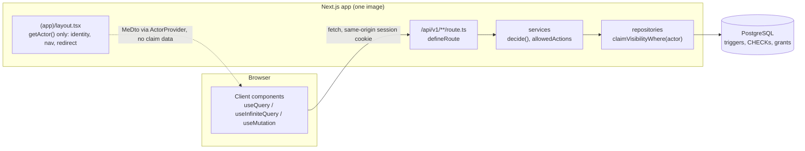
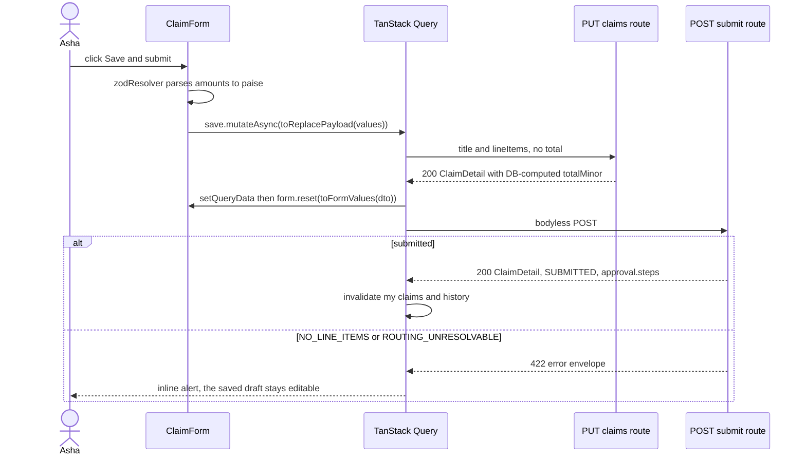

# 05 — Frontend (React in the Next.js App Router)

> Scope: everything the browser runs: pages, data fetching, forms, receipts UX, history UI, lists, the finance export page, the UI kit, money and date display, accessibility and frontend tests.
> Authoritative contracts: [`PLAN.md`](../../PLAN.md) and the canonical decisions D-04, D-09, D-10, D-27, D-30, D-50. API shapes and error codes are owned by [04-security-and-api](./04-security-and-api.md). Lifecycle and audit events by [02-domain-and-workflow](./02-domain-and-workflow.md). Export semantics and date-range helpers by [06-cross-cutting](./06-cross-cutting.md). The test harness by [07-testing](./07-testing.md).
> Budget: **~22–25 h of frontend work** across P1–P7. One list component is reused 3× and one `ClaimDetailView` is reused 3×.

---

## 1. Decisions at a glance

| # | Decision | Why (say this in the walkthrough) | Rejected |
|---|---|---|---|
| F1 | **All data goes through `/api/v1`** via TanStack Query in Client Components. Server Components render only the shell (`getActor()` from `@/server/auth/rsc`) | "There is one door to the data. The UI is an API client, so the §6 tests hit the same endpoint the UI uses. Lint stops the UI from importing Prisma, so it can't bypass authorization" | RSC reads through services (a second read path); RSC fetching its own API; Server Actions; tRPC |
| F2 | **No optimistic updates for money or status.** Mutations render the server's `ClaimDetail`. Mutations never auto-retry | "The total comes from a Postgres trigger and the status from the state machine. A guess in the browser could show a number the DB would refuse" | Optimistic updates with rollback; retrying transitions |
| F3 | **Buttons render only from server `allowedActions`** (`EDIT`, `SUBMIT`, `RECALL`, `DELETE`, `APPROVE`, `REJECT`) | "The UI never re-implements the state machine. Hiding is cosmetic; the server re-decides every call" | Client-side `if (status === … && role …)` logic |
| F4 | **One set of shared Zod schemas** (`src/shared/schemas/*`) used by route handlers and by react-hook-form via `zodResolver`. The only client-specific schema turns `"450.50"` into the server's `amountMinor` rule | "Rules are written once and enforced twice: the browser for UX, the server for truth" | Hand-written client validation |
| F5 | **Integer paise on the wire.** Parse with string math; format by giving `Intl.NumberFormat('en-IN')` a decimal **string**. `inputMode="decimal"`, never `type=number` | "`0.29 * 100` is `28.999999999999996` in JS. We never multiply a float" | `parseFloat * 100`; decimal.js/dinero |
| F6 | **Expense dates are `YYYY-MM-DD` strings end to end** (native `<input type=date>`). Instants are UTC on the wire and shown in Asia/Kolkata with an "IST" label | "A calendar date has no timezone; an instant does. Finance closes the books in IST, so the UI shows IST" | Browser-local display; date-picker libraries |
| F7 | **Filters live in the URL**, parsed by the API's own query schemas (`useUrlQuery`). Lists use `useInfiniteQuery` with cursor and "Load more" | "Shareable, survives refresh, deep-linkable by Playwright, and the server filters and pages, never the browser" | nuqs; component state; offset pages |
| F8 | **Tailwind 4 + shadcn/ui**, native `<select>` and date inputs, react-hook-form `useFieldArray`. React Compiler off | "Accessible copy-in components with no lock-in. Native inputs work on phones and in tests with no polyfills" | MUI/Chakra; Radix Select; TanStack Table; Redux/Zustand |
| F9 | **Out-of-scope claim = the same "Claim not found" view** as a nonexistent one. Role-section mismatch = `<ForbiddenView>` | "Same words for 'doesn't exist' and 'not yours', so IDs can't be probed: the UI mirrors the API's 404" | 403 for foreign claims (confirms existence); experimental `forbidden()` |

---

## 2. Data-fetching architecture

### 2.1 One transport, one enforcement path



- **Pages are thin.** `page.tsx` awaits `params`, validates the id shape and renders a client "screen". It does no reads.
- **The cost we accept** is ~100 ms of skeletons on first paint. This is an authenticated internal tool, so SEO and data-in-HTML don't matter. If they ever do, `prefetchQuery` + `<HydrationBoundary>` calling the same service is additive; components and keys stay the same.
- **Guardrails** (owned by [01](./01-architecture-and-stack.md)): ESLint forbids `@/server/**` and Prisma in `src/{components,features,lib,shared}`. Pages and layouts may import only `@/server/auth/rsc` (built in P0 as the regex `'^@/server(?:$|/(?!auth/rsc$))'`, because a gitignore-style negation can't re-include a file under an excluded directory). `'use server'` and `'use cache'` are lint errors. No `NEXT_PUBLIC_*` variables exist; the client learns everything from the API.

### 2.2 What Server Components may do (UX gates only)

```tsx
// src/app/(app)/layout.tsx — Server Component
import { redirect } from 'next/navigation';
import { getActor } from '@/server/auth/rsc';
export default async function AppLayout({ children }: { children: React.ReactNode }) {
  const actor = await getActor();                       // same session verifier as defineRoute
  if (!actor) redirect('/login');
  const me = { ...actor, isFinance: actor.role === 'FINANCE' };   // = MeDto
  return <ActorProvider me={me}><AppShell>{children}</AppShell></ActorProvider>;
}

// src/app/(app)/finance/layout.tsx  (approvals/layout.tsx is the same with canApprove && role !== 'FINANCE')
export default async function FinanceLayout({ children }: { children: React.ReactNode }) {
  const actor = await getActor();
  if (!actor) redirect('/login');
  return actor.role === 'FINANCE' ? children : <ForbiddenView area="Finance" />;
}
```

- Layout checks don't re-run on every client navigation and guard **no data**; the API's 401/403/404 is the boundary. A role change takes effect on the API's next request (roles are read live); the nav catches up on the next full load.
- `proxy.ts` only redirects cookie-less page requests to `/login?next=…` (using `sessionCookieName()`); its matcher excludes `/api`, so multipart bodies are never buffered. Deleting it changes nothing about security ([04](./04-security-and-api.md)). `(auth)/layout.tsx` sends a signed-in user from `/login` to `/claims`; `(app)/page.tsx` does `redirect('/claims')`.
- **`<Providers>` (QueryClient and Toaster) wraps the root `src/app/layout.tsx`**, not `(app)/layout.tsx`, so `/login` (outside `(app)`) gets toasts and a QueryClient too. `(app)/layout.tsx` only calls `getActor()` and renders the nav. In P1, delete the `src/app/page.tsx` that `create-next-app` scaffolds: next to `(app)/page.tsx` it makes two pages resolve to `/`, which fails the build.

### 2.3 Providers and QueryClient defaults

```tsx
// src/components/providers.tsx
'use client';
const goLogin = () => window.location.assign(`/login?next=${encodeURIComponent(location.pathname + location.search)}`);
const isUnauth = (e: unknown) => e instanceof ApiError && e.code === 'UNAUTHENTICATED';   // not INVALID_CREDENTIALS

export function Providers({ children }: { children: React.ReactNode }) {
  const [qc] = useState(() => new QueryClient({
    queryCache: new QueryCache({ onError: (e) => { if (isUnauth(e)) { qc.clear(); goLogin(); } } }),
    mutationCache: new MutationCache({
      onError: (e, _v, _c, m) => {
        if (isUnauth(e)) { qc.clear(); return goLogin(); }
        if (m.options.meta?.handlesErrors) return;                 // the feature renders its own UX
        const d = describeApiError(e); toast.error(d.title, { description: d.reference });
      },
    }),
    defaultOptions: {
      queries: { staleTime: 15_000, refetchOnWindowFocus: true,    // approver returns to tab → fresh queue
                 retry: (n, e) => !(e instanceof ApiError && e.status >= 400 && e.status < 500) && n < 2 },
      mutations: { retry: false },                                 // never auto-retry a state transition
    },
  }));
  return <QueryClientProvider client={qc}>{children}<Toaster richColors closeButton /></QueryClientProvider>;
}
```

**No retry on 4xx:** a foreign claim's 404 must render "not found" immediately, not after three retries. **Logout** = `POST /api/v1/auth/logout` (204) → `window.location.assign('/login')`; the full navigation drops every cached claim, so the next person on a shared machine sees nothing.

### 2.4 Query keys and cache rules (`src/lib/query-keys.ts`)

```ts
export const qk = {
  categories: ['categories'] as const,                                   // staleTime 1 h
  myClaims:   (q: ClaimListQuery) => ['claims', 'mine', q] as const,
  claim:      (id: string) => ['claims', 'detail', id] as const,
  history:    (id: string) => ['claims', 'history', id] as const,
  approvals:  (q: ApprovalQueueQuery) => ['approvals', q] as const,
  financeClaims: (q: FinanceClaimsQuery) => ['finance', 'claims', q] as const,
};
```

| Mutation | On success |
|---|---|
| Create (`POST /claims`) | `setQueryData(qk.claim(id), dto)`; invalidate `['claims','mine']`; `router.replace('/claims/' + id)` |
| Save (`PUT`) | `setQueryData(qk.claim(id), dto)`; `form.reset(toFormValues(dto))`; invalidate `['claims','mine']` |
| Delete draft | `removeQueries(qk.claim(id))`; invalidate `['claims','mine']`; `router.replace('/claims')` |
| Submit / recall | `setQueryData(qk.claim(id), dto)`; invalidate `['claims','mine']` and `qk.history(id)` |
| Approve / reject | `setQueryData(qk.claim(id), dto)`; invalidate `['approvals']` and `qk.history(id)`; `router.push('/approvals')` |
| Receipt upload / delete | invalidate `qk.claim(id)` |

Replacing the cached detail with the server DTO is what puts the DB-computed `totalMinor`, the new `status`, the chain and the new `allowedActions` on screen.

### 2.5 Frontend folder slice (C-18)

```
src/app/                  layout.tsx (<html lang="en-IN">, <Providers>), not-found.tsx, global-error.tsx,
                          (auth)/{layout.tsx, login/page.tsx}, (app)/{layout.tsx, page.tsx, error.tsx},
                          (app)/claims/{page, new/page, [id]/page}.tsx, (app)/approvals/{layout, page, [claimId]/page}.tsx,
                          (app)/finance/{layout, claims/page, claims/[id]/page, export/page}.tsx
src/features/auth/        LoginForm, api.ts
src/features/claims/      api.ts, form-schema.ts, ClaimForm, LineItemEditor, LineItemsTable, ClaimDetailView,
                          ClaimActionsBar, RecallDialog, DeleteDraftDialog, banners/, receipts/{upload.ts, ReceiptList}
src/features/approvals/   api.ts, columns.ts, DecisionPanel, ApproveDialog, RejectDialog
src/features/finance/     api.ts, columns.ts, ExportForm
src/components/ui/        shadcn (copied in, owned by us)
src/components/           providers.tsx, app-shell/{AppShell, NavLinks, UserMenu, ActorProvider}, common/* (§12)
src/lib/                  api-client.ts (apiFetch, ApiError, describeApiError, applyServerIssues, toSearch),
                          query-keys.ts, use-url-query.ts
src/shared/               enums.ts, errors.ts, policy.ts, money.ts, dates.ts, schemas/*, dto/*   (isomorphic)
```

---

## 3. Layout and navigation

**Shell:** a top bar with the product name, nav links and a user menu (name, email, role chip "Employee" / "Approver" / "Finance" / "Admin", **Sign out**); a breadcrumb row on detail pages; footer "All times in IST". Nav links wrap on narrow screens (a `Sheet` menu is OPTIONAL). **Nav comes from the server-computed `MeDto` capability flags** (`canApprove`, `isFinance`, C-01), never from claim data.

| Nav item | Shown when | Everyone | Approver | Finance | Admin |
|---|---|---|---|---|---|
| My claims `/claims` | always | ✓ | ✓ | ✓ | ✓ |
| New claim `/claims/new` | always | ✓ | ✓ | ✓ | ✓ |
| Approvals `/approvals` | `me.canApprove && !me.isFinance` | – | ✓ | – | – |
| Finance claims `/finance/claims` | `me.isFinance` | – | – | ✓ | – |
| Export `/finance/export` | `me.isFinance` | – | – | ✓ | – |

Every user is a claimant (Farah files C12). ADMIN gets nothing extra: there's no admin UI, and config goes through owner scripts.

---

## 4. Page map per role

### 4.1 Route table

| Route | Who reaches it (UX gate) | Purpose (§) | Data | Actions | Class |
|---|---|---|---|---|---|
| `/login` | public | Sign in (§6 every route authenticated) | `POST /api/v1/auth/login` → 200 `{data:{user}}` | Sign in | CORE |
| `/` | signed in | `redirect('/claims')` | — | — | CORE |
| `/claims` | everyone | My claims; filter by status and created date (§3.5) | `GET /api/v1/claims` | New claim, open claim | CORE |
| `/claims/new` | everyone | Create a draft with lines (§3.1) | `GET /categories`, `POST /claims` | Save draft | CORE |
| `/claims/[id]` | whoever the API lets see it (owner in practice) | Detail, editor, receipts, banners, chain, history (§3.1–§3.4) | `GET /claims/:claimId`, `GET …/history`, `GET /categories` | From `allowedActions`: Save draft, Submit / Resubmit, Save & submit, Recall, Delete draft, attach/remove receipts; downloads | CORE |
| `/approvals` | approvers | Queue: Pending / Decided, date range (§3.2, §3.5, §6) | `GET /api/v1/approvals` | Open review | CORE (Decided sub-filter OPTIONAL) |
| `/approvals/[claimId]` | approvers | Review, then approve (confirm) or reject (reason) (§3.2, §3.3) | `GET /claims/:claimId`, `GET …/history`, `POST …/approve`, `POST …/reject` | Approve, Reject | CORE |
| `/finance/claims` | finance | All employees' claims, read-only; status, date and `dateField` filters (§3.5) | `GET /api/v1/finance/claims` | Open | CORE |
| `/finance/claims/[id]` | finance | Read-only detail | `GET /claims/:claimId`, `GET …/history` | Downloads only | CORE |
| `/finance/export` | finance | Period picker and CSV download (§3.6) | `GET /api/v1/finance/exports/approved-claims` (native download) | Download CSV | CORE (summary card OPTIONAL) |
| `not-found.tsx`, `<NotFoundView kind="claim">`, `<ForbiddenView>` | — | 404 / 403 UX | — | — | CORE |

### 4.2 Page specs

**`/login`.** RHF + `LoginInput`. `INVALID_CREDENTIALS` shows a single form-level message, "Email or password is incorrect", so it never says which part was wrong. On 200, `window.location.assign(safeNext)`, where `safeNext = n?.startsWith('/') && !n.startsWith('//') && !n.startsWith('/\\') ? n : '/claims'`; this closes the open-redirect hole. OPTIONAL: a "Demo accounts" hint listing the `@acme.test` emails (never the password) when `DEMO_MODE=true`, exposed through a tiny `isDemoMode()` in `@/server/auth/rsc`, the only server module a page may import.

**`/claims`.** `PagedTable` (§10) + `FilterBar`: Status (All, Draft, In approval, Approved, Rejected), Created from / to ("Created date, IST"), Clear. Columns: Claim # (a real `<Link>`), Title, Status badge, Created, Submitted, Lines, Total (right-aligned, `tabular-nums`). Empty: "No claims yet" + "Create your first claim"; filtered-empty: "No claims match these filters" + "Clear filters".

**`/claims/new`.** `<ClaimForm>` in create mode: title plus one empty line row. Save draft sends `POST /api/v1/claims` with `CreateClaimInput`. A draft with zero lines is allowed; submission is what's blocked (`NO_LINE_ITEMS`). Receipts need a saved line, so the hint reads "Save the draft to attach receipts".

**`/claims/[id]`, `/approvals/[claimId]`, `/finance/claims/[id]`.** All three render one `<ClaimDetailView claimId context="owner" | "approver" | "finance">`. `context` changes only breadcrumbs, chips and the decision panel's placement. **It never decides which actions render**; `allowedActions` does.

```
My claims / EXP-2026-000123                                                   [✕ Rejected]
Hotel stay, Pune                        Revision 1 · Submitted 2 Oct 2026, 10:12 am IST
┌ STATUS BANNER (one of: recalled / in approval / rejected / approved-locked) ───────────────┐
│ ✕ Rejected by Ravi Menon · 4 Oct 2026, 4:05 pm IST · revision 1, level 1                  │
│ “Hotel invoice missing for 3 Oct”                                                         │
│ Edit the claim and resubmit. Approval restarts from level 1 using the new total;          │
│ this reason stays in the history below.                                                  │
└───────────────────────────────────────────────────────────────────────────────────────────┘
Line items                                               (editor if EDIT, else read-only table)
 #  Date         Category          Description           Merchant     Amount (₹)   Receipts
 1  03 Oct 2026  Hotels & lodging  Hotel, 2 nights       Hotel Blue    8,400.00    invoice.pdf ↓  [Attach] [Remove]
 2  03 Oct 2026  Local transport   Cab to client office  —             3,600.00    [Attach]
 [+ Add line item]
 Total (calculated by the database) ₹12,000.00     Unsaved total (preview) ₹12,500.00
                                   [Discard changes] [Save draft] [Save & resubmit]
Approval chain   1 Ravi Menon · Line manager ✕ Rejected 4 Oct  →  2 Meera Iyer · Skip-level manager – Cancelled
History          revision groups → events (§9) · "View submitted lines" per revision
```

- `/claims/[id]`: a visible non-owner sees the view read-only, plus a "Review in Approvals" link when `APPROVE` ∈ `allowedActions`. `/approvals/[claimId]`: the `DecisionPanel` renders only when `allowedActions` ∋ `APPROVE` / `REJECT`. `/finance/claims/[id]`: a "Read-only (Finance)" chip; finance on someone else's claim always gets `allowedActions: []`.
- `/approvals`, `/finance/claims`, `/finance/export`: see §10 and §11.

**404 / 403.** `<NotFoundView kind="claim">` ("Claim not found. It may not exist, or it isn't shared with you.") renders on API `CLAIM_NOT_FOUND` and, without fetching, when the route id fails `z.uuid()`. `app/not-found.tsx` covers unknown pages. `<ForbiddenView area>` covers a section-gate mismatch or API `FORBIDDEN` ("You don't have access to Finance."). Because data is client-fetched, the **document** status of an in-page not-found view is 200; the security-relevant 404 is the API response, and TC-E02 asserts both. Say so in the walkthrough before the RM finds it.

---

## 5. API client and error UX

### 5.1 `apiFetch` and `ApiError` (`src/lib/api-client.ts`)

```ts
export type ClientErrorCode = ErrorCode | 'NETWORK_ERROR' | 'UNEXPECTED_RESPONSE';   // ErrorCode from src/shared/errors.ts
export class ApiError extends Error {
  constructor(readonly status: number,                // 0 = never reached the server
              readonly code: ClientErrorCode, message: string,
              readonly details?: { issues?: ApiIssue[]; hint?: string; [k: string]: unknown },
              readonly requestId?: string) { super(message); this.name = 'ApiError'; }
}
export const one    = <T extends z.ZodType>(s: T) => z.object({ data: s }).transform((b) => b.data);
export const pageOf = <T extends z.ZodType>(s: T) =>
  z.object({ data: z.array(s), page: z.object({ nextCursor: z.string().nullable(), limit: z.number().int() }) });

export function toApiError(status: number, json: unknown, headerRequestId?: string): ApiError {
  const env = ErrorEnvelope.safeParse(json);                       // { error: { code, message, details?, requestId } }
  return env.success
    ? new ApiError(status, env.data.error.code, env.data.error.message, env.data.error.details, env.data.error.requestId)
    : new ApiError(status, 'UNEXPECTED_RESPONSE', `Unexpected ${status} from server`, undefined, headerRequestId);
}

export async function apiFetch<T = undefined>(path: `/api/v1/${string}`,
  opts: { method?: 'GET' | 'POST' | 'PUT' | 'DELETE'; body?: unknown; signal?: AbortSignal; schema?: z.ZodType<T> } = {}): Promise<T> {
  let res: Response;
  try {
    res = await fetch(path, {
      method: opts.method ?? 'GET', credentials: 'same-origin', cache: 'no-store', signal: opts.signal,
      headers: { accept: 'application/json', ...(opts.body !== undefined && { 'content-type': 'application/json' }) },
      body: opts.body === undefined ? undefined : JSON.stringify(opts.body),   // bodyless POST for /submit
    });
  } catch (e) {
    if (e instanceof DOMException && e.name === 'AbortError') throw e;
    throw new ApiError(0, 'NETWORK_ERROR', 'Could not reach the server. Check your connection and try again.');
  }
  const rid = res.headers.get('x-request-id') ?? undefined;
  if (res.status === 204) return undefined as T;
  const json: unknown = await res.json().catch(() => null);
  if (!res.ok) throw toApiError(res.status, json, rid);
  const parsed = opts.schema ? opts.schema.safeParse(json) : { success: true as const, data: json as T };
  if (!parsed.success) throw new ApiError(res.status, 'UNEXPECTED_RESPONSE', 'Server response did not match the expected shape', undefined, rid);
  return parsed.data;
}
```

- **Responses are parsed with the shared DTO schemas** (`src/shared/dto/*`). Unknown extra fields are stripped, so the backend can add fields. Enums are exact, so contract drift fails loudly instead of rendering `NaN`.
- **Every error surface shows "Reference: `<requestId>`"** in muted monospace. Support greps the pino logs for it, and it equals `claim_events.request_id` for audited actions ([06](./06-cross-cutting.md)).

### 5.2 Error code → UX (`describeApiError` + per-feature handlers)

| Code (HTTP) | Where it shows up | UX |
|---|---|---|
| `UNAUTHENTICATED` (401) | anywhere | Global: `qc.clear()` → `/login?next=<current>` |
| `INVALID_CREDENTIALS` (401) | /login | Form-level "Email or password is incorrect" |
| `FORBIDDEN` (403) | role sections, decisions | Queries: `<ForbiddenView>`. Mutations: toast "You don't have permission to do that" |
| `NOT_IN_YOUR_QUEUE` (403) | approve / reject | Toast "This claim is no longer waiting for you. It may have been recalled or decided." Invalidate `['approvals']` and the claim → `router.push('/approvals')` |
| `CLAIM_NOT_FOUND` (404) | detail queries, owner mutations | `<NotFoundView kind="claim">`, with the same copy for "doesn't exist" and "not yours" |
| `LINE_ITEM_NOT_FOUND` (404) | save | Dialog "This claim changed in another tab. Reload to see the latest; your unsaved edits will be lost." [Reload] [Keep editing] |
| `RECEIPT_NOT_FOUND` (404) | receipt delete | Row error, then refetch the claim |
| `CLAIM_LOCKED` (409) | save, submit, recall, receipts, delete | Refetch → locked banner, editor read-only; toast "This claim is approved and locked." |
| `CLAIM_NOT_EDITABLE` (409, `hint: 'RECALL_TO_EDIT'`) | save, receipts | Refetch → read-only; toast "This claim is in approval. Recall it to make changes", with a Recall action if `RECALL` is now allowed |
| `INVALID_STATUS_TRANSITION` (409) | submit, recall | Refetch; toast with the server message |
| `ALREADY_DECIDED` (409) | approve / reject | Toast "You already decided this revision"; refetch |
| `REVISION_MISMATCH` (409, `{requestedRevision, currentRevision}`) | approve / reject | Close the dialog, refetch, banner "This claim was resubmitted as revision N while you were reviewing. Review the latest version before deciding." |
| `CLAIM_HAS_HISTORY` (409) | delete draft | Refetch; toast "This claim was submitted before, so it can't be deleted" |
| `CONFLICT` (409, `retryable`) | any mutation | Toast "Another change hit this claim at the same moment" with a **Try again** action (manual; never automatic) |
| `VALIDATION_FAILED` (422) | any form | `applyServerIssues` maps `details.issues[].path` onto fields and focuses the first. Unmapped issues (e.g. path `['lineItems']` for the claim cap) go to an `<Alert role="alert">` summary |
| `NO_LINE_ITEMS` (422) | submit | Error on the Line items section: "Add at least one line item before submitting"; focus moves to "Add line item" |
| `CATEGORY_INACTIVE` (422) | save, submit | Field error if a path is given, else an alert "A category on this claim has been retired. Choose another and save again"; invalidate `qk.categories` |
| `ROUTING_UNRESOLVABLE` (422, `{tierCode, level}`) | submit | Alert "No eligible approver was found for approval level {level}. The claim was not submitted. Contact your administrator." It never says why (HR privacy) |
| `RECEIPT_TYPE_NOT_ALLOWED`, `RECEIPT_LIMIT_REACHED` (422), `PAYLOAD_TOO_LARGE` (413) | upload | Error under that line's receipt list (§8) |
| `INVALID_CURSOR` (422) | Load more | `qc.resetQueries(listKey)` → page 1; toast "The list changed; showing the first page again" |
| `EXPORT_RANGE_TOO_LARGE`, `EXPORT_STATUS_NOT_ALLOWED` (422) | export | Prevented client-side (§11). If the server still refuses, it shows as a failed browser download |
| `MALFORMED_JSON` (400), `UNSUPPORTED_MEDIA_TYPE` (415), `TOTAL_IS_DERIVED`, `READ_ONLY_FIELD` (422), `CSRF_REJECTED` (403), `ROUTE_NOT_FOUND` (404) | never from our forms (a UI bug) | Generic "The app sent a request the server refused" + reference; `console.error` in dev |
| `RATE_LIMITED` (429, OPTIONAL) | login | "Too many attempts. Try again in a moment" (`Retry-After`) |
| `INTERNAL_ERROR` (500), `UNEXPECTED_RESPONSE` | anywhere | Toast "Something went wrong" + reference. Queries show `<QueryErrorView>` with Retry |
| `SERVICE_UNAVAILABLE` (503) | anywhere | "The service is temporarily unavailable" + Retry (queries auto-retry ×2) |
| `NETWORK_ERROR` (client) | anywhere | "You appear to be offline"; cached data stays, Retry shown |
| unknown code | anywhere | Show the server `message` (server messages are written to be user-safe) + reference |

### 5.3 Server field issues → form fields

```ts
export function applyServerIssues<T extends FieldValues>(err: ApiError, setError: UseFormSetError<T>,
  mapPath: (p: (string | number)[]) => Path<T> | null): ApiIssue[] {
  const unmapped: ApiIssue[] = []; let first = true;
  for (const issue of err.details?.issues ?? []) {
    const name = mapPath(issue.path);
    if (name) { setError(name, { type: 'server', message: issue.message }, { shouldFocus: first }); first = false; }
    else unmapped.push(issue);
  }
  return unmapped;                                                   // rendered in the summary Alert
}
// src/features/claims/form-schema.ts — payload order == form order, so indexes line up
export const claimPathMap = (p: (string | number)[]): Path<ClaimFormInput> | null => {
  const [a, i, f] = p;
  if (a === 'title') return 'title';
  if (a === 'lineItems' && typeof i === 'number') {
    const field = f === 'amountMinor' ? 'amount' : f === 'id' ? 'lineItemId' : f;
    if (['expenseDate', 'categoryId', 'amount', 'description', 'merchant', 'lineItemId'].includes(String(field)))
      return `lineItems.${i}.${field}` as Path<ClaimFormInput>;
  }
  return null;
};
```

"A real category" (§6) and "not in the future, IST" are finally decided on the server (FK/active flag, UC014). Their errors still land under the right row's control.

---

## 6. Forms

### 6.1 Shared schemas

`src/shared/schemas/claims.ts` exports the request schemas (`LineItemInput`, `CreateClaimInput`, `ReplaceClaimInput`, `RecallInput`, `ApproveInput`, `RejectInput`) and their **field schemas** (`TitleSchema`, `ExpenseDateSchema`, `AmountMinorSchema`, `DescriptionSchema`, `MerchantSchema`, `RejectReasonSchema`), built from `src/shared/policy.ts` (C-14). The rules are D-28 verbatim (full table in [04](./04-security-and-api.md)): title 3..120 trimmed; `expenseDate` valid ISO, ≥ `2000-01-01`, ≤ today IST; `categoryId` uuid (existence and active flag checked server-side); `amountMinor` integer 1..100,000,000; description 3..500 trimmed; merchant ≤ 120; 0..50 lines with Σ ≤ 1,000,000,000; reject reason 10..1000 trimmed; approve comment ≤ 1000; recall note ≤ 500.

Request schemas are **strict**: a smuggled `totalMinor` is a 422 `TOTAL_IS_DERIVED`, never silently stripped. Zod 4 gotcha: compose object shapes by spreading, *then* refine; `.extend()` / `.omit()` throw on an object that already has refinements.

### 6.2 The form adapter: the only client-specific schema (`src/features/claims/form-schema.ts`)

```ts
export const MoneyStringSchema = z.string().transform((raw, ctx) => {
  const r = parseMoneyToMinor(raw);
  if (!r.ok) { ctx.issues.push({ code: 'custom', message: r.message, input: raw }); return z.NEVER; }
  return r.value;
}).pipe(AmountMinorSchema);                                  // the server's exact rule, re-applied

export const LineItemFormSchema = z.object({
  lineItemId: z.uuid().optional(),                           // RHF useFieldArray reserves `id` for its own keys
  expenseDate: ExpenseDateSchema, categoryId: z.uuid({ error: 'Choose a category' }),
  amount: MoneyStringSchema,                                 // what the human types: "1,250.50"
  description: DescriptionSchema, merchant: MerchantSchema,
});
export const ClaimFormSchema = z.object({ title: TitleSchema, lineItems: z.array(LineItemFormSchema).max(MAX_LINE_ITEMS) });
export type ClaimFormInput  = z.input<typeof ClaimFormSchema>;     // amount: string
export type ClaimFormOutput = z.output<typeof ClaimFormSchema>;    // amount: number (paise)

export const toReplacePayload = (v: ClaimFormOutput): ReplaceClaimInput => ReplaceClaimInput.parse({
  title: v.title,                                                  // belt and braces: identical to the server contract
  lineItems: v.lineItems.map(({ lineItemId, amount, merchant, ...rest }) =>
    ({ ...rest, ...(lineItemId && { id: lineItemId }), ...(merchant && { merchant }), amountMinor: amount })),
});
export const toFormValues = (c: ClaimDetail): ClaimFormInput => ({
  title: c.title,
  lineItems: c.lineItems.map((li) => ({ lineItemId: li.id, expenseDate: li.expenseDate, categoryId: li.category.id,
    amount: toDecimalString(li.amountMinor), description: li.description, merchant: li.merchant ?? '' })),
});
```

**Gotcha for the walkthrough:** `useFieldArray` overwrites a field named `id` with its own generated key. Keeping the server id as `lineItemId` stops it being silently lost, which would turn every edit into delete + insert. TC-C01 proves this.

### 6.3 `ClaimForm` and `LineItemEditor`

```tsx
export function ClaimForm({ claim, categories, onSave }: {
  claim?: ClaimDetail; categories: CategoryDto[]; onSave: (p: ReplaceClaimInput) => Promise<ClaimDetail>;
}) {
  const editable = !claim || claim.allowedActions.includes('EDIT');            // server decides; we only render
  const form = useForm<ClaimFormInput, unknown, ClaimFormOutput>({
    resolver: zodResolver(ClaimFormSchema), mode: 'onBlur', reValidateMode: 'onChange',
    defaultValues: claim ? toFormValues(claim) : { title: '', lineItems: [emptyLine()] },
  });
  const { fields, append, remove } = useFieldArray({ control: form.control, name: 'lineItems' });
  useEffect(() => { if (claim && !form.formState.isDirty) form.reset(toFormValues(claim)); }, [claim]);  // never clobber edits
  const submit = form.handleSubmit(async (v) => {
    try { const dto = await onSave(toReplacePayload(v)); form.reset(toFormValues(dto)); }   // new rows get server ids
    catch (e) { if (e instanceof ApiError && e.code === 'VALIDATION_FAILED') setSummary(applyServerIssues(e, form.setError, claimPathMap)); else throw e; }
  });
  if (!editable && claim) return <LineItemsTable lines={claim.lineItems} claimId={claim.id} />;
  /* title Field, LineItemEditor rows, <UnsavedTotal control={form.control} />, Add line item, Save draft */
}
const emptyLine = () => ({ expenseDate: todayInBusinessTz(), categoryId: '', amount: '', description: '', merchant: '' });
```

- **Rows** are a responsive CSS grid: a table at ≥ `md`, stacked fields below (card styling OPTIONAL). Every control has a visually hidden label ("Date for line 2", "Category for line 2", "Description for line 2", "Merchant for line 2", "Amount for line 2"), which doubles as the stable `getByLabel` selector for tests.
- **Add line item** focuses the new row's date and is disabled at 50 rows. **Remove** on a row with receipts confirms first ("…also removes its receipts; earlier submitted revisions keep their copies"). **Zero rows** shows "No line items yet", and Submit (still from `allowedActions`) is disabled with the hint "Add at least one line item"; the server's `NO_LINE_ITEMS` is the authority.
- **Read-only mode** is `LineItemsTable`: a plain `<table>` with download links and no inputs. The history reuses it for snapshot lines (§9).
- **Reset rule:** the form resets from the server DTO only after its own successful save or while clean, so a window-focus refetch never wipes unsaved edits. OPTIONAL: `beforeunload` guard, duplicate row, undo-remove.

### 6.4 Inputs

- **Amount.** `<Input inputMode="decimal" autoComplete="off">` with a `₹` addon (`input-group`). Never `type="number"`: it accepts `1e3`, changes on scroll, drops trailing zeros and varies by locale. On blur a valid value is normalised to the plain `1250.50` form. Parsing accepts en-IN grouping (`1,23,456.78`).
- **Date.** Native `<input type="date" min="2000-01-01" max={todayInBusinessTz()}>`. Its value already is the `YYYY-MM-DD` wire format, so no `Date` object and no timezone shift are involved. Playwright can `fill('2026-10-05')`.
- **Category.** A native `<select>` (shadcn `native-select`) filled from `GET /api/v1/categories` (cached 1 h). Options are the active categories sorted by `sortOrder`. The placeholder "Choose a category" has value `''`, which fails `z.uuid()`. A saved line whose category was since retired shows "Per diem (retired)" as an extra disabled-looking option so the row renders; saving gets `CATEGORY_INACTIVE` on that row.

### 6.5 Saved total vs unsaved preview (§3.1)

```tsx
function UnsavedTotal({ control }: { control: Control<ClaimFormInput> }) {
  const items = useWatch({ control, name: 'lineItems' }) ?? [];      // isolated: only this re-renders per keystroke
  let total = 0, invalid = 0;
  for (const li of items) { const r = parseMoneyToMinor(li?.amount ?? ''); r.ok ? (total += r.value) : invalid++; }
  return (
    <p data-testid="unsaved-total" className="text-sm text-muted-foreground tabular-nums">
      Unsaved total (preview): {formatMinor(total)}
      {invalid > 0 && ` · ${invalid} line(s) with invalid amounts excluded`}
      {total > MAX_CLAIM_TOTAL_MINOR && ' · exceeds the ₹1,00,00,000.00 claim limit'}
    </p>
  );
}
```

- The headline is `<span data-testid="saved-total">` = `claim.totalMinor`, labelled "Total (calculated by the database)". The preview appears only while the form is dirty (and on `/claims/new`); it is integer arithmetic (50 × 1e8 < 2^53), so `0.10 + 0.20` shows `₹0.30`.
- **The total is never sent:** no field exists, `toReplacePayload` can't produce one, the request schema is strict, and the DB trigger owns the column ([03](./03-data-model-and-integrity.md)).

### 6.6 The line-item save contract, from the UI's side (D-27)

- **One atomic request.** `PUT /api/v1/claims/:claimId` `{ title, lineItems: [{ id?, expenseDate, categoryId, amountMinor, description, merchant? }] }` (0..50 lines) replaces the whole set in one transaction: rows with `id` are updated, rows without are inserted, missing ids are deleted, and an id not on this claim → 404 `LINE_ITEM_NOT_FOUND` before anything is written. The response is the fresh `ClaimDetail`.
- **Why:** the user edits a set and presses Save once; one request = one transaction = one commit-time total check, so a claim is never half-saved. Rejected: client diffs with N per-line calls (partial failure), autosave.
- **After success, `form.reset(toFormValues(dto))`**, otherwise newly inserted rows have no `lineItemId` and the next save inserts them again.
- **Two tabs of the same claimant** are last-write-wins (claim `version` is OPTIONAL, D-17), harmless because the total is DB-derived; a kept line deleted elsewhere surfaces as `LINE_ITEM_NOT_FOUND` → reload dialog. **"Save & submit"** is two atomic calls in sequence; if the save fails we stop.



### 6.7 Mutation hooks (`src/features/*/api.ts`)

| Hook | Request | Body | Error handling (beyond §5.2 defaults) |
|---|---|---|---|
| `useCreateClaim()` | `POST /api/v1/claims` | `CreateClaimInput` | field issues via `claimPathMap` |
| `useSaveClaim(id)` | `PUT /api/v1/claims/:claimId` | `ReplaceClaimInput` | `meta.handlesErrors`: field issues, `LINE_ITEM_NOT_FOUND` dialog, `CLAIM_NOT_EDITABLE` / `CLAIM_LOCKED` refetch |
| `useSubmitClaim(id)` | `POST …/submit` | none | `NO_LINE_ITEMS`, `ROUTING_UNRESOLVABLE`, `CATEGORY_INACTIVE` inline |
| `useRecallClaim(id)` | `POST …/recall` | `RecallInput` `{ note? }` | refetch on 409 |
| `useDeleteDraft(id)` | `DELETE /api/v1/claims/:claimId` | — | `CLAIM_HAS_HISTORY` refetch |
| `useApprove(id)` | `POST …/approve` | `ApproveInput` `{ revision, comment? }` | `NOT_IN_YOUR_QUEUE`, `ALREADY_DECIDED`, `REVISION_MISMATCH` |
| `useReject(id)` | `POST …/reject` | `RejectInput` `{ revision, reason }` | same + reason field error |

Buttons are disabled while `isPending` to stop double submits. If one slips through anyway, the state machine answers 409 and the table above handles it.

**Dialogs:**
- **Recall** ("Recall claim"): copy built from `approval.steps` — "Ravi Menon has already approved level 1. Recalling cancels the remaining approvals; when you resubmit, approval restarts from level 1 based on the new total." Optional note ≤ 500. This puts the §3.2 amount-change rule into the user's words.
- **Approve** captures `revision = claim.currentRevision` **when it opens**, so the approver signs exactly what they looked at. Non-final level: "Level 1 of 2. It will go to Meera Iyer next." Final level: "This is the final approval. The claim will be locked and included in finance exports." Optional comment ≤ 1000 with counter; button "Confirm approval".
- **Reject**: its own RHF form on `RejectInput.pick({ reason: true })` — required, trimmed 10..1000, autofocus, counter, error "Give a reason of at least 10 characters"; destructive "Reject claim" disabled until valid; Esc returns focus to the trigger.
- **Delete draft**: "Delete this draft? This can't be undone." Rendered only when `DELETE` ∈ `allowedActions` (never-submitted drafts).

---

## 7. `allowedActions`-driven buttons: cosmetic, server-enforced

"Delete every `includes(...)` check from the React code and the system is exactly as secure, just uglier."

| UI element | Rendered when (cosmetic) | Server enforcement (authoritative, see [04](./04-security-and-api.md)) |
|---|---|---|
| Line editor, Save draft, Add/Remove line, Attach/Remove receipt | `allowedActions` ∋ `EDIT` | Owner-scoped lock; DRAFT/REJECTED only, else 409 `CLAIM_NOT_EDITABLE` / `CLAIM_LOCKED`; DB UC001/UC002 |
| Submit / Resubmit / Save & submit | ∋ `SUBMIT` (labels "Resubmit" / "Save & resubmit" when status is REJECTED) | State machine; `NO_LINE_ITEMS`; chain built from the DB total |
| Recall claim | ∋ `RECALL` | Owner + SUBMITTED, else 409 |
| Delete draft | ∋ `DELETE` | `current_revision = 0`, else 409 `CLAIM_HAS_HISTORY`; DB UC017 |
| Approve / Reject (`DecisionPanel`) | ∋ `APPROVE` / `REJECT` | Role gate (403 `FORBIDDEN`) → PENDING-scoped lock (403 `NOT_IN_YOUR_QUEUE`) → `revision` (409 `REVISION_MISMATCH`); DB re-checks eligibility (UC008) |
| Total | never editable (no input exists) | Strict Zod 422 `TOTAL_IS_DERIVED`; trigger-only column; commit-time check |
| Claim content at all | API returned 200 | `claimVisibilityWhere(actor)` inside the single SELECT, else 404 |
| Approvals / Finance nav and sections | `MeDto` flags | `defineRoute({ roles })` → 403 `FORBIDDEN`; finance services call `requireRole` |

**Banners are display, not authorization.** They are keyed on `status` (+ `currentRevision`) and never gate an action:

| State | Banner |
|---|---|
| DRAFT, `currentRevision = 0` | none |
| DRAFT, `currentRevision > 0` | "Recalled. Revision N was withdrawn. Edit and resubmit; approval restarts from level 1." |
| SUBMITTED | "In approval: waiting for Meera Iyer (level 2 of 2). To change anything, recall the claim." Recall appears only if `RECALL` is allowed |
| REJECTED | The rejection banner (§9.1). It stays while the claim is edited, because status stays REJECTED until resubmit |
| APPROVED | Lock icon: "Approved on 15 Sep 2026, 6:10 pm IST. This claim is locked. Line items, amounts and receipts can't be changed." |

---

## 8. Receipts UX (per line item, D-30)

**Choice for §3.1:** receipts attach **per line item** and are optional for submission. Finance sees the hotel invoice next to the hotel line instead of matching files by eye.

**Core scope (C-24 cut item 4 is applied up front):** attach, upload, list, download and remove. The `<Progress>` bar and the inline Retry are **BUF polish**; without them an upload shows a disabled Attach with "Uploading…" and failures use the standard §5.2 message.

**Upload** (core = server-proxied multipart; signed URLs are OPTIONAL-§8, see [06](./06-cross-cutting.md)):

```ts
// src/features/claims/receipts/upload.ts — XHR because fetch() has no upload-progress events
export function uploadReceipt(claimId: string, lineItemId: string, file: File,
                              onProgress: (pct: number) => void, signal: AbortSignal): Promise<ReceiptDto> {
  return new Promise((resolve, reject) => {
    const xhr = new XMLHttpRequest();
    xhr.open('POST', `/api/v1/claims/${claimId}/line-items/${lineItemId}/receipts`);
    xhr.responseType = 'json'; xhr.setRequestHeader('accept', 'application/json');
    xhr.upload.onprogress = (e) => { if (e.lengthComputable) onProgress(Math.round((e.loaded / e.total) * 100)); };
    xhr.onload = () => {
      const rid = xhr.getResponseHeader('x-request-id') ?? undefined;
      if (xhr.status === 201) { const p = one(ReceiptDto).safeParse(xhr.response); return p.success ? resolve(p.data) : reject(new ApiError(201, 'UNEXPECTED_RESPONSE', 'Bad response', undefined, rid)); }
      reject(toApiError(xhr.status, xhr.response, rid));
    };
    xhr.onerror = () => reject(new ApiError(0, 'NETWORK_ERROR', 'Upload failed. Check your connection.'));
    signal.addEventListener('abort', () => xhr.abort(), { once: true });
    const fd = new FormData(); fd.append('file', file);           // single field `file`; browser sets the boundary
    xhr.send(fd);
  });
}
```

- **Client pre-checks are UX only** (the server re-checks size, type and magic bytes): `file.type ∈ RECEIPT_TYPES` (`image/jpeg`, `image/png`, `image/webp`, `application/pdf`), else "Only JPEG, PNG, WebP or PDF receipts are accepted"; `file.size ≤ RECEIPT_MAX_BYTES` (10 MiB), else "Receipts must be 10 MB or smaller"; Attach is hidden once a line has `MAX_RECEIPTS_PER_LINE` (5).
- **Attach** is a visually hidden `<input type="file" accept="image/jpeg,image/png,image/webp,application/pdf">` labelled "Attach receipt to line N" (no `capture`, so phones offer camera *or* files). Uploading shows `<Progress value={pct} aria-label="Uploading invoice.pdf">`; failure shows the §5.2 message inline plus Retry. Unsaved lines (no `lineItemId`) show a disabled Attach: "Save the claim first".
- **Receipts render from the server DTO** (`claim.lineItems[].receipts`), not form state, so an upload refreshes the list without touching unsaved edits.
- **Download** is a plain `<a href="/api/v1/claims/:claimId/receipts/:receiptId/content" download>` (name + `formatBytes` size); the server streams it after the visibility check as `Content-Disposition: attachment` + `nosniff`. Owner, chain approvers and finance all get it; snapshot-only receipts of earlier revisions use the same route (§9.3).
- **Remove** (only with `EDIT`) confirms inline → `DELETE /api/v1/claims/:claimId/receipts/:receiptId` → 204 → refetch. **Locked claims** render no Attach/Remove; the server would answer `CLAIM_LOCKED` and the DB UC001 anyway. `proxy.ts` excludes `/api`, so a 10 MiB body is never buffered by the proxy layer.

---

## 9. History: rejection banner, approval chain, timeline

All of this comes from `GET /api/v1/claims/:claimId/history` → `ClaimHistory { submissions[], events[] }`, plus `ClaimDetail.approval` and `lastRejection`.

### 9.1 Rejection banner (§3.3)

The banner renders from `lastRejection { revision, level, reason, by, at }` while `status = REJECTED`. It says who rejected (`by.name`), when (IST), the revision and level, and quotes the reason as text in a `<blockquote>`; React escapes it, so there's no XSS. The next step is spelled out: "Edit the claim and resubmit. Approval restarts from level 1 using the new total; this reason stays in the history below." After resubmission the banner goes away, but the reason remains in the revision 1 group of the timeline.

### 9.2 Approval chain (`<ApprovalChain steps>`)

`<ol aria-label="Approval chain">`, one item per step: level, approver name, `tierLabel` ("Line manager", "Skip-level manager", "Senior leader"), status chip, activated/decided time (IST), and the approve comment or rejection reason under its step. The PENDING step has `aria-current="step"`. Only the **current** revision's chain shows here; earlier chains (cancelled by recall, or rejected) stay in the history, as events in the core raw list and as revision groups in the BUF timeline, which answers §7 Q1 visually: "after recall or resubmit, a brand-new chain built from the new total".

### 9.3 Timeline (`<ClaimTimeline history>`)

**Core is the raw event list** (C-24 cut item 5 is applied up front): an `<ol>` of `history.events`, one `<li data-testid="timeline-event" data-event-type={type}>` each, showing type, actor name, revision, the IST time, the reason or comment as text, and "Ref `<requestId>`". That is enough for §3.3, §7 Q3 and TC-E03; every revision's snapshot stays available through `GET …/history`. The grouped presentation below is **BUF polish**.

- **Grouped by `revision`, oldest first** so it reads like a story. Group header: "Revision 2 · ₹9,500.00 · In approval" from `submissions[].totalMinor` and the derived `outcome` (`IN_APPROVAL`, `APPROVED`, `REJECTED`, `RECALLED`). Each group has a "View submitted lines" disclosure rendering `snapshot.lines` through the same `LineItemsTable`, with receipt downloads, so the content each approver saw is never lost (§3.3).
- **Each event** is `<li data-testid="timeline-event" data-event-type={type}>` with a `<time dateTime={iso}>` in IST and a muted "Ref `<requestId>`", the key that joins the audit row to the logs in a dispute. Names come from `submissions[rev].steps` (payload ids → `UserRef`).

| `type` | Rendered text | Extra |
|---|---|---|
| `CLAIM_SUBMITTED` | "Asha Rao submitted revision 1 · ₹25,000.00 · 2 approval levels: Ravi Menon → Meera Iyer" | if `payload.previousRevision`, adds "after recalling revision N" |
| `CLAIM_RESUBMITTED` | "Asha Rao resubmitted as revision 2 · ₹9,500.00 (revision 1: ₹30,000.00, rejected) · 1 approval level" | from `payload.previousRevision` |
| `STEP_APPROVED` | "Ravi Menon approved level 1 of 2 · next: Meera Iyer" | `reason` (approve comment) quoted |
| `CLAIM_APPROVED` | "Meera Iyer gave the final approval (level 2 of 2). Claim locked" | comment quoted |
| `CLAIM_REJECTED` | "Ravi Menon rejected at level 1 of 1" | reason in a `<blockquote>`, kept forever |
| `CLAIM_RECALLED` | "Asha Rao recalled revision 1 · 1 approval voided, 1 step cancelled" | recall note quoted |
| unknown | "‹type› by ‹actor›" | forward-compatible |

A never-submitted draft has no events by design ("History starts when the claim is submitted. Each submission freezes a snapshot of its lines."); draft edits are not audited ([02](./02-domain-and-workflow.md)). The rendered-text table above is part of the BUF polish; the core list shows the raw type.

---

## 10. Lists: URL filter state and cursor pagination

### 10.1 `useUrlQuery` (`src/lib/use-url-query.ts`)

```ts
export function useUrlQuery<S extends z.ZodType<Record<string, unknown>>>(schema: S) {
  const sp = useSearchParams(); const router = useRouter(); const pathname = usePathname();
  const parsed = schema.safeParse(Object.fromEntries(sp));              // the API's own strict query schema
  const value: z.output<S> = parsed.success ? parsed.data : schema.parse({});   // garbage URL → defaults
  const set = (patch: Record<string, string | string[] | undefined>) => {
    const next = new URLSearchParams(sp);
    for (const [k, v] of Object.entries(patch)) {
      if (v === undefined || v === '' || (Array.isArray(v) && v.length === 0)) next.delete(k);
      else next.set(k, Array.isArray(v) ? v.join(',') : v);
    }
    next.delete('cursor'); next.delete('limit');                       // pagination never lives in the URL
    router.replace(`${pathname}?${next}`, { scroll: false });
  };
  return [value, set] as const;
}
```

- **URL params are the API params** (minus `cursor`/`limit`), so `toSearch(value)` goes straight to the endpoint; parsing with the same strict schema first means the UI never sends a param the API would 422. A `from > to` range fails the shared refinement: `FilterBar` shows "End date must be on or after start date" and leaves the URL alone. `useSearchParams` consumers sit inside `<Suspense>` so `next build` passes.

### 10.2 One list component, reused 3× (`PagedTable<T>`)

```ts
export const approvalsQuery = (q: ApprovalQueueQuery) => infiniteQueryOptions({
  queryKey: qk.approvals(q),
  queryFn: ({ pageParam, signal }) =>
    apiFetch(`/api/v1/approvals?${toSearch({ ...q, cursor: pageParam })}`, { schema: pageOf(ApprovalTask), signal }),
  initialPageParam: undefined as string | undefined,
  getNextPageParam: (last) => last.page.nextCursor ?? undefined,
  placeholderData: keepPreviousData,                                   // no flicker on filter change
});
```

- `<PagedTable query columns rowKey caption empty filteredEmpty />` renders a real `<table>` (`<th scope="col">`, claim number as the row link) and four states: skeleton rows with `aria-busy`, empty, filtered-empty, and `<QueryErrorView>` with Retry + reference. **Load more** calls `fetchNextPage()` and hides when `nextCursor` is null; there is no total count by design (the API runs no `COUNT(*)`).
- Column sets `myClaimsColumns`, `queueColumns(tab)` and `financeColumns` are ~30-line configs; per-role pages are thin wrappers.

### 10.3 Approver queue `/approvals` (§3.2, §6)

- **Tabs bind to `status`:** **Pending** (`status` absent or `PENDING`, oldest routed first — FIFO fairness) and **Decided** (`status=APPROVED,REJECTED`, newest first). OPTIONAL Decided sub-filter "Approved by me" / "Rejected by me" is just `status=APPROVED` / `REJECTED`.
- **Date range** `from`/`to` (IST dates), with helper text naming the field: "Routed to me between" (`activated_at`) on Pending, "Decided between" (`decided_at`) on Decided.
- **Columns** from `ApprovalTask`: Claim #, Employee (`claimant.name`), Title, Level ("1 of 2 · Line manager" from `level`/`levelCount`/`tierLabel`), Amount (`amountMinor`), Routed (`activatedAt`), and a "Resubmitted (rev N)" chip when `revision > 1`. Decided adds My decision (step chip) and Decided at. Empty: "You're all caught up."
- WAITING steps and other approvers' claims never appear because the **server** never returns them (TC-I25), not because the UI filters.

---

## 11. Finance views and export

**`/finance/claims`** (`GET /api/v1/finance/claims`, `FinanceClaimsQuery`) is a plain table, because C-24 cut item 3 is applied up front: the shared `PagedTable` + `FilterBar` with a `financeColumns` config, and nothing finance-specific beyond that. Status select — "Submitted, approved, rejected" (default; DRAFT hidden), "In approval", "Approved", "Rejected", "Drafts", "Everything incl. drafts" (`DRAFT,SUBMITTED,APPROVED,REJECTED`); Date field select — "Submitted date" (`dateField=submittedAt`, default) or "Approved date" (`approvedAt`), plus From/To. Columns: Claim #, Employee, Title, Status, Submitted, Approved, Total. Search by claim number or employee is NOT PLANNED (no API param; it would be a new feature).

**`/finance/claims/[id]`:** `ClaimDetailView context="finance"` — "Read-only (Finance)" chip, `allowedActions = []`, receipt downloads.

**`/finance/export`** (§3.6):
- **Period:** presets **Last month** (default, for month-end close), **This month**, **Custom** fill two labelled native date inputs From / To (`YYYY-MM-DD`, IST) via `monthPeriod(todayInBusinessTz(), offset)`. Validation uses the shared `ExportQuery` schema plus the `EXPORT_MAX_RANGE_DAYS` (366) span rule, so `VALIDATION_FAILED` / `EXPORT_RANGE_TOO_LARGE` can't be triggered from the page. The UI never sends `status` (the server would accept only `APPROVED`).
- **Copy:** "Includes every claim whose **final approval** happened between these dates (inclusive, IST). One row per line item; UTF-8 CSV that opens in Excel. In-flight, rejected and draft claims are never included. An empty period downloads a header-only file."
- **Period-open hint (cosmetic):** when `to ≥ todayInBusinessTz()` — "This period hasn't ended yet. Approvals made after you download won't be in this file; export again after it closes." The file's `X-Export-Period-Open` / `X-Export-As-Of` headers are authoritative ([06](./06-cross-cutting.md)).
- **Download:** `<Button asChild><a href={`/api/v1/finance/exports/approved-claims?${toSearch({ from, to })}`} download>Download CSV</a></Button>`, a disabled button while the period is invalid. **Why native:** the browser streams straight to disk with no blob in JS memory (scales to 2 years of data, §8); the cookie rides along; a top-level same-origin navigation sends `Sec-Fetch-Site: same-origin`, so the export CSRF check passes; Playwright reads it via `waitForEvent('download')`. Rejected: `fetch` → `blob()` → object URL (whole file in memory, no native download UX).
- **Failure modes:** a refused request or a mid-stream DB error (the server calls `controller.error()`) ends as a **failed download** in the browser's download bar — never a silently truncated file. In-page error reporting needs the OPTIONAL summary endpoint (`GET …/approved-claims/summary`), which would pre-flight the period and show "42 approved claims · 117 line items · ₹4,52,300.00".

---

## 12. UI kit and component list

**Stack:** Tailwind CSS 4 (CSS-first `@theme`; as built in P0 it is wired through the create-next-app 16.4 template's `@tailwindcss/turbopack` loader in `next.config.ts`, so there is **no** `postcss.config.mjs` and no `@tailwindcss/postcss` dependency) + shadcn/ui copied into `src/components/ui` (we own the code), `lucide-react` icons, `sonner` toasts, the system font stack (`next/font/google` rejected: it downloads during `docker build`). Not used: TanStack Table, Redux/Zustand, date-picker libraries — server state lives in TanStack Query, form state in RHF, filters in the URL and identity in `ActorProvider`, so nothing is left for a global store.

**shadcn components (CORE):** `button`, `input`, `input-group`, `textarea`, `label`, `field`, `native-select`, `badge`, `card`, `table`, `tabs`, `dialog`, `alert-dialog`, `alert`, `sonner`, `skeleton`, `empty`, `progress`, `dropdown-menu`, `separator`, `tooltip`. **OPTIONAL:** `sheet` (mobile nav), `breadcrumb`, `calendar` + `popover`, dark mode.

| App component | Responsibility |
|---|---|
| `AppShell`, `NavLinks`, `UserMenu`, `ActorProvider` / `useMe()` | Shell, nav from `MeDto` flags, sign out |
| `PagedTable<T>`, `FilterBar`, `LoadMore` | The one list pattern (§10) |
| `ClaimDetailView` | Header, banner, lines (editor or table), receipts, chain, history: one view for 3 pages |
| `ClaimForm`, `LineItemEditor`, `LineItemsTable`, `UnsavedTotal` | Forms (§6) |
| `ClaimActionsBar`, `DecisionPanel`, `RecallDialog`, `ApproveDialog`, `RejectDialog`, `DeleteDraftDialog` | Actions, all rendered from `allowedActions` |
| `StatusBadge`, `StepStatusChip`, `ApprovalChain`, `ClaimTimeline`, `ReceiptList` | Workflow display |
| `Money` (`<span class="tabular-nums">{formatMinor(minor)}</span>`), `DateTime` (`<time>` in IST), `CalendarDate` | Formatting primitives |
| `QueryErrorView`, `ErrorReference`, `EmptyState`, `NotFoundView`, `ForbiddenView` | States |

**`StatusBadge`** pairs an icon with text, never colour alone. The detail header badge carries `data-testid="claim-status"`.

| Status | Label | Icon | Tone |
|---|---|---|---|
| DRAFT | Draft | `FilePen` | neutral |
| SUBMITTED | In approval · level 2 of 3 (`currentLevel` / `levelCount`, or the PENDING step) | `Clock` | info |
| APPROVED | Approved · Locked | `CheckCircle2` + `Lock` | success |
| REJECTED | Rejected | `XCircle` | destructive |

**Step chips:** WAITING "Waiting" (muted), PENDING "Pending" (amber), APPROVED "Approved", REJECTED "Rejected", CANCELLED "Cancelled" (struck-through, muted). An unknown value gets a neutral chip with the raw text.

---

## 13. Money and date display utilities (`src/shared/money.ts`, `src/shared/dates.ts`)

```ts
// money.ts — integer paise in, strings out; INR only in the POC (CURRENCY = 'INR', 2 minor digits)
const inr = new Intl.NumberFormat('en-IN', { style: 'currency', currency: CURRENCY });
export function toDecimalString(minor: number): string {                 // 12345678 → "123456.78" (inputs, CSV)
  if (!Number.isSafeInteger(minor)) throw new RangeError(`Not a safe integer: ${minor}`);
  const sign = minor < 0 ? '-' : ''; const abs = String(Math.abs(minor)).padStart(3, '0');
  return `${sign}${abs.slice(0, -2)}.${abs.slice(-2)}`;
}
export const formatMinor = (minor: number) =>                            // 12345678 → "₹1,23,456.78"
  inr.format(toDecimalString(minor) as Intl.StringNumericLiteral);       // a STRING goes to Intl, never a float

export type MoneyParse = { ok: true; value: number }
  | { ok: false; code: 'REQUIRED' | 'INVALID' | 'TOO_MANY_DECIMALS' | 'NOT_POSITIVE' | 'TOO_LARGE'; message: string };
export function parseMoneyToMinor(raw: string, max = MAX_LINE_AMOUNT_MINOR): MoneyParse {   // string math only
  const s = raw.replace(/[\s,₹]/g, '');
  if (s === '') return { ok: false, code: 'REQUIRED', message: 'Enter an amount' };
  const m = /^(\d+)(?:\.(\d*))?$/.exec(s);                                 // no sign, exponent, hex or bare ".5"
  if (!m) return { ok: false, code: 'INVALID', message: 'Enter a number like 450 or 450.50' };
  const [, whole, frac = ''] = m;
  if (frac.length > 2) return { ok: false, code: 'TOO_MANY_DECIMALS', message: 'Use at most 2 decimal places' };
  if (whole.replace(/^0+/, '').length > 11) return { ok: false, code: 'TOO_LARGE', message: `Maximum per line is ${formatMinor(max)}` };
  const value = Number(whole) * 100 + Number(frac.padEnd(2, '0'));       // integers < 2^53: exact
  if (value <= 0) return { ok: false, code: 'NOT_POSITIVE', message: 'Amount must be greater than zero' };
  if (value > max) return { ok: false, code: 'TOO_LARGE', message: `Maximum per line is ${formatMinor(max)}` };
  return { ok: true, value };
}
```

```ts
// dates.ts — display side (range conversion businessDayRangeToUtc is specified in 06-cross-cutting)
const ist = (o: Intl.DateTimeFormatOptions) => new Intl.DateTimeFormat('en-IN', { timeZone: BUSINESS_TIMEZONE, ...o });
const instantFmt = ist({ day: 'numeric', month: 'short', year: 'numeric', hour: 'numeric', minute: '2-digit' });
export const formatInstant = (iso: string) => `${instantFmt.format(new Date(iso))} IST`;   // "1 Oct 2026, 12:15 am IST"
export const todayInBusinessTz = (now = new Date()) =>                                     // "2026-10-01"
  new Intl.DateTimeFormat('en-CA', { timeZone: BUSINESS_TIMEZONE, year: 'numeric', month: '2-digit', day: '2-digit' }).format(now);
export function formatCalendarDate(ymd: string): string {                                 // "5 Oct 2026", zero tz math
  if (!isValidYmd(ymd)) throw new RangeError(`Bad date: ${ymd}`);
  const [y, m, d] = ymd.split('-').map(Number);
  return new Intl.DateTimeFormat('en-IN', { timeZone: 'UTC', day: 'numeric', month: 'short', year: 'numeric' })
    .format(new Date(Date.UTC(y, m - 1, d)));
}
export function monthPeriod(todayYmd: string, offsetMonths = 0) {                         // presets for the export page
  const [y, mo] = todayYmd.split('-').map(Number);
  const iso = (d: Date) => d.toISOString().slice(0, 10);
  return { from: iso(new Date(Date.UTC(y, mo - 1 + offsetMonths, 1))), to: iso(new Date(Date.UTC(y, mo + offsetMonths, 0))) };
}
```

**Rules.** Wire: instants UTC ISO with `Z`, calendar dates `YYYY-MM-DD`, money integer paise. Display: every instant in IST with a literal " IST" suffix we append (so output doesn't depend on the ICU version); calendar dates formatted in UTC from their own parts, so the browser timezone can't shift them. **Why IST, not browser time:** a claim approved at 12:15 am IST on 1 Oct would look like 30 Sep in Los Angeles and "vanish" from the October export; component and e2e tests run in `America/Los_Angeles` to prove the display is timezone-independent. A P8 grep for `parseFloat`, `toFixed`, `* 100` on input, or `type="number"` in money code must come back empty.

---

## 14. Accessibility basics (CORE)

- **Labels:** `<html lang="en-IN">`; every control is labelled (`FieldLabel htmlFor`, or the visually hidden per-row labels in the editor).
- **Errors:** `aria-invalid` + `aria-describedby` → `FieldError`; RHF focuses the first invalid field (`shouldFocusError`), `applyServerIssues` the first server-flagged one; non-field errors go in `<Alert role="alert">`. Toasts announce politely but are never the only place a blocking error appears.
- **Dialogs:** Radix Dialog/AlertDialog trap focus, close on Esc and return focus to the trigger; destructive buttons say exactly what they do ("Reject claim", "Recall claim", "Delete draft").
- **Tables and status:** real `<th scope>`; the claim-number `<Link>` is the row's primary action (no clickable `<div>`s); money right-aligned with `tabular-nums`; status always icon + text, never colour alone (WCAG 1.4.1); focus-visible rings on, shadcn tokens at AA contrast, `prefers-reduced-motion` respected.
- **OPTIONAL:** `@axe-core/playwright` scans of `/claims`, `/claims/[id]`, `/approvals`, `/finance/export`.

---

## 15. Frontend tests

Harness, Vitest projects and the full catalogue live in [07-testing](./07-testing.md). Frontend-owned tests:

### 15.1 Unit (`tests/unit/`, P2)

- **TC-U01 `money.test.ts`:** "parseMoneyToMinor('0.29') returns 29 (no float drift)" · "parseMoneyToMinor rejects 3 decimal places, negatives, exponent notation and empty input" · "parseMoneyToMinor accepts en-IN grouping like 1,23,456.78" · "formatMinor(12345678) renders ₹1,23,456.78" · "sum of 0.10 + 0.20 in minor units is 30".
- **TC-U02 `dates.test.ts`:** "businessDayRangeToUtc('2026-09-01','2026-09-30') is [2026-08-31T18:30:00.000Z, 2026-09-30T18:30:00.000Z)" · "rejects impossible dates like 2026-02-30" · "todayInBusinessTz at 2026-09-30T18:30:00.000Z is 2026-10-01" · "formats instants in Asia/Kolkata regardless of process TZ".

### 15.2 Component (`tests/component/`, jsdom, `TZ=America/Los_Angeles`, P4)

TC-C01 `claim-form.test.tsx` tests the presentational `ClaimForm` with props in and callbacks out, so no network mocks (MSW) are needed:

```tsx
const cats = [category('LODGING', 'Hotels & lodging'), category('MEALS', 'Meals')];       // CategoryDto fixtures
beforeEach(() => { vi.useFakeTimers({ toFake: ['Date'] }); vi.setSystemTime(new Date('2026-10-12T06:00:00Z')); });

it('preview total shows ₹0.30 for 0.10 + 0.20', async () => {
  const user = userEvent.setup();
  render(<ClaimForm categories={cats} onSave={vi.fn()} />);
  await user.type(screen.getByLabelText('Amount for line 1'), '0.10');
  await user.click(screen.getByRole('button', { name: 'Add line item' }));
  await user.type(screen.getByLabelText('Amount for line 2'), '0.20');
  expect(screen.getByTestId('unsaved-total')).toHaveTextContent('₹0.30');
});
it('submits amountMinor integers and never a total', async () => {
  const onSave = vi.fn().mockResolvedValue(detailFixture());
  /* fill title; fireEvent.change(date, { target: { value: '2026-10-05' } }); selectOptions(category, 'Hotels & lodging');
     description; amount '450.50'; click 'Save draft' */
  const payload = onSave.mock.calls[0][0];
  expect(Object.keys(payload).sort()).toEqual(['lineItems', 'title']);
  expect(payload.lineItems[0]).toMatchObject({ amountMinor: 45050, expenseDate: '2026-10-05', categoryId: cats[0].id });
  expect(JSON.stringify(payload)).not.toMatch(/total/i);
});
it('server VALIDATION_FAILED issues land on the right field', …);   // onSave rejects with ApiError(422, …, { issues: [{ path: ['lineItems', 1, 'categoryId'], … }] })
                                                                       // → 'Category for line 2' has aria-invalid and shows the message
it('keeps server ids as lineItemId so edits are updates, not delete+insert', …);  // edit line 1 of a 2-line claim → payload ids equal the originals, in order
it('renders read-only when allowedActions lacks EDIT', …);            // claim with allowedActions ['RECALL'] → no textbox, no 'Add line item', no 'Save draft'
```

jsdom notes: set date inputs with `fireEvent.change` (typing into `type=date` is unreliable). The native select needs no pointer-capture polyfills.

### 15.3 Playwright (`e2e/`, P8)

Playwright 1.63 on the host runs against the compose production image (`E2E_BASE_URL`). Settings: `workers: 1`, browser `timezoneId: 'America/Los_Angeles'`, one `storageState` per persona created through the login API. Specs create uniquely titled claims through the public API and never reset the DB. Hooks: `data-testid` `claim-status`, `claim-number`, `saved-total`, `unsaved-total`, `timeline-event` (+ `data-event-type`), and the per-row labels from §6.3.

```ts
// e2e/auth.setup.ts — TC-E00 "saves storageState for asha, ravi, meera, neha and farah"
for (const name of ['asha', 'ravi', 'meera', 'neha', 'farah'] as const) {
  const email = { asha: 'asha.rao', ravi: 'ravi.menon', meera: 'meera.iyer', neha: 'neha.kapoor', farah: 'farah.khan' }[name] + '@acme.test';
  const res = await request.post('/api/v1/auth/login', { data: { email, password: process.env.SEED_DEMO_PASSWORD } });
  expect(res.status()).toBe(200);
  await request.storageState({ path: `e2e/.auth/${name}.json` });                        // gitignored
}
```

| Id · file | Test name (verbatim) | What it drives and asserts | Class |
|---|---|---|---|
| TC-E01 `journey-submit-approve-export.spec.ts` | "asha submits ₹25,000, ravi then meera approve, farah exports it" | **Asha (UI):** `/claims/new`, two lines (₹20,000 Hotels & lodging + ₹5,000 Meals) → `unsaved-total` ₹25,000.00 → Save draft → URL `/claims/<uuid>`, `saved-total` ₹25,000.00 → Submit → `claim-status` "In approval · level 1 of 2". (No receipt step: TC-E01 must not depend on P6.) **Meera:** her queue doesn't list it (WAITING). **Ravi:** queue → review → Approve dialog names "Meera Iyer" → confirm → gone from his queue. **Meera:** approves; the dialog says "final approval". **Asha:** reload → "Approved", no "Save draft", a timeline event shows "IST" in an LA browser. **Farah:** `/finance/export` From yesterday(IST) To today(IST) → Download CSV contains the claim number and `25000.00`, and not an in-flight claim created for the test | CORE |
| TC-E02 `foreign-claim-404.spec.ts` | "neha opening asha's claim sees the not-found view and the API returns 404" | Asha creates and submits ₹8,000 via API (routed to Ravi). Neha visits `/claims/<id>` and `/approvals/<id>`: the intercepted `GET /api/v1/claims/<id>` is 404 `CLAIM_NOT_FOUND`, the heading "Claim not found" is visible, and the claim title never appears in the DOM. Neha's `POST …/approve {revision: 1}` → 403 `NOT_IN_YOUR_QUEUE` | CORE |
| TC-E03 `journey-reject-resubmit.spec.ts` | "ravi rejects with a reason, asha edits and resubmits, and the timeline shows both revisions" | Ravi: an empty reason shows the 10-character error; he rejects with "Hotel invoice missing for 3 Oct". Asha: the banner shows the reason, "Ravi Menon" and IST; she edits the amount → Resubmit. Timeline `data-event-type` order: `CLAIM_SUBMITTED` → `CLAIM_REJECTED` → `CLAIM_RESUBMITTED`. The reason is still visible. Ravi's Pending tab shows "Resubmitted (rev 2)" | CORE-if-on-time |
| TC-E04 `page-redirects.spec.ts` | "every (app) page redirects to /login without a session" | Every page route in C-07 (with a random UUID for the `[id]` ones) → `/login?next=…`. The only test of the page half of §6-3 | CORE (never cut) |
| TC-E05 `locked-claim.spec.ts` | "an approved claim renders read-only and a direct PUT returns 409 CLAIM_LOCKED" | Asha creates a draft via API, opens `/claims/<id>` and attaches `e2e/fixtures/receipt.pdf` to line 1 in the UI; then submit via API, Ravi approves via API with `revision: 1`. UI: locked banner, no textboxes, no Attach/Remove/Save, the receipt still downloads. `asha.request.put(...)` → 409 `CLAIM_LOCKED` | CORE-if-on-time |
| TC-E06 `stack-smoke.spec.ts` | "a clean docker compose up is healthy and the app container holds no owner or superuser credentials" | Owned by [07](./07-testing.md) | CORE |
| TC-E07 `api-auth-smoke.spec.ts` | "every API route returns 401 over real HTTP without a cookie" | Owned by [07](./07-testing.md) | OPTIONAL |

API helpers (`e2e/support/api.ts`: `createAndSubmit`, `approve`, `reject`) use the persona's `APIRequestContext`, which sends no `Origin` header (allowed by the CSRF rule). Expense and export dates come from `todayInBusinessTz()`, so runs near IST midnight still pass. OPTIONAL extra e2e: `NO_LINE_ITEMS` on an empty draft, recall mid-chain, a two-context `REVISION_MISMATCH`, axe scans, a Pixel-7 viewport smoke test.

---

## 16. Scope, budget and cut order

Phase scopes follow C-24; the days are in [PLAN §4–§5](../../PLAN.md#5-day-by-day-timeline-and-critical-path), the only place with dates.

| Phase (C-24) | Frontend deliverable | ≈ h |
|---|---|---|
| P1 | Root `layout.tsx` with `<Providers>` (QueryClient + Toaster), `apiFetch`/`ApiError`/`describeApiError`, login page, `(app)` + `(auth)` layouts, `(app)/page.tsx` (`redirect('/claims')`), `AppShell`/nav/user menu/logout, `proxy.ts`, `NotFoundView`/`ForbiddenView`, `not-found.tsx`, `global-error.tsx`, `(app)/error.tsx`; delete the scaffolded `src/app/page.tsx` | 3.5 |
| P2 | `money.ts`/`dates.ts` display + TC-U01/02; `ClaimForm`/`LineItemEditor`/`UnsavedTotal`, `/claims/new`, `ClaimDetailView` (lines, save, delete draft) | 6.5 |
| P3 | Submit / Save & submit, `StatusBadge` levels, `ApprovalChain`, submit error UX | 1.5 |
| P4 | `useUrlQuery` and the shared `PagedTable`, built once for `/claims` and `/approvals`; `/approvals` with Pending and Decided tabs (`?status=PENDING` by default; Decided = `APPROVED,REJECTED`) and From/To IST date inputs bound to `from`/`to` in the URL ("Routed to me between" / "Decided between", §10.3); `/approvals/[claimId]`, `DecisionPanel`, Approve/Reject dialogs with `revision`; TC-C01 | 6.5 |
| P5 | Status banners, Recall dialog, `ClaimTimeline` as the raw event list (§9.3) | 2 |
| P6 | `uploadReceipt`, `ReceiptList`: attach, download, remove (no progress bar or Retry, §8) | 1.5 |
| P7 | `/finance/claims` as a plain `PagedTable` + detail (reuse), `/finance/export` | 1.5 |
| **Total** | Playwright (P8) is budgeted under evidence in [07](./07-testing.md) | **≈ 23** |

**OPTIONAL (buffer only):** the grouped timeline with rendered sentences and "View submitted lines" (§9.3); the upload progress bar and inline Retry (§8); export summary card; Decided-tab sub-filter; `version`-conflict dialog (only if claim `version` is built); `beforeunload` guard; mobile card styling and `Sheet` nav; axe scans; demo-accounts hint; calendar picker; dark mode; MSW container tests; an `api-client` unit test.
**NOT PLANNED:** admin UI, finance search, routing preview before submit, Entra sign-in button.

**Frontend cut order when behind** (C-24): C-24 items 3–5 (finance list polish, receipts polish, timeline polish) are already applied in the table above, so the only frontend item left to cut is item 2, the Playwright reject → resubmit journey (TC-E03). **Never cut:** TC-C01, TC-E01, TC-E02, TC-E04, the specific error codes surfaced in the UI, `allowedActions`-only buttons.

**Definition of done:** `pnpm lint` (import boundaries included), `pnpm typecheck`, `pnpm test:unit`, `pnpm test:component` and `pnpm test:e2e` green against `docker compose up --wait`; the money grep (§13) empty; every error UI shows a reference id.

---

## 17. Walkthrough crib (frontend answers)

- **"Approved = read-only. Is that the UI?"** "Only cosmetically. The editor isn't rendered because `allowedActions` lacks EDIT. The service refuses with 409 `CLAIM_LOCKED`, and a Postgres trigger refuses even raw SQL. TC-E05 calls the API directly after the UI hides the buttons."
- **"Why is there a total on screen if it's derived?"** "There are two numbers. The saved total is the database's number. The preview is integer math while you type, labelled as a preview and never sent. The request schema is strict, so a hand-crafted `totalMinor` is a 422."
- **"An approver opens someone else's claim by URL?"** "The repository's WHERE clause carries the visibility predicate, so Postgres returns nothing and the API says 404. The page says 'Claim not found' with the same words whether it doesn't exist or isn't yours. The HTML document is 200 because data is client-fetched; the security boundary is the API response, and TC-E02 asserts it."
- **"The claimant recalls or resubmits while I'm approving?"** "My click carries the `revision` I reviewed. After a recall I have no PENDING step, so 403 `NOT_IN_YOUR_QUEUE`. After a resubmit where I'm L1 again, 409 `REVISION_MISMATCH`. Either way the UI explains and reloads the latest. I never sign content I didn't see."
- **"Rejected claim back for edit: what's preserved?"** "The reason, who and when, every earlier chain, each revision's submitted lines and receipts, and every event all stay in the history: the timeline lists every event, and `GET …/history` returns each revision's frozen snapshot. What resets is the status (on resubmit) and the chain, rebuilt from level 1 off the new DB total."
- Float bugs, IST display and "why no Server Components" are answered by F5, F6 and F1 in §1.
