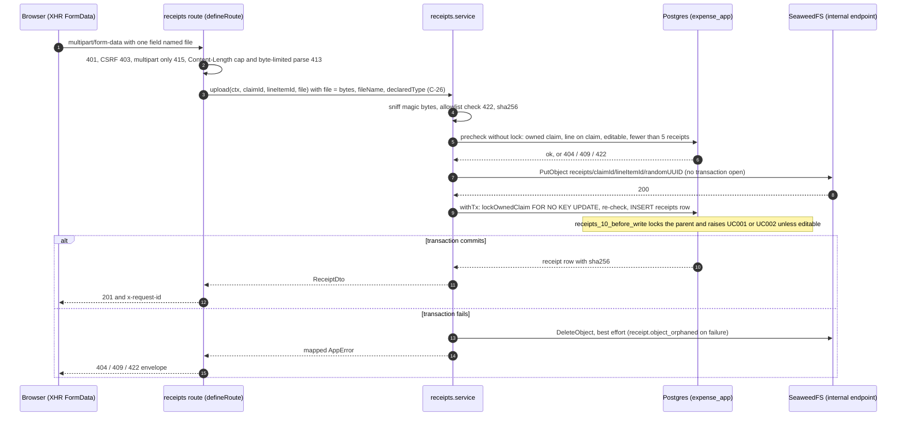
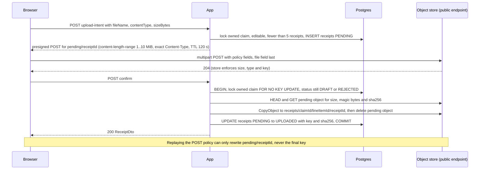
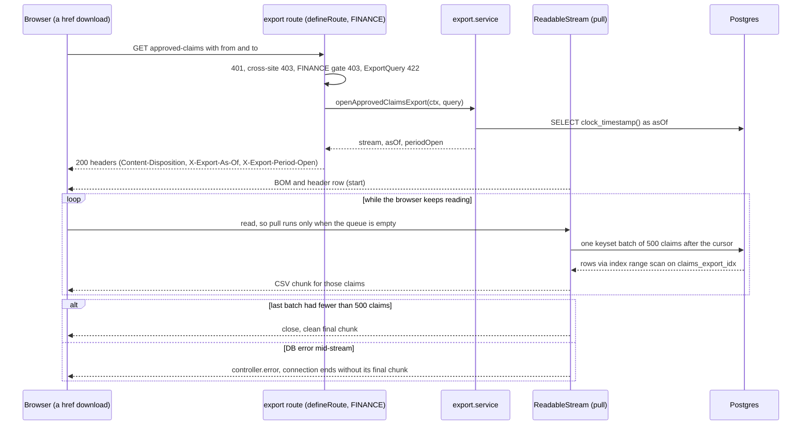

# 06 · Cross-cutting: logging, health, receipts, finance export, query performance

> **Read with** [01 architecture and stack](./01-architecture-and-stack.md) · [02 domain and workflow](./02-domain-and-workflow.md) · [03 data model and integrity](./03-data-model-and-integrity.md) · [04 security and API](./04-security-and-api.md) · [05 frontend](./05-frontend.md) · [07 testing](./07-testing.md) · [PLAN](../../PLAN.md).
> **Owns** canonical decisions D-30, D-31 (receipts), D-32, D-33 (export), D-40 (logging), D-41 (health), D-47 (OTel), and the business-time helpers of D-10. It adds performance notes for D-29 and D-48. Routes, envelopes and error codes are defined in [04](./04-security-and-api.md). Tables, triggers and indexes are defined in [03](./03-data-model-and-integrity.md). This doc explains how the cross-cutting pieces work and why.

---

## 1. Decisions at a glance

| Topic | Decision | Why (the one-liner for the walkthrough) | Phase |
|---|---|---|---|
| Logs | pino 10.4 JSON to stdout, with no transports. An AsyncLocalStorage mixin adds `requestId`, `userId` and `route` to every line | Every line a request writes is correlated without passing a logger around | P1 |
| Request ids | Accept an inbound `x-request-id` only if it matches `^[A-Za-z0-9-]{8,64}$`, otherwise use `crypto.randomUUID()`. Echo it on every response and error envelope, and store it in `claim_events.request_id` | One id joins the browser error, the logs and the audit row | P1 |
| Logs vs audit | `claim_events` is the evidence and is written in the same transaction. Logs are the operational mirror and are written after commit | Logs get rotated and sampled, and they can describe an action that later rolled back. Evidence must not | P1, P3 |
| Health | `/api/health/live` has no dependencies. `/api/health/ready` checks the DB with `SELECT 1` within 1 s and requires zero disabled integrity triggers. Storage is reported but never fails readiness | A DB blip shouldn't trigger restarts. A disabled integrity trigger should take the instance out of rotation | P0, P1 |
| Receipts | Attached per line item and optional for submit. Uploads are server-proxied multipart and stored in SeaweedFS 4.48 behind `ReceiptStorage`. Downloads stream through the app after the visibility check | No client ever holds a write credential, so approved evidence can't be overwritten | P6 |
| Retention | Objects are deleted only for claims that were never submitted (`current_revision = 0`). There is no sweeper in core | A snapshot may point at any object of a submitted claim | P6 |
| Export | `GET …/finance/exports/approved-claims`. The period is inclusive IST dates applied to the final `approved_at`, capped by `asOf`. Rows come from the approved snapshot. The response is a pull-based `ReadableStream` of 500-claim keyset batches | Memory is bounded by the batch size, and a closed period's file is stable | P7 |
| CSV | One row per line item, RFC 4180, CRLF, UTF-8 with BOM. Our own `csvText()` neutralises formulas | GL-level posting without rekeying, and it opens safely in Excel | P7 |
| OPTIONAL | REPEATABLE READ export + `export_runs` + concurrency cap → §8 signed URLs → 100k load + k6 → OTel (buffer order, C-24) | Deepen, don't add | BUF |

**Learning-path map:** structured logging and request IDs (§2) · health and process lifecycle (§3) · Azure concepts: storage behind an interface, probes, Log Analytics (§3.3, §5.3, §2.7) · HTTP streaming and backpressure (§6.6) · indexes and EXPLAIN (§7) · OpenTelemetry (§2.8).

---

## 2. Structured logging and request IDs (D-40)

### 2.1 Logger (`src/server/logging/logger.ts`)

```ts
import 'server-only';
import pino from 'pino';
import { requestContext } from '@/server/http/request-context';

export const logger = pino({
  // Reads three variables that env() already validated at boot (instrumentation.ts).
  // Reading them raw keeps this import from throwing during `next build`.
  level: process.env.LOG_LEVEL ?? 'info',
  base: { service: 'expense-claims', env: process.env.APP_ENV ?? 'local', version: process.env.APP_VERSION ?? 'dev' },
  timestamp: pino.stdTimeFunctions.isoTime,                       // "time":"2026-10-19T09:41:07.212Z"
  formatters: { level: (label) => ({ level: label }) },           // "level":"info", not 30
  mixin() {                                                       // runs on every log call
    const rc = requestContext.getStore();
    return rc ? { requestId: rc.requestId, userId: rc.userId, route: rc.route } : {};
  },
  redact: {
    paths: ['cookie', '*.cookie', '*.*.cookie', 'authorization', '*.authorization', '*.*.authorization',
            '"set-cookie"', '*["set-cookie"]', '*.*["set-cookie"]',
            'password', '*.password', 'token', '*.token', '*.passwordHash'],
    censor: '[REDACTED]',
  },
  serializers: { err: pino.stdSerializers.err },
});

export type LogEventName = 'app.boot' | 'app.shutdown' | 'http.request' | 'auth.login.succeeded' | 'auth.login.failed'
  | 'auth.logout' | 'authz.denied' | 'claim.created' | 'claim.updated' | 'claim.deleted' | 'claim.submitted'
  | 'claim.resubmitted' | 'claim.step_approved' | 'claim.approved' | 'claim.rejected' | 'claim.recalled'
  | 'receipt.uploaded' | 'receipt.deleted' | 'receipt.object_orphaned' | 'export.started' | 'export.completed'
  | 'export.failed' | 'db.backstop';                                           // C-19, closed list
export const logEvent = (event: LogEventName, fields: Record<string, unknown> = {}, level: pino.Level = 'info') =>
  logger[level]({ event, ...fields });
```

- **No transports.** pino's worker-thread transports break under Next bundling. Pretty output is a pipe, `pnpm dev:pretty` = `next dev | pino-pretty`. Next auto-externalizes `pino`, so no bundler config is needed.
- **Prisma** `warn`/`error` client events are forwarded to `logger`. Query logging stays off because it would log bound parameters.
- `logEvent` and plain `logger.info({ event: 'claim.submitted', … })` (as in the [02](./02-domain-and-workflow.md) sketches) produce the same line. `logEvent` exists so that a typo in an event name fails typecheck.

### 2.2 Request IDs and AsyncLocalStorage (`src/server/http/request-context.ts`)

```ts
import 'server-only';
import { AsyncLocalStorage } from 'node:async_hooks';
import { REQUEST_ID_PATTERN } from '@/shared/policy';

export interface RequestContext { requestId: string; route: string; userId?: string; startedAt: number;
  ip: string | null; userAgent: string | null }                      // from callMeta(req) (04 §2.4)
export const requestContext = new AsyncLocalStorage<RequestContext>();

export const resolveRequestId = (inbound: string | null) =>
  inbound && REQUEST_ID_PATTERN.test(inbound) ? inbound : crypto.randomUUID();   // ^[A-Za-z0-9-]{8,64}$

export function withRequestContext(req: NextRequest, fn: (rc: RequestContext) => Promise<Response>) {
  const rc: RequestContext = {
    requestId: resolveRequestId(req.headers.get('x-request-id')),
    route: `${req.method} ${req.nextUrl.pathname}`,                  // no query string
    startedAt: performance.now(),
    ...callMeta(req),                                                 // src/server/http/call-meta.ts: { ip, userAgent }
  };
  return requestContext.run(rc, async () => {
    const res = await fn(rc);                                         // defineRoute sets rc.userId after authenticate()
    res.headers.set('x-request-id', rc.requestId);
    return res;
  });
}

// src/server/http/define-route.ts — last statement inside the withRequestContext callback (context still active)
function logAccess(rc: RequestContext, res: Response) {
  const durationMs = Math.round(performance.now() - rc.startedAt);    // for streams this is time-to-headers
  const level = res.status >= 500 ? 'error' : rc.route.includes('/api/health/') ? 'debug' : 'info';
  logger[level]({ event: 'http.request', status: res.status, durationMs, ip: rc.ip, userAgent: rc.userAgent }, 'request completed');
}
```

`request-context.ts` imports nothing from `logging/`, and `logger.ts` imports the store. Writing the access line from `define-route.ts` keeps the dependency one-way: there is no logger ↔ context import cycle.

- **Where it runs:** it is step 1 of `defineRoute` ([04 §3.2](./04-security-and-api.md#32-defineroute-the-request-pipeline-srcserverhttpdefine-routets)), inside every handler. It doesn't run in `proxy.ts`. The proxy excludes `/api` and doesn't share an async context with the handler, which is why D-40 rejects "request id only in proxy".
- **Why the strict pattern:** an inbound id is accepted for cross-service correlation, but `claim_events.request_id` is `varchar(64)` and log lines must not be injectable. Anything else is replaced, never rejected (TC-I05).
- **Propagation limit:** everything awaited inside `requestContext.run` sees the store, including services, Prisma calls and the logger mixin. Callbacks driven *outside* the request's async chain may not see it, for example a `ReadableStream.pull()` that Next's response pump invokes. Those callbacks use an explicit `logger.child({ requestId, userId, route })` captured at request time (§6.6).

### 2.3 Log event catalogue (C-19)

Standard fields on every line: `level`, `time`, `service`, `env`, `version`, `msg`, plus `requestId`, `userId` and `route` inside a request, plus `event`.

| `event` | Level | Emitted by / when | Event fields |
|---|---|---|---|
| `app.boot` | info | `instrumentation.ts` after the boot checks pass ([01 §9.2](./01-architecture-and-stack.md#92-srcinstrumentationts-boot-checks-fail-fast)) | `version`, `appEnv` |
| `app.shutdown` | info | `process.once('SIGTERM')` listener registered in `instrumentation.ts`. It only logs; Next's own handler still closes the server | `signal` |
| `http.request` | info · debug for health · error for 5xx | `withRequestContext`, once per request | `status`, `durationMs`, `ip`, `userAgent` (from `callMeta(req)`) |
| `auth.login.succeeded` / `auth.login.failed` / `auth.logout` | info / warn / info | `auth.service` ([04](./04-security-and-api.md)) | `userId`; failures carry `reason` and never the email or password |
| `authz.denied` | warn | `errorResponse` for 401, 403 and claim 404s | `code`, `claimId?` (repeated hits are an id-probing signal) |
| `claim.created` / `claim.updated` / `claim.deleted` | info | claims service, after commit | `claimId`, `lineItemCount` (not audited: [02 §10.6](./02-domain-and-workflow.md#106-what-is-deliberately-not-audited)) |
| `claim.submitted` / `claim.resubmitted` / `claim.step_approved` / `claim.approved` / `claim.rejected` / `claim.recalled` | info | lifecycle and approvals services, **after commit** | `claimId`, `revision`, `stepLevel?`, `chainLength?`, `reasonLength?` |
| `receipt.uploaded` / `receipt.deleted` | info | receipts service, after commit | `claimId`, `lineItemId`, `receiptId`, `sizeBytes`, `contentType`, `objectDeleted?` |
| `receipt.object_orphaned` | warn | a compensating or post-commit `storage.delete` failed | `storageKey`, `err` |
| `export.started` / `export.completed` / `export.failed` | info / info / error (warn for a client cancel) | export service and stream (§6) | `from`, `to`, `asOf`, `periodOpen`, `batches`, `claims`, `rows`, `durationMs`, `reason?`, `sqlstate?` |
| `db.backstop` | error | `errorResponse` when a DB-backstop SQLSTATE (C-05) surfaces through the API | `defense: 'db'`, `sqlstate`, mapped `code` |

**`db.backstop` deserves its own line.** When a trigger or CHECK refuses a write that the service should already have refused, the data is still safe, but the service has a bug. The log line is the page-worthy signal (TC-I05 › "a DB-backstop error is logged at error with defense=db"). No real route can surface a backstop SQLSTATE in P1, so the test uses a test-only route module under `tests/helpers/` that throws the recorded `DriverAdapterError` shape with code `UC012` ([07 §6.2 notes](./07-testing.md)).

Example: Ravi approves level 1. Both lines come from the same request.

```json
{"level":"info","time":"2026-10-19T09:41:07.198Z","service":"expense-claims","env":"local","version":"dev","requestId":"0f6c2a1e-4b7d-4c1e-9a55-1f0c8d2e7b31","userId":"0199f2c4-…","route":"POST /api/v1/claims/0199f3a0-…/approve","event":"claim.step_approved","claimId":"0199f3a0-…","revision":1,"stepLevel":1}
{"level":"info","time":"2026-10-19T09:41:07.212Z","service":"expense-claims","env":"local","version":"dev","requestId":"0f6c2a1e-4b7d-4c1e-9a55-1f0c8d2e7b31","userId":"0199f2c4-…","route":"POST /api/v1/claims/0199f3a0-…/approve","event":"http.request","status":200,"durationMs":41,"msg":"request completed"}
```

(Event fields never reuse a standard key: the approval level is logged as `stepLevel` because `level` is the log level.)

### 2.4 Logs vs the audit trail

| | `claim_events` (audit, [02 §10](./02-domain-and-workflow.md#10-audit-trail)) | pino logs |
|---|---|---|
| Purpose | Evidence for a dispute (§4 "who, when, why"; §6 structured trace) | Operating the system |
| Writer | `recordEvent(tx, ctx, event)`, in the same transaction as the state change | `logger`, **after commit** |
| Rolled-back action | No row (the event rolls back with the transaction) | No domain line. The access log shows the failed status |
| Mutability | INSERT-only for `expense_app`, UC007 on UPDATE/DELETE | Rotated, sampled and shipped. No guarantees |
| Coverage | Six transition types (catalogue: [02 §10.3](./02-domain-and-workflow.md#103-event-catalogue-c-20)) | Every request, plus non-audited actions (drafts, receipts, exports, auth) |
| Join key | `request_id` column | `requestId` field (equal values, TC-I23 › "event request_id equals the response x-request-id") |

**Dispute walk (walkthrough answer):** query `claim_events` for the claim, ordered by `(occurred_at, id)` → take the `request_id` of the disputed decision → search the logs for that id to get the access line (status, latency) and any error or `db.backstop` line. The UI shows the same id as "Reference …" on error surfaces and in the timeline ([05](./05-frontend.md)).

### 2.5 What is never logged

Request and response bodies, cookies, `Set-Cookie`, tokens, passwords and hashes, receipt bytes and file names, CSV contents, line descriptions, and reject reasons or comments (only `reasonLength`). People are logged by `userId`, never by email. Redaction (§2.1) is the safety net. The rule is not to pass these values to the logger at all.

### 2.6 Errors

`errorResponse(err, rc)` in `defineRoute` maps through `mapError` ([04 §9.1](./04-security-and-api.md#91-one-error-type-one-mapper)) and then logs:

- 5xx at `error` with the serialized `err` (stack included). The response body is the generic message plus `requestId`, never details.
- 401, 403 and claim 404s as `authz.denied` (warn). Other 4xx get only the access line (validation noise isn't actionable).
- DB-backstop SQLSTATEs as `db.backstop` (error).

### 2.7 Reading logs

| Where | How |
|---|---|
| Dev | `pnpm dev:pretty`; filter with `jq 'select(.requestId=="…")'` |
| Compose | `docker compose logs app \| jq -c 'select(.event!="http.request")'` |
| Azure (mapping only) | Container Apps stdout → Log Analytics. Query `ContainerAppConsoleLogs_CL \| where Log_s has "<requestId>"`. The JSON shape is unchanged |

### 2.8 OpenTelemetry (OPTIONAL, D-47, last buffer item)

- `instrumentation.ts`: `if (env().OTEL_ENABLED) registerOTel({ serviceName: env().OTEL_SERVICE_NAME, instrumentations: ['auto', new PrismaInstrumentation()] })` using `@vercel/otel` + `@prisma/instrumentation` 7.10.0 (pinned when added). OTLP goes to `OTEL_EXPORTER_OTLP_ENDPOINT`. A Jaeger all-in-one container runs under compose profile `otel` (UI :16686).
- The logger mixin adds `traceId`/`spanId` from `trace.getActiveSpan()?.spanContext()`, so a log line links to its trace.
- Azure mapping: the Azure Monitor OpenTelemetry exporter sends to Application Insights. The code is the same; only the exporter changes.
- Why it's last: request ids already give per-request correlation. Traces add per-query timing, which the EXPLAIN evidence (§7) already covers for the hot paths.

---

## 3. Health, readiness and shutdown (D-41)

### 3.1 Endpoints

| Route | Auth | Checks | 200 body | Failure |
|---|---|---|---|---|
| `GET /api/health/live` | public | none (the process answers) | `{data:{status:'live'}}` | — (no response = dead) |
| `GET /api/health/ready` | public | DB round trip within 1 s **and** zero disabled non-internal triggers in `public`. Storage `ping()` is reported only | `{data:{status:'ready', checks:{db:'ok', integrityTriggers:'ok', storage:'ok' \| 'degraded'}}}` | 503 `NOT_READY`, generic body. The failing `checks` go to the log line |

Both go through `defineRoute({ auth: 'public' })`, so they get request ids, `ROUTE_META` and error mapping. (P0 wrote them before `defineRoute` existed; P1 re-wraps them, or TC-I01 fails.) Both are listed in `PUBLIC_ROUTES`, sit outside `/api/v1`, and return no business data. This is how they square with §6 "every route requires a real, authenticated user" (TC-I01 › "only PUBLIC_ROUTES are public").

### 3.2 Readiness implementation

```ts
// src/server/services/health.service.ts
export async function readiness() {
  const [db, storageOk] = await Promise.all([
    withTimeout(readinessProbe(), 1_000).catch(() => null),        // src/server/db/introspection.ts
    withTimeout(getStorage().ping(), 1_000).catch(() => false),
  ]);
  const checks = {
    db: db ? 'ok' : 'fail',
    integrityTriggers: !db ? 'unknown' : db.disabledTriggers === 0 ? 'ok' : 'fail',
    storage: storageOk ? 'ok' : 'degraded',
  } as const;
  return { ready: checks.db === 'ok' && checks.integrityTriggers === 'ok', checks };
}
```

```sql
-- readinessProbe(): one round trip proves the DB is reachable AND the integrity triggers are live
SELECT count(*)::int AS "disabledTriggers"
FROM pg_catalog.pg_trigger t
JOIN pg_catalog.pg_class c ON c.oid = t.tgrelid
WHERE c.relnamespace = 'public'::regnamespace
  AND NOT t.tgisinternal                 -- FK triggers are internal; our CONSTRAINT TRIGGERs are not
  AND t.tgenabled IN ('D', 'R');         -- disabled, or replica-only (doesn't fire in normal sessions)
```

**Why each check:**
- **DB in readiness, not liveness.** If liveness checked the DB, a 30-second DB blip would make the orchestrator restart every replica, and restarting doesn't fix a database.
- **Disabled triggers make the instance not ready.** `expense_app` can't disable triggers (42501, TC-I07), but an owner could, for example by forgetting to re-enable after a manual repair. With a trigger off, "provably impossible" stops being true. An instance that can't uphold the total and lock invariants should not take traffic (RT-B3; TC-I06 › "/api/health/ready returns 503 NOT_READY when an integrity trigger is disabled").
- **Storage is reported, never failing.** When the object store is down, only receipt routes fail (503 `SERVICE_UNAVAILABLE`). Claims, approvals and exports still work. Pulling the instance would turn a partial outage into a full one.

### 3.3 Who probes what

| Prober | Endpoint | Note |
|---|---|---|
| Compose `app` healthcheck and the Dockerfile `HEALTHCHECK` | `/api/health/ready` via `node -e "fetch(…)"` (no curl in slim images) | Gates `docker compose up --wait` ([01](./01-architecture-and-stack.md#113-developer-flows)) |
| Compose `postgres` healthcheck | `pg_isready -h 127.0.0.1 …` over **TCP** | During initdb Postgres listens only on its socket, so a socket probe can report healthy before `01-roles.sh` has finished (found while building P0) |
| Azure Container Apps (mapping) | liveness → `/live`, readiness and startup → `/ready` | The same image and the same probes |

### 3.4 Boot and graceful shutdown

- **Boot:** `instrumentation.ts` validates `env()`, refuses forbidden owner or superuser variables, runs `assertRuntimeRole()`, then (step 4, added in P3) `assertPolicyLoadsWellFormed()` from `src/server/routing/policy.ts`, which reads every tier as `expense_app` and runs `assertPolicyWellFormed`. Then it logs `app.boot`. Any failure calls `process.exit(1)` ([01 §9.2](./01-architecture-and-stack.md#92-srcinstrumentationts-boot-checks-fail-fast)). The tiers come from `seedReference()`, which the `release` step runs on **every** boot (departments, categories, tiers T1–T3, and L4 only once deepa exists; `INSERT … ON CONFLICT (code) DO NOTHING`), so a database seeded before P3, or a staging database that never gets demo data, still has tiers. Only the cast and C01–C12 wait for `SEED_ON_START=true` and an empty `users` table. Verified in P0: the app refuses to boot with owner credentials (exit 1).
- **Shutdown:** the Next standalone server handles SIGTERM. We don't set `NEXT_MANUAL_SIG_HANDLE`, and compose sets `init: true` and `stop_grace_period: 20s`. Our listener only logs `app.shutdown`.
- **Check in P8:** `docker compose stop app` exits within the grace period. An export in flight at that moment ends as a **failed download**, not a truncated "success" (§6.8).

---

## 4. Business-time helpers (`src/shared/dates.ts`, D-10)

`BUSINESS_TIMEZONE = 'Asia/Kolkata'` is a code constant (C-14). These helpers use `Intl` only: no date library and no hard-coded `+05:30` arithmetic. The display helpers (`formatInstant`, `formatCalendarDate`, `monthPeriod`) are in [05 §13](./05-frontend.md#13-money-and-date-display-utilities-srcsharedmoneyts-srcshareddatests).

```ts
const YMD = /^(\d{4})-(\d{2})-(\d{2})$/;
export function isValidYmd(s: string): boolean {                       // rejects 2026-02-30, 2026-13-01, 30/09/2026
  const m = YMD.exec(s); if (!m) return false;
  const t = new Date(Date.UTC(+m[1], +m[2] - 1, +m[3]));
  return t.getUTCFullYear() === +m[1] && t.getUTCMonth() === +m[2] - 1 && t.getUTCDate() === +m[3];
}
export const addDaysYmd = (ymd: string, n: number) => {
  const [y, m, d] = ymd.split('-').map(Number);
  return new Date(Date.UTC(y, m - 1, d + n)).toISOString().slice(0, 10);
};

const wallClock = new Intl.DateTimeFormat('en-US', { timeZone: BUSINESS_TIMEZONE, hourCycle: 'h23',
  year: 'numeric', month: '2-digit', day: '2-digit', hour: '2-digit', minute: '2-digit', second: '2-digit' });
function zoneOffsetMs(at: Date): number {                              // +19_800_000 for IST
  const p = Object.fromEntries(wallClock.formatToParts(at).map((x) => [x.type, x.value]));
  return Date.UTC(+p.year, +p.month - 1, +p.day, +p.hour, +p.minute, +p.second) - (at.getTime() - at.getUTCMilliseconds());
}
export function businessMidnightUtc(ymd: string): Date {               // 00:00 IST on ymd, as a UTC instant
  const [y, m, d] = ymd.split('-').map(Number);
  const wall = Date.UTC(y, m - 1, d);
  const first = wall - zoneOffsetMs(new Date(wall));
  return new Date(wall - zoneOffsetMs(new Date(first)));               // 2nd pass: DST-safe (IST has none; code doesn't assume)
}
/** Inclusive business dates → half-open UTC range [from 00:00, (to + 1) 00:00). Either bound may be omitted (lists). */
export function businessDayRangeToUtc(from?: string, to?: string): { gte?: Date; lt?: Date } {
  for (const d of [from, to]) if (d !== undefined && !isValidYmd(d)) throw new RangeError(`Bad date: ${d}`);
  return { gte: from ? businessMidnightUtc(from) : undefined, lt: to ? businessMidnightUtc(addDaysYmd(to, 1)) : undefined };
}
const ymdFmt = new Intl.DateTimeFormat('en-CA', { timeZone: BUSINESS_TIMEZONE, year: 'numeric', month: '2-digit', day: '2-digit' });
export const businessDateOf = (at: Date) => ymdFmt.format(at);        // "2026-10-01"
export const todayInBusinessTz = (now = new Date()) => businessDateOf(now);
export function formatBusinessIso(at: Date): string {                  // "2026-09-15T16:42:10.000+05:30" (CSV)
  const off = zoneOffsetMs(at), abs = Math.abs(off) / 60_000;
  const hhmm = `${String(Math.floor(abs / 60)).padStart(2, '0')}:${String(abs % 60).padStart(2, '0')}`;
  return `${new Date(at.getTime() + off).toISOString().slice(0, 23)}${off < 0 ? '-' : '+'}${hhmm}`;
}
```

| Input | Output | Why it matters |
|---|---|---|
| `businessDayRangeToUtc('2026-09-01', '2026-09-30')` | `{ gte: 2026-08-31T18:30:00.000Z, lt: 2026-09-30T18:30:00.000Z }` | September in IST. Half-open, so Sep ∪ Oct = Sep–Oct with no duplicates |
| C09 approved `2026-09-30 23:59:30 IST` = `18:29:30.000Z` | in September | < `lt` |
| C10 approved `2026-10-01 00:15:00 IST` = `2026-09-30T18:45:00.000Z` | in October | A UTC-date filter would wrongly put it in September |
| `todayInBusinessTz(new Date('2026-09-30T18:30:00.000Z'))` | `2026-10-01` | "Today" is an IST day, even on a server running in UTC |

Tests: TC-U02 (all four names), plus the component and e2e suites running in `America/Los_Angeles`. Why `timestamptz(3)`: a keyset cursor round-trips through a JS `Date` (millisecond precision) without duplicating or skipping rows.

---

## 5. Receipts (D-30, D-31)

### 5.1 Decisions

- **Per line item, optional for submission** (§3.1 "your choice, document it"). A receipt proves a specific expense: date, amount, category. Approvers check line by line, and finance sees `receipt_count` per GL row. With a per-claim bag of files, nobody can tell which line lacks evidence. Making receipts mandatory would be a new policy feature (§8 says deepen, don't add).
- **Limits (C-14):** ≤ 10,485,760 bytes (10 MiB). Types `image/jpeg`, `image/png`, `image/webp` and `application/pdf` only; no SVG or HTML, which can carry scripts, and HEIC is cut. At most 5 per line.
- **Core is server-proxied.** The browser posts multipart to our route, and the app writes to the object store over the internal network. No CORS, no public store endpoint and no upload credential exists in core. Signed URLs are the §8 deliverable (§5.10).

### 5.2 Object store: SeaweedFS 4.48 (`weed mini`)

| Option | Verdict |
|---|---|
| **SeaweedFS 4.48** (`chrislusf/seaweedfs:4.48`, Apache-2.0) | **Chosen.** One container (`weed mini`: master, volume, filer and S3 on :8333), enforces SigV4, and is mature. **It runs unauthenticated unless both `AWS_ACCESS_KEY_ID` and `AWS_SECRET_ACCESS_KEY` are set** (compose sets both from `S3_ACCESS_KEY_ID`/`S3_SECRET_ACCESS_KEY`) |
| MinIO | Archived in April 2026; images gone |
| LocalStack | Needs an auth token, which breaks "only a `.env`" |
| Garage / RustFS / S3Mock | Manual CLI bootstrap / too young / a test double, not a store |
| Local disk as primary | §8 asks for the object-store pattern. Kept only as the fallback adapter (§5.9) |

The compose service (`objectstore`, volume `objectstore:/data`, `127.0.0.1:${S3_HOST_PORT}:8333`, `nc -z` healthcheck) is in [01 §11.1](./01-architecture-and-stack.md#111-composeyaml). The bucket is created by `scripts/ensure-bucket.ts`, which runs in the `migrate` job's `release` step: `HeadBucket` with retry and backoff up to 60 s, then `CreateBucket` if it's missing. It is idempotent and needs no CORS in core. Production mapping: AWS S3 works with the same adapter. Azure Blob needs an `AzureBlobReceiptStorage` adapter (Blob is not S3-compatible) using managed identity.

### 5.3 `ReceiptStorage` interface and adapters (`src/server/storage/*`)

```ts
// receipt-storage.ts
export interface ReceiptStorage {
  put(key: string, body: Uint8Array, meta: { contentType: string; sha256: string }): Promise<void>;
  get(key: string): Promise<{ body: ReadableStream<Uint8Array>; sizeBytes: number } | null>;   // null = no such key
  delete(key: string): Promise<void>;                                                            // idempotent
  ping(): Promise<boolean>;                                                                      // ≤ 1 s, for readiness
}
export const getStorage = memo((): ReceiptStorage => {                                           // lazy: zero env at build
  switch (env().RECEIPT_STORAGE_DRIVER) {
    case 's3': return new S3ReceiptStorage();
    case 'fs': return new FsReceiptStorage(env().RECEIPT_FS_DIR);
    case 'memory': return new MemoryReceiptStorage();                                            // integration tests
  }
});
```

| Adapter | Implementation notes |
|---|---|
| `S3ReceiptStorage` | One **internal** `S3Client({ endpoint: S3_ENDPOINT, region: 'us-east-1' (S3_REGION), forcePathStyle: true, credentials, requestChecksumCalculation: 'WHEN_REQUIRED', responseChecksumValidation: 'WHEN_REQUIRED' })`. Path-style avoids `bucket.objectstore` DNS. The checksum settings stop SDK ≥ 3.729 sending CRC32 headers that third-party stores reject. `put` → `PutObject` with `ContentType`, `ContentLength`, `Metadata.sha256`. `get` → `GetObject` → `Body.transformToWebStream()`, and `NoSuchKey` → `null`. `ping` → `HeadBucket` with `AbortSignal.timeout(1000)` |
| `FsReceiptStorage` | Keys are validated against `^receipts/[0-9a-f-]{36}/[0-9a-f-]{36}/[0-9a-f-]{36}$` (no path traversal). Writes go to a temp file opened `wx` and then `rename` (atomic, never overwrites). Reads use `createReadStream` → `Readable.toWeb`. `ping` → `fs.access(dir, W_OK)` |
| `MemoryReceiptStorage` | A `Map`. Exposes `keys()` for assertions such as "a failed DB insert deletes the uploaded object" |

*Why an interface:* the services speak `put`/`get`/`delete`, so the fallback (§5.9), the tests (Memory) and production (S3 or Blob) are adapter swaps. Nothing above `src/server/storage` knows which store is in use.

### 5.4 Upload flow (core, server-proxied)

`POST /api/v1/claims/:claimId/line-items/:lineItemId/receipts`, `multipart/form-data`, single field `file`.



| Step | Rule | Failure |
|---|---|---|
| Size | `Content-Length` > 10 MiB + 64 KiB is rejected before reading. The body is then parsed through a byte-counting stream, `new Response(req.body.pipeThrough(limitBytes(cap)), { headers }).formData()`, so a missing or lying `Content-Length` can't make us buffer more | 413 `PAYLOAD_TOO_LARGE` |
| Shape | Exactly one part, `file`, a `File` of 1..10,485,760 bytes | 422 `VALIDATION_FAILED` / 413 |
| Type | Declared type ∈ `RECEIPT_TYPES` **and** `sniff.ts` agrees: JPEG `FF D8 FF`, PNG `89 50 4E 47 0D 0A 1A 0A`, WebP `RIFF….WEBP`, PDF `%PDF-`. The **sniffed** type is stored | 422 `RECEIPT_TYPE_NOT_ALLOWED` (an `.exe` renamed to `.pdf` starts with `MZ`) |
| Hash | `sha256` of the bytes, stored `char(64)` NOT NULL on the row and later copied into the snapshot | — |
| Precheck | Before touching storage: owned claim, line bound to the claim, editable, count < 5. This avoids writing bytes for a request that will fail anyway | 404 `CLAIM_NOT_FOUND` / `LINE_ITEM_NOT_FOUND`, 409 `CLAIM_NOT_EDITABLE` / `CLAIM_LOCKED`, 422 `RECEIPT_LIMIT_REACHED` |
| Put | Key `receipts/{claimId}/{lineItemId}/{randomUUID()}` is fresh on every upload, so an existing object is never overwritten. The key holds no file name or PII. The put happens outside any transaction because D-14 forbids network I/O inside one | 503 `SERVICE_UNAVAILABLE` if the store is down |
| Commit | The same checks run again under `lockOwnedClaim` (two parallel uploads for the 5th slot serialize, and the loser gets 422), then INSERT | same codes; the object is deleted |
| File name | Basename only, control characters stripped, trimmed to 255. Stored in the DB only. Served as `filename="<ASCII fallback>"; filename*=UTF-8''<percent-encoded>`, so header injection is impossible | — |

Memory note: `formData()` holds up to ~10 MiB per concurrent upload. That's acceptable at POC scale. The §8 presigned flow removes the app from the byte path entirely.

### 5.5 Download flow (visibility first)

`GET /api/v1/claims/:claimId/receipts/:receiptId/content`

1. `findClaimForActor(actor, claimId, select)` (C-26, `claim-visibility.ts`): `claimVisibilityWhere` is AND-composed into the single SELECT, so the request is refused at the point of the query → 404 `CLAIM_NOT_FOUND` ([04 §5.2](./04-security-and-api.md#52-child-resources-only-through-the-scoped-parent)).
2. Resolve the receipt **within that claim only**. First the live row `receipts WHERE id = $rid AND claim_id = $cid`. Otherwise it's a receipt that only one of this claim's submission snapshots still references, for example after the line was deleted on a REJECTED claim:
   ```sql
   SELECT r->>'storageKey' AS "storageKey", r->>'fileName' AS "fileName", r->>'contentType' AS "contentType"
   FROM public.claim_submissions s
   CROSS JOIN LATERAL jsonb_array_elements(s.snapshot->'lines') l
   CROSS JOIN LATERAL jsonb_array_elements(l->'receipts') r
   WHERE s.claim_id = $1 AND r->>'receiptId' = $2
   ORDER BY s.revision DESC LIMIT 1;           -- a handful of rows: one claim's submissions
   ```
   Neither found → 404 `RECEIPT_NOT_FOUND`.
3. `getStorage().get(key)` → `new Response(body, …)` streamed through. The headers are the **stored** `Content-Type` (from the DB, never from store metadata), `Content-Length`, `Content-Disposition: attachment; filename=…`, `X-Content-Type-Options: nosniff` and `Cache-Control: no-store`. `attachment` + `nosniff` mean a PDF or image is never rendered inline from our origin.
4. A store that is down gives 503 `SERVICE_UNAVAILABLE`. A missing object for a referenced key is an integrity incident: 500 `INTERNAL_ERROR`, logged at error with the key.

Test: TC-I27 › "download: owner, chain approvers and finance 200; unrelated approver 404". Also TC-I14 › "downloading or deleting another claim's receipt through my claim id returns 404 RECEIPT_NOT_FOUND" and TC-I22 › "receipts referenced by revision 1 stay downloadable after the line is deleted".

### 5.6 Delete flow and retention (D-31)

`DELETE /api/v1/claims/:claimId/receipts/:receiptId` → `withTx`: `lockOwnedClaim` (null → 404 `CLAIM_NOT_FOUND`, thrown by the service) → editable (409 otherwise) → receipt bound to the claim (404 `RECEIPT_NOT_FOUND`) → DELETE the row (the trigger re-checks) → after commit, apply the retention rule → 204, log `receipt.deleted {objectDeleted}`.

| Situation | DB row | Storage object |
|---|---|---|
| Receipt deleted, claim never submitted (`current_revision = 0`) | deleted | deleted **after commit** (best effort) |
| Line removed by the PUT replace-set, or a draft deleted, `current_revision = 0` | cascade-deleted | keys collected under the lock, deleted after commit ([02](./02-domain-and-workflow.md) C-25 write orders). P2 builds `replaceClaim` and `deleteDraft` without these steps (no receipts table yet); P6 adds them, logging `receipt.object_orphaned` when a delete fails |
| Receipt or line deleted while `current_revision > 0` (a REJECTED claim, or a recalled DRAFT) | deleted | **kept**: a snapshot may reference it |
| Upload whose DB transaction failed | none | deleted immediately (best effort) |
| Claim APPROVED | immutable (UC001) | kept |

*Why this rule and not "delete if unreferenced":* checking every snapshot's JSON on every delete, or keeping a `retained_objects` ledger, is more moving parts. The cost of the simple rule is a few unreferenced objects on edited, previously submitted claims. Rejected outright: post-commit delete always, plus a sweeper of "rows without a receipt". That destroys exactly the revision-1 evidence finance needs in a dispute (RT-M4). Test: TC-I27 › "deleting a receipt on a previously submitted claim keeps the object".

### 5.7 Locked-claim enforcement for attachments (§3.4)

| Layer | Mechanism | Result |
|---|---|---|
| UI (cosmetic) | No Attach or Remove without `EDIT` in `allowedActions` ([05 §8](./05-frontend.md#8-receipts-ux-per-line-item-d-30)) | — |
| Service | Precheck, then a re-check under `lockOwnedClaim` (D-14) | 409 `CLAIM_LOCKED` (APPROVED), 409 `CLAIM_NOT_EDITABLE` (SUBMITTED, hint `RECALL_TO_EDIT`) |
| Database | `receipts_10_before_write` calls `assert_claim_editable(claim_id)`, which locks the parent `FOR NO KEY UPDATE` and raises UC001/UC002. `claim_id`/`line_item_id` are immutable (UC010). A composite FK `(line_item_id, claim_id) → line_items(id, claim_id)`. `expense_app` has **no UPDATE** on `receipts` (C-16). SQL in [03](./03-data-model-and-integrity.md) | Raw SQL as the app role can't attach, detach or alter evidence on a locked claim |
| Object | No client write credential exists. Keys are fresh UUIDs and never rewritten. `sha256` is in the row and in the snapshot, so any later byte change is detectable (`shasum -a 256`) | Approved evidence can't be overwritten through the app. Production adds bucket versioning or immutability |

Tests: TC-I27 › "SUBMITTED → 409 CLAIM_NOT_EDITABLE; APPROVED → 409 CLAIM_LOCKED", "raw DELETE FROM receipts on an APPROVED claim raises UC001". TC-I11 covers receipt upload and delete among "every mutation route on an APPROVED claim returns 409 CLAIM_LOCKED".

### 5.8 Orphans (core: no sweeper)

Orphans arise in three ways: (1) the process crashes between `put` and commit; (2) a compensating or post-commit delete fails, which is logged as `receipt.object_orphaned` with the key; (3) objects retained by design (§5.6). They are harmless. Keys are unguessable, the bucket is private, and the API only resolves objects through DB rows or snapshots, so an orphan can never be served. The runbook (`docs/runbook.md`) has a **report-only** reconciliation: list `receipts/` keys and anti-join them against `receipts.storage_key` ∪ every snapshot `storageKey`. Deleting anything is a human decision. An automatic sweeper would need to be snapshot-aware, which is exactly the kind of extra machinery D-31 avoids.

### 5.9 Fallback ladder (decided at the storage gate, 30-minute timebox)

The storage gate opens P6; its date is in [PLAN §5](../../PLAN.md#5-day-by-day-timeline-and-critical-path).

1. **SeaweedFS** (planned): `RECEIPT_STORAGE_DRIVER=s3`.
2. **FS-volume adapter:** the full recipe (compose details in [01 §11.3](./01-architecture-and-stack.md#113-developer-flows)):
   - `.env`: `RECEIPT_STORAGE_DRIVER=fs`, `RECEIPT_FS_DIR=/app/.data/receipts`.
   - `app`: add the volume `receipts:/app/.data/receipts`, and a top-level `receipts: {}`.
   - Remove the `objectstore` service and its volume (or move it under `profiles: ["s3"]`), so a broken SeaweedFS can't fail `docker compose up --wait`. Drop `objectstore` from `migrate.depends_on`.
   - Pass `RECEIPT_STORAGE_DRIVER` to `migrate`; `ensure-bucket` is a no-op when it is `fs`.
   - Dockerfile `runner`: `RUN mkdir -p .next .data/receipts && chown -R node:node .next .data`. Otherwise Docker creates the volume's mount point owned by root and `FsReceiptStorage` gets `EACCES` as uid 1000.

   Services, routes and the UI don't change, and neither do the integration tests (they use the Memory adapter anyway). **Only TC-E06's service list changes**: it drops `objectstore` when `RECEIPT_STORAGE_DRIVER=fs` ([07 §11](./07-testing.md#11-e2e-with-playwright-d-44)). The README then states "object-store adapter exists; local demo runs on a volume".

P6 is planned as two halves (see PLAN §4); its second half, in the BUF day, is the first place a slip lands (C-24).

### 5.10 §8 OPTIONAL: signed upload and download URLs (buffer)

This is the §8 "real object-store pattern with signed upload URLs", designed now so the core doesn't block it.



| Piece | Design |
|---|---|
| Routes | `POST /api/v1/claims/:claimId/line-items/:lineItemId/receipts/upload-intent`, `POST /api/v1/claims/:claimId/receipts/:receiptId/confirm` (both through `defineRoute`, so TC-I01 picks them up) |
| Why POST, not PUT | A presigned PUT can't cap size at the store. A POST policy's `content-length-range` makes the store refuse a 2 GB "receipt" |
| Why quarantine + copy | A policy stays valid until its TTL. Without the copy, a claimant could confirm, get approved, then replay the policy to overwrite approved evidence (RT-M3). The final key is never exposed to any upload credential |
| Confirm order | Lock + status check **first**, then verify, then copy, then UPDATE. This is the one place a transaction waits on network I/O, a deliberate exception to D-14 bounded by the 10 s transaction timeout. It is the price of "nothing is promoted unless the claim was editable at that instant" |
| Two S3 clients | **internal** (`S3_ENDPOINT`, sends every request) and **signer** (`S3_PUBLIC_ENDPOINT`, never sends, only signs browser-facing URLs). SigV4 signs the `Host` header, so a URL signed for `objectstore:8333` fails from the browser, and string-replacing the host breaks the signature |
| Download | After the same visibility check, 302 to a presigned GET (`RECEIPT_DOWNLOAD_URL_TTL_SECONDS=60`) with `ResponseContentType` forced to the stored type and `ResponseContentDisposition: attachment`. URLs are never logged |
| Schema | Migration `…_receipt_upload_intents`: `receipt_status` {PENDING, UPLOADED}, `CHECK (status <> 'UPLOADED' OR sha256 IS NOT NULL)`, column-level UPDATE grant for PENDING → UPLOADED only. The adjusted trigger lets PENDING rows be deleted in any claim state, because they were never evidence. Snapshots, DTOs and downloads see UPLOADED only |
| Ops | Bucket CORS (`POST`, `GET`, `HEAD` from `APP_BASE_URL`) in `ensure-bucket`. A sweeper deletes PENDING rows older than the TTL and `pending/` objects, **never** `receipts/` objects. A scoped non-admin S3 identity for the app (deferred RT-m6 locally) |
| Tests | TC-O01 (whole file), including "reusing the upload policy after confirm leaves the final object unchanged (same sha256)" and "confirm after approval returns 409 CLAIM_LOCKED and promotes nothing" |

---

## 6. Finance export (§3.6, D-32, D-33)

### 6.1 Contract

`GET /api/v1/finance/exports/approved-claims?from=YYYY-MM-DD&to=YYYY-MM-DD[&status=APPROVED]`. The route row, the `ExportQuery` schema and a worked request/response are in [04](./04-security-and-api.md#83-per-endpoint-filters-and-sort) (§7.2, §10.6, §11.6).

| Aspect | Rule |
|---|---|
| Who | FINANCE only (ADMIN excluded: least privilege). This is checked twice: by the `defineRoute` role gate before any query, and by `requireRole(actor, 'FINANCE')` as the first line of every `export.service` function (D-04, TC-U09) |
| CSRF | It's a GET, so `SameSite=Lax` cookies ride on top-level cross-site navigation. `Sec-Fetch-Site: cross-site` → 403 `CSRF_REJECTED` (RT-m3, TC-I03 › "export GET with Sec-Fetch-Site: cross-site returns 403 CSRF_REJECTED"). The finance page's same-origin `<a download>` sends `same-origin` |
| Params | `from`, `to` required, inclusive IST dates. `from > to` → 422 `VALIDATION_FAILED`. Span > 366 days → 422 `EXPORT_RANGE_TOO_LARGE`. `status` accepts only `APPROVED`; anything else → 422 `EXPORT_STATUS_NOT_ALLOWED`. That is how the export "supports status filtering" (§6) without ever leaking in-flight claims |
| 200 headers | `Content-Type: text/csv; charset=utf-8` · `Content-Disposition: attachment; filename="approved-claims_<from>_<to>.csv"` · `X-Export-As-Of: <ISO>` · `X-Export-Period-Open: true\|false` · `Cache-Control: no-store` · `x-request-id` |
| Errors before the first byte | JSON envelope (401/403/422, 503 if the `asOf` query fails) |
| Errors after the first byte | The stream errors, so the download fails visibly (§6.8) |

### 6.2 Period semantics

- **What a period means:** a claim is in the period if its **final approval** instant falls inside it: `approved_at ∈ [from 00:00 IST, (to + 1) 00:00 IST)` via `businessDayRangeToUtc` (§4). `approved_at` is stamped by Postgres for `expense_app` and can't be backdated (D-23, UC010).
- **Why approval date and not expense date:** a September expense approved on 3 October belongs to October's books. With expense-date filtering, every late approval would rewrite an already-closed month. With approval-date filtering, a closed month stays closed.
- **`asOf`:** `SELECT clock_timestamp()` at request start. It uses the DB clock because the DB stamps `approved_at`, so there's no app/DB clock skew. The predicate adds `approved_at < asOf`, so approvals that happen *during* a long export can't leak into the end of the file. The same query proves the DB is reachable before we commit to a 200.
- **Settle window:** `X-Export-Period-Open: true` when `(to + 1) 00:00 IST + EXPORT_SETTLE_MINUTES (2) > asOf`. The reason is that `approved_at = now()` is the approving transaction's *start*. A final approval that starts at 23:59:59.900 on 30 Sep and commits at 00:00:00.300 belongs to September but is invisible until it commits. Two minutes is far longer than the 10 s transaction timeout and the 15 s statement timeout, so once the window has passed, every September approval has committed or rolled back. The UI shows the hint ([05 §11](./05-frontend.md#11-finance-views-and-export)). Finance re-exports after close.

### 6.3 Why an in-flight or rejected claim can never appear (walkthrough answer)

| # | Layer | What it rules out |
|---|---|---|
| 1 | Predicate `status = 'APPROVED' AND approved_at ∈ [gte, lt) AND approved_at < asOf` | anything not finally approved inside the period |
| 2 | CHECK `claims_approved_at_iff_approved` | A partially approved claim is SUBMITTED with `approved_at` NULL, so it can't match a range even if someone weakens the status filter |
| 3 | `claims_guard`: APPROVED is terminal (UC001); →APPROVED requires every step of the current submission APPROVED (UC011); the chain length equals the applicable tiers (UC012) | exported-then-rejected claims; under-approved claims (one signature on a ₹75,000 claim) |
| 4 | Rows come from the **approved submission's snapshot** (`claims.current_submission_id`), which is INSERT-only and DB-verified against the live lines (UC016) | Edits to category names, GL codes or the claimant's details after approval (RT-M6). Lines of an approved claim are frozen anyway (UC001) |
| 5 | DB-owned timestamps (D-23) | Backdating an approval into a closed period (TC-I28 › "backdating approved_at as expense_app raises UC010") |
| 6 | Postgres never shows uncommitted rows | an approval still in flight, or one that later rolls back |

A claim that was rejected, edited and resubmitted appears **once**, with its final revision and `approved_at`. One that is still REJECTED, recalled to DRAFT, or resubmitted and in flight has `approved_at` NULL and is excluded (TC-I28 › "partially approved, rejected, draft, recalled and resubmitted-in-flight claims never appear").

### 6.4 CSV layout for bookkeeping (C-22)

One row per **line item**, with claim-level columns repeated. That's the shape journal imports and pivot tables expect, and it keeps the GL split (one claim can post to 6110 Lodging and 6120 Meals). The header row uses these names in this order (`CSV_COLUMNS` in `csv.ts`; `claimToCsvRows()` maps one snapshot to its rows). There is no footer or totals row, because trailers break importers. Control totals are the sum of `amount`.

| # | Column | Source (snapshot `S` = approved `claim_submissions.snapshot`) | Format | Escaped |
|---|---|---|---|---|
| 1 | `claim_number` | `claims.claim_number` | `EXP-2026-000004` (CHECK regex) | raw |
| 2 | `claim_id` | `claims.id` | uuid | raw |
| 3 | `revision` | `claims.current_revision` (= approved revision) | integer | raw |
| 4 | `employee_code` | `S.claimant.employeeCode` | text | `csvText` |
| 5 | `employee_name` | `S.claimant.name` | text | `csvText` |
| 6 | `employee_email` | `S.claimant.email` | text | `csvText` |
| 7 | `department_code` | `S.claimant.departmentCode` (frozen at submit) | text | `csvText` |
| 8 | `claim_title` | `S.title` | text | `csvText` |
| 9 | `submitted_at` | approved submission's `submitted_at` | `2026-09-11T10:05:00.000+05:30` (`formatBusinessIso`) | raw |
| 10 | `approved_at` | `claims.approved_at` | ISO with `+05:30` | raw |
| 11 | `posting_date` | IST date of `approved_at` (`businessDateOf`) | `YYYY-MM-DD` | raw |
| 12 | `final_approver_email` | highest-level APPROVED step of that submission → `users.email` (live join; `users` is owner-only writable, an accepted residual per RT-M6) | text | `csvText` |
| 13 | `line_no` | 1-based position in `S.lines` (ordered `expense_date, id`) | integer | raw |
| 14 | `line_item_id` | `S.lines[i].lineItemId` | uuid | raw |
| 15 | `expense_date` | `S.lines[i].expenseDate` | `YYYY-MM-DD` (a calendar date, no TZ math) | raw |
| 16 | `category_code` | `S.lines[i].categoryCode` | text | `csvText` |
| 17 | `category_name` | `S.lines[i].categoryName` | text | `csvText` |
| 18 | `gl_code` | `S.lines[i].glCode` | digits (CHECK `^[0-9]{4,10}$`) | raw |
| 19 | `description` | `S.lines[i].description` | text | `csvText` |
| 20 | `merchant` | `S.lines[i].merchant` | text, may be empty | `csvText` |
| 21 | `amount` | `S.lines[i].amountMinor` | `toDecimalString()` → `42000.00` (dot decimal, no grouping) | raw |
| 22 | `currency` | `S.currency` | `INR` (CHECK `^[A-Z]{3}$`) | raw |
| 23 | `claim_total` | `S.totalMinor` | decimal string, repeated per row. **Sum `amount`, not `claim_total`** (README note) | raw |
| 24 | `receipt_count` | `S.lines[i].receipts.length` | integer | raw |

File rules: UTF-8 **with BOM**, so Excel shows `₹` and non-ASCII names correctly. RFC 4180 quoting, CRLF line endings, comma separator. Numbers have no locale formatting. An empty period gives a header-only file with 200. Money uses integer paise until formatting (`toDecimalString` from `src/shared/money.ts`, [05 §13](./05-frontend.md#13-money-and-date-display-utilities-srcsharedmoneyts-srcshareddatests)), so the CSV can't drift by a paisa.

### 6.5 CSV escaping and injection safety (`src/server/export/csv.ts`)

```ts
export const CSV_BOM = '';
const FORMULA_START = /^[=+\-@]/;
const CONTROL_START = /^[\t\r]/;

/** OWASP CSV-injection guard for every text column we did not generate. */
export function csvText(value: string | null | undefined): string {
  const v = value ?? '';
  return CONTROL_START.test(v) || FORMULA_START.test(v.trimStart()) ? `'${v}` : v;   // " =1+1" is caught too
}
/** RFC 4180: quote only when needed, double embedded quotes. Embedded line breaks stay inside the quotes. */
export const csvField = (v: string) => (/[",\r\n]/.test(v) ? `"${v.replaceAll('"', '""')}"` : v);
export const csvLine = (cells: readonly string[]) => cells.map(csvField).join(',') + '\r\n';
```

- **Allowlist, not denylist:** only columns *we* generate are written raw: uuids, claim numbers and GL codes (each with a CHECK regex), integers, our ISO dates and our decimal amounts. Every other text column goes through `csvText()`, including category names and department codes, which come from reference data, and emails (RT-m2).
- The leading-whitespace check exists because some spreadsheet apps trim before evaluating. The `'` prefix is the documented convention: a merchant that genuinely starts with `+91` shows as `'+91…` (README note for finance). User text is changed in exactly this one way.
- Tests: TC-U06 (all four names) and TC-I28 › "formula payloads in description, merchant, names and category are escaped".

### 6.6 Streaming: pull-based `ReadableStream` + keyset batches



```ts
// src/app/api/v1/finance/exports/approved-claims/route.ts
export const GET = defineRoute({
  auth: 'required', roles: ['FINANCE'], query: ExportQuery,
  handler: async ({ actor, query, requestId }) => {
    const x = await exportService.openApprovedClaimsExport({ actor, requestId }, query);   // (ctx, input) per C-26
    return new Response(x.stream, { status: 200, headers: {
      'content-type': 'text/csv; charset=utf-8',
      'content-disposition': `attachment; filename="approved-claims_${query.from}_${query.to}.csv"`,
      'x-export-as-of': x.asOf.toISOString(),
      'x-export-period-open': String(x.periodOpen),
    } });
  },
});

// src/server/services/export.service.ts
export async function openApprovedClaimsExport(ctx: ServiceCtx, q: ExportQuery,
                                                opts: { batchSize?: number } = {}) {      // batchSize: tests only (3)
  const { actor } = ctx;
  requireRole(actor, 'FINANCE');                                        // self-guard (D-04, RT-M11)
  const { gte, lt } = businessDayRangeToUtc(q.from, q.to) as { gte: Date; lt: Date };
  const asOf = await exportRepo.asOfNow();                              // SELECT clock_timestamp(); throws → 503 JSON
  const periodOpen = lt.getTime() + EXPORT_SETTLE_MINUTES * 60_000 > asOf.getTime();
  const log = logger.child({ requestId: ctx.requestId, userId: actor.id, route: 'GET /api/v1/finance/exports/approved-claims' });
  log.info({ event: 'export.started', from: q.from, to: q.to, asOf, periodOpen }, 'export started');
  const batchSize = opts.batchSize ?? env().EXPORT_BATCH_SIZE;
  const stream = approvedClaimsCsvStream({
    batchSize, log,
    fetchBatch: (after) => exportRepo.approvedClaimsBatch(actor, { gte, lt, asOf, after, limit: batchSize }),
  });
  return { stream, asOf, periodOpen };
}

// src/server/export/export-stream.ts — no database access of its own, so unit tests can inject fetchBatch
export function approvedClaimsCsvStream(o: {
  batchSize: number; log: Logger;
  fetchBatch: (after: { approvedAt: Date; id: string } | null) => Promise<ExportClaimRow[]>;
}): ReadableStream<Uint8Array> {
  const enc = new TextEncoder(); const t0 = performance.now();
  const stats = { batches: 0, claims: 0, rows: 0 };
  let after: { approvedAt: Date; id: string } | null = null;
  return new ReadableStream<Uint8Array>({
    start(c) { c.enqueue(enc.encode(CSV_BOM + csvLine(CSV_COLUMNS))); },
    async pull(c) {                                                     // called only when the consumer wants more
      try {
        const claims = await o.fetchBatch(after);
        let chunk = '';
        for (const claim of claims) { chunk += claimToCsvRows(claim); stats.claims++; stats.rows += claim.snapshot.lines.length; }
        if (chunk) c.enqueue(enc.encode(chunk));
        stats.batches++;
        if (claims.length < o.batchSize) {                              // last page: no extra empty query
          c.close();
          o.log.info({ event: 'export.completed', ...stats, durationMs: Math.round(performance.now() - t0) }, 'export completed');
          return;
        }
        const last = claims.at(-1)!; after = { approvedAt: last.approvedAt, id: last.id };
      } catch (err) {
        o.log.error({ event: 'export.failed', reason: 'ERROR', sqlstate: readSqlState(err), err, ...stats }, 'export failed mid-stream');
        c.error(err);                                                   // never a clean end
      }
    },
    cancel() { o.log.warn({ event: 'export.failed', reason: 'CLIENT_CANCELLED', ...stats }, 'export cancelled by client'); },
  }, { highWaterMark: 1 });                                             // at most one chunk queued ahead of the client
}
```

The batch query (`src/server/repositories/export.repo.ts`) is a tagged `$queryRaw`, parameterised, schema-qualified, and returns one row per claim:

```sql
WITH page AS (
  SELECT c.id, c.claim_number, c.current_revision, c.approved_at, c.current_submission_id
  FROM public.claims c
  WHERE c.status = 'APPROVED'
    AND c.approved_at >= ${gte}::timestamptz AND c.approved_at < ${lt}::timestamptz
    AND c.approved_at < ${asOf}::timestamptz
    -- batches after the first add:  AND (c.approved_at, c.id) > (${after.approvedAt}::timestamptz, ${after.id}::uuid)
  ORDER BY c.approved_at, c.id
  LIMIT ${limit}
)
SELECT p.id, p.claim_number AS "claimNumber", p.current_revision AS revision, p.approved_at AS "approvedAt",
       s.submitted_at AS "submittedAt", s.snapshot, fa.email AS "finalApproverEmail"
FROM page p
JOIN public.claim_submissions s ON s.id = p.current_submission_id AND s.claim_id = p.id
LEFT JOIN LATERAL (
  SELECT u.email FROM public.approval_steps st JOIN public.users u ON u.id = st.approver_id
  WHERE st.submission_id = p.current_submission_id AND st.status = 'APPROVED'
  ORDER BY st.level DESC LIMIT 1
) fa ON true
ORDER BY p.approved_at, p.id;
```

- **Keyset on `(approved_at, id)`**, served by `claims_export_idx (approved_at, id)`. The row-value comparison is a single btree Index Cond, so each batch is an index range scan of about 500 entries with **no Sort**. `id` breaks ties: TC-I28 › "keyset batches (batchSize=3) with tied approved_at emit every line exactly once".
- **Batches are claims, not lines**, so a claim's lines are never split across chunks. The snapshot JSON is parsed with the shared `SnapshotV1` Zod schema, then expanded by `claimToCsvRows`.
- **Backpressure comes free with `pull`.** The stream calls `pull()` only when its queue (high-water mark 1) is drained by the consumer. Next pipes the web stream into the Node socket and respects `drain`. A slow client therefore means fewer queries, not more memory. Memory ≈ one queued chunk + one batch in flight (500 claims ≈ 2,000 lines ≈ under 1 MB), whatever the period length. That is the §6 "without loading every claim into memory" proof. P7 check: `curl --limit-rate 50k` and watch the batches arrive at the client's pace in the logs.
- **No long transaction, no held connection.** Each batch is one READ COMMITTED statement on the pool, and the connection goes back between pulls. A browser that stalls for a minute pins no pool slot and no snapshot.
- *Rejected:* building the CSV in memory (fails §6); OFFSET batches (O(n²/batch) re-scans, rows skipped or duplicated when the set changes); a push-style `TransformStream` writer (backpressure has to be awaited by hand); `csv-stringify` (Node-stream API, and we need custom escaping anyway).

### 6.7 Consistency without a long transaction

**Claim:** for a closed period (`X-Export-Period-Open: false`), the RC batches return exactly the set of claims approved in the period, each once, in a deterministic order. Re-running gives the same rows.

**Why:** let S = the APPROVED claims with `approved_at ∈ [gte, lt)`.
1. Every member of S committed before `asOf`. Its transaction started before `lt`, and `lt + 2 min ≤ asOf` exceeds any transaction lifetime. So every member is visible to the very first batch's snapshot.
2. No member changes or leaves S. APPROVED is terminal and immutable (UC001), and `approved_at` can't change (UC010). The rows come from an INSERT-only snapshot.
3. Nothing joins S later. A new approval gets `approved_at = now() ≥ its start > lt`.
4. The keyset walks a fixed, totally ordered set (`approved_at, id`) strictly forward. So the union of the batches is S, with no gaps and no duplicates (TC-I28 › "Sep + Oct exports equal the Sep–Oct export with no duplicates").

**Open periods** (the current month, or within the 2-minute window): the `asOf` cap keeps out everything approved after the export started (TC-I28 › "a claim approved after asOf is excluded"). The only remaining non-determinism is an approval whose transaction was *in flight* at `asOf`. It appears if it commits before the cursor passes its key. That window is ≤ 10 s, and the header flags it (TC-I28 › "X-Export-Period-Open is true until 2 minutes after the period ends").

*Why not REPEATABLE READ in core:* RR needs one connection and one snapshot held for the whole download, plus a Prisma transaction timeout of minutes. For closed periods it gives the same answer the four facts above already guarantee. RR earns its keep only alongside `export_runs.sha256` for *provable* byte-identical reruns (§6.9, RT-M5's deferred part).

### 6.8 Failure modes

| Event | What happens | Why it's safe |
|---|---|---|
| Validation, auth, role or CSRF failure | JSON envelope, no CSV | Nothing has been sent yet |
| DB unreachable at start | 503 `SERVICE_UNAVAILABLE` JSON (the `asOf` query fails before the 200) | — |
| DB error mid-stream (statement timeout, connection loss, permissions) | `controller.error(err)` → Next aborts the chunked response without its terminating chunk → the browser shows a **failed** download, and `curl` exits 18. Logged as `export.failed` (error) with `sqlstate`, batches and rows so far | Headers are already 200, so killing the stream is the only honest signal. A truncated file must never look complete. TC-I28 › "an injected DB error mid-stream errors the stream (no clean end)". In-process, `await res.text()` rejects. One way to inject: the owner revokes `SELECT` on `claim_submissions` from `expense_app` between batches, and the test restores it in `finally` |
| Client cancels | `cancel()` → `export.failed {reason: 'CLIENT_CANCELLED'}` (warn). No further queries run | Pull-based means no orphaned producer loop |
| Instance shutdown (SIGTERM) | The connection closes mid-stream → failed download (P8 check, §3.4) | Same as above |

P7 must confirm against the real image that Next 16.4 *aborts* rather than cleanly ends a response whose stream errors (curl exit code 18). The integration test proves the stream errors. The P7 check proves the HTTP effect.

### 6.9 OPTIONAL (buffer, first SHOULD item): RR snapshot, `export_runs`, concurrency cap, summary

| Item | Design |
|---|---|
| RR snapshot | Check out one dedicated `pg` client in `src/server/db/`, run `BEGIN ISOLATION LEVEL REPEATABLE READ READ ONLY`, run every batch on it, and release it in `close`/`cancel`/`error`. This is simpler than keeping a Prisma interactive transaction open across pulls. `SET LOCAL idle_in_transaction_session_timeout = '60s'` so a stalled client can't pin the snapshot for long |
| `export_runs` | Columns per C-03 (`period_from`, `period_to`, `as_of`, `status` RUNNING/SUCCEEDED/FAILED, `claim_count`, `line_count`, `total_minor bigint`, `sha256`, `request_id`, `started_at`, `completed_at`, `error_code`). A RUNNING row is inserted in its own short transaction before streaming. The stream hashes exactly the bytes it enqueues. A terminal UPDATE happens in its own transaction on close or failure. A trigger allows exactly one RUNNING → SUCCEEDED\|FAILED transition, and terminal rows are immutable. `expense_app`: SELECT, INSERT, trigger-guarded UPDATE, no DELETE. Listing route `GET /api/v1/finance/exports`. TC-O04 |
| Concurrency cap | An in-process semaphore, `EXPORT_MAX_CONCURRENT=2`, acquired before the 200 and released on close, error or cancel. Over the cap → 429 `RATE_LIMITED` with `Retry-After: 10` and `details.reason = 'EXPORT_CONCURRENCY'`. It's per instance; a cluster-wide cap would count RUNNING `export_runs` |
| Summary | `GET /api/v1/finance/exports/approved-claims/summary?from&to` → `{ claimCount, lineCount, totalMinor, asOf, periodOpen }`. One aggregate on the same index. The UI pre-flights with it, and tests reconcile it against the file |

### 6.10 Tests

| Id | Covers |
|---|---|
| TC-I28 `export/finance-export.int.test.ts` | All 16 names, including "includes only APPROVED claims approved within the period", "IST boundaries: 2026-08-31T18:29:59.999Z excluded, 18:30:00.000Z included; 2026-09-30T18:29:59.999Z included, 18:30:00.000Z excluded", "rows come from the approved snapshot: renaming a category after approval does not change the CSV", "an empty period returns a header-only CSV", "status=APPROVED is accepted and returns the same CSV as omitting status", "status=REJECTED returns 422 EXPORT_STATUS_NOT_ALLOWED", "a range over 366 days returns 422 EXPORT_RANGE_TOO_LARGE", "a non-finance user gets 403 FORBIDDEN and no auth gets 401" |
| TC-U06 `csv.test.ts` | quoting, CRLF, the injection guard, BOM |
| TC-U09 | "finance and export services throw FORBIDDEN for a non-finance actor before touching the database" |
| TC-E01 | "asha submits ₹25,000, ravi then meera approve, farah exports it" (real download through the real image) |
| Evidence | `docs/perf/explain-export-before.txt`, `explain-export-after.txt` (§7) |

---

## 7. List and query performance notes (D-29, D-48)

The contracts (params, cursor, fixed sorts, `keysetWhere`) are in [04 §8.2–8.3](./04-security-and-api.md#82-keyset-pagination). Index DDL is in [03](./03-data-model-and-integrity.md). This section covers why each hot query stays O(page) and what the plans must show.

| Query | Index (C-03 name) | Expected plan | Note |
|---|---|---|---|
| Claimant list `GET /claims` | `claims_claimant_list_idx (claimant_id, created_at DESC, id DESC)` | Index Scan → Limit 26, no Sort | The scope column leads the index, so the actor scope *is* the range |
| Approver queue, PENDING | `approval_steps_pending_queue_idx (approver_id, activated_at, id) WHERE status = 'PENDING'` | Index Scan on the partial index, Index Cond `approver_id` + the `from`/`to` range on `activated_at` → nested loop by PK to `claims`, `claim_submissions` | The partial index holds only open work, so it stays tiny however much history accumulates. Amount comes from `claim_submissions.total_minor` (no amount sort, R-59) |
| Approver queue, decided | `approval_steps_approver_history_idx (approver_id, decided_at DESC, id DESC)` | Index Scan, Index Cond includes `decided_at IS NOT NULL` | see rule 4 |
| Finance list, default statuses | `claims_submitted_idx (submitted_at DESC, id DESC)` | Index Scan, `status` as a Filter | `submitted_at IS NOT NULL` skips the NULLS-FIRST block of never-submitted drafts |
| Finance list, one status | `claims_finance_list_idx (status, submitted_at DESC, id DESC)` | Index Scan | — |
| Finance list, `dateField=approvedAt` | `claims_export_idx (approved_at, id)` | Index Scan **Backward** | `approved_at IS NOT NULL` |
| Export batch | `claims_export_idx` | Index Scan, Index Cond `ROW(approved_at, id) > ROW(…)`, Limit 500, no Sort (a batch holding the whole rest of the period may instead be a bitmap scan of the same index + a Sort of ≤ 500 rows) | Each batch costs O(batch), not O(period) |
| Claim by id + visibility | PK + `approval_steps_visibility_idx (claim_id, approver_id)` | Index Scan + EXISTS probe | The sharpest test's query ([04 §5.1](./04-security-and-api.md)) |
| Lines, recompute SUM | `line_items_claim_idx (claim_id, expense_date, id)` | Index Scan | Also orders lines for the snapshot |
| History | `claim_events_timeline_idx (claim_id, occurred_at, id)` | Index Scan | — |

**Rules every list repository follows:**
1. **Scope first.** The actor predicate is the first conjunct and never comes from input, and where possible it is the index's leading column.
2. **Keyset, `LIMIT n+1`, no `COUNT(*)`, no OFFSET.** Cost is proportional to the page at any depth, and pages stay complete and disjoint under concurrent inserts.
3. **The sort is fixed per endpoint and matches an index exactly**, including the `id` tiebreaker and its direction. So there is never a Sort node.
4. **State `<sortField> IS NOT NULL` explicitly** whenever NULLs aren't wanted, even when a CHECK implies it. The planner doesn't use CHECKs to prune index ranges. Without the predicate, a `DESC` scan starts with the NULL block (drafts, WAITING/CANCELLED steps) and filters it row by row.
5. **One query per page.** Joins and selects build the DTO; there are no per-row follow-up queries.
6. **`timestamptz(3)`**, so cursor values round-trip through JS exactly.

**Evidence (P7, owned by [07 §12](./07-testing.md), the generator spec):** `pnpm perf:seed` loads `expense_perf` as the owner with **all triggers on** (24 months, 10,000 claims by default, ~4 lines each; 50,000 and 100,000 are O3), then runs `ANALYZE` and the drift check. `pnpm perf:explain` writes `EXPLAIN (ANALYZE, BUFFERS)` output to `docs/perf/explain-export-before.txt`, `explain-export-after.txt`, `explain-queue.txt` and `explain-finance-list.txt`. For "before", the index is dropped inside `BEGIN … ROLLBACK`; DDL is transactional, so nothing changes permanently.

| Plan | Before (index dropped) | After |
|---|---|---|
| Export batch | Seq Scan on `claims` + Sort, repeated **per batch** (O(n²/batch) for the whole file) | Index Scan using `claims_export_idx`, no Sort, shared hits only |
| Queue page | Index Scan using `approval_steps_one_pending_per_submission` (the other PENDING partial index) with `approver_id` and the `activated_at` range as a row Filter, then a Sort | Index Scan using `approval_steps_pending_queue_idx` |
| Finance page | Bitmap Heap Scan via `claims_finance_list_idx` (status + `submitted_at` range), then a top-N heapsort Sort | Index Scan using `claims_submitted_idx` |

Honest walkthrough note: at 10k claims (and even at 50k) a sequential scan is "only" milliseconds to tens of milliseconds. The real win is that cost stays flat as data grows past two years, and that a 12-month export is a series of small range scans instead of one full scan per batch. OPTIONAL-§8 (O3): `--claims 50000` / `100000`, k6 thresholds (TC-O03) and plan assertions (TC-O02).

---

## 8. Configuration used by this doc

Full table and per-service distribution are in [01 §9](./01-architecture-and-stack.md). The constants come from `src/shared/policy.ts` (C-14).

| Variable / constant | Value | Used by |
|---|---|---|
| `LOG_LEVEL`, `APP_ENV`, `APP_VERSION` | `info`, `local`, `dev` | logger base fields |
| `RECEIPT_STORAGE_DRIVER` | `s3` (`s3 \| fs \| memory`) | `getStorage()` |
| `RECEIPT_FS_DIR` | `./.data/receipts` (host); `/app/.data/receipts` in compose (§5.9) | FS fallback only |
| `S3_ENDPOINT`, `S3_REGION`, `S3_BUCKET`, `S3_ACCESS_KEY_ID`, `S3_SECRET_ACCESS_KEY` | `http://objectstore:8333` (compose), `us-east-1`, `receipts`, demo keys | S3 adapter, `ensure-bucket` |
| `EXPORT_BATCH_SIZE` | `500` | export stream |
| `BUSINESS_TIMEZONE`, `EXPORT_MAX_RANGE_DAYS`, `EXPORT_SETTLE_MINUTES`, `RECEIPT_MAX_BYTES`, `RECEIPT_TYPES`, `MAX_RECEIPTS_PER_LINE`, `REQUEST_ID_PATTERN` | code constants | dates, export, receipts, request ids |
| OPTIONAL: `S3_PUBLIC_ENDPOINT`, `RECEIPT_UPLOAD_URL_TTL_SECONDS=120`, `RECEIPT_DOWNLOAD_URL_TTL_SECONDS=60`, `EXPORT_MAX_CONCURRENT=2`, `OTEL_ENABLED`, `OTEL_SERVICE_NAME`, `OTEL_EXPORTER_OTLP_ENDPOINT` | — | §5.10, §6.9, §2.8 |

---

## 9. Tests that pin this doc

| Id | File | Key names (verbatim) |
|---|---|---|
| TC-I05 | `observability/request-id.int.test.ts` | "echoes a valid inbound x-request-id" · "replaces an invalid or oversized x-request-id with a UUID" · "every log line within a request carries requestId and userId" · "a DB-backstop error is logged at error with defense=db" |
| TC-I06 | `observability/health.int.test.ts` | "/api/health/live returns 200 without the DB" · "/api/health/ready returns 200 when the DB is up and triggers are enabled" · "/api/health/ready returns 503 NOT_READY when an integrity trigger is disabled" · "assertRuntimeRole rejects the owner role and accepts expense_app" |
| TC-U02 | `dates.test.ts` | "businessDayRangeToUtc('2026-09-01','2026-09-30') is [2026-08-31T18:30:00.000Z, 2026-09-30T18:30:00.000Z)" · "rejects impossible dates like 2026-02-30" · "todayInBusinessTz at 2026-09-30T18:30:00.000Z is 2026-10-01" · "formats instants in Asia/Kolkata regardless of process TZ" |
| TC-I27 | `receipts/receipts.int.test.ts` | "owner uploads a PDF to a DRAFT line → 201 with sha256" · "an .exe renamed to .pdf returns 422 RECEIPT_TYPE_NOT_ALLOWED" · "a file over 10 MiB returns 413 PAYLOAD_TOO_LARGE" · "a 9.9 MiB PDF uploads successfully" · "the 6th receipt on a line returns 422 RECEIPT_LIMIT_REACHED" · "a failed DB insert deletes the uploaded object" (+ the names cited in §5.5–§5.7) |
| TC-I14 | `authz/child-idor.int.test.ts` | "uploading a receipt to another claim's line returns 404" · "downloading or deleting another claim's receipt through my claim id returns 404 RECEIPT_NOT_FOUND" |
| TC-I28, TC-U06, TC-U09, TC-I03 | export | §6.10 |
| TC-I24, TC-I25, TC-I26 | lists | "keyset pages are complete and disjoint including ties" · "keyset pages are complete and disjoint including ties on activated_at" · "keyset completeness with ties" |
| OPTIONAL | TC-O01 (signed URLs), TC-O02/TC-O03 (plans, k6), TC-O04 (`export_runs`) | — |

---

## 10. Walkthrough crib

- **"How would you investigate a disputed approval?"** Read `claim_events` for the claim (actor, time, reason, revision). Take that row's `request_id` and search the logs for it to get the request's status, latency and any errors. Logs mirror events after commit, so a rolled-back action never shows up as a domain event.
- **"Can an in-flight or rejected claim end up in the export?"** No, and it isn't just the WHERE clause: the CHECK ties `approved_at` to APPROVED, APPROVED is terminal, approval needs every tier signed (UC011/UC012), rows come from the frozen snapshot, `approved_at` can't be backdated, and uncommitted rows are invisible (§6.3).
- **"Does the export load every claim into memory?"** No. A pull-based stream fetches one 500-claim keyset batch only when the client has drained the previous one. Memory is about one batch, whether the period is a month or a year (§6.6). The EXPLAIN files show each batch is an index range scan with no Sort.
- **"What if the DB dies halfway through a download?"** The stream errors, the HTTP response ends without its final chunk, and the browser reports a failed download. A partial file never looks complete (§6.8).
- **"Why not one REPEATABLE READ transaction?"** Approved rows are immutable and the `asOf` cap and settle window fix the set, so closed periods are already deterministic without holding a connection and snapshot for the whole download. RR plus `export_runs.sha256` is the first buffer item, for provable reruns.
- **"How is an approved receipt protected?"** The service locks and checks the claim. A DB trigger locks the parent and refuses writes (UC001). The app role has no UPDATE on `receipts`. No client ever holds a write credential, every upload gets a fresh key, and the sha256 is frozen in the snapshot (§5.7).
- **"Why is 'storage down' still 'ready'?"** Only receipts depend on it. Pulling the instance would turn a partial outage into a total one. A disabled integrity trigger, by contrast, does make the instance not ready.
