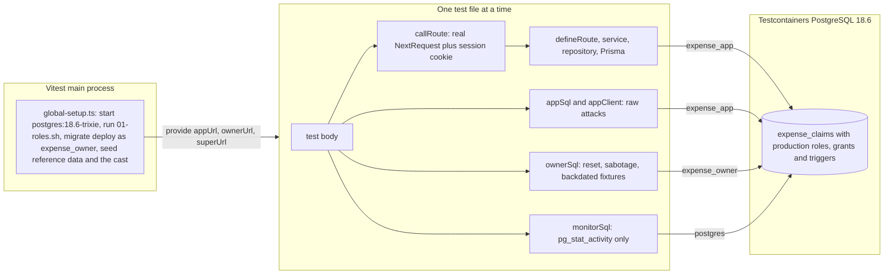
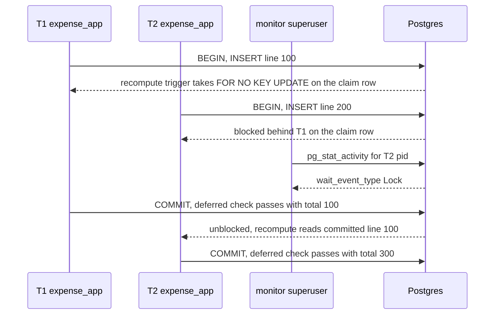

# 07 · Testing

> This doc owns canonical decisions D-42 (test database), D-43 (route testing), D-44 (E2E) and D-48 (load test and plan evidence), plus the named test catalogue. **Test names are verbatim.** The README §6 table, the ADRs and the walkthrough quote them exactly as written here.
> **Read with** [01 architecture and stack](./01-architecture-and-stack.md) · [02 domain and workflow](./02-domain-and-workflow.md) · [03 data model and integrity](./03-data-model-and-integrity.md) · [04 security and API](./04-security-and-api.md) · [05 frontend](./05-frontend.md) · [06 cross-cutting](./06-cross-cutting.md) · [PLAN](../../PLAN.md).

---

## 1. Decisions at a glance

| Decision | Why (say this in the walkthrough) | Rejected |
|---|---|---|
| Integration tests run on a **real PostgreSQL 18.6**: one Testcontainers container per run | The rules being proven (triggers, deferred COMMIT checks, row locks, grants) only exist inside a real Postgres. A mock would prove nothing. | SQLite / pg-mem; mocking Prisma; a compose `db-test` profile (a second harness) |
| Code under test connects as **`expense_app`** | A raw-SQL attack in a test is exactly what a compromised app process could run. The test proves what the production credentials can and cannot do. | Testing as owner or superuser |
| Files run **serially**, with an owner `TRUNCATE` before every test | Deferred checks fire only at COMMIT, so tests must really commit. TRUNCATE takes about 15 ms and fires no row triggers. | Rolling back each test (deferred checks never fire); per-file template DBs (clones lose the DB-level REVOKEs) |
| **`afterEach(assertTotalsInSync)`** on every integration test | It turns all ~245 integration tests into desync probes for free | Checking the invariant only in the desync file |
| Route handlers are called **in-process** with a real `NextRequest` | Every call runs the full `defineRoute → service → repository → triggers` path, 10–50× faster than HTTP, with stack traces in-process | HTTP against a running server for every test |
| Sessions come from a **test helper that inserts a `sessions` row** | Auth only reads the cookie, so no "log in as anyone" code ships in `src` | A test backdoor in `src` |
| Fixtures go **through the real services**. Raw SQL is used only for attacks and backdated timestamps | Fixture data obeys the same rules as production data | Hand-inserted fixture rows |
| Playwright runs against the **production image** under `docker compose up --wait`, with `timezoneId: 'America/Los_Angeles'` | It proves the image, the migrate job, the object store and the cookies. A non-IST browser proves IST formatting doesn't depend on the client's timezone. | Cypress; e2e against `next dev` |
| Performance evidence uses a separate **`expense_perf`** database loaded **with every trigger on** | The two-year dataset then doubles as an integrity test at scale, and the demo database stays clean | Disabling triggers to load faster (that would prove nothing) |

---

## 2. Test pyramid and tooling

| Layer | Tool | Runs against | Size | Command | Lands in |
|---|---|---|---|---|---|
| Unit | Vitest 5.0.3, project `unit`, node | pure code in `src/shared/*`, `src/server/{routing,authz,export,errors}` | 11 files, ~50 tests, < 5 s | `pnpm test:unit` | P0–P7 |
| Component | project `component`, jsdom 30.1.1, Testing Library, `TZ=America/Los_Angeles` | `ClaimForm` (props in, callbacks out; no network) | 1 file, 5 tests | `pnpm test:component` | P4 |
| Integration | project `integration` + Testcontainers 12.2.0 (`postgres:18.6-trixie`, digest-pinned like compose), `MemoryReceiptStorage` | real route modules → services → repositories → PG, as `expense_app` | 29 files, ~245 tests, target < 3 min | `pnpm test:int` | P0–P7 |
| E2E | Playwright 1.63, Chromium | the production image under `docker compose up --wait` | 8 specs (7 CORE) | `pnpm test:e2e` | P8 |
| Evidence | `scripts/perf/seed-perf.ts`, `scripts/perf/explain.ts` (owner, `expense_perf`); k6 2.3 OPTIONAL | 24 months, 10,000 claims by default (50,000 / 100,000 in O3) | 4 EXPLAIN files | `pnpm perf:seed && pnpm perf:explain` | P7 |
| Live check | `scripts/verify-integrity.ts` | any database | `v_claim_total_drift` returns 0 rows | `pnpm verify:integrity` | P2 |

`pnpm verify` runs generate, typecheck, lint, format:check, unit, component and integration (C-18). It is the local definition of "green" and the body of CI. The CI workflow file itself lands in P8 (§13); until then `pnpm verify` on the laptop is the gate.



The integration project in `vitest.config.mts` ([01 §9.5](./01-architecture-and-stack.md)) needs one addition: a `setupFiles` entry for the per-test hooks.

```ts
{ extends: true, test: { name: 'integration', include: ['tests/integration/**/*.int.test.ts'], environment: 'node',
    globalSetup: ['tests/helpers/global-setup.ts'],
    setupFiles: ['tests/helpers/integration-setup.ts'],          // per-test hooks (§3.2)
    fileParallelism: false, testTimeout: 30_000, hookTimeout: 180_000 } },
// OPTIONAL (BUF): { name: 'perf', include: ['tests/perf/**/*.perf.test.ts'], testTimeout: 120_000 }  (TC-O02, needs PERF_DATABASE_URL)
```

**What we never do:**
- Mock Prisma or Postgres.
- Disable a trigger to make a fixture easier.
- Import a `src` helper that only exists for tests.
- Assert exact claim numbers. `claim_number_seq` survives TRUNCATE, so assert the format `^EXP-\d{4}-\d{6,}$`.

---

## 3. Test database strategy (D-42)

### 3.1 One container per run (`tests/helpers/global-setup.ts`)

```ts
import { PostgreSqlContainer } from '@testcontainers/postgresql';
import { execFileSync } from 'node:child_process';
import { randomBytes } from 'node:crypto';
import type { TestProject } from 'vitest/node';
import { seedReferenceAndCast } from '../../prisma/seed-personas';   // seedReference() + the C-15 cast: the same idempotent inserts prisma/seed.ts uses

const secret = () => randomBytes(12).toString('hex');                 // URL-safe, fresh every run
const IMAGE = 'postgres:18.6-trixie@sha256:74935e72241653ca55e0414067e6d8763aceb8a810eb51b452253ec3dcfc4336';  // same digest as compose.yaml

export default async function setup(project: TestProject) {
  const ownerPw = secret(), appPw = secret(), demoPw = secret();       // demoPw: the cast's login password for this run
  // (as built in P0) if TEST_PG_SUPERUSER_URL is set, an external empty PG 18 replaces the container: see the bullet below
  const pg = await new PostgreSqlContainer(IMAGE)
    .withDatabase('expense_claims').withUsername('postgres').withPassword(secret())
    .withEnvironment({ DB_OWNER_PASSWORD: ownerPw, DB_APP_PASSWORD: appPw })
    .withCopyFilesToContainer([{ source: 'docker/postgres/initdb/01-roles.sh',          // SAME roles + REVOKEs as prod
                                 target: '/docker-entrypoint-initdb.d/01-roles.sh', mode: 0o755 }])
    .withTmpFs({ '/var/lib/postgresql': 'rw' })                                         // PG 18 keeps PGDATA below this
    .withCommand(['postgres', '-c', 'fsync=off', '-c', 'synchronous_commit=off', '-c', 'full_page_writes=off'])
    .start();
  const url = (user: string, pw: string) => `postgresql://${user}:${pw}@${pg.getHost()}:${pg.getPort()}/expense_claims`;
  const ownerUrl = url('expense_owner', ownerPw);
  execFileSync('pnpm', ['exec', 'prisma', 'migrate', 'deploy'], { stdio: 'inherit',     // prisma.config.ts: MIGRATE_DATABASE_URL ?? DATABASE_URL
    env: { ...process.env, MIGRATE_DATABASE_URL: ownerUrl, DATABASE_URL: ownerUrl } });
  await seedReferenceAndCast(ownerUrl, { password: demoPw });
  // departments, 10 active + 1 inactive categories and the C-15 cast (P1); from P3 also tiers T1–T3 active + L4_CFO inactive
  project.provide('appUrl', url('expense_app', appPw));
  project.provide('ownerUrl', ownerUrl);
  project.provide('superUrl', pg.getConnectionUri());                                  // monitor connection only
  project.provide('demoPassword', demoPw);                                             // TC-I02's successful-login case
  return async () => { await pg.stop(); };
}
declare module 'vitest' { export interface ProvidedContext { appUrl: string; ownerUrl: string; superUrl: string; demoPassword: string } }
```

*Why a single database created by `01-roles.sh`:* `REVOKE TEMPORARY` and `REVOKE CREATE` are set **per database**, and template clones don't copy them. Tests on a clone would quietly have more privileges than production (RT-M10). Demo claims C01–C12 are **not** seeded here: every test builds the claims it needs, so no test depends on another test's leftovers. The one exception is TC-I16 › "stored approvers equal buildChain() for every seeded claim", which calls `seedDemoClaims()` inside the test (§6.2 notes).

- **Where the seed helpers come from.** `prisma/seed-personas.ts` exports `seedReferenceAndCast(url, { password })` and `restoreReference(sql)` (both written in P1). The reference part is the same `seedReference()` the `release` step runs on every boot (departments, categories, tiers T1–T3, and L4_CFO only once deepa exists; `INSERT … ON CONFLICT (code) DO NOTHING`). The tiers part starts working in P3, when the `…_workflow` migration creates `approval_policy_tiers`.
- **Why a random password.** CI never copies `.env` before `test:int`, and Vitest doesn't load it, so there is no `SEED_DEMO_PASSWORD` to rely on. Global setup generates one per run and provides it; TC-I02 reads it with `inject('demoPassword')`.
- **External-DB mode (built in P0).** Testcontainers stays the default. If `TEST_PG_SUPERUSER_URL` is set (a superuser URL for an empty, disposable PostgreSQL 18 cluster, for machines without a Docker daemon), global setup creates a fresh `expense_claims_test_<hex>` database there, runs the same SQL as `01-roles.sh` (parsed from the script, so there is one source of truth) and drops the database at teardown. It refuses a cluster that already hosts a non-test database owned by `expense_owner`, such as the compose database.
- Since P1 the harness creates no shadow database (the drift rule in §13 needs none); `global-setup.ts` seeds reference data and the cast with a random demo password and provides it as `demoPassword`.

### 3.2 Per-test lifecycle (`tests/helpers/integration-setup.ts`)

```ts
import { afterAll, afterEach, beforeEach, inject } from 'vitest';
import { assertGuardsEnabled, assertTotalsInSync, closePools, closeTestClients, resetDb } from './db';

process.env.DATABASE_URL = inject('appUrl');                 // getDb() is lazy: app code under test is expense_app, nothing else
Object.assign(process.env, { APP_ENV: 'test', APP_BASE_URL: 'http://localhost:3000', LOG_LEVEL: 'silent',
  RECEIPT_STORAGE_DRIVER: 'memory', EXPORT_BATCH_SIZE: '3', DEMO_MODE: 'false' });
for (const v of ['MIGRATE_DATABASE_URL', 'SHADOW_DATABASE_URL', 'DB_OWNER_PASSWORD', 'POSTGRES_PASSWORD'])
  delete process.env[v];                                     // app code can't reach owner credentials even by accident

beforeEach(resetDb);
afterEach(assertTotalsInSync);    // §6: every integration test is also a desync probe
afterEach(assertGuardsEnabled);   // a sabotage test can't leave a trigger disabled for the next test
afterEach(closeTestClients);      // after-hooks run in reverse order, so this runs first: no open tx blocks the next TRUNCATE
afterAll(closePools);             // end the pg pools and getDb().$disconnect(), so the worker exits cleanly
```

- `EXPORT_BATCH_SIZE=3` makes **every** route-level export test cross batch boundaries. Service-level tests can still pass `opts.batchSize` ([06 §6.6](./06-cross-cutting.md)).
- `LOG_LEVEL=silent` keeps output readable. TC-I05 switches capture on with `captureLogs()` (§4).
- `getDb()` must build its client with `log: [{ emit: 'event', level: 'query' }]` when `APP_ENV === 'test'`. This is a one-line condition in `src/server/db/client.ts`. Events are only emitted, never written to the log, and nothing subscribes outside tests. `captureQueries()` (§3.3) depends on it. Verified in P0: Prisma 7.10 with the `PrismaPg` adapter emits these query events.

### 3.3 `tests/helpers/db.ts`

```ts
import pg from 'pg';
import { expect, inject } from 'vitest';
import { getDb } from '@/server/db/client';
import { readSqlState } from '@/server/db/pg-error';
import { restoreReference } from '../../prisma/seed-personas';
// P6 adds: import { getStorage } from '@/server/storage/receipt-storage';   (the module doesn't exist before P6)

export type Sql = <T = any>(s: TemplateStringsArray, ...v: unknown[]) => Promise<T[]>;
const toSql = (q: pg.Pool | pg.Client): Sql => async (s, ...v) =>
  (await q.query(s.reduce((acc, part, i) => `${acc}$${i}${part}`), v)).rows;     // tagged template → $1..$n

const pools = {
  app: new pg.Pool({ connectionString: inject('appUrl'), max: 4 }),
  owner: new pg.Pool({ connectionString: inject('ownerUrl'), max: 2 }),
  monitor: new pg.Pool({ connectionString: inject('superUrl'), max: 1 }),
};
export const appSql = toSql(pools.app);          // raw attacks with the production credentials
export const ownerSql = toSql(pools.owner);      // reset, sabotage, backdated fixtures; never used by app code
export const monitorSql = toSql(pools.monitor);  // pg_stat_activity (other roles' wait events need superuser or pg_monitor)

const opened: pg.Client[] = [];
async function client(url: string) {
  const c = new pg.Client(url); await c.connect(); opened.push(c);
  return Object.assign(c, { sql: toSql(c) });
}
export const appClient = () => client(inject('appUrl'));     // a dedicated connection: concurrency tests
export const ownerClient = () => client(inject('ownerUrl'));
export async function closeTestClients() { await Promise.all(opened.splice(0).map((c) => c.end())); }
export async function closePools() { await Promise.all([...Object.values(pools).map((p) => p.end()), getDb().$disconnect()]); }

/** BEGIN … COMMIT on one connection. Deferred errors (UC009, UC015) surface at COMMIT, so the COMMIT is inside. */
export async function tx<T>(c: pg.Client, fn: () => Promise<T>): Promise<T> {
  await c.query('BEGIN');
  try { const r = await fn(); await c.query('COMMIT'); return r; }
  catch (e) { await c.query('ROLLBACK').catch(() => {}); throw e; }
}
export async function errorOf(fn: () => Promise<unknown>) { return fn().then(() => null, (e) => e); }
/** Assert the exact SQLSTATE. Works for pg errors, Prisma P2039/P2010 and commit-time DriverAdapterErrors. */
export async function rejects(code: string, fn: () => Promise<unknown>) {
  const err = await errorOf(fn);
  expect(err, `expected SQLSTATE ${code}, but the statement succeeded`).not.toBeNull();
  expect(readSqlState(err)).toBe(code);
}

/** Transactional tables and the phase each arrives in: P0 claims, line_items, sessions · P3 claim_submissions,
 *  approval_steps, claim_events · P6 receipts · O1 export_runs. resetDb truncates only the ones that exist yet. */
const TRANSACTIONAL = ['claims', 'line_items', 'receipts', 'claim_submissions', 'approval_steps', 'claim_events', 'sessions', 'export_runs'];

export async function resetDb() {
  const present = (await ownerSql<{ t: string }>`SELECT tablename AS t FROM pg_tables
    WHERE schemaname = 'public' AND tablename = ANY(${TRANSACTIONAL}::text[])`).map((r) => r.t);
  if (present.length) await pools.owner.query(`TRUNCATE ${present.map((t) => `public.${t}`).join(', ')}`);  // one statement; names from the constant
  await ownerSql`DELETE FROM users WHERE email LIKE 'tmp.%'`;
  await restoreReference(ownerSql);   // idempotent. P1: categories' is_active + cast role/can_approve/is_active/manager_id; P3 adds tiers (L4_CFO inactive)
  // P6 adds: (getStorage() as { clear?(): void }).clear?.();      // MemoryReceiptStorage
}
export async function assertTotalsInSync() {
  expect(await ownerSql`SELECT claim_id, total_minor, line_sum FROM v_claim_total_drift`,
         'claims.total_minor differs from Σ line_items.amount_minor').toEqual([]);
}
export async function assertGuardsEnabled() {
  expect(await ownerSql`SELECT c.relname, t.tgname FROM pg_trigger t JOIN pg_class c ON c.oid = t.tgrelid
     WHERE c.relnamespace = 'public'::regnamespace AND NOT t.tgisinternal AND t.tgenabled IN ('D', 'R')`).toEqual([]);
}

// Concurrency: prove a lock wait instead of sleeping (§3.4 rule 2)
export async function pidOf(c: pg.Client) { return (await c.query('SELECT pg_backend_pid() AS pid')).rows[0].pid as number; }
export async function waitUntilBlocked(pid: number, timeoutMs = 5_000) {
  for (const end = Date.now() + timeoutMs; Date.now() < end; await new Promise((r) => setTimeout(r, 20))) {
    const [row] = await monitorSql`SELECT wait_event_type FROM pg_stat_activity WHERE pid = ${pid}`;
    if (row?.wait_event_type === 'Lock') return;
  }
  throw new Error(`backend ${pid} never waited on a lock`);
}
/** Hold the claim row lock from a third connection, so contenders queue in a known order (deterministic races). */
export async function gate(claimId: string) {
  const c = await ownerClient(); await c.query('BEGIN');
  await c.query('SELECT 1 FROM claims WHERE id = $1 FOR NO KEY UPDATE', [claimId]);
  return { release: () => c.query('COMMIT') };
}

/** Record the SQL Prisma sends from now on (TC-I17). Needs the test-only query events from §3.2. */
let sink: string[] | null = null, hooked = false;
export function captureQueries(): string[] {
  if (!hooked) { (getDb() as unknown as QueryEvents).$on('query', (e) => sink?.push(e.query)); hooked = true; }
  return (sink = []);
}
type QueryEvents = { $on(ev: 'query', cb: (e: { query: string; params: string }) => void): void };
```

*Why `resetDb` discovers its tables:* the file is written in P0, but `claim_submissions`, `approval_steps` and `claim_events` only arrive in P3 and `receipts` in P6. A fixed `TRUNCATE` list would fail every integration test's `beforeEach` with 42P01 until P6. `afterEach(assertTotalsInSync)` is registered once, here in `integration-setup.ts` (§3.2), from P0 on; no later phase registers it again.

### 3.4 Gotchas, already learned on a real PostgreSQL by the SQL proof

1. **Deferred errors appear at COMMIT.** Wrap the whole transaction: `rejects('UC015', () => tx(c, …))`. Through Prisma they surface as a raw `DriverAdapterError`, which `readSqlState` already handles.
2. **Prove a block; never sleep.** Read `pg_backend_pid()` *before* the blocking statement, because a pg `Client` queues later queries behind a blocked one. Start the statement and attach `p.catch(() => {})`. Then poll `wait_event_type = 'Lock'` from the superuser monitor.
3. **Use gates for deterministic races** (`gate()` above), not timing.
4. **Use short timeouts in tests.** `SET lock_timeout = '300ms'` on one connection exercises 55P03 → 409 `CONFLICT` without waiting 5 s.
5. **Never run `SET CONSTRAINTS ALL IMMEDIATE` before a line write.** Immediate row-level constraint triggers fire before the statement-level recompute and raise a spurious UC009. It fails closed, but app code must never do it.
6. **Lock the claim first.** Raw multi-row line writes that skip the claim lock deadlock (40P01) under contention. Integrity still holds (never UC009, never drift). Only attack tests write that way, and they expect 40P01.
7. **pg typing.** Cast `name[]` with `::text[]` and `count(*)` with `::int`. Compare instants with `toISOString()`, which works because of `timestamptz(3)`.
8. **The `RECALL_TO_EDIT` HINT is not exposed on Prisma errors.** The service sets `details.hint` itself, so assert it at the API.
9. **Docker must be running** for Testcontainers. The first run pulls the digest-pinned `postgres:18.6-trixie`. Without Docker, set `TEST_PG_SUPERUSER_URL` (§3.1).

---

## 4. Calling route handlers in-process (`tests/helpers/http.ts`, D-43)

```ts
import { NextRequest } from 'next/server';
import { asPersona, createSession, type Persona } from './auth';

type Method = 'GET' | 'HEAD' | 'POST' | 'PUT' | 'PATCH' | 'DELETE' | 'OPTIONS';
type Handler = (req: NextRequest, ctx: { params: Promise<Record<string, string | string[]>> }) => Promise<Response>;

export async function callRoute(mod: Partial<Record<Method, Handler>>, method: Method, o: {
  path: string; params?: Record<string, string | string[]>; query?: Record<string, string>;
  body?: unknown; as?: Persona | { id: string }; headers?: Record<string, string>;
}): Promise<Response> {
  const handler = mod[method];
  if (!handler) throw new Error(`route module does not export ${method}`);
  const url = new URL(o.path, 'http://localhost:3000');
  for (const [k, v] of Object.entries(o.query ?? {})) url.searchParams.set(k, v);
  const headers = new Headers(o.headers);
  if (o.as) headers.append('cookie', await createSession(typeof o.as === 'string' ? (await asPersona(o.as)).id : o.as.id));
  let body: BodyInit | undefined;
  if (o.body instanceof FormData || typeof o.body === 'string') body = o.body;    // multipart upload, malformed-JSON cases
  else if (o.body !== undefined) {
    body = JSON.stringify(o.body);
    if (!headers.has('content-type')) headers.set('content-type', 'application/json');
  }
  return handler(new NextRequest(url, { method, headers, body }), { params: Promise.resolve(o.params ?? {}) });
}
```

- **What is real:** `defineRoute` (request id, auth from `req.cookies`, CSRF, role gate, Zod, error mapping, access log), the services, the repositories, Prisma, the triggers and the grants. The `Response` is the real one: `res.status`, `await res.json()`, and `await res.text()` for CSV. If an export stream errors, `res.text()` **rejects**, which is how TC-I28 proves "no clean end".
- **What is not real:** the Next server, `proxy.ts`, cookies over a socket, HTTP chunking. Playwright covers those once (§11). Authentication sits inside every handler, never in middleware, so in-process calls lose no security behaviour.
- No `Origin` header is sent by default (the CSRF rule allows that). TC-I03 sets `origin: 'https://evil.example'` and `sec-fetch-site: cross-site` explicitly.
- `captureLogs()` (same file) temporarily swaps the pino stream via `logger[pino.symbols.streamSym]` and raises the level to `info`. TC-I05 uses it to read log lines as JSON.
- The route-inventory helper `tests/helpers/route-manifest.ts` and TC-I01's loop are in [04 §3.4](./04-security-and-api.md#34-the-route-enumeration-test-tc-i01).

---

## 5. Auth helpers, personas and factories

### 5.1 `tests/helpers/auth.ts` (not exported from `src`)

```ts
import { createHash, randomBytes } from 'node:crypto';
import { appSql } from './db';
import { sessionCookieName } from '@/server/auth/cookie';
import type { Actor } from '@/server/auth/actor';

export const PERSONAS = { asha: 'asha.rao', ravi: 'ravi.menon', meera: 'meera.iyer', vikram: 'vikram.shah', deepa: 'deepa.menon',
  neha: 'neha.kapoor', arjun: 'arjun.das', farah: 'farah.khan', admin: 'admin' } as const;
export type Persona = keyof typeof PERSONAS;

export async function asPersona(p: Persona | { email: string }): Promise<Actor> {
  const email = typeof p === 'string' ? `${PERSONAS[p]}@acme.test` : p.email;
  const [u] = await appSql<Actor>`SELECT id, email, name, role, can_approve AS "canApprove" FROM users WHERE email = ${email}`;
  return u;
}

/** Mints a session the same way login does (sha256 of a random token) and returns the Cookie header value. */
export async function createSession(userId: string, o: { idleExpiresAt?: Date; absoluteExpiresAt?: Date } = {}) {
  const token = randomBytes(32).toString('base64url');
  await appSql`INSERT INTO sessions (user_id, token_hash, idle_expires_at, absolute_expires_at)
    VALUES (${userId}, ${createHash('sha256').update(token).digest('hex')},
            ${o.idleExpiresAt ?? new Date(Date.now() + 3_600_000)}, ${o.absoluteExpiresAt ?? new Date(Date.now() + 43_200_000)})`;
  return `${sessionCookieName('http://localhost:3000')}=${token}`;          // ec_session on http
}
```

Expired sessions (TC-I01, TC-I02) pass `idleExpiresAt` in the past. A deactivated user is a `makeUser()` throwaway that the owner switches to `is_active = false`. The only test that logs in through the real login route with a password is TC-I02; it uses `inject('demoPassword')` (§3.1).

### 5.2 Personas: who to use for what (cast and chains from canonical C-15)

| Persona | Role in tests |
|---|---|
| `asha` | Main claimant. Her chains: ≤ ₹10,000.00 → [ravi]; up to ₹50,000.00 → [ravi, meera]; above → [ravi, meera, vikram] (T4 inactive) |
| `ravi`, `meera`, `vikram` | Asha's L1, L2 and L3: "active", "waiting" and "decided" approvers in the matrix |
| `deepa` | Fallback approver and L4 designated user. Vikram's ₹8,000 claim → [deepa (FALLBACK)] |
| `vikram` as a claimant | ₹25,000 → 422 `ROUTING_UNRESOLVABLE` (a deliberate fixture) |
| `neha` | Approver **outside** Asha's chain: the sharpest-test actor. She is L1 for Arjun |
| `arjun` | Owns claims routed to Neha, the positive control that shows Neha's queue works |
| `farah` | FINANCE: reads everything, exports; 403 `FORBIDDEN` on approve/reject |
| `admin` | No extra visibility; behaves like an unrelated employee |
| `makeUser()` → `tmp.*@acme.test` | Anything that mutates a user (deactivate, demote to FINANCE, re-point a manager). `resetDb()` deletes it |

### 5.3 `tests/helpers/factories.ts`

```ts
type LineSpec = { amountMinor: number; category?: CategoryCode; expenseDate?: string; description?: string; receipt?: File };
// Every service function is (ctx: ServiceCtx, ...ids, input?) with ServiceCtx = { actor; requestId; clock?: SeedClock } (C-26)
const ctx = (actor: Actor): ServiceCtx => ({ actor, requestId: `test-${randomUUID()}` });   // matches REQUEST_ID_PATTERN
export const categoryIds = async () =>                                         // { MEALS: uuid, … } from the seeded categories
  Object.fromEntries((await appSql<{ code: string; id: string }>`SELECT code, id FROM categories`).map((r) => [r.code, r.id]));

export async function makeUser(o: { role?: UserRole; canApprove?: boolean; manager?: Persona } = {}) {
  const email = `tmp.${randomUUID().slice(0, 8)}@acme.test`;                 // the app role can't INSERT users: owner SQL
  const [u] = await ownerSql`INSERT INTO users (employee_code, email, name, role, can_approve, department_id, manager_id)
    VALUES (${'T' + email.slice(4, 12)}, ${email}, 'Temp User', ${o.role ?? 'EMPLOYEE'}, ${o.canApprove ?? false},
            (SELECT id FROM departments WHERE code = 'ENG'),
            (SELECT id FROM users WHERE email = ${PERSONAS[o.manager ?? 'ravi'] + '@acme.test'})) RETURNING id, email`;
  return u as { id: string; email: string };
}
export async function makeDraft(who: Persona | Actor, o: { title?: string; lines?: LineSpec[] } = {}): Promise<ClaimDetail> {
  const actor = typeof who === 'string' ? await asPersona(who) : who;
  const cats = await categoryIds();                                            // code → id, cached per file
  let claim = await claimsService.createClaim(ctx(actor), { title: o.title ?? `Test claim ${randomUUID().slice(0, 6)}` });
  if (o.lines?.length) claim = await claimsService.replaceClaim(ctx(actor), claim.id, { title: claim.title,
    lineItems: o.lines.map((l) => ({ expenseDate: l.expenseDate ?? todayInBusinessTz(), categoryId: cats[l.category ?? 'MEALS'],
                                     amountMinor: l.amountMinor, description: l.description ?? 'Test expense' })) });
  for (const [i, l] of (o.lines ?? []).entries())                              // P6+: receipts through the real service
    if (l.receipt) await receiptsService.upload(ctx(actor), claim.id, claim.lineItems[i].id, l.receipt);
  return claimsService.getClaim(ctx(actor), claim.id);
}
export const submitAs  = async (who: Persona, c: ClaimDetail) => lifecycleService.submit(ctx(await asPersona(who)), c.id, {});
export const recallAs  = async (who: Persona, c: ClaimDetail) => lifecycleService.recall(ctx(await asPersona(who)), c.id, {});
export const approveAs = async (who: Persona, c: ClaimDetail, o: { at?: string } = {}) => o.at
  ? ownerDecideAt(who, c, 'APPROVED', o.at)          // backdated: the only fixture that bypasses services (D-23)
  : approvalsService.approve(ctx(await asPersona(who)), c.id, { revision: c.currentRevision });
export const rejectAs  = async (who: Persona, c: ClaimDetail, reason = 'Hotel invoice missing for 3 Oct') =>
  approvalsService.reject(ctx(await asPersona(who)), c.id, { revision: c.currentRevision, reason });
export const lineInput = (l: ClaimDetail['lineItems'][number]) => ({ id: l.id, expenseDate: l.expenseDate,
  categoryId: l.category.id, amountMinor: l.amountMinor, description: l.description, merchant: l.merchant ?? undefined });
export const fakePdf = (bytes = 2_048, name = 'invoice.pdf') =>               // magic bytes + padding; built in memory
  new File([Buffer.concat([Buffer.from('%PDF-1.7\n'), Buffer.alloc(bytes - 9)])], name, { type: 'application/pdf' });
export const pdfForm = (f = fakePdf()) => { const fd = new FormData(); fd.set('file', f); return fd; };
```

- **The file grows with the phases.** P2: `makeUser`, `makeDraft` (no `receipt` option), `categoryIds`, `lineInput`. P3: `submitAs`. P4: `approveAs`, `rejectAs`, `ownerDecideAt` and the `at` option of `approveAs` (TC-I25's IST boundary case needs them; TC-I28 reuses them in P7). P5: `recallAs`. P6: `fakePdf`, `pdfForm` and the `receipt` option of `makeDraft`.
- **`ownerDecideAt(who, claim, outcome, at)`** is owner SQL that runs the C-25 approve/reject write order and supplies `decided_at`, `approved_at` and `occurred_at = at` (plus the next level's `activated_at` on a non-final approval). Only the owner may supply transition timestamps (D-23). TC-I28's and TC-I25's IST-boundary tests use it, the same way the seed passes a `SeedClock` through `ServiceCtx.clock` ([02 §9](./02-domain-and-workflow.md)).
- Receipt fixtures are generated in memory: `fakePdf(10_380_902)` is the 9.9 MiB case, `fakePdf(10_485_761)` is 10 MiB + 1 byte, and a `MZ`-header file named `.pdf` is the renamed `.exe`. The only binary checked in is `e2e/fixtures/receipt.pdf`.

---

## 6. Named test catalogue (verbatim)

Requirement ids: §n from the requirements doc; RT-xx from the red-team ledger ([§7.3](#73-red-team-ledger)). Phases follow canonical C-24.

### 6.1 Unit (`tests/unit/`)

| Id | File | Test names | Proves | Phase |
|---|---|---|---|---|
| TC-U01 | `money.test.ts` | "parseMoneyToMinor('0.29') returns 29 (no float drift)" · "parseMoneyToMinor rejects 3 decimal places, negatives, exponent notation and empty input" · "parseMoneyToMinor accepts en-IN grouping like 1,23,456.78" · "formatMinor(12345678) renders ₹1,23,456.78" · "sum of 0.10 + 0.20 in minor units is 30" | §3.1 amounts, D-09 | P2 |
| TC-U02 | `dates.test.ts` | "businessDayRangeToUtc('2026-09-01','2026-09-30') is [2026-08-31T18:30:00.000Z, 2026-09-30T18:30:00.000Z)" · "rejects impossible dates like 2026-02-30" · "todayInBusinessTz at 2026-09-30T18:30:00.000Z is 2026-10-01" · "formats instants in Asia/Kolkata regardless of process TZ" | §3.6 period, §6-6 | P2 |
| TC-U03 | `build-chain.test.ts` | "₹10,000.00 routes to 1 step" · "₹10,000.01 routes to 2 steps" · "₹50,000.00 routes to 2 steps" · "₹50,000.01 routes to 3 steps" · "activating the L4 tier row yields a 4-step chain with no code change" · "tier input order does not change the chain" · "skips claimant, FINANCE, inactive and non-approver candidates by escalating upward" · "a person resolved for two tiers is used once; the later tier escalates to the next distinct approver" · "uses the fallback approver when the reporting line is too short" · "throws ROUTING_UNRESOLVABLE when no eligible candidate exists" · "assertPolicyWellFormed rejects gaps, non-increasing thresholds and a level 1 threshold above 0" | §3.2-a/b, §8-1, §7-Q1 | P3 |
| TC-U04 | `claim-policy.test.ts` | "decide() is exhaustive over status × relationship × action" · "allowedActions for FINANCE is always empty" · "allowedActions offers DELETE only for never-submitted drafts" · "submissionOutcome derives IN_APPROVAL, APPROVED, REJECTED and RECALLED from steps" | §4-b, §3.4/§3.5 (UI actions) | P2, P4 |
| TC-U05 | `schemas.test.ts` | "claim bodies containing totalMinor fail with TOTAL_IS_DERIVED" · "claim bodies containing status, claimantId or claimNumber fail with READ_ONLY_FIELD" · "amountMinor must be a positive safe integer ≤ 100000000" · "unknown keys are rejected, never stripped" · "reject reason is trimmed and must be 10..1000 characters" · "query schemas reject unknown params" | §3.1-c, §6-1, §6-2, RT-m4 | P2 |
| TC-U06 | `csv.test.ts` | "quotes fields per RFC 4180 and uses CRLF" · "prefixes ' to text starting with = + - @ TAB or CR, including after leading whitespace" · "leaves safe text and generated columns unchanged" · "starts the file with a UTF-8 BOM" | §3.6-a, RT-m2 | P7 |
| TC-U07 | `pagination.test.ts` | "cursor round-trips" · "tampered cursor fails with INVALID_CURSOR" · "cursor issued for different filters fails with INVALID_CURSOR" | §6-6 | P2 |
| TC-U08 | `error-mapping.test.ts` | "maps every UC SQLSTATE to its catalogue code and status" · "reads SQLSTATE from Prisma P2039/P2010 meta, from a commit-time DriverAdapterError and from pg errors" · "ZodError maps to 422 VALIDATION_FAILED with issues[].path" · "unknown errors map to 500 INTERNAL_ERROR without internals" | §6-2, RT-B1(d) | P1 |
| TC-U09 | `service-role-guards.test.ts` | "finance and export services throw FORBIDDEN for a non-finance actor before touching the database" · "financeClaimsWhere throws FORBIDDEN unless the actor is FINANCE" | §3.5-c, RT-M11 | P7 |
| TC-U10 | `lint-boundaries.test.ts` | "importing @/generated/prisma from src/app fails lint" · "importing @/server from src/components fails lint" · "a 'use server' directive fails lint" · "a 'use cache' directive fails lint" | STACK, §6-4 (Prisma only in repositories), RT-M11 | P0 (built with the ESLint zones) |
| TC-U11 | `env.test.ts` | "invalid env makes env() throw with the variable name" · "staging and production reject SEED_ON_START=true, DEMO_MODE=true or a SEED_DEMO_PASSWORD" · "the forbidden owner and superuser variables are detected in production mode" | §6-8, RT-B3, RT-m7 | P1 |

TC-U08's fixtures are the 11 Prisma 7.10 error shapes recorded by the SQL proof (P2039 model ops, P2010 raw, P2002 with `originalCode` only, a raw `DriverAdapterError` at COMMIT, pg `DatabaseError`). TC-U10 runs ESLint's Node API on fixture strings with typescript-eslint's `disableTypeChecked` override (virtual fixture files can't be type-checked); the rules under test come from the real `eslint.config.mjs`.

### 6.2 Integration (`tests/integration/`)

| Id | File | Test names | Proves | Phase |
|---|---|---|---|---|
| TC-I00 | `spike/integrity-spike.int.test.ts` | "(a) app role raw UPDATE claims SET total_minor raises UC003" · "(b) Prisma lineItem.update on a SUBMITTED claim raises UC002 and its error shape is recorded" · "(c) owner-disabled recompute trigger makes COMMIT fail with UC009" · "(d) app role cannot DISABLE TRIGGER, TRUNCATE or SET session_replication_role (42501)" · "(e) two connections inserting lines into one claim serialize and the total is 300" | §3.1-c, §4-e, D-13 gate | P0 |
| TC-I01 | `auth/every-route-requires-auth.int.test.ts` | "every exported handler for every HTTP method carries ROUTE_META" · "only PUBLIC_ROUTES are public" · "every non-public route returns 401 UNAUTHENTICATED with no cookie" · "every non-public route returns 401 UNAUTHENTICATED with a garbage cookie" · "every non-public route returns 401 UNAUTHENTICATED with an expired session" · "every non-public route returns 401 UNAUTHENTICATED for a deactivated user" · "an unauthenticated request with an invalid body gets 401, not 422" · "the x-middleware-subrequest header does not bypass authentication" | §6-3, RT-m5 | P1 |
| TC-I02 | `auth/login.int.test.ts` | "login sets an HttpOnly SameSite=Lax session cookie (Secure and __Host- prefix on https)" · "wrong password and unknown email return identical 401 INVALID_CREDENTIALS" · "logout deletes the session and the old cookie gets 401" · "idle and absolute expiry are enforced" · "deactivating a user revokes their sessions on the next request" · "a role change takes effect on the next request" · "login issues a new token and deletes any presented session" | §6-3, RT-M12 | P1 |
| TC-I03 | `auth/csrf.int.test.ts` | "POST with a cross-site Origin returns 403 CSRF_REJECTED" · "requests without an Origin header are allowed" · "JSON routes reject non-JSON content types with 415" · "export GET with Sec-Fetch-Site: cross-site returns 403 CSRF_REJECTED" | D-06, RT-m3 | P1, P7 |
| TC-I04 | `http/error-envelope.int.test.ts` | "every non-2xx response has {error:{code,message,requestId}}" · "envelope requestId equals the x-request-id header" · "5xx responses contain no stack, SQL or details" · "unknown /api/v1 paths return 404 ROUTE_NOT_FOUND" | §5, §6-2 | P1 |
| TC-I05 | `observability/request-id.int.test.ts` | "echoes a valid inbound x-request-id" · "replaces an invalid or oversized x-request-id with a UUID" · "every log line within a request carries requestId and userId" · "a DB-backstop error is logged at error with defense=db" | §6-7 (log join), D-40 | P1 |
| TC-I06 | `observability/health.int.test.ts` | "/api/health/live returns 200 without the DB" · "/api/health/ready returns 200 when the DB is up and triggers are enabled" · "/api/health/ready returns 503 NOT_READY when an integrity trigger is disabled" · "assertRuntimeRole rejects the owner role and accepts expense_app" | D-41, RT-B3 | P0, P1 |
| TC-I07 | `db/privileges.int.test.ts` | "privilege matrix for expense_app matches the expected matrix for every table in public" · "expense_app cannot DISABLE TRIGGER, TRUNCATE, or SET session_replication_role (42501)" · "expense_app cannot UPDATE or DELETE claim_events or claim_submissions" · "expense_app cannot write users, departments, categories or approval_policy_tiers" · "expense_app has no TEMP or CREATE privilege" | §7-Q2, D-34/D-35, RT-M7, RT-M10, RT-m8 | P0, P3, P6 |
| TC-I08 | `db/schema-objects.int.test.ts` | "every plpgsql function pins search_path = pg_catalog, public, pg_temp" · "each table has exactly the expected triggers, all enabled" | RT-B1(e), RT-M10 | P0, P3, P6 |
| TC-I09 | `claims/claims-crud.int.test.ts` | "POST /claims creates an empty DRAFT with total 0 and a claim number" · "PUT replace-set inserts, updates and deletes lines in one transaction" · "DELETE removes a never-submitted draft (204)" · "DELETE of a claim that was ever submitted returns 409 CLAIM_HAS_HISTORY" · "non-owner PUT and DELETE return 404 CLAIM_NOT_FOUND" · "concurrent PUTs on one draft end last-write-wins with no drift" | §2-Claimant, §3.1, RT-m4 | P2 (the CLAIM_HAS_HISTORY case: P3) |
| TC-I10 | `claims/line-item-validation.int.test.ts` | `it.each` "rejects %s with 422 VALIDATION_FAILED at the field path" over: amount 0 · amount negative · amount non-integer · amount over the per-line cap · date 2026-02-30 · date 2026-13-01 · date in DD/MM/YYYY · date in the future (IST) · unknown category · missing category · empty description · description over 500 characters — plus "inactive category returns 422 CATEGORY_INACTIVE" · "totalMinor in the body returns 422 TOTAL_IS_DERIVED" · "51 lines return 422 VALIDATION_FAILED" · "DB backstops: raw amount_minor = 0 → 23514, raw future expense_date → UC014, raw inactive category → UC013" | §6-1, §3.1-a | P2 |
| TC-I11 | `claims/locked-approved.int.test.ts` | "every mutation route on an APPROVED claim returns 409 CLAIM_LOCKED" (PUT, DELETE, submit, recall, receipt upload, receipt delete) · "PUT on a SUBMITTED claim returns 409 CLAIM_NOT_EDITABLE with hint RECALL_TO_EDIT" · "raw SQL as expense_app on an APPROVED claim raises UC001" (UPDATE/INSERT/DELETE lines; UPDATE status, title or approved_at; DELETE claim) · "Prisma lineItem.update on an APPROVED claim maps to 409 CLAIM_LOCKED" | §3.4-a, §6-2, §7-Q2 | P5 (the receipt upload/delete cases: P6) |
| TC-I12 | `integrity/total-desync.int.test.ts` | **"no code path can leave claims.total_minor different from the sum of its line items"** (`describe`) containing: "API: POST and PUT with totalMinor return 422 TOTAL_IS_DERIVED and persist nothing" · "Prisma: claim.update({ totalMinor }) is refused with UC003" · "raw SQL: UPDATE claims SET total_minor is refused with UC003" · "raw SQL: INSERT INTO claims with total_minor ≠ 0 is refused with UC003" · "raw SQL insert, update and delete of lines keep total = Σ lines" · "bulk INSERT … SELECT, COPY FROM STDIN and MERGE keep total = Σ lines" · "Prisma createMany, updateMany and deleteMany keep total = Σ lines" · "moving a line to another claim is refused with UC010" · "cascade delete of a draft does not trip the guard" · "owner sabotage: with the recompute trigger disabled, COMMIT fails with UC009" · "50 lines at the per-line cap exceed the claim cap and return 422, never 500" · "v_claim_total_drift is empty after every case" | §3.1-c, §4-e, **§6-5**, RT-m10 | P2 |
| TC-I13 | `integrity/total-concurrency.int.test.ts` | "a second writer waits on the claim lock (visible in pg_stat_activity) and the final total is 300" · "10 parallel PUTs on one claim end with total = Σ lines" · "inserts spanning two claims in opposite order deadlock-retry without drift" | §6-5, §4-e, RT-m10 | P2 |
| TC-I14 | `authz/child-idor.int.test.ts` | "PUT on my claim containing another claim's line id returns 404 LINE_ITEM_NOT_FOUND and changes nothing" · "uploading a receipt to another claim's line returns 404" · "downloading or deleting another claim's receipt through my claim id returns 404 RECEIPT_NOT_FOUND" · "the victim's rows and total are byte-for-byte unchanged" | RT-B2, §3.1-b | P2, P6 |
| TC-I15 | `workflow/submit.int.test.ts` | "submitting a claim with zero line items returns 422 NO_LINE_ITEMS" · "raw UPDATE claims SET status='SUBMITTED' on an empty claim raises UC004" · "submit creates revision 1, a snapshot, a chain from the total and one CLAIM_SUBMITTED event" · "submitting a SUBMITTED claim returns 409 INVALID_STATUS_TRANSITION" · "submitting someone else's claim returns 404 CLAIM_NOT_FOUND" · "a raw chain shorter than the applicable tiers is refused with UC012" · "a forged snapshot that disagrees with the live lines is refused with UC016" · "a raw invalid status transition raises UC005" · "vikram's ₹25,000 claim returns 422 ROUTING_UNRESOLVABLE and the claim is unchanged" | §6-1, §3.2, §4-b, RT-M1 | P3 |
| TC-I16 | `workflow/routing-tiers.int.test.ts` | "₹10,000.00 → [ravi]; ₹10,000.01 → [ravi, meera]; ₹50,000.01 → [ravi, meera, vikram]" · "activating L4 via owner SQL routes ₹2,50,000 to [ravi, meera, vikram, deepa] with no code change" · "only level 1 is PENDING at submit; approving level n activates n+1" · "stored approvers equal buildChain() for every seeded claim" · "vikram's ₹8,000 claim routes to deepa as FALLBACK" · "expense_app cannot change approval_policy_tiers" | §3.2-a/b, §8-1, §7-Q1, RT-M1 | P3, P4 (level-activation case), P5 (stored-approvers case, once `seedDemoClaims()` is complete) |
| TC-I17 | `authz/out-of-queue-by-id.int.test.ts` | **"approver requesting a claim outside their queue by id is refused at the point of the query"** · "GET /claims/:id returns 404 CLAIM_NOT_FOUND identical to the 404 for a random UUID" · "history and receipt routes for that claim return 404" · "approve and reject return 403 NOT_IN_YOUR_QUEUE" · "nothing changes: step statuses, the claim row and claim_events are untouched" | **§6-4**, §3.2-c, §1 | P2 (first form), P4, P5 (history and recall rows), P6 (receipt rows) |
| TC-I18 | `authz/visibility-matrix.int.test.ts` | `it.each` "%s %s → %i %s" over personas {owner, active approver, waiting approver, decided approver, cancelled approver, unrelated approver, finance, unrelated employee} × actions {GET, PUT, DELETE, submit, recall, approve, reject, history}, with expected status + code from canonical C-02 · "finance can GET any claim including drafts and every write returns 404 or 403 FORBIDDEN" | §3.5-a/b/c, §6-4, RT-m1 | P4 (fixture F1; GET, PUT, DELETE, submit, approve, reject), P5 (recall and history columns; fixture F2) |
| TC-I19 | `workflow/approve-reject.int.test.ts` | "approving a claim that is not in my queue returns 403 NOT_IN_YOUR_QUEUE" · "approving a non-existent id returns the same 403 NOT_IN_YOUR_QUEUE body" · "the L2 approver while WAITING gets 403 NOT_IN_YOUR_QUEUE" · "double approve returns 200 then 409 ALREADY_DECIDED with exactly one event" · "stale revision returns 409 REVISION_MISMATCH" · "reject without a reason or with < 10 characters returns 422 VALIDATION_FAILED" · "FINANCE approve/reject returns 403 FORBIDDEN" · "an approver demoted to FINANCE mid-chain is refused by the DB (UC008) even if the service check is bypassed" · "intermediate approval keeps SUBMITTED and activates the next level; final approval sets APPROVED and approved_at" · "rejection cancels WAITING steps and sets REJECTED with the reason" | §6-2, §2-Approver, §3.5-c, RT-M8, RT-M9 | P4 |
| TC-I20 | `workflow/decisions-concurrency.int.test.ts` | "10 parallel approvals of one step produce exactly 1 success and 1 event" · "approve racing recall: on the final level exactly one wins; on an intermediate level both succeed in lock order; status, steps and events agree" | RT-m11 | P4 (parallel approvals), P5 (approve racing recall) |
| TC-I21 | `workflow/recall-resubmit.int.test.ts` | "line items cannot be edited while SUBMITTED (409 CLAIM_NOT_EDITABLE)" · "recall after L1 approved: L1 stays APPROVED on revision 1, open steps CANCELLED, claim DRAFT, CLAIM_RECALLED event" · "resubmitting at a higher amount builds a fresh chain from the new total (1 → 3 steps)" · "recalling an APPROVED claim returns 409 CLAIM_LOCKED" · "only the claimant can recall (404 for others)" · "a cancelled approver loses visibility (404)" | §3.2-d, §7-Q1, RT-m1 | P5 |
| TC-I22 | `workflow/rejection-history.int.test.ts` | "a rejected claim shows reason, approver and time to the claimant and is editable" · "after edit and resubmit, revision 1 snapshot, steps and reason are unchanged" · "events read CLAIM_SUBMITTED(r1) → CLAIM_REJECTED(r1) → CLAIM_RESUBMITTED(r2)" · "preserved vs reset: claim number, events, reasons and prior steps preserved; status, chain and editability reset" · "receipts referenced by revision 1 stay downloadable after the line is deleted" | §3.3-a/b, §7-Q3, RT-M4 | P5, P6 |
| TC-I23 | `audit/audit-trail.int.test.ts` | "submit, approve (intermediate and final), reject and recall each write exactly one typed event" · "event request_id equals the response x-request-id" · "event actor is the authenticated actor" · "a failed transition writes no event" · "a status change without an event fails at COMMIT with UC015" · "a decision event whose actor is not the step approver fails at COMMIT with UC015" · "claim_events rejects UPDATE and DELETE (42501 / UC007)" · "GET /claims/:id/history returns ordered events to authorized viewers only" | §4-d, **§6-7**, RT-M2 | P3 (submit), P4 (approve, reject), P5 (recall, history) |
| TC-I24 | `lists/claimant-list.int.test.ts` | "returns only the caller's claims" · "filters by status and IST created date" · "keyset pages are complete and disjoint including ties" · "an unknown query param returns 422" | §3.5-a, §6-6 | P2 |
| TC-I25 | `lists/approver-queue.int.test.ts` | "default lists only my PENDING steps, oldest first" · "never lists claims routed to other approvers or WAITING steps" · "status=APPROVED,REJECTED lists my decided steps newest first" · "from/to use IST day boundaries (23:59:59.999 IST in, 00:00 next day out)" · "keyset pages are complete and disjoint including ties on activated_at" · "a non-approver gets 403 FORBIDDEN" | §3.2-c, §3.5-b, **§6-6** | P4 |
| TC-I26 | `lists/finance-list.int.test.ts` | "lists all employees' claims, excluding DRAFT by default" · "status=DRAFT includes drafts explicitly" · "filters by status and by dateField submittedAt or approvedAt" · "a non-finance user gets 403 FORBIDDEN" · "keyset completeness with ties" | §3.5-c, §6-6 | P7 |
| TC-I27 | `receipts/receipts.int.test.ts` | "owner uploads a PDF to a DRAFT line → 201 with sha256" · "SUBMITTED → 409 CLAIM_NOT_EDITABLE; APPROVED → 409 CLAIM_LOCKED" · "an .exe renamed to .pdf returns 422 RECEIPT_TYPE_NOT_ALLOWED" · "a file over 10 MiB returns 413 PAYLOAD_TOO_LARGE" · "a 9.9 MiB PDF uploads successfully" · "the 6th receipt on a line returns 422 RECEIPT_LIMIT_REACHED" · "download: owner, chain approvers and finance 200; unrelated approver 404" · "raw DELETE FROM receipts on an APPROVED claim raises UC001" · "deleting a receipt on a previously submitted claim keeps the object" · "a failed DB insert deletes the uploaded object" | §3.1-b, §3.4-a, RT-M3, RT-M4, RT-m6 | P6 |
| TC-I28 | `export/finance-export.int.test.ts` | "includes only APPROVED claims approved within the period" · "partially approved, rejected, draft, recalled and resubmitted-in-flight claims never appear" · "IST boundaries: 2026-08-31T18:29:59.999Z excluded, 18:30:00.000Z included; 2026-09-30T18:29:59.999Z included, 18:30:00.000Z excluded" · "Sep + Oct exports equal the Sep–Oct export with no duplicates" · "keyset batches (batchSize=3) with tied approved_at emit every line exactly once" · "a claim approved after asOf is excluded" · "rows come from the approved snapshot: renaming a category after approval does not change the CSV" · "formula payloads in description, merchant, names and category are escaped" · "an empty period returns a header-only CSV" · "status=APPROVED is accepted and returns the same CSV as omitting status" · "status=REJECTED returns 422 EXPORT_STATUS_NOT_ALLOWED" · "a range over 366 days returns 422 EXPORT_RANGE_TOO_LARGE" · "a non-finance user gets 403 FORBIDDEN and no auth gets 401" · "an injected DB error mid-stream errors the stream (no clean end)" · "backdating approved_at as expense_app raises UC010" · "X-Export-Period-Open is true until 2 minutes after the period ends" | §3.6-a/b, **§6-6**, RT-M5, RT-M6, RT-m2 | P7 |

Notes that sharpen some of these tests (the names stay as they are):

- **TC-I01** › "every exported handler for every HTTP method carries ROUTE_META" compares the discovered keys with `EXPECTED_ROUTES` in `tests/helpers/route-manifest.ts` (`arrayContaining`, not a count). Each phase appends its route keys: P1 has 12 (login, logout, me, the two health probes and the 7 catch-all methods), the final app 29. The P0 health routes are re-wrapped in `defineRoute({ auth: 'public' })` in P1 ([04 §3.4](./04-security-and-api.md#34-the-route-enumeration-test-tc-i01)).
- **TC-I05** › "a DB-backstop error is logged at error with defense=db" uses a test-only route module under `tests/helpers/` (outside the TC-I01 glob) whose handler throws the recorded `DriverAdapterError` shape with code `UC012`. It asserts exactly one `db.backstop` line at level `error` with `defense: 'db'` and `sqlstate: 'UC012'`. No real route can surface a backstop SQLSTATE in P1.
- **TC-I09** › "POST /claims creates an empty DRAFT with total 0 and a claim number" also creates three claims back-to-back and asserts their numbers are consecutive. This guards the double-draw bug the SQL proof fixed.
- **TC-I15** › "a forged snapshot that disagrees with the live lines is refused with UC016" also edits a line *after* the snapshot insert but inside the same transaction, and expects UC002 (the snapshot freeze).
- **TC-I16** › "stored approvers equal buildChain() for every seeded claim" calls `seedDemoClaims()` (exported from `prisma/seed-claims.ts`) inside the test, asserts `SELECT count(*) FROM approval_steps` > 0 (so the loop can't pass over zero rows), then compares each submission's approver ids with `buildChain()`.
- **TC-I18** fixtures (F1 and the GET, PUT, DELETE, submit, approve and reject columns land in P4; the recall and history columns and F2 land in P5, with recall):
  - **F1:** Asha ₹75,000 → [ravi, meera, vikram], then Ravi approves L1. That gives owner = asha, decided = ravi, active = meera, waiting = vikram, unrelated approver = neha, finance = farah, unrelated employee = arjun.
  - **F2:** Asha ₹25,000, Ravi approves, Asha recalls, edits to ₹8,000 and resubmits → [ravi]. Meera's PENDING step became CANCELLED, so she is the cancelled approver.
- **TC-I20** › "approve racing recall: on the final level exactly one wins; on an intermediate level both succeed in lock order; status, steps and events agree" (P5, with recall). On a **1-step (final)** chain exactly one wins: approve first means recall gets 409 `CLAIM_LOCKED`; recall first means approve gets 403 `NOT_IN_YOUR_QUEUE`. On an intermediate level both requests succeed in lock order (recall is legal until the final approval).
- **TC-I28** file-format checks: every case that reads a CSV body also asserts the UTF-8 BOM, CRLF line ends, and `amount` and `claim_total` matching `^\d+\.\d{2}$`; the formula case asserts that every escaped cell starts with `'`. This, not opening the file in a spreadsheet app, is the objective P7 exit check; opening it once in Excel is walkthrough evidence.
- **TC-I28** › "status=APPROVED is accepted and returns the same CSV as omitting status" is the positive half of the §6-6 status filter: it exports the same closed period twice and compares the two CSV bodies byte for byte.
- **TC-I28** › "an injected DB error mid-stream errors the stream (no clean end)": after the first chunk, the owner revokes `SELECT ON claim_submissions` from `expense_app`. The test expects `res.text()` to reject, then re-grants the privilege in `finally`. "a claim approved after asOf is excluded" reads the first chunk, approves a claim in the period, then drains the rest of the stream.

### 6.3 Component (`tests/component/`)

| Id | File | Test names | Proves | Phase |
|---|---|---|---|---|
| TC-C01 | `claim-form.test.tsx` | "preview total shows ₹0.30 for 0.10 + 0.20" · "submits amountMinor integers and never a total" · "server VALIDATION_FAILED issues land on the right field" · "keeps server ids as lineItemId so edits are updates, not delete+insert" · "renders read-only when allowedActions lacks EDIT" | §3.1-c (UI never sends a total), §6-1 | P4 |

Sketches and jsdom notes: [05 §15.2](./05-frontend.md).

### 6.4 E2E (`e2e/`, Playwright 1.63, `workers: 1`, `timezoneId: 'America/Los_Angeles'`)

| Id | File | Test name | Proves | Class |
|---|---|---|---|---|
| TC-E00 | `auth.setup.ts` | "saves storageState for asha, ravi, meera, neha and farah" | setup via the login API | CORE P8 |
| TC-E01 | `journey-submit-approve-export.spec.ts` | "asha submits ₹25,000, ravi then meera approve, farah exports it" | §2, §3.2, §3.6 through the real image (no receipt step, so it doesn't depend on P6) | CORE P8 |
| TC-E02 | `foreign-claim-404.spec.ts` | "neha opening asha's claim sees the not-found view and the API returns 404" | §6-4 (UI half) | CORE P8 |
| TC-E03 | `journey-reject-resubmit.spec.ts` | "ravi rejects with a reason, asha edits and resubmits, and the timeline shows both revisions" | §3.3 | CORE-if-on-time P8 |
| TC-E04 | `page-redirects.spec.ts` | "every (app) page redirects to /login without a session" | §6-3 (pages; the only test of the `(app)` layout redirect) | CORE P8 |
| TC-E05 | `locked-claim.spec.ts` | "an approved claim renders read-only and a direct PUT returns 409 CLAIM_LOCKED" | §3.4-a (UI + API); §3.1-b (it carries the receipt-attach step) | CORE-if-on-time P8 |
| TC-E06 | `stack-smoke.spec.ts` | "a clean docker compose up is healthy and the app container holds no owner or superuser credentials" | §6-8, RT-B3, RT-m6 | CORE P8 |
| TC-E07 | `api-auth-smoke.spec.ts` | "every API route returns 401 over real HTTP without a cookie" | §6-3 over a socket | OPTIONAL BUF |

### 6.5 OPTIONAL (buffer only)

| Id | File | Test names | Covers |
|---|---|---|---|
| TC-O01 | `tests/integration/receipts/receipts-presigned.int.test.ts` | "upload intent returns a presigned POST to pending/{receiptId} with content-length-range" · "a presigned POST over 10 MiB is rejected by the store" · "confirm locks the claim and checks status before copying" · "reusing the upload policy after confirm leaves the final object unchanged (same sha256)" · "confirm after approval returns 409 CLAIM_LOCKED and promotes nothing" | §8-2, RT-M3 |
| TC-O02 | `tests/perf/plans.perf.test.ts` | "export batch uses claims_export_idx with no Sort and no Seq Scan on claims" · "approver queue uses approval_steps_pending_queue_idx" · "finance list uses claims_submitted_idx" | §8-3 |
| TC-O03 | `load/export.k6.js` | thresholds "export p95 < 5s for a 31-day period over 2 years of data" · "queue p95 < 300ms" | §8-3 |
| TC-O04 | `tests/integration/export/export-runs.int.test.ts` | "export_runs goes RUNNING → SUCCEEDED with counts, total and sha256 of the body" · "terminal export_runs rows are immutable" · "re-exporting a closed period yields the same sha256" | RT-M5, RT-M6 |
| TC-O05 | `tests/integration/auth/rate-limit.int.test.ts` | "the 6th failed login for an account in 15 minutes returns 429 RATE_LIMITED with Retry-After" | D-05 optional |
| — | `tests/integration/integrity/total-property.int.test.ts` (fast-check 4.10.2; not catalogued) | see §9.4 | §6-5, extra depth |

### 6.6 Porting the SQL proof (a head start for P0–P5)

The Prove step ran 127 attacks green on real PostgreSQL 18.4 as `expense_app`, with up to 12 concurrent connections. Port them file by file. Its fixture style (C-25-shaped helpers with hooks such as `beforeClaimUpdate` and `beforeCommit`) turns each forgery into a one-liner.

| Target file | Port these proven cases |
|---|---|
| TC-I00 | P0-a … P0-e, plus the `lineItem.update` on SUBMITTED Prisma shape |
| TC-I07 / TC-I08 / TC-I06 | H1–H8 (H7's matrix query is copy-paste ready) / J10 / J9 and H8 |
| TC-I11 · TC-I12 · TC-I13 | E1–E6, I2 · A1–A12, B1–B5, C1–C2, J13 · D1–D9 |
| TC-I15 · TC-I16 | F1–F4, I1, I6–I9, I17–I19 · I7, I24 |
| TC-I19 / TC-I20 · TC-I21 / TC-I22 · TC-I23 | I10–I14, D10, D11-* · E7, E8, I15, I16, I21–I23 · G1–G12 |

---

## 7. Coverage maps

### 7.1 §6 "things this POC will be checked for" (never cut)

| §6 check | Primary evidence | Supporting |
|---|---|---|
| 1. Positive amount, valid date, real category; zero-line claim not submittable | TC-I10 (whole file); TC-I15 › "submitting a claim with zero line items returns 422 NO_LINE_ITEMS" | TC-I15 › "raw UPDATE claims SET status='SUBMITTED' on an empty claim raises UC004"; TC-U05; TC-C01 |
| 2. Clear, specific failure for editing an approved claim / approving outside your queue | TC-I11 › "every mutation route on an APPROVED claim returns 409 CLAIM_LOCKED"; TC-I19 › "approving a claim that is not in my queue returns 403 NOT_IN_YOUR_QUEUE" | TC-I19 › "approving a non-existent id returns the same 403 NOT_IN_YOUR_QUEUE body"; TC-U08; TC-I04 |
| 3. Every route requires a real, authenticated user | TC-I01 (whole file) for API routes; TC-E04 › "every (app) page redirects to /login without a session" for pages | TC-I02; TC-E07 (OPTIONAL) |
| 4. **Sharpest test:** out-of-queue claim by id refused at the point of the query | TC-I17 › "approver requesting a claim outside their queue by id is refused at the point of the query" (§8) | TC-I18; TC-E02; TC-U10 |
| 5. Total provably impossible to desynchronise | TC-I12 › "no code path can leave claims.total_minor different from the sum of its line items" (§9) | TC-I00; TC-I13; `afterEach(assertTotalsInSync)`; `pnpm verify:integrity` |
| 6. Queue and export filter by date and status without loading every claim | TC-I25 › "keyset pages are complete and disjoint including ties on activated_at"; TC-I28 › "keyset batches (batchSize=3) with tied approved_at emit every line exactly once" | TC-I25 › "from/to use IST day boundaries (23:59:59.999 IST in, 00:00 next day out)"; TC-I26; TC-I28 › "status=APPROVED is accepted and returns the same CSV as omitting status", "status=REJECTED returns 422 EXPORT_STATUS_NOT_ALLOWED"; `docs/perf/explain-*.txt` (§12) |
| 7. Submission, approval and rejection leave a structured trace | TC-I23 › "submit, approve (intermediate and final), reject and recall each write exactly one typed event" | TC-I23 › "event request_id equals the response x-request-id", "a status change without an event fails at COMMIT with UC015"; TC-I05 |
| 8. `docker compose up` with only a documented `.env` | TC-E06 › "a clean docker compose up is healthy and the app container holds no owner or superuser credentials" | P0 exit criterion; P8 clean-clone rehearsal |

### 7.2 §3 functional rules

| Rule | Tests |
|---|---|
| §3.1-a one or more line items (date, category, amount, description) | TC-I10; TC-I15 › "submitting a claim with zero line items returns 422 NO_LINE_ITEMS" |
| §3.1-b receipts per line item (our choice) | TC-I27 › "owner uploads a PDF to a DRAFT line → 201 with sha256"; TC-I14 › "uploading a receipt to another claim's line returns 404" |
| §3.1-c total derived, never editable, incl. via a direct API call | TC-I12; TC-I13; TC-I00; TC-U05 › "claim bodies containing totalMinor fail with TOTAL_IS_DERIVED"; TC-C01 › "submits amountMinor integers and never a total" |
| §3.2-a/b chain by amount; documented thresholds | TC-U03 (four boundary names); TC-I16 › "₹10,000.00 → [ravi]; ₹10,000.01 → [ravi, meera]; ₹50,000.01 → [ravi, meera, vikram]" |
| §3.2-c approver sees only claims currently routed to them | TC-I25 › "never lists claims routed to other approvers or WAITING steps"; TC-I17; TC-I18 (waiting and cancelled rows → 404) |
| §3.2-d amount change after routing started | TC-I21 (whole file); TC-I11 › "PUT on a SUBMITTED claim returns 409 CLAIM_NOT_EDITABLE with hint RECALL_TO_EDIT"; TC-I19 › "stale revision returns 409 REVISION_MISMATCH" |
| §3.3-a rejected claim returns with its reason, editable | TC-I22 › "a rejected claim shows reason, approver and time to the claimant and is editable"; TC-E03 |
| §3.3-b reason and history survive edit and resubmit | TC-I22 › "after edit and resubmit, revision 1 snapshot, steps and reason are unchanged", "events read CLAIM_SUBMITTED(r1) → CLAIM_REJECTED(r1) → CLAIM_RESUBMITTED(r2)" |
| §3.4-a approved = read-only via UI or API (lines, amounts, attachments) | TC-I11; TC-I27 › "SUBMITTED → 409 CLAIM_NOT_EDITABLE; APPROVED → 409 CLAIM_LOCKED", "raw DELETE FROM receipts on an APPROVED claim raises UC001"; TC-E05 |
| §3.5-a claimants see only their own | TC-I24 › "returns only the caller's claims"; TC-I18 (unrelated-employee rows) |
| §3.5-b approvers see assigned, plus decided (our choice: yes, read-only) | TC-I18 (decided-approver rows → 200 read-only); TC-I25 › "status=APPROVED,REJECTED lists my decided steps newest first" |
| §3.5-c finance sees everything read-only; cannot approve or reject | TC-I18 › "finance can GET any claim including drafts and every write returns 404 or 403 FORBIDDEN"; TC-I19 › "FINANCE approve/reject returns 403 FORBIDDEN", "an approver demoted to FINANCE mid-chain is refused by the DB (UC008) even if the service check is bypassed"; TC-I26; TC-U09 |
| §3.6-a export approved claims for a period, usable for bookkeeping | TC-I28 › "includes only APPROVED claims approved within the period"; TC-U06; TC-E01 |
| §3.6-b only genuinely approved claims in that period | TC-I28 › "partially approved, rejected, draft, recalled and resubmitted-in-flight claims never appear", the IST boundary test, "a claim approved after asOf is excluded", "backdating approved_at as expense_app raises UC010" |

### 7.3 Red-team ledger

| RT | Finding (short) | Status | Test evidence |
|---|---|---|---|
| RT-B1 | Cross-section contract conflicts | FIXED | TC-U08; TC-I08 › "each table has exactly the expected triggers, all enabled"; TC-I11; TC-I12 |
| RT-B2 | IDOR via child ids on write paths | FIXED | TC-I14 (whole file) |
| RT-B3 | App container held owner/superuser credentials | FIXED | TC-E06; TC-I06 › "assertRuntimeRole rejects the owner role and accepts expense_app", "/api/health/ready returns 503 NOT_READY when an integrity trigger is disabled"; TC-U11 |
| RT-M1 | Under-approval: short chain, wrong approver, writable tiers | FIXED (1, 3) / DEFERRED (2) | TC-I15 › "a raw chain shorter than the applicable tiers is refused with UC012"; TC-I16 › "stored approvers equal buildChain() for every seeded claim", "expense_app cannot change approval_policy_tiers" |
| RT-M2 | Spoofable DB actor; derived audit actor | FIXED by removal | TC-I23 › "a decision event whose actor is not the step approver fails at COMMIT with UC015", "event actor is the authenticated actor" |
| RT-M3 | Overwritable receipt evidence | FIXED | TC-I27 (core path); TC-O01 (§8 path) |
| RT-M4 | Receipt GC deletes snapshot evidence | FIXED | TC-I22 › "receipts referenced by revision 1 stay downloadable after the line is deleted"; TC-I27 › "deleting a receipt on a previously submitted claim keeps the object" |
| RT-M5 | Backdating; late approvals change exported periods | FIXED / DEFERRED (byte-identical rerun) | TC-I28 › "backdating approved_at as expense_app raises UC010", "a claim approved after asOf is excluded", "X-Export-Period-Open is true until 2 minutes after the period ends"; TC-O04 |
| RT-M6 | Exports change through reference data | FIXED | TC-I28 › "rows come from the approved snapshot: renaming a category after approval does not change the CSV"; TC-O04 |
| RT-M7 | App can write users, roles, tiers | FIXED | TC-I07 › "expense_app cannot write users, departments, categories or approval_policy_tiers" |
| RT-M8 | Eligibility not re-checked at decision | FIXED | TC-I19 › "an approver demoted to FINANCE mid-chain is refused by the DB (UC008) even if the service check is bypassed" |
| RT-M9 | Approving a stale revision | FIXED | TC-I19 › "stale revision returns 409 REVISION_MISMATCH" |
| RT-M10 | Temp-table shadowing; TEMP privilege parity | FIXED | TC-I08 › "every plpgsql function pins search_path = pg_catalog, public, pg_temp"; TC-I07 › "expense_app has no TEMP or CREATE privilege"; single DB from `01-roles.sh` (§3.1) |
| RT-M11 | RSC reads through unguarded services | FIXED | TC-U09; TC-U10 |
| RT-M12 | Session model and cookie-name ambiguity | FIXED | TC-I02 (whole file) |
| RT-m1 | Visibility predicates diverge / leak | FIXED | TC-I18 (cancelled-approver row); TC-I21 › "a cancelled approver loses visibility (404)" |
| RT-m2 | CSV injection gaps | FIXED | TC-U06; TC-I28 › "formula payloads in description, merchant, names and category are escaped" |
| RT-m3 | Export GET CSRF; out-of-scope lock takers | FIXED | TC-I03 › "export GET with Sec-Fetch-Site: cross-site returns 403 CSRF_REJECTED"; TC-I19 › "FINANCE approve/reject returns 403 FORBIDDEN" (gate before any query) |
| RT-m4 | Claim inserts accept number, time, claimant | FIXED (number, time) / DEFERRED (claimant) | TC-I09 › "POST /claims creates an empty DRAFT with total 0 and a claim number"; TC-U05 › "claim bodies containing status, claimantId or claimNumber fail with READ_ONLY_FIELD" |
| RT-m5 | Route-inventory gaps (HEAD/OPTIONS) | FIXED | TC-I01 › "every exported handler for every HTTP method carries ROUTE_META", "only PUBLIC_ROUTES are public" |
| RT-m6 | Local exposure; inline downloads | FIXED / DEFERRED (S3 identity) | TC-E06 (ports bound to 127.0.0.1); TC-I27 › "download: owner, chain approvers and finance 200; unrelated approver 404" (asserts `attachment` + `nosniff`) |
| RT-m7 | Demo credentials leak | FIXED | TC-U11 › "staging and production reject SEED_ON_START=true, DEMO_MODE=true or a SEED_DEMO_PASSWORD" |
| RT-m8 | Default-privilege drift | FIXED | TC-I07 › "privilege matrix for expense_app matches the expected matrix for every table in public" |
| RT-m9 | Splitting claims under thresholds | DEFERRED | none (policy gap, documented) |
| RT-m10 | Desync: COPY, MERGE, opposite order, overflow | FIXED | TC-I12 (COPY, MERGE, overflow cases); TC-I13 › "inserts spanning two claims in opposite order deadlock-retry without drift" |
| RT-m11 | Approved lock and workflow races | FIXED | TC-I20; repeating it nightly is OPTIONAL (§13) |

### 7.4 Every PL/pgSQL function has a named test (C-04)

| Function | Test that would fail if it broke |
|---|---|
| #1 `assert_claim_editable` | TC-I11 › "raw SQL as expense_app on an APPROVED claim raises UC001"; TC-I21 › "line items cannot be edited while SUBMITTED (409 CLAIM_NOT_EDITABLE)"; v2 (P3 `…_workflow`, the BUG-2 snapshot freeze): TC-I15 › "a forged snapshot that disagrees with the live lines is refused with UC016" (its UC002 case, §6.2 notes) |
| #2 `line_items_before_write` | TC-I10 › "DB backstops: raw amount_minor = 0 → 23514, raw future expense_date → UC014, raw inactive category → UC013"; TC-I12 › "moving a line to another claim is refused with UC010" |
| #3 `line_items_recompute_claim_totals` | TC-I12 (all write cases); TC-I13 |
| #4 `claims_guard` | TC-I12 › "raw SQL: UPDATE claims SET total_minor is refused with UC003"; TC-I15 › "a raw invalid status transition raises UC005"; TC-I09 › "DELETE of a claim that was ever submitted returns 409 CLAIM_HAS_HISTORY" |
| #5 `assert_claim_total_consistent` | TC-I12 › "owner sabotage: with the recompute trigger disabled, COMMIT fails with UC009"; TC-I00 (c) |
| #6 `claim_submissions_verify` | TC-I15 › "a forged snapshot that disagrees with the live lines is refused with UC016"; v2 (P6 `…_receipts`, receipts in the snapshot): TC-I22 › "receipts referenced by revision 1 stay downloadable after the line is deleted", which submits a claim with a receipt (with v1 still in place that submit fails with UC016) |
| #7 `approval_steps_guard` | TC-I19 › "an approver demoted to FINANCE mid-chain is refused by the DB (UC008) even if the service check is bypassed"; TC-I15 › "a raw chain shorter than the applicable tiers is refused with UC012" |
| #8 `forbid_mutation` | TC-I23 › "claim_events rejects UPDATE and DELETE (42501 / UC007)" |
| #9 `assert_transition_audited` | TC-I23 › "a status change without an event fails at COMMIT with UC015" |
| #10 `receipts_before_write` | TC-I27 › "raw DELETE FROM receipts on an APPROVED claim raises UC001" |
| `next_claim_number()` | TC-I09 › "POST /claims creates an empty DRAFT with total 0 and a claim number" |

TC-I08 › "each table has exactly the expected triggers, all enabled" catches a trigger that was dropped or renamed.

---

## 8. Sharpest test 1: an approver asks for a claim outside their queue by id (TC-I17)

**What "refused at the point of the query" means here.** The one SQL statement that loads the claim carries the visibility predicate (D-26). Postgres itself returns zero rows. No row is fetched and then rejected, and nothing is hidden in the UI. The test shows four things:
1. The repository returns `null` for a row that exists. A positive control proves the predicate is not simply "always null".
2. Exactly one `SELECT` on `claims` was sent, and it contains the step predicate.
3. The API's 404 is byte-identical to the 404 for a random UUID, so there is no existence oracle.
4. Commands get the specific 403 `NOT_IN_YOUR_QUEUE`, and nothing in the database changes.

**The file grows with the phases.** A test file can only import route modules that exist, so it is built in four steps:

| Phase | What the file contains |
|---|---|
| P2 (first form, 2 tests) | The block below. No routing exists yet, so the predicate is owner OR FINANCE and the proof is owner scoping |
| P4 | Switch to the full `beforeEach` (C02/C08 through `submitAs`) and add the step-branch regex. Imports and `attempts()` cover only GET/PUT/DELETE claim, submit, approve and reject; the snapshot query leaves out `receipts` |
| P5 | Add the history and recall imports and rows |
| P6 | Add the three receipt route imports and rows, the `receipt` fixture option and the `receipts` column of the snapshot |

```ts
// P2 first form: tests/integration/authz/out-of-queue-by-id.int.test.ts (P4 replaces this beforeEach)
import * as claimRoute from '@/app/api/v1/claims/[claimId]/route';     // the only route module imported in P2
let c02: ClaimDetail, own: ClaimDetail;
beforeEach(async () => {
  c02 = await makeDraft('asha', { title: 'Cab to client site', lines: [{ amountMinor: 800_000 }] });   // no submit in P2
  own = await makeDraft('neha');                                         // positive control: Neha's own draft
});

it('approver requesting a claim outside their queue by id is refused at the point of the query', async () => {
  const neha = await asPersona('neha');
  expect(await findClaimForActor(neha, own.id, { id: true })).toEqual({ id: own.id });   // the predicate is not "always null"
  const queries = captureQueries();
  expect(await findClaimForActor(neha, c02.id, { id: true })).toBeNull();
  const claimSelects = queries.filter((q) => /^\s*SELECT/i.test(q) && /"claims"/.test(q));
  expect(claimSelects).toHaveLength(1);                                  // ONE statement, carrying the owner predicate
  expect(claimSelects[0]).toMatch(/"claimant_id"/);                      // P4 adds the step-branch regex
});
// 'GET /claims/:id returns 404 CLAIM_NOT_FOUND identical to the 404 for a random UUID': the same body as the full form below
```

The full form (P4 onwards; the comments mark the rows that arrive in P5 and P6):

```ts
// tests/integration/authz/out-of-queue-by-id.int.test.ts
import { randomUUID } from 'node:crypto';
import { beforeEach, expect, it } from 'vitest';
import * as claimRoute from '@/app/api/v1/claims/[claimId]/route';
import * as historyRoute from '@/app/api/v1/claims/[claimId]/history/route';                                // P5
import * as submitRoute from '@/app/api/v1/claims/[claimId]/submit/route';
import * as recallRoute from '@/app/api/v1/claims/[claimId]/recall/route';                                  // P5
import * as approveRoute from '@/app/api/v1/claims/[claimId]/approve/route';
import * as rejectRoute from '@/app/api/v1/claims/[claimId]/reject/route';
import * as uploadRoute from '@/app/api/v1/claims/[claimId]/line-items/[lineItemId]/receipts/route';     // these three
import * as receiptRoute from '@/app/api/v1/claims/[claimId]/receipts/[receiptId]/route';                   // imports and their
import * as receiptContentRoute from '@/app/api/v1/claims/[claimId]/receipts/[receiptId]/content/route';    // rows land in P6
import { findClaimForActor } from '@/server/repositories/claim-visibility';
import { lockClaimRoutedToMe } from '@/server/repositories/claims.repo';
import { withTx } from '@/server/db/tx';
import { callRoute } from '../../helpers/http';
import { asPersona } from '../../helpers/auth';
import { captureQueries, ownerSql } from '../../helpers/db';
import { fakePdf, makeDraft, pdfForm, submitAs, type ClaimDetail } from '../../helpers/factories';

let c02: ClaimDetail;      // Asha ₹8,000 → PENDING with Ravi. Neha is NOT in its chain (C-15)
let c08: ClaimDetail;      // Arjun ₹5,000 → PENDING with Neha: the positive control
let receiptId: string;

beforeEach(async () => {   // resetDb() already ran (integration-setup.ts)
  c02 = await submitAs('asha', await makeDraft('asha', { title: 'Cab to client site',
    lines: [{ amountMinor: 800_000, receipt: fakePdf() }] }));             // `receipt` from P6; P4 runs without it
  c08 = await submitAs('arjun', await makeDraft('arjun', { lines: [{ amountMinor: 500_000 }] }));
  receiptId = c02.lineItems[0].receipts[0]?.id ?? randomUUID();
  expect(c02.approval?.steps.map((s) => s.approver.name)).toEqual(['Ravi Menon']);      // fixture sanity
  expect(c08.approval?.steps.map((s) => s.approver.name)).toEqual(['Neha Kapoor']);
});

/** Everything Neha could try against C02, with the one answer each must get (canonical C-02 / C-06). */
const attempts = () => {
  const id = c02.id, lineItemId = c02.lineItems[0].id, p = { claimId: id };
  // P4 has the GET/PUT/DELETE claim, submit, approve and reject rows; history and recall join in P5, the receipt rows in P6
  return [
    { name: 'GET claim',      mod: claimRoute,          method: 'GET',    path: `/api/v1/claims/${id}`, params: p, want: [404, 'CLAIM_NOT_FOUND'] },
    { name: 'GET history',    mod: historyRoute,        method: 'GET',    path: `/api/v1/claims/${id}/history`, params: p, want: [404, 'CLAIM_NOT_FOUND'] },
    { name: 'GET receipt',    mod: receiptContentRoute, method: 'GET',    path: `/api/v1/claims/${id}/receipts/${receiptId}/content`, params: { ...p, receiptId }, want: [404, 'CLAIM_NOT_FOUND'] },
    { name: 'upload receipt', mod: uploadRoute,         method: 'POST',   path: `/api/v1/claims/${id}/line-items/${lineItemId}/receipts`, params: { ...p, lineItemId }, body: pdfForm(), want: [404, 'CLAIM_NOT_FOUND'] },
    { name: 'delete receipt', mod: receiptRoute,        method: 'DELETE', path: `/api/v1/claims/${id}/receipts/${receiptId}`, params: { ...p, receiptId }, want: [404, 'CLAIM_NOT_FOUND'] },
    { name: 'PUT claim',      mod: claimRoute,          method: 'PUT',    path: `/api/v1/claims/${id}`, params: p, body: { title: 'Hijacked', lineItems: [] }, want: [404, 'CLAIM_NOT_FOUND'] },
    { name: 'DELETE claim',   mod: claimRoute,          method: 'DELETE', path: `/api/v1/claims/${id}`, params: p, want: [404, 'CLAIM_NOT_FOUND'] },
    { name: 'submit',         mod: submitRoute,         method: 'POST',   path: `/api/v1/claims/${id}/submit`, params: p, want: [404, 'CLAIM_NOT_FOUND'] },
    { name: 'recall',         mod: recallRoute,         method: 'POST',   path: `/api/v1/claims/${id}/recall`, params: p, body: {}, want: [404, 'CLAIM_NOT_FOUND'] },
    { name: 'approve',        mod: approveRoute,        method: 'POST',   path: `/api/v1/claims/${id}/approve`, params: p, body: { revision: 1 }, want: [403, 'NOT_IN_YOUR_QUEUE'] },
    { name: 'reject',         mod: rejectRoute,         method: 'POST',   path: `/api/v1/claims/${id}/reject`, params: p, body: { revision: 1, reason: 'Not my claim to decide' }, want: [403, 'NOT_IN_YOUR_QUEUE'] },
  ] as const;
};
const send = (a: ReturnType<typeof attempts>[number]) =>
  callRoute(a.mod, a.method, { path: a.path, params: a.params, body: 'body' in a ? a.body : undefined, as: 'neha' });
const outcome = async (r: Response) => [r.status, (await r.json()).error.code];

it('approver requesting a claim outside their queue by id is refused at the point of the query', async () => {
  const neha = await asPersona('neha');
  expect(await ownerSql`SELECT status FROM claims WHERE id = ${c02.id}`).toEqual([{ status: 'SUBMITTED' }]);  // the row exists…
  expect(await findClaimForActor(neha, c08.id, { id: true })).toEqual({ id: c08.id });  // …and Neha's own queue works

  const queries = captureQueries();
  const row = await findClaimForActor(neha, c02.id, { id: true, title: true, totalMinor: true });
  expect(row).toBeNull();                                                  // Postgres returned zero rows

  const claimSelects = queries.filter((q) => /^\s*SELECT/i.test(q) && /"claims"/.test(q));
  expect(claimSelects).toHaveLength(1);                                    // ONE statement: no "load, then check"
  expect(claimSelects[0]).toMatch(/"claimant_id"/);                        // owner branch …
  expect(claimSelects[0]).toMatch(/"approval_steps"[\s\S]*"approver_id"/); // … and step branch, in the same WHERE
});

it('GET /claims/:id returns 404 CLAIM_NOT_FOUND identical to the 404 for a random UUID', async () => {
  const get = (id: string) => callRoute(claimRoute, 'GET', { path: `/api/v1/claims/${id}`, params: { claimId: id }, as: 'neha' });
  const strip = async (r: Response) => { const b = await r.json(); delete b.error.requestId; return { status: r.status, b }; };
  const [real, random] = await Promise.all([get(c02.id).then(strip), get(randomUUID()).then(strip)]);
  expect(real).toEqual(random);                                            // no existence oracle
  expect(real).toMatchObject({ status: 404, b: { error: { code: 'CLAIM_NOT_FOUND' } } });
  expect(JSON.stringify(real)).not.toContain('Cab to client site');        // nothing about the claim leaks
});

it('history and receipt routes for that claim return 404', async () => {
  for (const a of attempts().filter((x) => ['GET history', 'GET receipt', 'upload receipt', 'delete receipt'].includes(x.name)))
    expect([a.name, ...(await outcome(await send(a)))]).toEqual([a.name, ...a.want]);
});

it('approve and reject return 403 NOT_IN_YOUR_QUEUE', async () => {
  const neha = await asPersona('neha');
  expect(await withTx((tx) => lockClaimRoutedToMe(tx, neha, c02.id))).toBeNull();   // the write path is scoped too
  for (const a of attempts().filter((x) => x.name === 'approve' || x.name === 'reject')) {
    const res = await send(a);
    expect([a.name, res.status]).toEqual([a.name, 403]);
    expect((await res.json()).error).toMatchObject({ code: 'NOT_IN_YOUR_QUEUE', requestId: res.headers.get('x-request-id') });
  }
});

it('nothing changes: step statuses, the claim row and claim_events are untouched', async () => {
  const snapshot = () => ownerSql`SELECT
      (SELECT row_to_json(c)::text FROM claims c WHERE c.id = ${c02.id}) AS claim,
      (SELECT json_agg(s ORDER BY s.level)::text FROM approval_steps s WHERE s.claim_id = ${c02.id}) AS steps,
      (SELECT json_agg(l ORDER BY l.id)::text FROM line_items l WHERE l.claim_id = ${c02.id}) AS lines,
      (SELECT count(*)::int FROM claim_events e WHERE e.claim_id = ${c02.id}) AS events,
      (SELECT count(*)::int FROM receipts r WHERE r.claim_id = ${c02.id}) AS receipts`;   // receipts column: P6
  const before = await snapshot();
  for (const a of attempts()) expect([a.name, ...(await outcome(await send(a)))]).toEqual([a.name, ...a.want]);
  expect(await snapshot()).toEqual(before);                                // byte-identical, including updated_at
});
```

*Why each piece is there:* the positive control (C08) rules out "the predicate is just broken". The single-SELECT assertion rules out a load-then-filter implementation. The random-UUID comparison rules out an existence oracle. The DB snapshot rules out a silent partial write. Three structural guards back the test up: ESLint keeps Prisma inside repositories (TC-U10), there is no unscoped `findClaimById` anywhere, and repository functions take a required `actor` ([04 §5](./04-security-and-api.md#5-refusal-at-the-point-of-the-query)). The browser half is TC-E02.

---

## 9. Sharpest test 2: the claim total cannot be desynchronised (TC-I12, TC-I13 and the invariant hook)

The guarantee is layered (D-12): statement triggers recompute the total, `claims_guard` refuses direct writes (UC003), a deferred COMMIT check backstops everything (UC009), and the app role can't switch any of it off (42501). The tests attack each layer **through every door**: the API, Prisma model operations, raw SQL as `expense_app`, set-based SQL, COPY, MERGE, line moves, concurrency, and owner sabotage.

### 9.1 The invariant hook (every integration test)

`afterEach(assertTotalsInSync)` (§3.2) runs `SELECT … FROM v_claim_total_drift` and expects zero rows after **every** integration test: lifecycle, receipts, export, all of them. Any code path anyone adds later is checked automatically the first time a test exercises it. `pnpm verify:integrity` runs the same query against a live DB during the demo.

### 9.2 `tests/integration/integrity/total-desync.int.test.ts`

```ts
import { finished } from 'node:stream/promises';
import { from as copyFrom } from 'pg-copy-streams';                         // test-only devDependency, 7.0.0
import { beforeAll, describe, expect, it } from 'vitest';
import * as claimsRoute from '@/app/api/v1/claims/route';
import * as claimRoute from '@/app/api/v1/claims/[claimId]/route';
import { getDb } from '@/server/db/client';
import { readSqlState } from '@/server/db/pg-error';
import { mapError } from '@/server/errors/map-error';
import { todayInBusinessTz } from '@/shared/dates';
import { appClient, appSql, errorOf, ownerClient, ownerSql, rejects, tx, type Sql } from '../../helpers/db';
import { callRoute } from '../../helpers/http';
import { asPersona } from '../../helpers/auth';
import { categoryIds, lineInput, makeDraft } from '../../helpers/factories';

let cat: Record<string, string>;
const today = todayInBusinessTz();
beforeAll(async () => { cat = await categoryIds(); });
const total = async (id: string) => (await ownerSql<{ t: number }>`SELECT total_minor AS t FROM claims WHERE id = ${id}`)[0].t;
const sumOf = async (id: string) =>
  (await ownerSql<{ s: number }>`SELECT COALESCE(SUM(amount_minor), 0)::int AS s FROM line_items WHERE claim_id = ${id}`)[0].s;
const expectInSync = async (id: string) => expect(await total(id)).toBe(await sumOf(id));
const insertLine = (sql: Sql, claimId: string, amount: number) => sql`
  INSERT INTO line_items (claim_id, category_id, expense_date, amount_minor, description)
  VALUES (${claimId}, ${cat.MEALS}, ${today}, ${amount}, 'raw insert')`;

describe('no code path can leave claims.total_minor different from the sum of its line items', () => {
  it('API: POST and PUT with totalMinor return 422 TOTAL_IS_DERIVED and persist nothing', async () => {
    const post = await callRoute(claimsRoute, 'POST', { path: '/api/v1/claims', as: 'asha',
      body: { title: 'Sneaky total', totalMinor: 1, lineItems: [] } });
    expect([post.status, (await post.json()).error.code]).toEqual([422, 'TOTAL_IS_DERIVED']);
    expect(await ownerSql`SELECT count(*)::int AS n FROM claims`).toEqual([{ n: 0 }]);

    const c = await makeDraft('asha', { lines: [{ amountMinor: 120_000 }] });
    for (const key of ['totalMinor', 'total', 'total_minor']) {               // every total-like spelling (D-28)
      const put = await callRoute(claimRoute, 'PUT', { path: `/api/v1/claims/${c.id}`, params: { claimId: c.id }, as: 'asha',
        body: { title: c.title, lineItems: c.lineItems.map(lineInput), [key]: 1 } });
      expect([key, put.status, (await put.json()).error.code]).toEqual([key, 422, 'TOTAL_IS_DERIVED']);
    }
    expect(await total(c.id)).toBe(120_000);
  });

  it('Prisma: claim.update({ totalMinor }) is refused with UC003', async () => {
    const c = await makeDraft('asha', { lines: [{ amountMinor: 120_000 }] });
    await rejects('UC003', () => getDb().claim.update({ where: { id: c.id }, data: { totalMinor: 1 } }));         // P2039
    await rejects('UC003', () => getDb().claim.updateMany({ where: { id: c.id }, data: { totalMinor: 1 } }));
    await rejects('UC003', () => getDb().$executeRaw`UPDATE claims SET total_minor = 1 WHERE id = ${c.id}::uuid`); // P2010
    expect(await total(c.id)).toBe(120_000);
  });

  it('raw SQL: UPDATE claims SET total_minor is refused with UC003', async () => {
    const c = await makeDraft('asha', { lines: [{ amountMinor: 120_000 }] });
    await rejects('UC003', () => appSql`UPDATE claims SET total_minor = 999 WHERE id = ${c.id}`);
    await rejects('UC003', () => appSql`                                                  -- the CTE trick
      WITH l AS (INSERT INTO line_items (claim_id, category_id, expense_date, amount_minor, description)
                 VALUES (${c.id}, ${cat.MEALS}, ${today}, 5, 'cte') RETURNING claim_id)
      UPDATE claims SET total_minor = 7 WHERE id IN (SELECT claim_id FROM l)`);
    await rejects('UC003', () => ownerSql`UPDATE claims SET total_minor = 1 WHERE id = ${c.id}`);  // a rule, not a privilege
    expect(await total(c.id)).toBe(120_000);
  });

  it('raw SQL: INSERT INTO claims with total_minor ≠ 0 is refused with UC003', async () => {
    const asha = await asPersona('asha');
    await rejects('UC003', () => appSql`INSERT INTO claims (claimant_id, title, total_minor) VALUES (${asha.id}, 'Born with a total', 500)`);
    expect(await ownerSql`SELECT count(*)::int AS n FROM claims`).toEqual([{ n: 0 }]);
  });

  it('raw SQL insert, update and delete of lines keep total = Σ lines', async () => {
    const c = await makeDraft('asha');                                                    // empty draft, total 0
    await insertLine(appSql, c.id, 100);                                                  await expectInSync(c.id);
    await insertLine(appSql, c.id, 250);                                                  await expectInSync(c.id);
    await appSql`UPDATE line_items SET amount_minor = amount_minor * 2 WHERE claim_id = ${c.id}`;   await expectInSync(c.id);
    await appSql`UPDATE line_items SET description = 'text only' WHERE claim_id = ${c.id}`;          await expectInSync(c.id);
    await appSql`DELETE FROM line_items WHERE claim_id = ${c.id} AND amount_minor = 200`;            await expectInSync(c.id);
    await appSql`DELETE FROM line_items WHERE claim_id = ${c.id}`;
    expect(await total(c.id)).toBe(0);
  });

  it('bulk INSERT … SELECT, COPY FROM STDIN and MERGE keep total = Σ lines', async () => {
    const c = await makeDraft('asha');
    await appSql`INSERT INTO line_items (claim_id, category_id, expense_date, amount_minor, description)
      SELECT ${c.id}, ${cat.MEALS}, ${today}, g * 10, 'bulk ' || g FROM generate_series(1, 1000) g`;      // 1,000 rows, one statement
    expect(await total(c.id)).toBe(5_005_000);

    const app = await appClient();                                                         // COPY runs the same statement triggers
    const copy = app.query(copyFrom('COPY line_items (claim_id, category_id, expense_date, amount_minor, description) FROM STDIN'));
    copy.end(`${c.id}\t${cat.MEALS}\t${today}\t700\tcopied\n${c.id}\t${cat.MEALS}\t${today}\t300\tcopied\n`);
    await finished(copy);
    expect(await total(c.id)).toBe(5_006_000);

    const [first] = await appSql<{ id: string }>`SELECT id FROM line_items WHERE claim_id = ${c.id} ORDER BY id LIMIT 1`;
    await appSql`
      MERGE INTO line_items li
      USING (VALUES (${first.id}::uuid, 0), (NULL::uuid, 4242)) AS v(id, amount) ON li.id = v.id
      WHEN MATCHED AND v.amount = 0 THEN DELETE
      WHEN MATCHED THEN UPDATE SET amount_minor = v.amount
      WHEN NOT MATCHED THEN INSERT (claim_id, category_id, expense_date, amount_minor, description)
                            VALUES (${c.id}, ${cat.MEALS}, ${today}, v.amount, 'merged')`;           // delete + insert, one statement
    await expectInSync(c.id);
  });

  it('Prisma createMany, updateMany and deleteMany keep total = Σ lines', async () => {
    const c = await makeDraft('asha');
    await getDb().lineItem.createMany({ data: [1, 2, 3].map((n) => ({ claimId: c.id, categoryId: cat.MEALS,
      expenseDate: new Date(`${today}T00:00:00Z`), amountMinor: n * 100, description: `prisma ${n}` })) });
    expect(await total(c.id)).toBe(600);
    await getDb().lineItem.updateMany({ where: { claimId: c.id }, data: { amountMinor: 50 } });
    expect(await total(c.id)).toBe(150);
    await getDb().lineItem.deleteMany({ where: { claimId: c.id } });
    expect(await total(c.id)).toBe(0);
  });

  it('moving a line to another claim is refused with UC010', async () => {
    const a = await makeDraft('asha', { lines: [{ amountMinor: 300 }] });
    const b = await makeDraft('asha', { lines: [{ amountMinor: 700 }] });
    const lineId = a.lineItems[0].id;
    await rejects('UC010', () => appSql`UPDATE line_items SET claim_id = ${b.id} WHERE id = ${lineId}`);
    await rejects('UC010', () => getDb().lineItem.update({ where: { id: lineId }, data: { claimId: b.id } }));
    expect([await total(a.id), await total(b.id)]).toEqual([300, 700]);
  });

  it('cascade delete of a draft does not trip the guard', async () => {
    const a = await makeDraft('asha', { lines: [{ amountMinor: 300 }, { amountMinor: 400 }] });
    const res = await callRoute(claimRoute, 'DELETE', { path: `/api/v1/claims/${a.id}`, params: { claimId: a.id }, as: 'asha' });
    expect(res.status).toBe(204);
    const b = await makeDraft('asha', { lines: [{ amountMinor: 500 }] });
    await appSql`DELETE FROM claims WHERE id = ${b.id}`;                                   // raw cascade as the app role
    expect(await ownerSql`SELECT count(*)::int AS n FROM line_items`).toEqual([{ n: 0 }]);
  });

  it('owner sabotage: with the recompute trigger disabled, COMMIT fails with UC009', async () => {
    const c = await makeDraft('asha', { lines: [{ amountMinor: 100 }] });
    const owner = await ownerClient();
    await rejects('UC009', () => tx(owner, async () => {
      await owner.query('ALTER TABLE line_items DISABLE TRIGGER line_items_20_recompute_after_insert');
      await insertLine(owner.sql, c.id, 50);               // stored total stays 100, lines now sum to 150 …
    }));                                                    // … and the deferred check refuses the COMMIT
    expect(await total(c.id)).toBe(100);                    // the insert AND the DISABLE rolled back together
    // assertGuardsEnabled (afterEach) proves the trigger is enabled again
  });

  it('50 lines at the per-line cap exceed the claim cap and return 422, never 500', async () => {
    const c = await makeDraft('asha');
    const maxLine = { expenseDate: today, categoryId: cat.MEALS, amountMinor: 100_000_000, description: 'Max line' };
    const res = await callRoute(claimRoute, 'PUT', { path: `/api/v1/claims/${c.id}`, params: { claimId: c.id }, as: 'asha',
      body: { title: c.title, lineItems: Array.from({ length: 50 }, () => maxLine) } });   // ₹50 crore > ₹1 crore cap
    expect(res.status).toBe(422);
    expect((await res.json()).error).toMatchObject({ code: 'VALIDATION_FAILED',
      details: { issues: [expect.objectContaining({ path: ['lineItems'] })] } });
    const bulk = (n: number) => appSql`INSERT INTO line_items (claim_id, category_id, expense_date, amount_minor, description)
      SELECT ${c.id}, ${cat.MEALS}, ${today}, 100000000, 'cap' FROM generate_series(1, ${n}::int)`;
    const [overCap, overflow] = [await errorOf(() => bulk(11)), await errorOf(() => bulk(22))];   // 1.1e9 > CHECK; 2.2e9 > int4
    expect([readSqlState(overCap), readSqlState(overflow)]).toEqual(['23514', '22003']);         // the DB backstops fail closed …
    expect([mapError(overCap).code, mapError(overflow).code]).toEqual(['VALIDATION_FAILED', 'VALIDATION_FAILED']); // … as 422
    expect(await total(c.id)).toBe(0);
  });

  it('v_claim_total_drift is empty after every case', async () => {
    const drift = () => ownerSql`SELECT * FROM v_claim_total_drift`;
    const c = await makeDraft('asha', { lines: [{ amountMinor: 1_000 }, { amountMinor: 2_000 }] });      expect(await drift()).toEqual([]);
    await callRoute(claimRoute, 'PUT', { path: `/api/v1/claims/${c.id}`, params: { claimId: c.id }, as: 'asha',
      body: { title: c.title, lineItems: [lineInput(c.lineItems[0]), { ...lineInput(c.lineItems[1]), id: undefined, amountMinor: 9 }] } });
    expect(await drift()).toEqual([]);                     // replace-set: one kept, one deleted, one created
    await insertLine(appSql, c.id, 7);                     expect(await drift()).toEqual([]);
    await rejects('UC003', () => appSql`UPDATE claims SET total_minor = 0 WHERE id = ${c.id}`);        expect(await drift()).toEqual([]);
  });
});
```

### 9.3 `tests/integration/integrity/total-concurrency.int.test.ts`



```ts
// imports and helpers as in §9.2, plus withTx (src/server/db/tx) and pidOf / waitUntilBlocked (tests/helpers/db)
it('a second writer waits on the claim lock (visible in pg_stat_activity) and the final total is 300', async () => {
  const c = await makeDraft('asha');
  const [t1, t2] = [await appClient(), await appClient()];
  const pid2 = await pidOf(t2);                          // read BEFORE t2 blocks: a pg Client queues later queries
  await t1.query('BEGIN'); await insertLine(t1.sql, c.id, 100);
  await t2.query('BEGIN'); const p = insertLine(t2.sql, c.id, 200); p.catch(() => {});
  await waitUntilBlocked(pid2);                          // observed, not assumed: wait_event_type = 'Lock'
  await t1.query('COMMIT'); await p; await t2.query('COMMIT');
  expect(await total(c.id)).toBe(300);
});

it('10 parallel PUTs on one claim end with total = Σ lines', async () => {
  const c = await makeDraft('asha', { lines: [{ amountMinor: 100 }] });
  const put = (n: number) => callRoute(claimRoute, 'PUT', { path: `/api/v1/claims/${c.id}`, params: { claimId: c.id }, as: 'asha',
    body: { title: c.title, lineItems: Array.from({ length: n }, (_, i) => ({ expenseDate: today, categoryId: cat.MEALS,
      amountMinor: 1_000 * (i + 1), description: `parallel ${n}.${i}` })) } });
  const results = await Promise.all(Array.from({ length: 10 }, (_, k) => put(k + 1)));
  for (const r of results) expect([200, 409]).toContain(r.status);        // 409 only as CONFLICT after retries
  await expectInSync(c.id);                                                // last write wins; the total always matches it
  const n = (await ownerSql<{ n: number }>`SELECT count(*)::int AS n FROM line_items WHERE claim_id = ${c.id}`)[0].n;
  expect(await total(c.id)).toBe((1_000 * n * (n + 1)) / 2);               // exactly one PUT's line set survived, whole
});

it('inserts spanning two claims in opposite order deadlock-retry without drift', async () => {
  const [a, b] = [await makeDraft('asha'), await makeDraft('asha')];
  let attempts = 0, bothHoldFirstLock!: () => void;
  const barrier = new Promise<void>((r) => { let n = 0; bothHoldFirstLock = () => { if (++n === 2) r(); }; });
  const writer = (first: string, second: string) => withTx(async (tx) => {  // the app's retry wrapper (40P01 ×2)
    attempts++;
    await tx.$executeRaw`INSERT INTO line_items (claim_id, category_id, expense_date, amount_minor, description)
                         VALUES (${first}::uuid, ${cat.MEALS}::uuid, ${today}::date, 10, 'x')`;
    bothHoldFirstLock(); await barrier;                                     // resolved already on the retry
    await tx.$executeRaw`INSERT INTO line_items (claim_id, category_id, expense_date, amount_minor, description)
                         VALUES (${second}::uuid, ${cat.MEALS}::uuid, ${today}::date, 10, 'y')`;
  });
  await Promise.all([writer(a.id, b.id), writer(b.id, a.id)]);              // Postgres kills one with 40P01; withTx re-runs it
  expect(attempts).toBe(3);
  expect([await total(a.id), await total(b.id)]).toEqual([20, 20]);
});
```

### 9.4 OPTIONAL (BUF): property-based desync search with fast-check

fast-check is OPTIONAL in C-12, so this file is buffer work. It is the strongest form of "write a test that tries": a random program of writes through every door, with the invariant checked after every step.

```ts
// tests/integration/integrity/total-property.int.test.ts
import fc from 'fast-check';
const amount = fc.integer({ min: 1, max: 5_000_000 });
const op = fc.oneof(
  fc.record({ kind: fc.constant('apiPut' as const), claim: fc.nat(1), lines: fc.array(amount, { maxLength: 6 }) }),
  fc.record({ kind: fc.constant('rawInsert' as const), claim: fc.nat(1), amount }),
  fc.record({ kind: fc.constant('rawUpdateAll' as const), claim: fc.nat(1), amount }),
  fc.record({ kind: fc.constant('rawDeleteOne' as const), claim: fc.nat(1) }),
  fc.record({ kind: fc.constant('prismaTotalWrite' as const), claim: fc.nat(1), value: fc.integer() }),
  fc.record({ kind: fc.constant('moveLine' as const), from: fc.nat(1) }),
  fc.record({ kind: fc.constant('submit' as const), claim: fc.nat(1) }),
  fc.record({ kind: fc.constant('recall' as const), claim: fc.nat(1) }),
);
const REFUSALS = ['UC001', 'UC002', 'UC003', 'UC004', 'UC010', '23514', '22003',                  // DB backstops
  'CLAIM_NOT_EDITABLE', 'INVALID_STATUS_TRANSITION', 'NO_LINE_ITEMS', 'VALIDATION_FAILED'];       // API refusals

it('property: any sequence of writes leaves every claim total equal to the sum of its lines', async () => {
  await fc.assert(fc.asyncProperty(fc.array(op, { maxLength: 25 }), async (ops) => {
    await resetDb();
    const claims = [await makeDraft('asha'), await makeDraft('asha')];
    for (const o of ops) {
      const err = await errorOf(() => apply(o, claims));                  // dispatches to API / Prisma / raw SQL
      if (err) expect(REFUSALS).toContain(readSqlState(err) ?? err.code);  // refused loudly, never a silent no-op
      expect(await ownerSql`SELECT * FROM v_claim_total_drift`).toEqual([]);
    }
  }), { numRuns: Number(process.env.FC_RUNS ?? 40), seed: process.env.FC_SEED ? Number(process.env.FC_SEED) : undefined });
}, 180_000);
```

On failure, fast-check prints the seed and a **shrunk** minimal sequence. Replay it with `FC_SEED=<seed>`. Locally it runs 40 iterations; the OPTIONAL nightly runs `FC_RUNS=200`.

---

## 10. Decision races (TC-I20)

```ts
// tests/integration/workflow/decisions-concurrency.int.test.ts (approveRoute = @/app/api/v1/claims/[claimId]/approve/route)
it('10 parallel approvals of one step produce exactly 1 success and 1 event', async () => {
  const c = await submitAs('asha', await makeDraft('asha', { lines: [{ amountMinor: 800_000 }] }));   // 1 step: ravi
  const results = await Promise.all(Array.from({ length: 10 }, () => callRoute(approveRoute, 'POST',
    { path: `/api/v1/claims/${c.id}/approve`, params: { claimId: c.id }, body: { revision: 1 }, as: 'ravi' })));
  const codes = await Promise.all(results.map(async (r) => (r.status === 200 ? 'OK' : (await r.json()).error.code)));
  expect(codes.filter((x) => x === 'OK')).toHaveLength(1);
  expect(new Set(codes.filter((x) => x !== 'OK'))).toEqual(new Set(['ALREADY_DECIDED']));          // never a silent 200
  expect(await ownerSql`SELECT type FROM claim_events WHERE claim_id = ${c.id} AND type <> 'CLAIM_SUBMITTED'`)
    .toEqual([{ type: 'CLAIM_APPROVED' }]);
});
```

"approve racing recall: on the final level exactly one wins; on an intermediate level both succeed in lock order; status, steps and events agree" lands in P5, with recall. It uses `gate(claimId)` (§3.3) so each order is forced deterministically. The expected outcomes for both orders and both levels are in the §6.2 notes.

---

## 11. E2E with Playwright (D-44)

```ts
// playwright.config.ts
import { defineConfig, devices } from '@playwright/test';
export default defineConfig({
  testDir: 'e2e', workers: 1, fullyParallel: false, retries: process.env.CI ? 1 : 0,
  reporter: [['list'], ['html', { open: 'never' }]],
  use: { baseURL: process.env.E2E_BASE_URL ?? 'http://localhost:3000', timezoneId: 'America/Los_Angeles',
         trace: 'retain-on-failure', screenshot: 'only-on-failure' },
  projects: [
    { name: 'setup', testMatch: /auth\.setup\.ts/ },
    { name: 'chromium', use: { ...devices['Desktop Chrome'] }, dependencies: ['setup'], testIgnore: /auth\.setup\.ts/ },
  ],
});
```

- **Run:** `cp .env.example .env && docker compose up --build --wait && pnpm exec playwright install chromium && pnpm test:e2e`. Playwright drives the **production image**, so the stack must already be up. There is no `webServer` entry.
- **Data:** the seeded cast (C-15). Specs create uniquely titled claims through the persona's `APIRequestContext` (`e2e/support/api.ts`) and **never reset the DB**, so reruns are additive. Dates come from `todayInBusinessTz()`, so runs near IST midnight still pass.
- **Auth:** TC-E00 logs each persona in through `POST /api/v1/auth/login` and saves `e2e/.auth/<name>.json` (gitignored). Journeys with several personas open one `browser.newContext({ storageState })` per persona.
- **Journeys TC-E01–TC-E05:** step-by-step scripts and `data-testid` hooks are in [05 §15.3](./05-frontend.md).
- **E2E gate (date in PLAN §5):** if e2e is red at the gate, drop the reject → resubmit journey (TC-E03). TC-E00, TC-E01, TC-E02, TC-E04 and TC-E06 are never dropped.
- **Receipts:** only TC-E05 attaches `e2e/fixtures/receipt.pdf`, so a P6 that slips to its second half doesn't turn a CORE journey red.

```ts
// e2e/stack-smoke.spec.ts — TC-E06 (owned here)
import { execFileSync } from 'node:child_process';
import { expect, test } from '@playwright/test';
const sh = (...args: string[]) => execFileSync('docker', ['compose', ...args], { encoding: 'utf8' });
const FORBIDDEN = ['MIGRATE_DATABASE_URL', 'SHADOW_DATABASE_URL', 'POSTGRES_PASSWORD', 'DB_OWNER_PASSWORD', 'DB_APP_PASSWORD', 'SEED_DEMO_PASSWORD'];

test('a clean docker compose up is healthy and the app container holds no owner or superuser credentials', async ({ request }) => {
  const ready = await request.get('/api/health/ready');
  expect(ready.status()).toBe(200);
  expect((await ready.json()).data).toMatchObject({ status: 'ready', checks: { db: 'ok', integrityTriggers: 'ok' } });

  const ps = sh('ps', '--all', '--format', 'json').trim().split('\n').map((l) => JSON.parse(l));
  const svc = (name: string) => ps.find((s) => s.Service === name);
  expect(svc('migrate')).toMatchObject({ State: 'exited', ExitCode: 0 });           // the one-shot release job succeeded
  const fsFallback = process.env.RECEIPT_STORAGE_DRIVER === 'fs';                     // storage gate fallback (06 §5.9): no objectstore
  const longRunning = ['postgres', 'app', ...(fsFallback ? [] : ['objectstore'])];
  for (const name of longRunning) expect(svc(name)?.Health).toBe('healthy');         // postgres probes over TCP (pg_isready -h 127.0.0.1)

  const env = sh('exec', '-T', 'app', 'env');
  for (const v of FORBIDDEN) expect(env, v).not.toMatch(new RegExp(`^${v}=`, 'm'));
  expect(env).toMatch(/^DATABASE_URL=postgresql:\/\/expense_app:/m);                 // the runtime role, nothing else
  expect(sh('exec', '-T', 'app', 'id', '-u').trim()).toBe('1000');                   // non-root runner
  const ports = [['app', '3000'], ['postgres', '5432'], ...(fsFallback ? [] : [['objectstore', '8333']])];
  for (const [s, port] of ports)
    expect(sh('port', s, port).trim()).toMatch(/^127\.0\.0\.1:/);                    // RT-m6: loopback only
});
```

**TC-E07 (OPTIONAL):** TC-I01 writes the route manifest it discovers to `.artifacts/route-manifest.json`. TC-E07 replays each entry over real HTTP with no cookie (random UUIDs for path params) and expects 401 `UNAUTHENTICATED` everywhere except `PUBLIC_ROUTES`.

**P8 manual checks** (evidence, not automated): the clean-clone rehearsal `docker compose down -v && cp .env.example .env && docker compose up --build --wait`, then `pnpm test:e2e`. Run it on a machine that just meets the README prerequisites: Docker with Compose v2 (supports `up --wait`), ≥ 6 GB RAM for the Docker VM, and host ports 3000, 5432 and 8333 free on 127.0.0.1 (otherwise set `APP_PORT` / `POSTGRES_HOST_PORT` / `S3_HOST_PORT` in `.env`). Also `docker compose stop app` during a running export must end as a **failed** download (curl exit 18).

---

## 12. §8 load test and query-plan evidence (D-48)

| Item | Class | Output |
|---|---|---|
| Two-year perf dataset in `expense_perf` (`--claims 10000` by default), all triggers on | CORE-light (P7) | `docs/perf/seed-summary.txt` |
| `EXPLAIN (ANALYZE, BUFFERS)` of an export batch, a queue page and a finance-list page, before and after | CORE-light (P7) | `docs/perf/explain-export-before.txt`, `explain-export-after.txt`, `explain-queue.txt`, `explain-finance-list.txt` |
| `--claims 50000` / `100000`, k6 thresholds, RSS sampling | OPTIONAL-§8 (O3, BUF) | `docs/perf/k6-summary.json`, `docs/perf/rss.txt` (TC-O03) |
| Plan assertions in Vitest | OPTIONAL-§8 (BUF) | TC-O02 |

### 12.1 The generator (`scripts/perf/seed-perf.ts`, `pnpm perf:seed`)

This section is **the** generator spec; [03 §13](./03-data-model-and-integrity.md) links here.

Flags: `--months 24 --claims 10000 --seed 42` (defaults; 50,000 and 100,000 are O3). It connects with `PERF_DATABASE_URL`, the **owner** URL for `expense_perf`; that variable is in the core section of `.env.example` (C-11), so the core `pnpm perf:seed` always has a URL.

- **How it runs:** `tsx --conditions=react-server scripts/perf/seed-perf.ts` (likewise `perf:explain` and `verify:integrity`). It imports the real `buildChain()` from `src/server/routing`, and every `src/server` file starts with `import 'server-only'`, which throws under plain `tsx`. It loads `.env` with a **default** import, `import nextEnv from '@next/env'; nextEnv.loadEnvConfig(process.cwd())`; the named import fails under `tsx` in this `"type": "module"` repo.

1. **Create the database with production privileges.**
   - Connect to `expense_claims` as the owner (CREATEDB) and run `DROP DATABASE IF EXISTS expense_perf WITH (FORCE)` and `CREATE DATABASE expense_perf OWNER expense_owner`.
   - In the new database, apply the database part of `01-roles.sh`: `ALTER DATABASE … SET timezone TO 'UTC'`, `REVOKE ALL ON DATABASE expense_perf FROM PUBLIC`, `GRANT CONNECT … TO expense_app`, `REVOKE ALL ON SCHEMA public FROM PUBLIC`, `GRANT USAGE ON SCHEMA public TO expense_app`.
   - Run `prisma migrate deploy` against it (the grants come from the migrations).
2. **Reference data and org.**
   - The same categories and tiers as the demo (T4 inactive).
   - 500 users `@perf.test`: 1 CFO/fallback, 4 directors, 12 heads, 45 managers `mgr001…mgr045`, 431 ICs, 6 finance `fin1…fin6` and 1 admin. `manager_id` chains feed the real tiers.
   - Every user gets one argon2id hash of `SEED_DEMO_PASSWORD`, computed once.
3. **One transaction per month** (about 417 claims at the default, 2,083 at 50,000). Batching is mandatory: deferred-trigger events queue in memory until COMMIT. A tiny seeded PRNG (mulberry32), with no faker, keeps every run identical, so EXPLAIN outputs are reproducible. Each month:
   1. Insert the claims as empty DRAFTs, with the owner supplying `created_at` and `claim_number`.
   2. Insert 1–8 lines each (mean 4) in **one** set-based `INSERT`, so the statement triggers recompute totals once. Amounts are log-normal per category, giving about 72% ≤ ₹10k, 23% ₹10k–50k and 5% > ₹50k.
   3. Compute every chain in TypeScript with the **real** `buildChain()`, which is pure.
   4. Insert `claim_submissions`, with snapshots built in SQL from the live rows (below). Then insert `approval_steps` (level 1 PENDING, the rest WAITING), set the claims to SUBMITTED, and insert `CLAIM_SUBMITTED` events.
   5. Decide level by level: `STEP_APPROVED` events, the next level → PENDING, and the final level → claim APPROVED + `CLAIM_APPROVED`. About 5% are rejected (`CLAIM_REJECTED`, remaining steps CANCELLED).
   6. The status mix is 87% APPROVED, 5% REJECTED, 4% SUBMITTED in flight (mostly the last 6 weeks) and 4% DRAFT.
   7. `approved_at` falls in weekday business hours IST, plus deliberate edge values: exactly 00:00:00.000 IST, exactly 23:59:59.999 IST, and 50 claims sharing one `approved_at` to exercise keyset tie-breaking at scale.
4. **COMMIT.** The deferred checks (UC009 totals, UC015 audit) verify the generator's own output.
5. **Finish:** `VACUUM (ANALYZE)`, then `SELECT count(*) FROM v_claim_total_drift` must be **0**. Write counts by status, rows per table and the elapsed time to `docs/perf/seed-summary.txt`. Target: under 5 minutes on a laptop.

```sql
-- step 3.4: every snapshot in the month built from the live rows in ONE statement; claim_submissions_verify still checks each one
INSERT INTO claim_submissions (claim_id, revision, submitted_by_id, submitted_at, total_minor, currency, line_item_count, snapshot)
SELECT c.id, 1, c.claimant_id, b.submitted_at, c.total_minor, c.currency,
       (SELECT count(*) FROM line_items li WHERE li.claim_id = c.id),
       jsonb_build_object('v', 1,
         'claimant', jsonb_build_object('id', u.id, 'employeeCode', u.employee_code, 'name', u.name, 'email', u.email, 'departmentCode', d.code),
         'title', c.title, 'currency', c.currency, 'totalMinor', c.total_minor,
         'lines', (SELECT jsonb_agg(jsonb_build_object('lineItemId', li.id, 'expenseDate', li.expense_date, 'categoryId', k.id,
                     'categoryCode', k.code, 'categoryName', k.name, 'glCode', k.gl_code, 'amountMinor', li.amount_minor,
                     'description', li.description, 'merchant', li.merchant, 'receipts', '[]'::jsonb) ORDER BY li.expense_date, li.id)
                   FROM line_items li JOIN categories k ON k.id = li.category_id WHERE li.claim_id = c.id))
FROM unnest($1::uuid[], $2::timestamptz[]) AS b(claim_id, submitted_at)
JOIN claims c ON c.id = b.claim_id JOIN users u ON u.id = c.claimant_id JOIN departments d ON d.id = u.department_id
RETURNING id, claim_id;
```

*Why owner + triggers on:* the owner may supply backdated timestamps, but only at legal transitions (D-23). Every trigger still fires, so 10,000 claims (50,000 in O3) with full histories that pass every guard is itself evidence that the integrity layer holds at scale.

### 12.2 Capturing plans (`scripts/perf/explain.ts`, `pnpm perf:explain`)

It runs every **"after"** plan as **`expense_app`** on `expense_perf`, like the app (it rebinds the app's own `DATABASE_URL`, which must be the `expense_app` URL, to the perf database), and every **"before"** plan as the owner through `PERF_DATABASE_URL`, because only the owner may drop the index (inside `BEGIN … ROLLBACK`; `expense_owner` is not a member of `expense_app`, so it can't `SET ROLE`). No table has row security, so the role doesn't change the plan; each file's header records which role ran what. The SQL is captured from the app's own Prisma client (`query` event) while the real repository or service function runs, and the export and finance texts are asserted equal to their SQL builders. Each capture uses `PREPARE … ; EXPLAIN (ANALYZE, BUFFERS, SETTINGS) EXECUTE …` with realistic parameters, so the plan is the one the parameterised app query gets. The SQL text mirrors the repositories ([06 §6.6](./06-cross-cutting.md)). On the first run, compare it once with `captureQueries()` output from an integration test.

```ts
async function capture(c: pg.Client, prepare: string, execute: string, dropIndex?: string) {
  await c.query('BEGIN');
  try {
    if (dropIndex) await c.query(`DROP INDEX public.${dropIndex}`);     // DDL is transactional: ROLLBACK restores it
    await c.query(prepare);
    const { rows } = await c.query(`EXPLAIN (ANALYZE, BUFFERS, SETTINGS) ${execute}`);
    return rows.map((r) => r['QUERY PLAN']).join('\n');
  } finally {
    await c.query('ROLLBACK');        // undoes the DROP INDEX, but NOT the PREPARE: prepared statements are session-level
    await c.query('DEALLOCATE ALL');  // so the next capture can PREPARE perf_q again on this connection
  }
}
```

| File | Query and parameters | "Before" drops | Each file's header |
|---|---|---|---|
| `explain-export-after.txt` | Export batch, Sep 2026 (`2026-08-31T18:30Z`–`2026-09-30T18:30Z`), `LIMIT 500`: the first batch **and** a mid-period batch with the `(approved_at, id) >` cursor | — | date, git SHA, `SELECT version()`, row counts |
| `explain-export-before.txt` | Same two batches | `claims_export_idx` | same |
| `explain-queue.txt` | PENDING queue page for the busiest approver (`GROUP BY approver_id ORDER BY count(*) DESC LIMIT 1`), `from`/`to` = the last 30 IST days (an `activated_at` range), `LIMIT 26`: before + after | `approval_steps_pending_queue_idx` | same |
| `explain-finance-list.txt` | Finance list, default statuses, last 30 days, `LIMIT 26`: before + after | `claims_submitted_idx` | same |

**What to point at in the plan** (the walkthrough script):
- **After:** `Index Scan using claims_export_idx`, with `Index Cond` containing `ROW(approved_at, id) > ROW(…)`, then `Limit`, and **no Sort below the Limit**. `actual rows` is about the batch size. `Buffers: shared hit` only, in the low hundreds. Execution time is under 10 ms. The cursor batch costs the same as the first one: O(batch), not O(period). Also accepted (P8 finding): when the rest of the period fits in one batch, so the Limit cuts nothing, the planner may pick `Limit → Sort → Bitmap Heap Scan on claims c` over a `Bitmap Index Scan on claims_export_idx`; `perf:explain` passes it only if the heap scan returns ≤ `EXPORT_BATCH_SIZE` rows, so the Sort is still O(batch). Which of the two it picks depends on the heap's physical order (`pg_stats.correlation` of `approved_at`) after `perf:seed`.
- **Before (export):** `Seq Scan on claims` with the period as a row-by-row Filter ("Rows Removed by Filter" ≈ 9,600 at 10,000 claims: the rest of the table), then a `Sort` on `(approved_at, id)`, repeated **for every batch**.
- **Before (queue and finance list):** not Seq Scans, because the remaining indexes still help, but each needs a Sort. Queue: `Index Scan using approval_steps_one_pending_per_submission` (the other partial index on PENDING steps) with `approver_id` and the `activated_at` range as a row Filter, then `Sort` on `(activated_at, id)`. Finance: `Bitmap Heap Scan` via `Bitmap Index Scan on claims_finance_list_idx` (status + `submitted_at` range), then a top-N heapsort `Sort` on `(submitted_at DESC, id DESC)`.
- Queue: `Index Scan using approval_steps_pending_queue_idx` with `Index Cond: (approver_id = … AND activated_at >= … AND activated_at < …)`, so the §6-6 date filter is served by the index, not a Filter. Finance: `Index Scan using claims_submitted_idx`, with `status` as a Filter.
- The honest scale note (a sequential scan is "only" tens of milliseconds at 50k rows; the win is flat cost as data grows) is in [06 §7](./06-cross-cutting.md).

### 12.3 k6 (OPTIONAL-§8, `load/export.k6.js`, compose profile `load`)

```js
import http from 'k6/http';
import { check } from 'k6';
const BASE = __ENV.BASE_URL;
export const options = {
  scenarios: {
    month_export: { executor: 'constant-vus', vus: 2, duration: '2m', exec: 'monthExport' },
    queue:        { executor: 'constant-vus', vus: 20, duration: '2m', exec: 'queuePage' },
    year_export:  { executor: 'shared-iterations', vus: 1, iterations: 2, exec: 'yearExport', startTime: '2m10s' },
  },
  thresholds: {
    'http_req_duration{scenario:month_export}': ['p(95)<5000'],   // "export p95 < 5s for a 31-day period over 2 years of data"
    'http_req_duration{scenario:queue}': ['p(95)<300'],           // "queue p95 < 300ms"
    http_req_failed: ['rate<0.01'], checks: ['rate==1'],
  },
};
const login = (email) => check(http.post(`${BASE}/api/v1/auth/login`, JSON.stringify({ email, password: __ENV.PASSWORD }),
  { headers: { 'content-type': 'application/json' } }), { 'login 200': (r) => r.status === 200 });   // per-VU cookie jar
const exportUrl = (from, to) => `${BASE}/api/v1/finance/exports/approved-claims?from=${from}&to=${to}`;
export function monthExport() {                                  // a random calendar month in Oct 2024 … Sep 2026
  if (__ITER === 0) login('fin1@perf.test');
  const i = Math.floor(Math.random() * 24), y = 2024 + Math.floor((9 + i) / 12), m = ((9 + i) % 12) + 1;
  const mm = String(m).padStart(2, '0'), last = new Date(Date.UTC(y, m, 0)).getUTCDate();
  check(http.get(exportUrl(`${y}-${mm}-01`, `${y}-${mm}-${last}`), { timeout: '60s' }), {
    '200': (r) => r.status === 200, header: (r) => r.body.startsWith('claim_number,claim_id') });
}
export function queuePage() {                                    // 20 distinct approvers, page 1 then page 2 by cursor
  if (__ITER === 0) login(`mgr${String((__VU % 45) + 1).padStart(3, '0')}@perf.test`);
  const p1 = http.get(`${BASE}/api/v1/approvals?limit=25`);
  check(p1, { '200': (r) => r.status === 200 });
  const next = p1.json('page.nextCursor');
  if (next) check(http.get(`${BASE}/api/v1/approvals?limit=25&cursor=${next}`), { 'page 2': (r) => r.status === 200 });
}
export function yearExport() {                                   // the 366-day cap: "two years" = two one-year requests
  if (__ITER === 0) login('fin2@perf.test');
  const [from, to] = __ITER === 0 ? ['2024-10-01', '2025-09-30'] : ['2025-10-01', '2026-09-30'];
  check(http.get(exportUrl(from, to), { responseType: 'none', timeout: '120s' }), { '200': (r) => r.status === 200 });
}
```

```bash
set -a; . ./.env; set +a
pnpm perf:seed -- --claims 100000                                          # OPTIONAL scale (O3); default is 10,000
POSTGRES_DB=expense_perf docker compose up -d --no-deps --wait app         # point the app at the perf DB
while sleep 1; do docker stats --no-stream --format '{{.MemUsage}}' "$(docker compose ps -q app)"; done > docs/perf/rss.txt &
docker compose --profile load run --rm --no-deps -e PASSWORD="$SEED_DEMO_PASSWORD" k6 \
  run --summary-export=/out/k6-summary.json /scripts/export.k6.js
kill %1; docker compose up -d --no-deps --wait app                          # back to expense_claims
```

### 12.4 Targets (laptop, Docker, warm cache, 50,000 claims ≈ 200k lines)

The core P7 run uses 10,000 claims (≈ 40k lines); the plan shapes in the table hold at that size, and the timings and the k6/RSS rows are measured on the O3 50,000-claim dataset.

| Measure | Before index | After index (target) |
|---|---|---|
| Export batch, 500 claims | Seq Scan + Sort, ~20–50 ms, repeated per batch | Index Scan `claims_export_idx`, < 10 ms, shared hits only |
| Month export (~1,800 claims, ~7k rows, ~2.5 MB) | — | time to first byte < 300 ms, total < 2 s; k6 p95 < 5 s (TC-O03) |
| One-year export (~22k claims, ~87k rows, ~30 MB) | — | < 20 s; **RSS growth < 50 MB** while streaming (bounded by the batch, not the period) |
| Queue page | Index Scan on `approval_steps_one_pending_per_submission` + Filter + Sort | Index Scan `approval_steps_pending_queue_idx`, < 2 ms; k6 p95 < 300 ms at 20 VUs |
| Finance list page | Bitmap Heap Scan via `claims_finance_list_idx` + top-N Sort | Index Scan `claims_submitted_idx`, < 5 ms |
| Integrity | — | `v_claim_total_drift` = 0 rows over the whole dataset |

**TC-O02 (OPTIONAL):** `tests/perf/plans.perf.test.ts` runs the same prepared statements with `EXPLAIN (FORMAT JSON)`. It walks the plan tree (`const nodes = (p) => [p, ...(p.Plans ?? []).flatMap(nodes)]`) and asserts node types and `Index Name`, so a future migration that drops or bypasses an index fails a test, not a demo.

---

## 13. CI wiring

The workflow file is in [01 §13](./01-architecture-and-stack.md). It lands in **P8** (it was cut item 6 anyway); until then `pnpm verify` on the laptop is the gate. Test-specific rules:

- **Order:** install (frozen lockfile) → `db:generate` → typecheck → lint → format check → `test:unit` → `test:component` → `test:int` → drift check. Cheap failures come first; the Testcontainers job uses the runner's own Docker daemon.
- **Budget:** `timeout-minutes: 25`. Integration should finish in under 3 minutes (image pull + migrate ≈ 30 s, then serial files). If it grows past 5 minutes, the upgrade path is per-worker databases created by `01-roles.sh`'s database part, never template clones.
- **Drift check (one rule everywhere):** Drift = `pnpm db:deploy && pnpm db:diff-check`, where `db:diff-check` is `prisma migrate diff --from-config-datasource --to-schema prisma/schema.prisma --exit-code`. It compares the migrated database with the schema, so **no shadow database** is needed. Verified in P0: "No difference detected", and `migrate dev --create-only` run twice produced empty migrations.
- **On failure:** upload the Vitest JUnit report. If the OPTIONAL e2e job exists, also upload `playwright-report/` and `docker compose logs`.
- **OPTIONAL:**
  - An e2e job: `cp .env.example .env && docker compose up --build --wait`, then `pnpm exec playwright install --with-deps chromium && pnpm test:e2e`.
  - A nightly job: `FC_RUNS=200` for the property test, plus TC-I13 and TC-I20 repeated 20× (`--repeats`). This is the RT-m11 "repeat the race suite" item.
- **Never in CI:** the perf seed and k6 (laptop evidence, committed as files).

---

## 14. When each test lands (phases and gates, C-24)

Phase scopes follow C-24. The days for each phase and gate are in [PLAN §4–§5](../../PLAN.md#5-day-by-day-timeline-and-critical-path), the only place with dates.

| Phase | Tests that must be green at exit | Gate |
|---|---|---|
| P0 | Harness (§3); TC-I00 (a)–(e); TC-I06 › "assertRuntimeRole rejects the owner role and accepts expense_app"; TC-U10; P0-table parts of TC-I07, TC-I08 (the re-slot schedules TC-I07/TC-I08 for P2, but they were built and are green in P0) | **Plan B gate:** if the spike isn't green, switch to compute-on-read (D-13). The SQL proof and the P0 build both ran (a)–(e) green |
| P1 | TC-U08, TC-U11; TC-I01 (against the P1 `EXPECTED_ROUTES`), TC-I02–TC-I05; TC-I06 (rest) | Every later route inherits auth, validation and errors |
| P2 | TC-U01, U02, U04 (part), U05, U07; TC-I09 (all but CLAIM_HAS_HISTORY), I10, I12, I13, I14 (PUT), **TC-I17 first form (2 tests)**, I24 | **Integrity gate:** TC-I10, TC-I12, TC-I13 and the TC-I17 first form green |
| P3 | TC-U03; TC-I15, I16 (all but its level-activation and stored-approvers cases); TC-I23 (submit); TC-I09 › CLAIM_HAS_HISTORY; TC-I07/TC-I08 extended | — |
| P4 | **TC-I17** (approve/reject, step branch), TC-I18 (fixture F1; GET, PUT, DELETE, submit, approve, reject), TC-I19, TC-I20 › "10 parallel approvals of one step produce exactly 1 success and 1 event", TC-I25; TC-I23 (approve, reject); TC-I16 › "only level 1 is PENDING at submit; approving level n activates n+1"; TC-U04 (rest); TC-C01 | **Sharpest-test gate:** TC-I17 (without its history, recall and receipt rows) + TC-I18 (F1) green |
| P5 | TC-I11 (all but the receipt cases), TC-I21, TC-I22 (non-receipt cases); TC-I17 history and recall rows; TC-I18 recall and history columns + fixture F2; TC-I20 › "approve racing recall: on the final level exactly one wins; on an intermediate level both succeed in lock order; status, steps and events agree"; TC-I23 (recall); TC-I16 › "stored approvers equal buildChain() for every seeded claim"; `scripts/demo/*.sh` | — |
| P6 | TC-I27; the receipt parts of TC-I11, TC-I14, TC-I17 and TC-I22; TC-I07/TC-I08 extended for `receipts` | **Storage gate** (object store or FS fallback). The tests don't change (Memory adapter) |
| P7 | TC-U06, TC-U09; TC-I26, TC-I28; TC-I03 export case; `docs/perf/*.txt` | — |
| P8 | TC-E00, TC-E01, TC-E02, TC-E04, TC-E06 (CORE); TC-E03, TC-E05 (CORE-if-on-time); the CI workflow (§13); clean-clone rehearsal; README §6 table quoting §7.1 | **E2E gate:** if e2e is red, drop TC-E03 |
| BUF | TC-E07, TC-O01–TC-O05, the property test, k6 | Only after the demo rehearsal |

**Never cut** (C-24): the validation tests, the specific failure codes, TC-I01, TC-E04, TC-I17, TC-I12, the keyset/streamed filtering tests, TC-I23 and TC-E06.

---

## 15. Walkthrough crib (testing questions)

- **"How do you know the total can't drift?"** "Three layers in the database: triggers maintain it, a guard refuses direct writes, and a commit-time check refuses any transaction that leaves it wrong. The test attacks every door: the API, Prisma, raw SQL, COPY, MERGE, moving a line, concurrent writers, even an owner disabling the trigger. On top of that, every one of the ~245 integration tests ends by asserting the drift view is empty."
- **"Prove the refusal happens at the query."** "The repository returns null for a claim that exists, the captured SQL shows one SELECT whose WHERE carries the approver predicate, the 404 is byte-identical to a random UUID, approve gets 403 NOT_IN_YOUR_QUEUE, and a snapshot shows nothing changed. A positive control shows Neha's own queue still works."
- **"Why not mock the database?"** "Everything I need to prove (triggers, deferred checks, locks, grants) only exists in Postgres. The tests run on the same PG 18.6 image with the same roles script, connected as the same least-privilege role as production."
- **"Why run the files serially?"** "The commit-time checks only fire on COMMIT, so tests must commit. One database and serial files keep that deterministic, and the suite still finishes in a few minutes."
- **"How do you test a race without sleeps?"** "A monitor connection watches `pg_stat_activity` until the second writer is actually waiting on a lock, or a third connection holds the row lock as a gate so the order is forced. Then I release and assert the outcome."
- **"Does the export load everything? Show me."** "`docs/perf/explain-export-after.txt`: an index range scan per 500-claim batch with no Sort, and the before file with a sequential scan and a sort repeated per batch. With k6, memory stays flat while a year streams out."
